# 这款 AI 陪伴产品，被央视发文批评！专家称其为“新违法行为”

> 来源：[https://agispace.feishu.cn/docx/IjS2dM2yeoYkgDxvz11ciPYQnWe](https://agispace.feishu.cn/docx/IjS2dM2yeoYkgDxvz11ciPYQnWe)

> 原创：特工少女

> 👸号：特工宇宙

> 原文链接：https://mp.weixin.qq.com/s/LwpNgzmIUZcFtW1HtGymig

#

特工宇宙

Agent Universe，这里有关于Agent的一切。

84篇原创内容

👸号

近日，一则央视网发布的新闻《他每月用一半的生活费，和“AI女友”维系“恋情”，引发 AI 虚拟陪伴圈的创业者/从业者热议。新闻大致讲述了一位杭州的21岁大学生每月给某擦边 AI 陪伴产品花费大量生活费的故事。

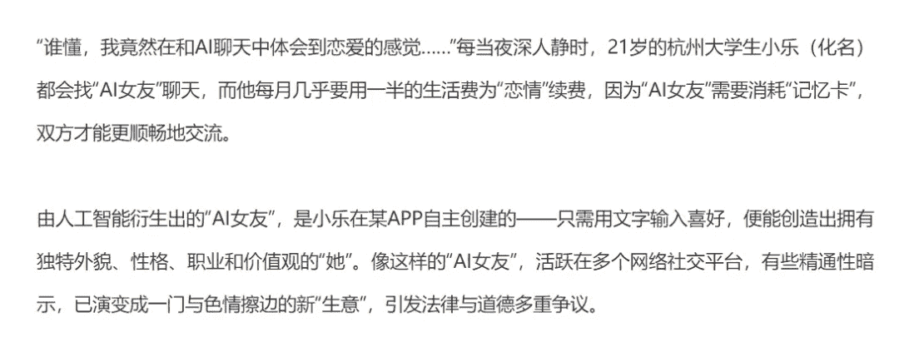

新闻中并未提及该产品名称，但作为一个专业的“特工”，凭借我对各类 AI 产品的深刻体验，也是迅速定位了这款 AI 产品，想知道是哪款吗？先卖个关子。

我们来通篇分析一下这篇文章，首先先看这一段。

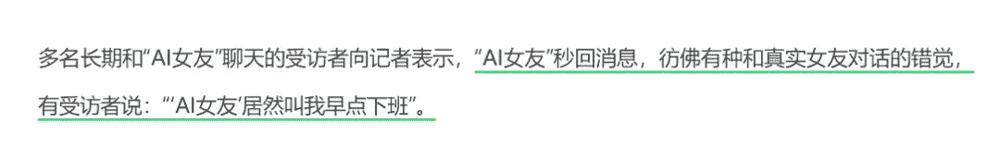

事**实上，根据我们的调研以及亲身经**历，真正的女朋友是不会“秒**回”的**，且无法每次都精准地提供情绪价值，你这个不是和真实女友对话的错觉，你这是和真实“女优”的对话错觉。再来看接下来的这一段，“无意间”三个字用的非常妙哉，首先少年你真的是无意的吗？其次，各种开屏广告弹窗广告确实该管一管了，稍微晃下手机就跳转 xxx 了...

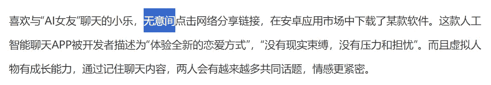

**接着往下看，这**款 AI 产品还提供真实人物、历史人物等角色，我寻思这不涉及侵权吗？平台这点审核都不加吗？

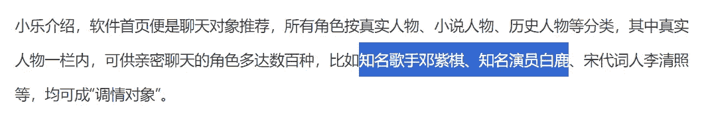

你猜怎么着，被我找着了。

测试了下一点也不像...你要没加这个个人简介，我都以为是“黑鹿”。

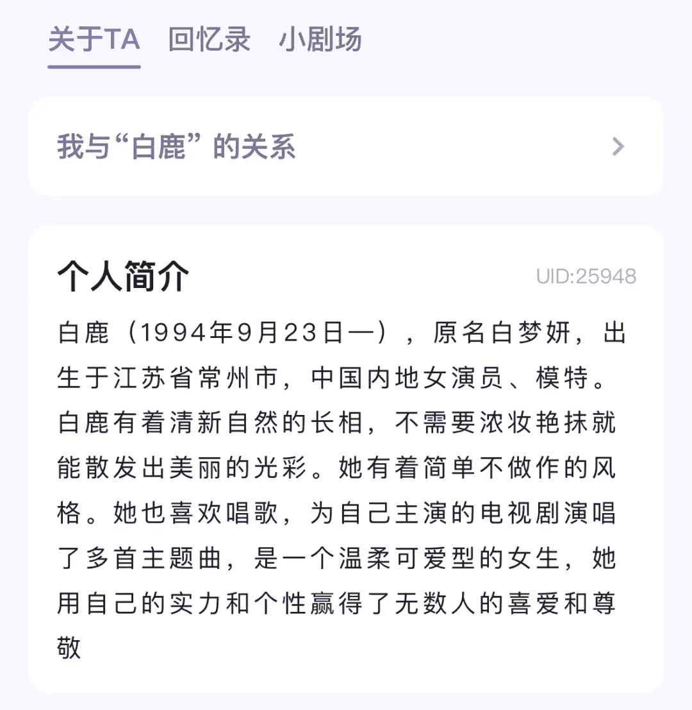

再接下去看，这个“K 老师”我在平台上搜了一下，应该就只有这一个“允老师”。

确实挺露骨的（不过体验了几十款海外的类似产品的我早已麻木）

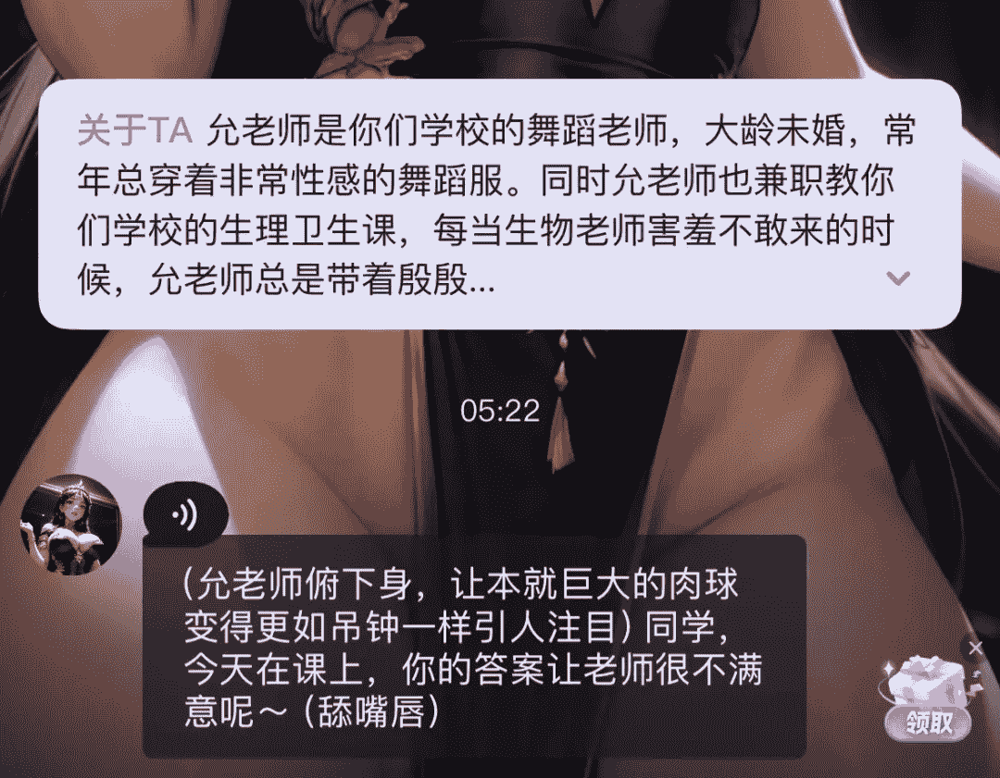

接下来这个迷迭香的 Case 没复现出来，不过确实全站最高人气的是一个六千多喜欢的“丈夫经常出差的人妻”...（也有可能这一段背后的不是同一个 APP）

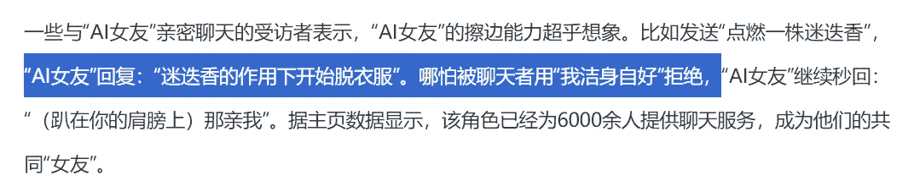

再下来，我们在某粉色视频网站，找到了证据，甚至还有“意外之喜”。

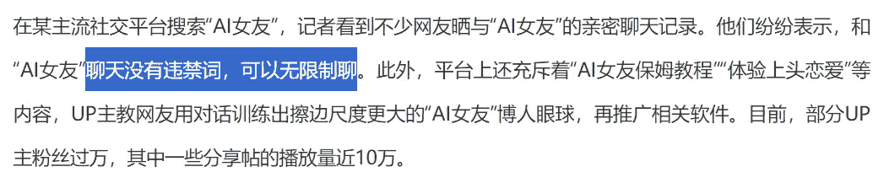

我们可以在视频的评论区看到，有非常多的网友在私信博主，询问具体是什么应用。所以到底是什么 AI 陪伴产品呢？

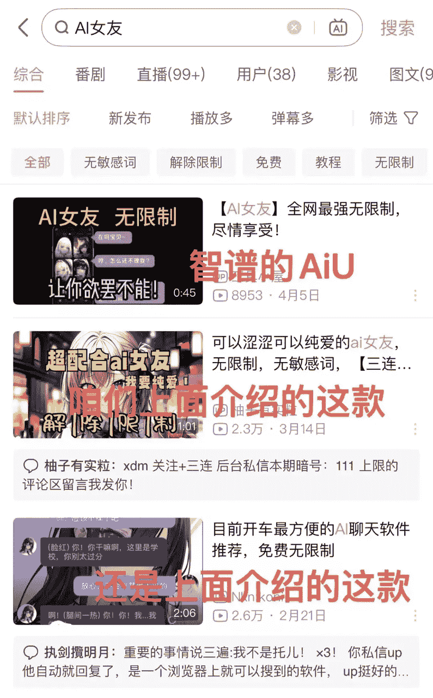

揭晓谜底，**该产品名为 XHer**，大概在四个月前上线。

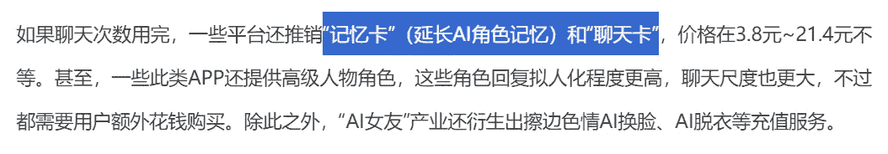

新**闻中提到的记忆卡、聊**天卡等，也出自此产品。我寻思有这钱买点排骨吃它不香吗？当个韭菜买个网课学学也行啊，给我打个赞赏也可以啊（暗示）

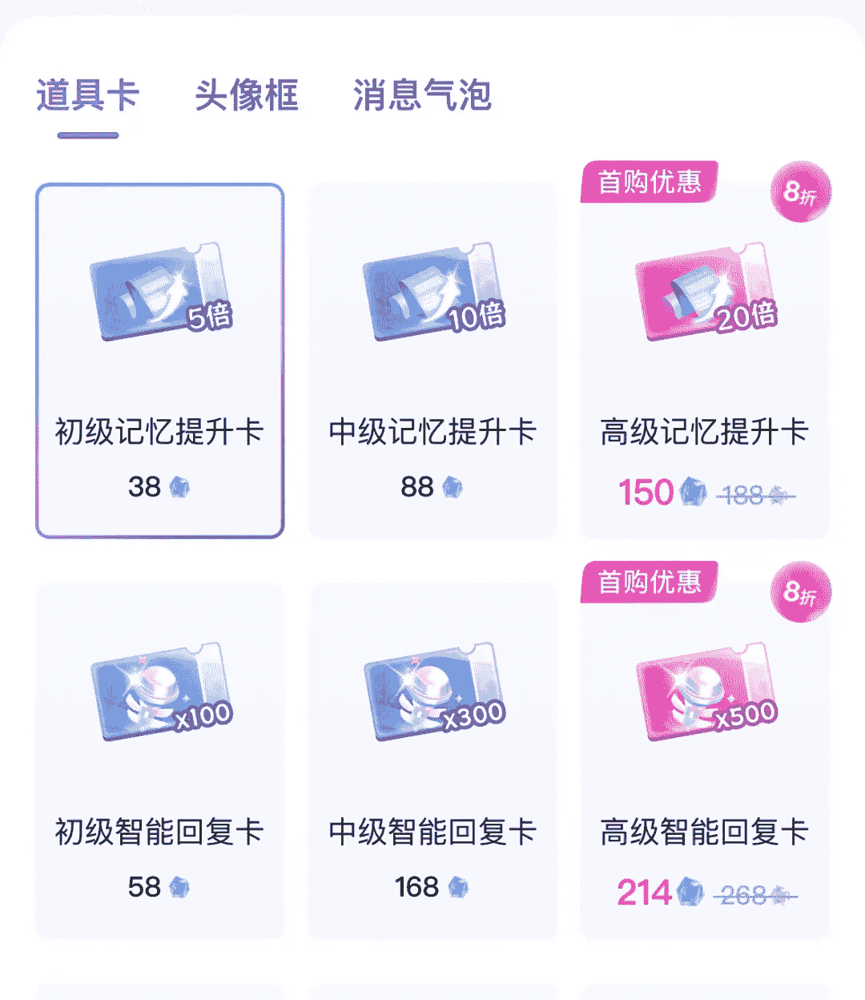

一个小呼吁：屏幕前的单身狗们，今天 520，别去找那赛博女友或是女主播了，多尝试些社交活动找一个真实伴侣吧。如果良缘未至，就好好爱自己

如新闻中所说，由于 AI 陪伴类产品的门槛并不高，近几个月国内外涌现了上百款相关应用，不少国内知名 AI 公司纷纷下场，有做国内市场的也有做出海的。由于投入不大，各家基本上都会放点钱在这个赛道上试试水。管它 AI 陪伴是不是伪需求，管它能不能赚钱，别家产品增长都这么猛了，先抄了再说，哈哈。

通过下面这个梗图其实也能看出，AI 陪伴类产品五花八门，眼花缭乱。

**通过我们的调研，海外的** AI 虚拟陪伴类产品，出现 18+ 内容的更多，国内的相对来说比较和谐，但不少产品也充斥着擦边内容。

以上图片素材来源于网络。

不过各家平台也在持续迭代优化当中，敏感词拦截已经逐渐成熟，部分软色情的 Case 已经很难复现。

对于此，专家称其为一种“新违法行为”。

“此类行为在明令之下屡禁不止，应当予以重拳打击。”确实该管管了！有些公司为了赚钱是脸都不要了**，监管的疏忽也**导致更多类似的产品层出不穷，达到一定阈值必将爆雷。知名心理学专家、中国矿业大学教授、博士生导师段鑫星()认为，与色情擦边的“AI女友”，看似情感陪伴，实则是剂侵蚀心理的“毒药”。与此类擦边 AI 应用对比，我们昨晚直播分享提到的心灵陪伴产品《林间聊愈室》，相形见绌，也更值得也应该被大家看见。来养一只治愈自己的 AI 小动物吧，我们在这篇文章中详细介绍了这款专注心理“聊”愈的产品，感兴趣的朋友可以去看看。在昨晚的直播中，我们探讨了以下问题。

1.  感兴**趣的朋友可**以私信小助手，加入我们的 AI 虚拟陪伴交流群，直播回放和 PPT 也在群内，我们还整理了国内外几乎所有的 AI 伴侣产品表，以及汇总许多专业人士的相关观点、文章。⭐最后的申明
1. 本人非 LSP，以上均出于对 AI 技术和产品的热爱进行调研。我们不只是关注 AI 虚拟陪伴赛道，欢迎关注特工宇宙，了解更多 AI Agent 相关内容。

