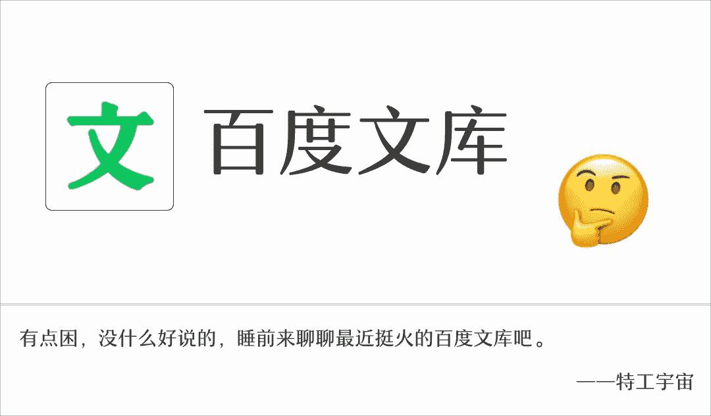

# 百度文库靠 AI “爆火”，月活是文心一言两倍多？

> 来源：[https://agispace.feishu.cn/docx/ZZcldvZUvo30Njxwr2RcGRrjnBd](https://agispace.feishu.cn/docx/ZZcldvZUvo30Njxwr2RcGRrjnBd)

> 原创：特工少女

> 👸号：特工宇宙

> 原文链接：https://mp.weixin.qq.com/s/uwPgxP-9gnBVYRnVNUvXXQ

特工宇宙

Agent Universe，这里有关于Agent的一切。

84篇原创内容

👸号

前两天 520，因为加班爽约，导致对象生气了，不知道如何道歉且夜不能寐的我决定向 AI 请教一下。于是我搜索智谱，期望使用一下情商还不错的 GLM4.结果我点了“智谱”之后，竟然跳转了“百度文库”，还自动给我生成了“帮我写智谱”？

我原本来以为是我太困了按错了，返回去看发现，好家伙，原来是广告！

不过，为啥你百度文库前面有个“智谱”？我又测试了几个友商名字，很多也已被“攻占”。

**好家伙，条条大路通文库了属于是。我们通过业界知**名榜单可以看到，百度文库四月份的月活国内第一，是文心一言的两倍多，关键是，相较于三月它的访问还降低了！

**不少同学看到这肯定就心**生质疑了，难道访问量国内第一的**原因，是投放广告出**来的？🤔那也不一定是，各家都投放，也不见第一是别家。

关键就在于百度文库非常老牌了，用户基数已经非常大。AI 能力重塑后，霸榜可以说是轻轻松松。不过这就引出了另一个问题，传统的软件平台结合了 AI 能力，该不该上所谓的“AI 产品榜”？这是一个值得讨论的问题，但我们这次先不聊这个，继续我们的主线。

紧接着我又思考，“文库”穿“智谱”等友商的衣服，会不会构成侵权？我也不是很懂，刚好刚刚打开了百度文库，我就顺便来问问它吧。

回复的还是比较中肯的**，于是我去查了下，智**谱是注册了一系列商标。

而当我继续询问时，我回车点了几下都没反应，发现上面给我弹了好几个弹窗。

**原来是体验用完**了提醒我付费...看到次月 27 元的价格，我果断取消自动订阅。然后我们可以看到文库给到的回复。

诶是它自己说的侵权的嗷，不是我说的嗷

（页面中也缺少“内容由 AI 生成仅供参考”等字眼）。

1.  百度文库的 AI整体体验也比较一般，比如：我就不知道为什么我每次刷新进来，都会自动给我生成一个“帮我写工作计划”的内容，每一次！还有每次刷新都会有的这个弹窗，你是有多想让我添加到桌面？

1.  这个设计的槽点就更多了，对话框上面不是已经有快捷工具了吗，为啥按斜杠之后还是些重复的功能。

1.  还**是上图，为啥清空**对话的按钮放这么深？更有趣的是，我点了清空对话，前端没有任何改变，测试后发现，的确没有清除上下文。5. 无法新起一个会话，所以导致无法系统的查看历史会话（如果不上滑，你都会以为它没有历史会话）。生成的回答说不上好，但也还凑合。但是，我为什么不去使用其他可以全网搜集信息的 AI+搜索工具?

作为弃坑多年，曾**经生产的内容经常被搬运到百度文**库的创作者，我天真的以为，百度文库结合 AI，能力也就是如上可见的知识库问答。但我发现我格局小了。

它真的应有应有，可以说是活成了文心一言的模样。

当我点击左上角首页按钮，来到百度文库“真正”的主页时，我和我的小伙伴们都惊呆了。

百**度文库支**[持 AI 搜索，海量文档下载，文](http://mp.weixin.qq.com/s?__biz=Mzk0NTYzNDQ5NQ==&mid=2247489894&idx=1&sn=144e3b7d6cb4922c72714f26c1849ac0&chksm=c31334b6f464bda05fa8e1b62277c8c6e165fb8bff3c71342bf103a761be00f69d359123c112&scene=21#wechat_redirect)件各种处理，AI 知识问答，文档编辑与总结，AI 生成 PPT、思维导图，甚至是生成漫画（唯一感觉比较吸引的点，但还没体验到）。不得不感慨一句，无论各家如何定位自己，事实就是，各家产品的功能逐渐趋近于同一。原谅我看不到它所谓的转型成功，只能看到它的急切与臃肿。阅品无数的我已经审美疲劳了，看着铺天盖地的媒体宣传，看着推陈出新的各种榜单，突然感觉一切似乎都失去了意义。只希望少一些套路，少一些劣币驱逐良币。不说了，哄对象去了，下期见！

意犹未尽的朋友可以再看看之前写的这一篇👉百度的 AgentBuilder 和 AppBuilder 有什么区别？

