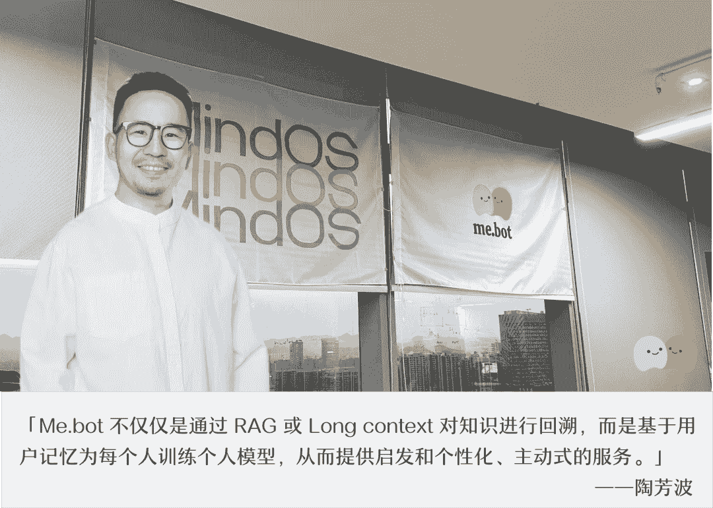
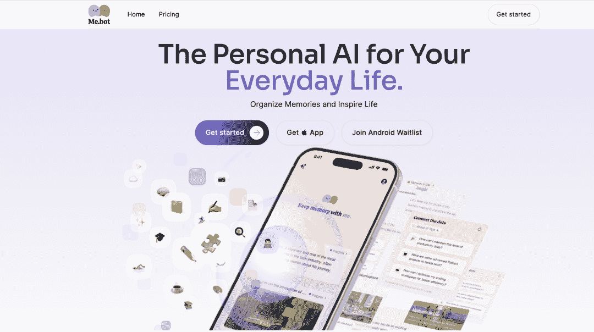
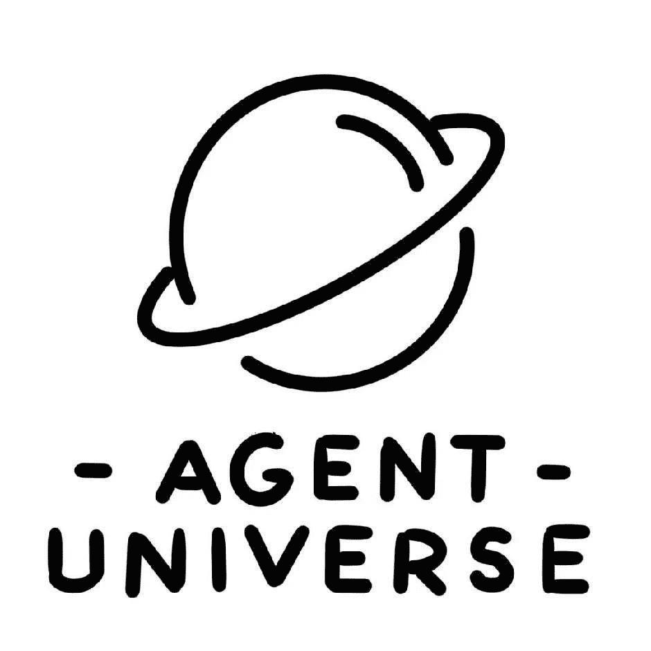

# 专访丨陶芳波，正在用 Me.bot 构建人与 AI 共生的宇宙

> 来源：[https://agispace.feishu.cn/docx/Xeb3djuUYoOmMvxMAGWczwsqnQg](https://agispace.feishu.cn/docx/Xeb3djuUYoOmMvxMAGWczwsqnQg)

> 原创：特工少女

> 公众号：特工宇宙

> 原文链接：https://mp.weixin.qq.com/s/_sfX043ovGi5pMKwgltlvQ

特工宇宙

Agent Universe，这里有关于Agent的一切。

84篇原创内容

公众号

陶芳波博士，心识宇宙创始人兼 CEO，毕业于清华大学和 UIUC()，并先后在美国微软研究院、Facebook 研究院工作，后归国成立阿里达摩院()神经符号实验室从事 AI 研发工作，随后在 2022 年初开始 AI 创业，获红杉、线性、Square Peg 等近亿元融资。

心识宇宙继年初上架 MindOS，最近又上线了一个个人 AI 助手 Me.bot，并一举斩下当日 Product Hunt 日榜第一。

Me.bot 官网：https://me.bot，目前移动端仅在美区 iOS 端开放。

而在上周，特工宇宙（Agentverse）的小伙伴来到了心识宇宙（Mindverse），向陶博请教学习，并约了一个专访，内容如下。

1.  **什么是 Me.bot？**

Bill Gates 曾经说，“希望为每个家庭放上一台个人计算机”。类似的，在超级大模型时代，我们想**探索另一条路径，不让全世界只有被 10 **家大公司掌握 10 个大模型，而是能帮助世界上每一个人，都能训练自己的个人模型。这不仅是为了个性化的便利，而且是一种“人的个人权利的释放，AI 的多样性的表达”。最终帮助我们决策的 AI 是被你我定义和所有的，而不是被中心化、"Big Brother" 定义的。这是 Me.bot 产品出现的初衷。

所以 Me.bot 是一个以“个人记忆”为切入点的产品，希望塑造一个和你共生的 AI，你和他一起经历生活的一切，一起听、一起看、一起交流，把脑海中的想法随时随地分享给他。在一起经历的生命旅程中，每个人的个人模型被逐渐训练出来，这个模型时刻都被更新着，学会和你一样去思考和体验，也永远忠诚于你。

当每个人有一个自己的模型的时候，有一个 Me.bot 的时候，会释放巨大的想象力。他不仅可以帮助你把所有的服务都变成个性化，同时，个人模型，也可能会成为 “AI 身份”，成为人和世界连接的必由之路。

1.  你理解的 Agent 是什么？这个概念还能火多久？

我不是特别推崇 Agent 这个词，在传统机器学习中，Agent 指可以根据环境，自主做出**行动选择的 AI，是一个工具性很强的概念。我们成**立 Mindverse 的时候，认为 Agent 更合适的定位，是一个类人的、可演化的智能结构，并逐渐成为社会参与的主体。因此，我们使用的是 "Mind" - 数字心识这个词。

因此 Agent 这个概念，应该会一直存在。但作为最早的一批 Agent 的探索者，我觉得 A**g**ent 还有两个关键的问题要解决。第一个是关于 Agent 的可训练性的问题，从去年我们发布的 MindOS，到现在很火的 Coze，其本质都是为大模型搭配脚手架，最终 Agent 的交付是相当“不智能”的。第二个是关于“做什么人”的问题，Agent 可以去模仿一个职业、陪伴（her）、助手等，但似乎都不够合理。我给的答案是，Agent 首先应该做 "me（我）"，做每个人的 AI 身份。这两个问题，也是我们想在 me.bot 解决的。

1.  你认为 Agent 当中的 Workflow 是不是伪需求？

**不是伪需求，但不是 Agent 的最终解。你可以把 work**flow 想成模型的脚手架，是一种外挂。但 workflow 并没有改变模型本身，RAG 同理。所以最后做出来的 AI Agent 依然显得很笨拙。

人脑中，行动能力和记忆能力，是和前额叶联合训练的。这意味着把记忆当外挂（RAG），或者把行动能力当外挂（Workflow），和底层的 LLM 分离，最终是一个脆弱的组合。这就好比，一个 “实习生” 的工作，可以通过查看工作流程来完成，而一个“优秀的员工”，一定是在工作中不断精进和学习，不会仅仅按照固定的工作流程来完成，甚至可以自己摸索出最好的行动流程，随机应变。这需要我们有能力把行动能力和记忆能力，训练到模型中。

1.  Me.bot 和 MindOS 的产品定位的区别是什么？

MindOS 和 Me.bot 的出发点都是为了构建 Agent.

一个比较明显的区别在于 MindOS 的目标是企业用户 SMB，而 Me.bot 用户是个人。对企业来讲，核心是创造不同类型的“数字员工”，所以 MindOS 其实是模型能力和框架驱动的，本质上是为企业提供一个搭建智能体的 toolkit，提供 LLM 大脑和其周围脚手架的选择。而 Me.bot 是数据驱动的，用户并不是主动的训练自己的个人模型，而是在与 Me.bot 分享自己的记忆，获得服务的过程中，逐渐训练自己的个人模型，一个参数完全被用户记忆塑造的 AI 模型。

最终，我们相信企业侧的 Agent 和个人侧的 Agent 会形成一个新的“互联网”。

1.  **Mebot 的产品形态是不是更适合用 Agent+硬**件来做会更好？对这方面现在有什么想法吗？

长期来看，个人模型与硬件的深度融合是必然的趋势，我认为 AI 时代的硬件革命会在三个方向上发生。

+   **第一个是数据感知端**，个人模型会需要更大量、更多模态的实时数据，需要被全新的，always-on 的硬件捕捉；

+   **第二个是交互端**，AI 与人的交互方式将不仅仅局限于 GUI，这种交互方式很可能“无设备”和“AI 主动”为核心；

+   **第三个是计算端**，随着个人数据的积累以及模型能力的提高，我们对个人信息的参数化能力将达到前所未有的程度，继而对于成本和隐私性也就有了更高的要求，因此边缘存储和边缘计算()也将会变得更加重要。

从这三点来看，**手**机可能在很长一段时间里依然会占据主要地位，但由于手机本质是个“被动设备”，因此不太可能成为 AI 时代的唯一硬件。我比较看好主动设备+手机的融合方案。

1.  **Me.bot 产品的哪些特点会让你认为你**的产品更具有差异化，以及会吸引更多用户？

Me.bot 相比于传统的笔记应用，会更加 AI-Native。你并不是在维护一个笔记数据库，而是和一个 AI 在完成一段人生旅途，过程中 AI 不仅仅是记住，而且会提供大量的增量价值。

Me.bot 相比于 ChatGPT 这样的聊天机器人产品，核心差异化在于能基于用户的个人记忆，提供主动的、个性化的服务，在提高生产力的同时还保留着深度的个人色彩。因为我深度相信个人化会是 AI时代最大的 game-changer。

管理记忆的需求是 Me.bot 触达用户的切入点，但个性化服务才是用户粘性的来源，这种差异化是以一定的技术壁垒为支撑的，也就是真的把人的记忆参数化，训练出每个人自己的大模型。

1.  最近比较火的关于大模型记忆的 Mem0 有关注吗？和咱们的有什么差别？

Mem0 跟我们大的方向上是一致的，都是**认为 AI + M**emory 非常重要，不过有两个核心差异，第一个是，它认为 AI 的 Memory 主要来自于用户和 AI 聊天的过程中的数据，而我们的思路是人本身在这个世界里体验到的数据，包括听到的看到的，跟 AI 无关的，也是 Memory 的重要来源。

第二个区别是，它其实采用的方式是把对话里的内容通过 Prompt 的方式来维护一个外部偏好的文本库，这些偏好在使用的过程中通过 RAG 的方法变成对话的上下文，所以可以发现它在使用这些记忆的时候，并没有把记忆作为参数训练进去。

那这样是存在一些问题的，第一是模型本身在计算过程中并没有一个真正内化的记忆，而我们使用的参数化的方式是可以直接把它内化了的。第二就是当数据量特别大的时候，由于不是参数化的方法，就会有很多外部的记忆库然后通过 RAG 去连接它，那还是会有一个显然的问题，就是我们在 Paper 中提到的，这种 RAG 是非常不稳定的，是脆弱的，因为相关性的判定，包括对记忆的这些底层的抽象，都很难做到很精准，所以我们采用端到端的参数化的方法，效果会好很多。

1.  **目**前接入的哪家模型呀？（除了自研的快速模型以外），试接入过多少家模型（尤其是多模态方向），比较结果大致如何？

通用处理 ChatGPT；每个人的个人模型，是我们自己的底座，基于 QWEN。模型能力肯定还是 ChatGPT 最佳，而且他们会定义模型使用的标准。

1.  **如何**确定 Bot 与用户个人“像”的程度？不像或太像可能都有问题。如何定义 Bot 与用户“像”在哪些方面？想法、行为…是怎么定义一个人之所以为人的维度，并且决定要让 AI 模仿其中哪几个维度的？

回答像不像，首先要理解，“为什么记忆可以训练出你？”，个人模型训练的本质，是预测人的下一个想法。每个人背后有一套自己的思维过程，类似 predict next token，如果系统拥有足够的个人记忆，那么记忆作为一种时序数据，就可以 predict next thought。如果 AI 可以很好的预测出你的下一个想法，那么他一定很大程度上理解了你的思考模式，也就可以按照你的方式来帮忙决策和提供个性化的服务。

有一个有趣的例子，前几天我刚过 35 岁生日，我在同事面前表达了我的感受，而 AI 几乎复刻了我那段话：“30 岁的时候选择回国创业，35 岁开始做 Me.bot ，感到很感恩之类的”。所以，人的思维是可以被预测的。

1.  用了哪些技术方法提升记忆能力？技术上有遇到什么瓶颈吗？

当然在技术方面，我们的研究部门 Mindverse Research，有几项本质的创新

+   Learning Paradigm：死记硬背 + 自我对抗（类似 Q*），所以需要大量的数据增强（multi-scale augmentation）；

+   Brain-inspired Learning Framework: 时间换智能，白天获得的新的信息，用rag+上下文来做；晚上将新的数据再进行训练；

+   **RL-Me-F**：类比 RLHF(), 在动态的过程中，不断地接受一个人的指示。

1.  如何看待大模型的幻觉？幻觉有没有可能是思维火花的迸发？

我觉得幻觉与创造力是一体两面的事情。如果没有幻觉，那无非就是记忆和记忆的回溯，是“查阅工具书”式的公式化的反应。有幻觉才会有想象力，才会有发散，才会有智能。因此大模型的幻觉存在是 make sense 的，我们需要想的不是怎么消除，而是如何把控它，让幻觉变成创造力而非不合时宜的错误。

**幻觉对于大模型和 Agent 能力的损害，其实是被 A**gent 的 workflow 放大的。现在常用的构建 Agent 的做法是步骤拆解，比如先把一个复杂任务拆成 8 个任务去做，假设每一个步骤中发生幻觉的概率都是 20%，那经过 8 个步骤最终任务的完成率还不到 20%，这就是误差的累积效应。

回过**头来看人类是如何解决幻觉问题的，人类也有幻觉，幻觉这词本身就属于心理学语汇。但是人有一套**自我监控或者说反馈机制，比如当你做到第 4 步的时候发现结果不对，就会回去再从第二步开始换个方向走。人是有一些宏观的机制在确保不断地 validate（验证）中间的这些结果是否符合最后的那个目标的，这些机制不一定发生在意识层而更多是发生在潜意识层，是一个后台运行的程序。

今天的 AI 会展现出幻觉，实际上就是因为我们缺乏这一套机制。目前在技术上针对幻觉也有两股力量在拉扯：第一股力量是尝试给 AI 做更多部更细分的思考，让他的功能变得更加丰富、复杂和自主；但这样做就会导致幻觉的放大。

还有一种方式就是我说的为 AI 构建一种横向的监控机制，让它能够持续的 validate 目前的进度，确保自己一直与最终的目标对齐，保持一种对目标的方向感。这样就可以减少幻觉，或者说让它产生符合我们目标的幻觉。

1.  **看到 **Me.bot 的 Slogan 是“keep memories with me”，现大部分用户可能会用 Cubox、Notion、Obsidian 等来保管自己的知识、闪念等，是否会考虑提供功能 or 工具来支持该部分用户实现跨平台的知识迁移到 Me.bot？

有在考虑提供从主流笔记平台迁移内容的功能。

Cubox，Notion AI 等记忆工具，即便嵌入了 AI，其核心价值仍然只是为用户管理记忆和个人的数据库。Me.bot 相比于传统的笔记应用，会更加 AI-Native。你并不是在维护一个笔记数据库，而是和一个 AI 在完成一段人生旅途，过程中 AI 不仅仅是记住，而且会提供大量的增量价值。

同时，**AI 对知识的理解，也分层次。Notion AI 类型的知识问答，本质上也只**是对信息的存储，整理和检索，并不涉及高层次的理解与抽象。人的大脑本质上是“时间换智能”，我们需要消耗智力和时间来把信息抽象为智能；这一点体现在大模型上就是模型训练与参数化。Me.bot 不仅仅是通过 RAG 或 Long context 对知识进行回溯，而是基于用户记忆为每个人训练个人模型，从而提供启发和个性化、主动式的服务。

1.  **Me.bot 偏向于个人记录类产品，大量个人数据的积累在未来会是很大的市场，比**如在心理学和行为学，Mindverse 在这方面有什么布局？会如何利用这些数据？

Me.bot 的个人数据不会市场化，只会用于训练个人模型并给用户提供个性化服务。其实这不仅仅是隐私的考虑，还有更深层次的意义。

我觉得更重要的，是要改变平台和用户的关系，尤其是数据和参数化之后的模型的所有权。

之前是平台用用户数据来做商业化，本质上用户的数据，并不属于用户，属于平台，因为用户赚不到钱，所以这些数据，并不是用户的资产。而我认为个人化 AI 产品，关系不是这样的。平台应该是 Infra() 的提供者，帮助用户训练个人模型，而模型是用户的个人资产。当个性化分发，产生价值的时候，用户应该是赚钱的，平台只是收取一些管理费。

1.  **目前产品的受众是哪些用户，如何打开更大的市场，让之**前没有记录习惯的人也使用 Me.bot？

首先，笔记记录是市场比较熟悉的定位和切入点，会吸引到相关的人群来试用我们的产品。同时在发布和增长的过程中我们也有一些意想不到的发现，比如很多 ADHD 人群会喜欢使用我们的产品，有一个在这个群体里很知名的 Influencer 自发的帮助我们推广了产品，因为他说用这款产品时他会感觉到平静；还有一个人群是 Mindfulness 的人群，这个人群比较关注自己的个人成长，而 Me.bot 能够启发他们，帮助他们成长。

但我们的理念是通过使用 Me.bot，让用户和一个 AI 在完成一段人生旅途。以这个为出发点，会有很多可以发挥的破圈的思路。

增长的核心是为用户提供价值，并让用户看见价值。‘笔记软**件**’这个先入为主的印象是优势但也是劣势，Me.bot 的破圈之道在于如何完成价值闭环，让‘主动服务’和‘懂你的 AI’这些价值第一时间透出给客户。同时也需要一些必要的发布和曝光度，我们也在逐渐探索中。

1.  **Me.bot 未来会有社交属性吗？有价值的**内容可以共享吗？会打造 Bot 社区嘛？

未来的 Me.bot 会考虑加入弱社交属性，但社交短时间内不会是 Me.bot 的主要战略防线，我们还是以做好人与 Me.bot 的交互为主。共享记忆是一个很好的想法，这个功能已经提上日程，预计在几个版本内与裂变活动联动上线。Bot 社区也有趣，让每个人自己的 Me.bot 去打榜，似乎是个有意思的想法。

1.  MindOS 什么时候会和 Me.bot 联动？

**我认为 AI 时代的终局是人，其**他社会责任主体与其 AI 分身共生的宇宙。从长期来讲，个人 AI 也不会 talk to 各种网站和 APP，而是 talk to 其他的 AI，用某种 protocol 进行握手。因此也可以这样理解，从个性化信息分发和服务提供这一角度来说，Me.bot 和 Mindos 分别是需求侧和供给侧的创新；但从本质上来说，两者都是供给的创新。什么时候联动，要看各自的发展。

1.  未来社会，数字生命与人类共存，社会形态会发生哪些改变？

首先，**我**认为 AI 最好不要完全独立于人存在，每一个 AI 必须隶属于某一个真实的人或者真实的组织，不能凭空存在，不能有独立的利益，那很危险。在权责方面，一定要有一个所有权链路可以追溯每个 AI。反过来说，每个人每个组织背后都会有一个依附的 AI，他们被连接起来，定义一种新的交互和信息传播的方式，共同组成一个新的社会网络。

另一个角度，是关于人是什么的定义。尤其是当每个人有自己的个人模型，自己的 Me.bot，这些参数就会成为最重要的资产，和人一起构成了生命共同体。但这样个人化的资产，是属于平台，还是属于用户自己？这个问题很关键。我觉得不同于传统互联网的模式，个人模型应该是被个人完全所有，而平台只是提供训练和维护的基础设施。

1.  有什么对现在 AI 时代下的大学生的建议？

AI 带来的技术平权，让“专业”的壁垒被降低了。在大学期间，以及初期工作的几年，可以保持更开放的心态，去尝试不同的工作。最终，每个人要找到自己相信的方向，然后持之以恒地去推进。

