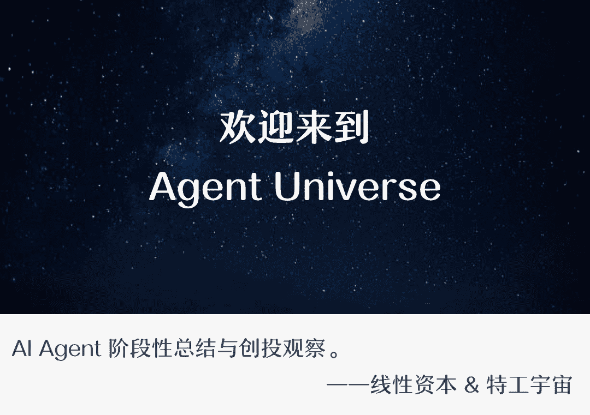
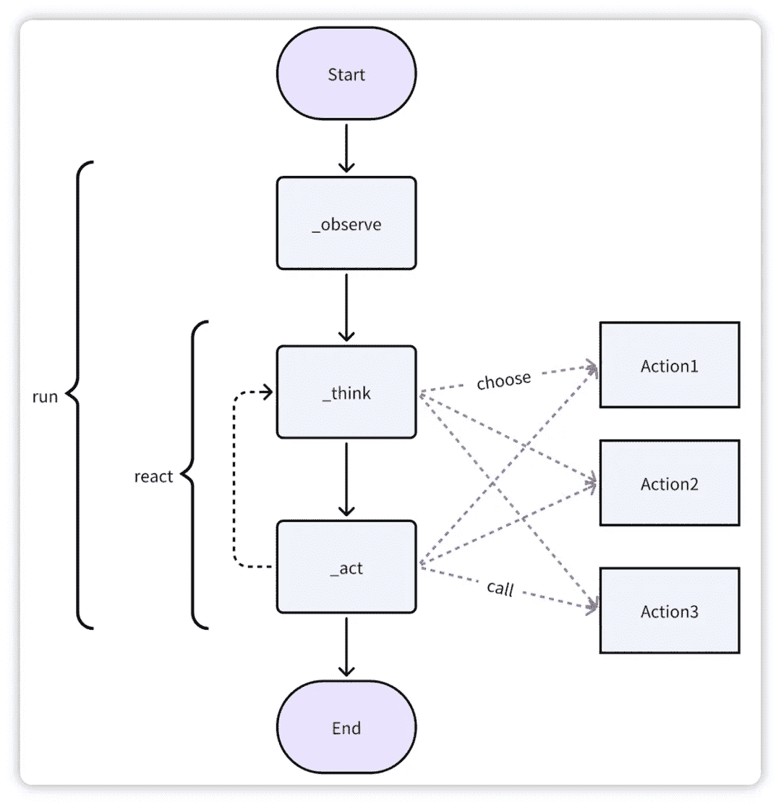
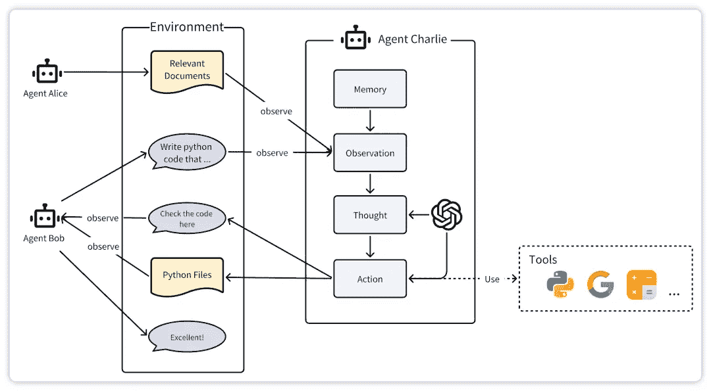
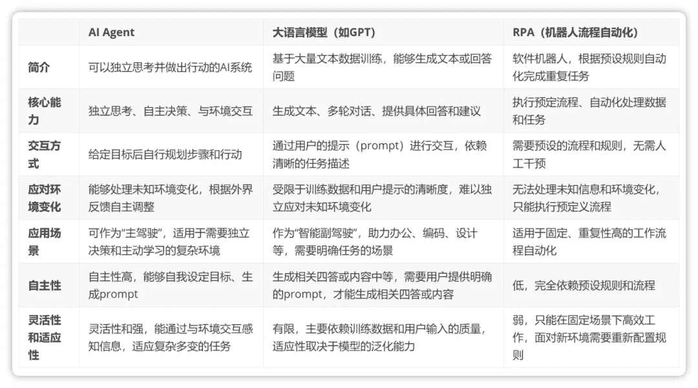

# AI Agent 阶段性总结与创投观查

> 来源：[https://agispace.feishu.cn/docx/EoExdyFJKonttLx377ec7PHDnve](https://agispace.feishu.cn/docx/EoExdyFJKonttLx377ec7PHDnve)

> 原创：特工少女

> 公众号：特工宇宙

> 原文链接：https://mp.weixin.qq.com/s/YSFoNEuGGm-Ory0SeDij0A

特工宇宙

Agent Universe，这里有关于Agent的一切。

84篇原创内容

公众号

**作者**｜**线性资本、特工小鹏编辑｜特工少女

申明：以下内容源自「线**性资本」最近的一次 Agent 分享，内容整理自网络资源，「特工宇宙」经授权发布。线性资本成立于 2014 年，聚焦“前沿科技+产业”方向的投资，目前线性资本共管理十支基金，总管理规模约 20 亿美元。2024 年年初，线性资本发布为早期阶段、面向全球市场 AI 应用专门设立的投资项目 Linear Bolt。它秉持线性投资的理念和哲学，专注在技术驱动带来变革的项目，希望帮助创始人找到实现目标的最短路径，不管是行动速度，还是投资方式，Bolt() 的承诺是更轻，更快，更灵活。本篇分享来自 Bolt 团队研究资料。

1.  **AI Agent 概念与设计Agent 是什么1.1 AI **Agent 通用定义1.1.1 单智能体学术界和工业界对术语“智能体”提出了各种定义。大致来说，一个智能体应具备类似人类的思考和规划能力，拥有记忆甚至情感，并具备一定的技能以便与环境、智能体和人类进行交互。可以将智能体想象成环境中的数字人，其中：

> 智能体 = 大语言模型（LLM） + 观察 + 思考 + 行动 + 记忆。

1.  这个公式概括了智能体的功能本质。为了理解每个组成部分，让我们将其与人类进行类比：大语言模型（LLM）：LLM 作为智能体的“大脑”部分，使其能够处理信息，从交互中学习，做出决策并执行行动。观察：这是智能体的感知机制，使其能够感知其环境。智能体可能会接收来自另一个智能体的文本消息、来自监视摄像头的视觉数据或来自客户服务录音的音频等一系列信号。这些观察构成了所有后续行动的基础。思考：思考过程涉及分析观察结果和记忆内容并考虑可能的行动。这是智能体内部的决策过程，其可能由 LLM 进行驱动。行动：这些是智能体对其思考和观察的显式响应。行动可以是利用 LLM 生成代码，或是手动预定义的操作，如阅读本地文件。此外，智能体还可以执行使用工具的操作，包括在互联网上搜索天气，使用计算器进行数学计算等。记忆：智能体的记忆存储过去的经验。这对学习至关重要，因为它允许智能体参考先前的结果并据此调整未来的行动。

资料来自MetaGPT**1.1.2 多智能体**多智能体系统可以视为一个智能体社会，其中

> 多智能体 = 智能体 + 环境 + 标准流程（SOP()） + 通信 + 经济

1.  这些组件各自发挥着重要的作用：智能体：在上面单独定义的基础上，在多智能体系统中的智能体协同工作，每个智能体都具备独特有的 LLM、观察、思考、行动和记忆；环境：环境是智能体生存和互动的公共场所。智能体从环境中观察到重要信息，并发布行动的输出结果以供其他智能体使用；标准流程（SOP）：这些是管理智能体行动和交互的既定程序，确保系统内部的有序和高效运作。例如，在汽车制造的 SOP 中，一个智能体焊接汽车零件，而另一个安装电缆，保持装配线的有序运作；通信：通信是智能体之间信息交流的过程。它对于系统内的协作、谈判和竞争至关重要；经济：这指的是多智能体环境中的价值交换系统，决定资源分配和任务优先级。

资料来自MetaGPT1.2 AI Agent 和 LLM、 RPA 的区别

LLM 和 Al Agent 的区别在于：Al Agent 可以独立思考，并做出行动

RPA 和 Al Agent 的区别在于：Al Agent 能够处理未知环境信息

1.3 AI Agent 待解决的问题

1.  大模型智能水平不够

1.  大模型的上下文限制，限制了 LLM 可以选择的工具范围

1.  由于 Transformer 架构的限制，存在推理速度较慢，无法处理并行任务等问题

1.  大模型幻觉问题

1.  用户与 AI Agent 交互基于 Prompt

1.  高成本，消耗大量 Token

1.4 Al Agent Landscape

> 由 E2B 整理的 Al Agents Landscape项目地址：https://github.com/e2b-dev/awesome-ai-agents?tab=readme-ov-file

**1.5 Frameworks and t**ools for Al products

> 由 E2B 整理的 Frameworks and tools for Al products项目地址：https://github.com/e2b-dev/awesome-ai-sdks?tab=readme-ov-file

1.  **AI agent 设计模式**2024 年 4 月 2 日，吴恩达教授在美国红杉() AI 活动上关于 Agent 的最新趋势与洞察，提出了目前有 4 种主要的 Agent 设计模式，分别是：反思（Reflection）、工具使用（Tool Use）、规划（Planning）、多智能体（Multiagent Collaboration）。2.1 反思（Reflection）

让 Agent 审视和修正自己生成的输出。

我们可以将之前生成的代码再次输入给语言模型，同一个生成代码的模型可能会发现漏洞并提出改进意见，接收反馈后，我们可以让模型根据修改建议重新生成，它会生成更好的代码版本。这个想法的一种自然延伸是，不是单一的代码代理，而是有两个代理,一个是编码代理，另一个是评审代理。它们可以基于同一个大型语言模型，但你以不同的方式对它们进行提示，对一个说"你是专业编码者，编写代码"，对另一个说"你是专业代码评审员，评审这段代码"。这会帮助很多工作流程带来显著的大型语言模型性能提升。

2.2 工具使用（Tool use）

LLM 生成代码、调用 API 等进行实际操作。

我们让大语言模型可以根据用户意图自主完成调用 API，搜索网页、生成和运行代码等操作，并且使用各种工具来分析数据、收集信息、执行操作等，以此提高生产效率。

2.3 规划（Planning）

让 Agent 分解复杂任务并按计划执行。

1.  我们以一个 HuggingGPT 案例理解 AI Agent 规划流程。输入：男孩的照片；输出：一个和男孩相同姿势的女孩正在看书的照片，然后请用语音描述新图片；Prompt：请生成一张女孩正在看书的图片，她的姿势与图片 example.jpg 中的男孩相同，然后请用语音描述新图片；AI Agent 自主规划：第一步是确定男孩的姿势，然后可能在 Hugging Face() 上找到一个合适的模型来提取这个姿势，接下来要找到一个姿势图像模型来合成一个女孩的图像，然后使用图像到文本的模型，最后使用语音合成，生成描述。

**2.4 多智能体协作（Multi**agent collaboration）

多个 Agent 扮演不同角色合作完成任务。

以开源项目 ChatDev 为案例，我们让大语言模型扮演不同的角色，比如公司 CEO、设计师、产品经理或测试员，这些"代理"会相互协作，共同开发一个复杂程序。虽然不是每次都能成功，但有时确实令人印象深刻。研究还发现，让不同的人工智能代理进行辩论，也能提高它们的表现。

1.  **Agent 工作原理和主流框架AI Agent 工**作原理3.1 AI Agent 框架拆解

一个基于大模型的 AI Agent 系统可以拆分为大模型、规划、记忆与工具使用四个组件部分。OpenAI 的应用研究主管 Lilian Weng 撰写了一篇博客，认为 AI Agent 可能会成为新时代的开端。她提出了 Agent = LLM + 规划 + 记忆 + 工具使用的基础架构，其中 LLM 扮演了 Agent 的“大脑”，在这个系统中提供推理、规划等能力。

3.2 AI Agent 决策流程完整的 AI Agent 决策流程分为 8 个步骤。完整的 AI Agent 决策流程分为 8 个步骤：感知、记忆、规划路径、使用工具、行动、执行、反馈、学习。

1.  
AI Agent 主流框架4.1 单智能体框架AutoGPT

开发者：AutoGPT 由游戏公司 Significant Gravitas Ltd. 的创始人 Toran Bruce Richards 构建

发布时间：2023 年 3 月 30 日

Github Stars：164k

AutoGPT 定位类似个人助理，帮助用户完成指定的任务，如调研某个课题。AutoGPT 比较强调对外部工具的使用，如搜索引擎、页面浏览等。作为早期 Agent，AutoGPT 有很多缺点，比如无法控制迭代次数、工具有限。但是后续的模仿者非常多，基于此演变出了非常多的框架。

相关文章：https://mp.weixin.qq.com/s/EYxbsC3zxa3eyl4OA-OvuA

**HuggingGPT**

开发者：浙江大学和微软联合团队

发布时间：2023 年 4 月

HuggingGPT 将模型社区 HuggingFace() 和 ChatGPT 连接在一起，形成了一个 AI Agent. HuggingGPT 融合了 HuggingFace 中成百上千的模型和 GPT，可以解决多种任务，包括文本分类、对象检测、语义分割、图像生成、问答、文本语音转换和文本视频转换。具体步骤分为四步：1）任务规划：使用 ChatGPT 来获取用户请求；2）模型选择：根据 HuggingFace 中的函数描述选择模型，并用选中的模型执行 AI 任务；3）任务执行：使用第 2 步选择的模型执行的任务，总结成回答返回给 ChatGPT；4）回答生成：使用 ChatGPT 融合所有模型的推理，生成回答返回给用户。HuggingGPT 的亮点：HuggingGPT 与 AutoGPT 的不同之处在于，它可以调用 HuggingFace 上不同的模型来完成更复杂的任务，从而提高了每个任务的精确度和准确率，然而，总体成本并没有降低太多。

**AppAgent**

开发团队：腾讯与德州大学达拉斯分校合作开发

发布时间：2023 年 12 月 22 日

AppAgent 可以通过自主学习和模仿人类的点击和滑动手势,能够在手机上执行各种任务。它可以在社交媒体上发帖、帮你撰写和发送邮件、使用地图、在线购物，甚至进行复杂的图像编辑…..AppAgent 在 50 个任务上进行了广泛测试，涵盖了 10 种不同的应用程序。该项目由腾讯和德州大学达拉斯分校的研究团开发。

项目及演示: https://appagent-official.github.io

项目论文: https://arxiv.org/abs/2312.13771

GitHub: https://github.com/mnotgod96/AppAgent

4.2 多智能体框架斯坦福虚拟小镇

开发团队：斯坦福大学的人机交互研究小组

发布时间：2023 年 8 月 10 日

这个小镇中，可以添加最多 25 个由 ChatGPT 扮演的角色。他们有着不同的身份、性格和年龄，共同生活在这个小镇里。他们像人类一样进行着自己的活动，也像人类一样彼此交流。在这个数字化的「西部世界」沙盒虚拟城镇中，有学校、医院、家庭。25 个 AI 智能体不仅能在这里上班、闲聊、social、交友，甚至还能谈恋爱，而且每个 Agent 都有自己的个性和背景故事。

> 以下就是 John Lin 度过的一天早晨：6点醒来，开始刷牙、洗澡、吃早餐，在出门工作前，他会见一见自己的妻子 Mei 和儿子 Eddy。这些智能体相互之间会发生社会行为。当他们注意到彼此时，可能会进行对话。随着时间推移，这些智能体会形成新的关系，并且会记住自己与其他智能体的互动。一个有趣的故事是，在模拟开始时，一个智能体的初始化设定是自己需要组织一个情人节派对。随后发生的一系列事情，都可能存在失败点，智能体可能不会继续坚持这个意图，或者会忘记告诉他人，甚至可能忘了出现。幸运的是，在模拟中，情人节派对真实地发生了，许多智能体聚在了一起发生了有趣的互动。

Github：https://github.com/joonspk-research/generative_agents

项目论文：https://arxiv.org/abs/2304.03442

**ChatDev**开发团队：面壁智能联合清华大学 NLP 实验室、北京邮电大学、布朗大学等研究人员发布时间：2023 年 7 月ChatDev 是一家软件自动开发框架，通过各种不同角色的智能体运营,包括执行官、技术官、程序员、测试员等。这些智能体形成了一个多智能体组织结构，ChatDev 内的智能体通过参加专业的功能研讨会来协作，包括设计、编码、测试和文档编写等任务。

ChatDev 的主要目标是提供一个基于大型语言模型(LLM)的易于使用、高度可定制并且可扩展的框架,它是研究群体智能的理想场景。

项目地址: https://github.com/OpenBMB/ChatDev

项目论文: https://arxiv.org/abs/2307.07924v3

相关文章：https://mp.weixin.qq.com/s/Rax0UWHYD22Re_Ak-saHrg

**MetaGPT**

开发团队：深度赋智，创始人 & CEO：吴承霖

发布时间：2023 年 7 月 4 日

MetaGPT 是一个解决复杂多智能体协作问题的框架。项目通过模拟软件开发公司的工作流程，将标准化操作程序(SOP)编码到 Prompt 中。在框架中为每个智能体分配角色(老板、产品经理、项目经理、设计师、工程师、质量工程师)，并规划智能体的协作过程。同时保持输出的模块化，以及赋予智能体与人类工作者相当的领域专业知识，以验证输出并减少错误。MetaGPT 的核心理念是 "Code = SOP (Team)",即将 SOP 具象化并应用于由 LLMs 组成的团队。MetaGPT 的主要用途是帮助开发团队根据简短的需求描述生成产品需求文档(PRD)、设计文档、任务列表以及相关的代码仓库。它可以加快软件开发流程,提供多个角色的协作,并自动生成部分项目文档和设计。

图｜软件公司多角色示意图

1.  AI Agent 应用案例AI Agent 应用

5.1 AI Agent 构建平台

**Coze/扣子**

字节跳动推出的 AI Bot 构建工具。

Coze 扣子是字节跳动推出的 AI Bot 开发平台，用户无需编程经验就能快速搭建各类问答 Bot，并可以将创建的聊天机器人一键发布到 Discord（海外版）、飞书、微信公众号等平台中。

**5.2 陪伴/娱乐**

**独响App**

AI Agent 朋友圈。

独响是一个安全，私密的轻笔记，你可以用来记录生活日常，学习感悟，所思所想，但独响又不仅如此，我们创造和移植了许多虚拟角色的灵魂，让他们成为你独响中的伙伴，他们会在你的记录下方评论，你可以和他们讨论，聊天，甚至是...吵架。

**5.3 效率工具**

**Opencord.ai**

AI Agent 运营社交媒体。

1.  Opencord AI 是一款全新的社交媒体管理工具,它通过动员一支 24 小时在线的创作智能体团队,为您高效地运营社交媒体账号。这支团队由多个自主的创作智能体组成,它们能够自动分析热门趋势,及时制作吸引人的帖子和视频内容,添加流行话题标签，并自动点赞、转发和回复，全程免去人工干预。产品特点:持续 24 小时运营，确保您的社交媒体内容持续输出，随时跟进最新热点；自适应优化策略，根据内容表现自动调整运营方式，持续提升效果；高效内容生产，只需提供一个简单的指令，智能体就能自动生成创意帖文、剪辑优质视频短片等；扁平化协作网络,智能体间高效自主协作，精简运营成本。

**5.4 教育**

**Gatekeep**

生成教育短视频。

1.  Gatekeep 是一个可以生成教育 AI 短视频的网站，使用起来非常方便，用户只需要输入一个主题，比如“分数的加法”或者“太阳、地球和月球的运动关系”，就可以生成相应的教育视频。技术链路：先让 AI 把你的问题拆解成各个子模块；每个模块生成对应的文字解释和 Manim 的 Python 代码；最后按一定的时间戳，生成配音，合成视频。

特工宇宙注：该产品刚上线我们就介绍过 Gatekeep，仅用一句话，生成优雅的教学视频。

**1.5 代码编程**

**OpenDevin**AI 程序员智能体。OpenDevin 是一个开源的自主人工智能软件工程师，能够执行复杂的工程任务，并在软件开发项目中与用户积极协作，例如：如 "查找上个月 OpenDevin 仓库中的拉取请求数量"，还能处理软件工程任务，例如 "请为这个文件添加测试并验证所有测试都通过，如果没有修复该文件"。同时，OpenDevin 是一个代理开发者平台和社区，用于测试和评估新代理的环境。

5.6 Caller Agent

**Parloa**

客户服务对话式人工智能平台。

Parloa 是一家总部位于德国的科技初创公司，成立于 2018 年，是一家专注于开发对话式人工智能平台。该公司最新在B轮融资中获得了 6600 万美元投资，投资方包括知名风投 Altimeter Capital 等核心产品是一个基于人工智能的语音对话平台,可用于企业客户服务和自动化沟通。该平台结合了专有和开源的大型语言模型，对语音进行识别并生成自然语言对话响应，实现语音智能自动化。公司还开发了定制的电话基础设施来最小化语音延迟，客户包括欧洲的一些大型企业如瑞士人寿保险公司和零售商迪卡侽等，它们使用 Parloa 平台自动化客户沟通流程。

图｜Parloa 官网

**5.7 个人助理**

**MultiOn AI**

帮助人类免除执行琐事的 AI Agent.

MultiON 旨在开发帮助人们处理那些“世俗琐事”的 AI Agent，比如帮助用户在快速完成旅行规划，或者为用户快速在喜欢的餐厅预订一顿年夜饭并确认最适合的时间和日期，把诸如此类“费时不费脑”的事情在 AI 的帮助下几分钟内完成。

**5.8 游戏玩伴Nunu.ai**

一个能够和玩家玩游戏的 AI Agent.

Towards AGI for Games 是一个先驾者项目,旨在开发出能够测试和玩任何游戏的人工智能智能体。这些智能体是基于视觉的,能够像人类玩家一样看到游戏画面并与之互动。在游戏过程中,智能体会对自己的行为进行推理,并提供可解释的思维见解。

参考资料：

1. [Agent > GPT5？吴恩达最新演讲：](http://mp.weixin.qq.com/s?__biz=Mzk0NTYzNDQ5NQ==&mid=2247488311&idx=1&sn=7dd2c61032eb1eda7fe35017fe690d25&chksm=c3133ee7f464b7f13d8c6696ad352304c84e70d47996c274bd4ee0abdd0e6ef7bd23476c3278&scene=21#wechat_redirect)四种 Agent 设计范式（通俗易懂版）

2. [《](https://mp.weixin.qq.com/s?__biz=MzU5OTI0NTc3Mg==&mid=2247532985&idx=1&sn=a79f478f7c73be9a1c3b681831fb8ff9&scene=21#wechat_redirect)2024年AI Agent行业报告》——大模型时代的“APP”，探索新一代人机交互及协作范式｜甲子光年智库