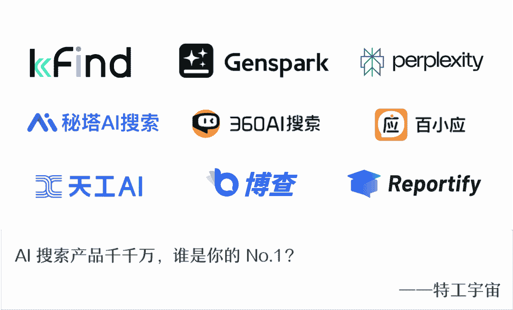
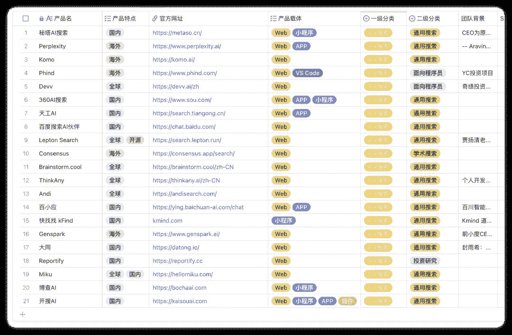
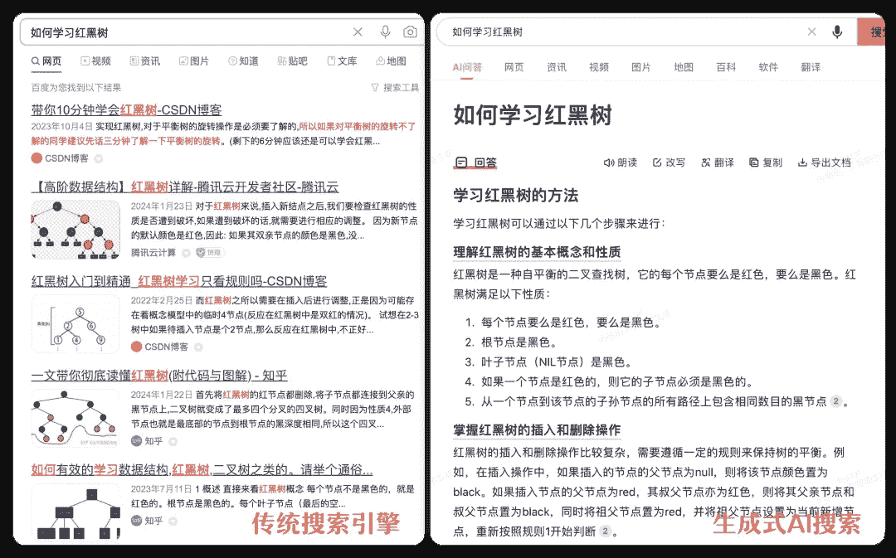
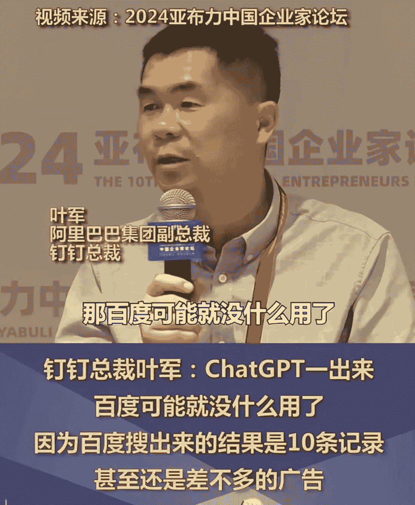
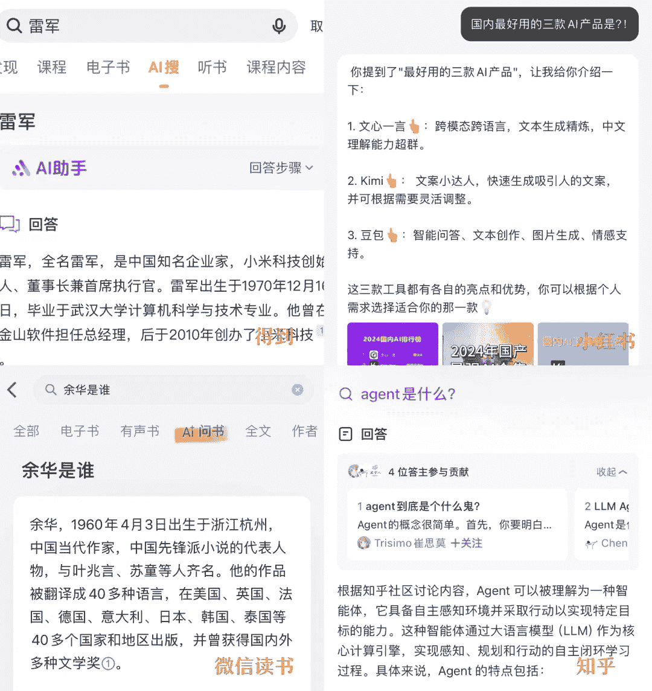

# AI 搜索产品千千万，谁是你的 No.1？

> 来源：[https://agispace.feishu.cn/docx/O2y3dRlIgooaQAxLT8Vc0Ueanwf](https://agispace.feishu.cn/docx/O2y3dRlIgooaQAxLT8Vc0Ueanwf)

> 原创：特工少女

> 公众号：特工宇宙

> 原文链接：https://mp.weixin.qq.com/s/ZRVLr9O44MHizFmHxJgiOQ

特工宇宙

Agent Universe，这里有关于Agent的一切。

84篇原创内容

公众号

每出现一款 AI 搜索产品，我们都会第一时间心潮澎拜地去测评去记录。但说实话，现在的 AI 搜索产品已经多到眼花缭乱了。如果加上诸如 kimi、元宝等各种带有联网功能的 ChatBot，那就更多了。无论是传统的搜索引擎， 还是内容平台内置的搜索功能，不加点 AI 的点缀，仿佛就落后了一个时代...

什**么是 AI 搜索？**每次有外行朋友来问，我都会不自觉地想起 360 老周那段融资佳话。老周曾经想实现的“我搜你看，你问我答”如今成为了现实。区别于传统搜索，AI 搜索会分析用户意图，然后抓取对应的网页，基于大语言模型进行分析，最后结构化输出。

AI 搜索的风，是从 Perplexity 吹起来的。自贾扬清() 500 行手搓 Lepton Search 之后，热度至今就没消减过。最近钉钉总裁叶军对百度的吐槽，也是说出了很多人的心声，“ChatGPT 一出来，百度可能就没什么用了，因为百度搜出来的十条记录，甚至是十条差不多的广告。”不知道百度接下来会有什么动作，毕竟广告是百度的大头收入，不能轻易革自己的命。

据相关调查结果显示，现在越来越多的人不再使用传统搜索引擎了搜索内容了，遇到问题打开知乎/公众号/小红书的人越来越多。AI 重塑内容生产关系，冲击内容社区生态。平台对 AI 是又爱又恨，一方面要预防大量 AI 内容充斥的问题，另一方面还要积极地拥抱 AI. 各个内容平台自身也纷纷上线 AI 搜索功能，知乎/小红书/微信读书，甚至钉钉，都“跟风”地锦上添花了一把。

在前两天，我们与国内顶级个人开发者 idoubi()，和资深产品前辈黄叔有过一些交流**学习，**然**后在昨天，俩大佬不约而同的**发了万字长文，附在文末供大家学习。各路豪杰纷纷下场，群雄争霸。在如此时代浪潮之下，也诞生了很多非共识。有一种声音是“AI+搜索简化了用户搜索的路径，能够更高效的提供高质量信息，已经是发展的必然趋势”。而也有人认为“AI 搜索后总结的内容空洞，反而会 miss 掉很多有价值的信息，另外，从商业化的角度来说，也很难真正落地”。另外关于做垂类的搜索引擎是否有前途，也有不同的看法。一种声音是“类似 Repotify 和 devv 这样的垂直搜索更懂用户需求，也清楚好的信息源在哪，从细分品类切入更容易占领心智获得口碑”。而也有观点认为“不看好垂类搜索引擎，虽然能在某个场景上做深做透，但用户需求非常多样，很难会给多个垂类搜索引擎同时付费。垂类搜索引擎自建索引库工程投入大，整体 ROI 不见得高”。

看厌了“城头变化大王旗，你方唱罢我登场”的“自吹自擂”，看倦了“**Fear Of M**issing Out”的“趋之若鹜”。产品能不能符合市场需求，核心还是看用户体验。尽管各家[产品同质化很严重](https://mp.weixin.qq.com/s?__biz=Mzk0NTYzNDQ5NQ==&mid=2247493457&idx=1&sn=ba35c5c4a228bba5079ffb64c854be0a&chksm=c2a55ffd2b5b69cfd9403bc98693128d92daa79f801789c2f90427f31fe09775c79fd5434106&scene=126&sessionid=1722394090&subscene=227&clicktime=1722394450&enterid=1722394450&key=daf9bdc5abc4e8d088023651fb97ac88938f1976145c634a824d44e56ea691e748c040780f35f97c45c139671e64ed2aa9d09ffbb73f42998722d1d0dcbd2594b5557521075a19d507278f4eea22ac53df8195db3092034530cc530b914d1356cde58d0eec63492b9914d692a1b1e2eb0702e60d28ef73b50e5e82989bc75801&ascene=0&uin=MzY3NDEwMzA5OA%3D%3D&devicetype=Windows+10+x64&version=63090b19&lang=zh_CN&countrycode=IS&exportkey=n_ChQIAhIQHagSIsVyH5%2BRC6%2FTaqw%2BqBLmAQIE97dBBAEAAAAAAMuMMxjLJf0AAAAOpnltbLcz9gKNyK89dVj05A3WqrAngxhQR257%2FeDgVOOlMtYtIbbJsNuhr5vnZeJrJEtkuy9iiEJssSOYc6qLfvYJ4DoYbgeovDvhXm1lLEWT%2BMCwOPWK7ZGcEjTMrXt%2FsdZIyHARM%2BcDLftnVrRaS6oeKXNRG%2FwBo3YTlUNeYnl%2Fc%2FxIs%2BtsBFGEtwsfT3jry8G2jSr%2F1TlfQnCsgeoifA7IAArZfaE%2FK8RGeyvaiRF3hdCqogayFX3Xho19h39X6FQ9yvPDw9bji4FOQ7U4&acctmode=0&pass_ticket=fuvJJa%2BGbRyQrhjXiV7kIodgkefB3lT82%2FrS1QO5zXUUXbA8S598h2OVSSbPE20Y&wx_header=1&fasttmpl_type=0&fasttmpl_fullversion=7317222-zh_CN-zip&fasttmpl_flag=1)，**但还是有一些让人眼前一亮的**产品设计（秒出答案，生成脑图等都是过去式了）。比如道哥（吴翰清）团队新做的 快找找 kFind，kFind() 是 KMind 公司基于 kOS 于 2024 年 6 月推出的 AI 搜索产品，访问链接：快找找kfind，轻量的设计中也带着一些巧思。其中一大特点是“匿名智能搜索”，无需注册即可使用。

另一个特点是可以左右滑动屏幕“刷一刷”，看看别人都在搜什么，满足了用户的猎奇心理。同时，因为是匿名的，也很好地保护了提问者的隐私。在刷的过程中，还能学到很多知识。

面对很多抽象的问题，kFind 也回答的相当不错，有种来到早期知乎的错觉，但获取答案的效率比知乎更高了。

据了解，kFind 后续还会**基于匿名机制推出更多有趣的功能****，非常期待。另外****不得**不提最近的一个黑马 GenSpark()，《一个让黄叔直呼卧槽的 AI 搜索产品》，出自前小度 CEO 景鲲和 CTO 朱凯之手。

**GenSpark 创新了一种**名为 Sparkpages 的页面，创新了一种内容组织和交互模式。它的 AI Agent 会专注于不同类型的查询，执行广泛的调研并为每个查询生成定制的 Sparkpages（目前有旅游、产品、图像）。即刻上的@Jing婧 打了个形象的比方：Google 是你自己去食堂打饭，Perplexity 是找你的男室友帮你打饭，Genspark 是有美女给你打好饭还喂进嘴。

**生成的 S**parkpages 甚至支持编辑、分享，还有类似小红书模样的内容社区属性。

还有值得一提的是好朋友 Sean 的 AI Agent Search——博查 AI.

博查 AI() 采用了 Multi-Agent 模式的搜索架构，博查有各种各样的 AI Agent，每个 Agent 都可以处理特定领域的问题，给出更专业和有深度的答案。相比传统的根据网页的“Rank”模式的索引排序，Agent Search 是基于意图匹配、内容匹配来实现的，整体效率会更高。

从用户体验角度来看，最大的亮点是快，并且可以搜索到抖音内容。

另外道哥是 Sean 在阿里时的 +2，Sean 做产品的心法也是道哥教的～

One more thing，前两天看到一个名为  Kagi 的搜索引擎，也让我眼前一亮，结合了 AI 功能算不上什么亮点，没有任何广告，支持定制化输出也不足为奇。最关键的是，使用它搜索是需要付费的！更离谱的是，官方说已经实现了盈利。或许这对“没有广告直击答案”的 AI 搜索商业化落地有一定参考意义。

---

除了卷功能，**各家还在卷入口**，比如各家都逐步在做小程序版本。再比如 360 浏览器直接[全新升级，下载全新的AI ](https://mp.weixin.qq.com/s?__biz=MzU0NDk4OTk2Mg==&mid=2247484435&idx=1&sn=db57229886f140cd826af37ad7a58348&scene=21#wechat_redirect)浏览器[，默认就自带了很多 AI 功能。没有浏览器先天优势的诸](https://mp.weixin.qq.com/s?__biz=MjM5ODU1MzQzOQ==&mid=2451424204&idx=1&sn=af6627dfefee1fa54641274ccca4283f&scene=21#wechat_redirect)侯们，浏览器插件又成了一个兵家必争之地。尽管现在大模型还存在一些幻觉，让人一时无法完全信任，但我们愿意相信，现在市场仍在早期，AI+搜索有非常大的想象空间。

毕竟，在这个信息爆炸却知识匮乏的时代，

获取智慧的方式是减少垃圾的输入，而非摄取更多。--延展阅读--特工宇宙：AI 搜索个人玩家，3 天独立开发上线！特工宇宙：加持了AI的360浏览器，强大到让人感到陌生。差评：说出来你不爱听，我支持搜索引擎收费。idoubi：我做了一个 AI 搜索引擎

黄叔：拳打Google，脚踢Perplexity，Genspark要做美女给你打好饭还喂进嘴的新物种

