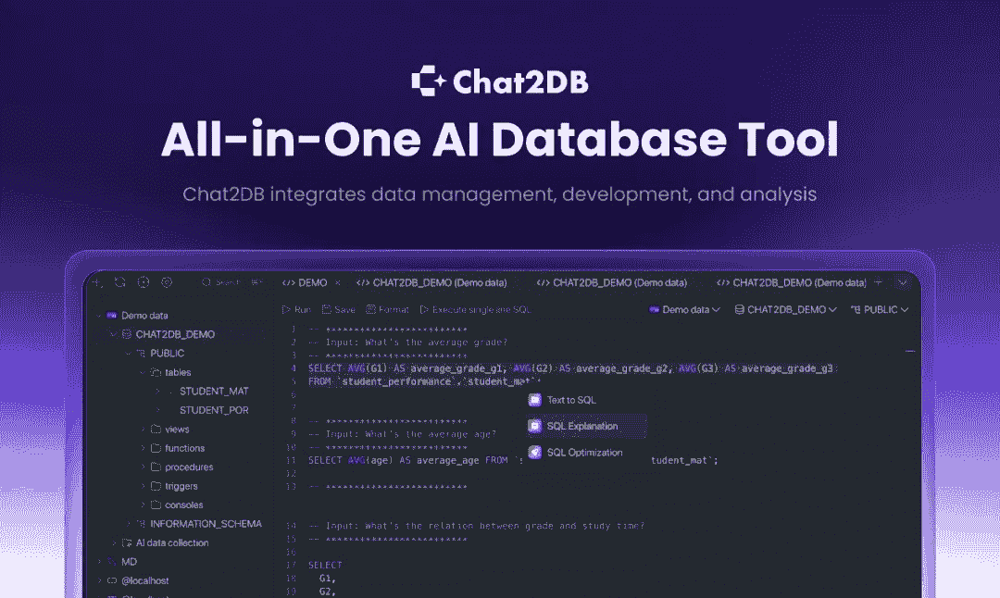
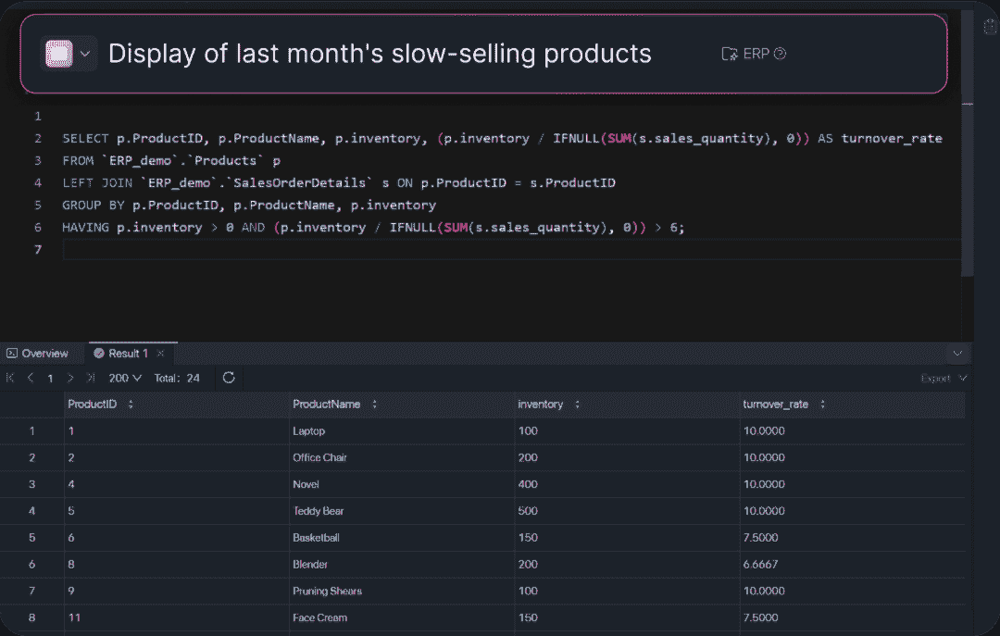
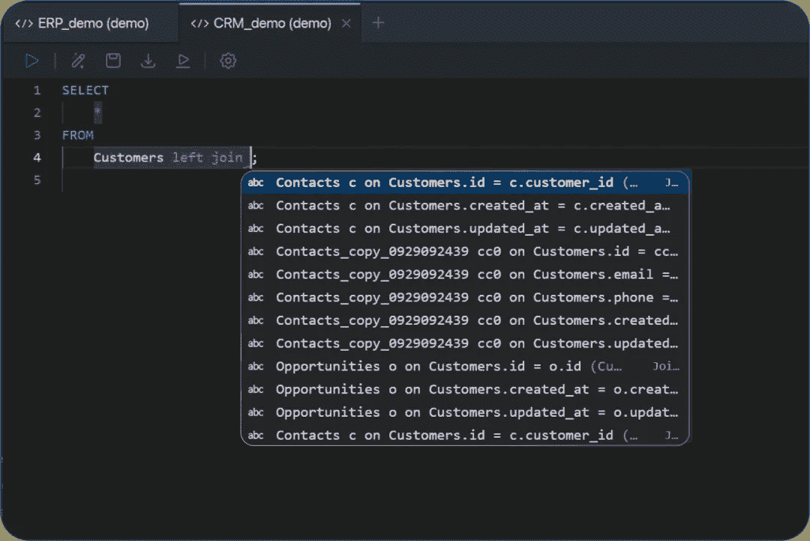
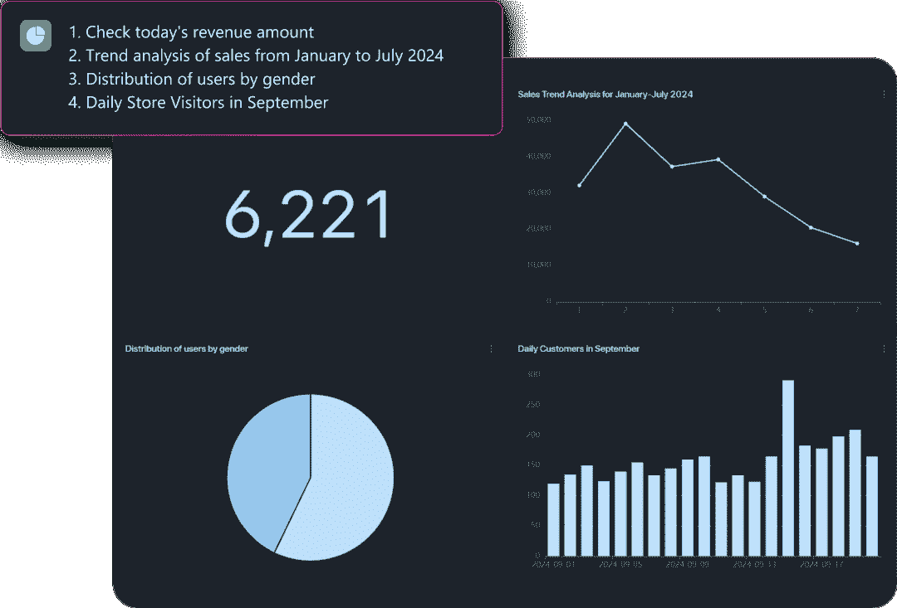

# 对话姬朋飞：从大厂辞职到 Chat2DB 的诞生

> 来源：[https://agispace.feishu.cn/docx/Da73dyBQqoVf1PxVCX3cfPsenqc](https://agispace.feishu.cn/docx/Da73dyBQqoVf1PxVCX3cfPsenqc)

> 原创：特工少女

> 公众号：特工宇宙

> 原文链接：https://mp.weixin.qq.com/s/fYvM7KrbWwcf0E3m-5epkg

> 最有力的回击就是用产品说话，而不是口舌之争。——姬朋飞

今天，是姬朋飞的生日。

在一年前的今天，姬朋飞选择离开了工作 8 年的地方，毅然选择了创业做 Chat2DB，希望用户能用 AI 一站式更好地处理数据库。今天是他创业一周年的日子，我们找到姬朋飞做了一次专访，回顾他创业这跌宕起伏的一年。“创业的想法由来已久，但这个决定下得并没有那么容易。”姬朋飞面对采访时如是说道。这一年来，姬朋飞经历过两段融资，发布的开源项目受到许多开发者好评，也经历过低谷，无数次彻夜难眠，被恶意诋毁抄袭...

离开稳定的环境，踏上一条未知而充满挑战的道路，需要的不仅是勇气，还有对未来的坚定信念。

**大厂辞职，后悔吗？**很多人都问过我这个问题。其实，我一直觉得自己是一个很擅长打工的人。在 29 岁那年晋升**为 P8，**算是非常年轻的 P8了。之所以能晋升这么**快，我始终坚**持两个习惯：第一是思考。无论是技术方案、业务逻辑，还是产品设计需要深入思考，并给出切实可行的解决方案；第二是执行力。仅有想法是不够的，能不能落地才是真本事。22 年，一个同事离职时聊到我时，他知道我有一个做开源项**目的想法；到 23 年**我去北京融资，再次约饭时，他感叹我的开源项目已经有超过 10K 的 Star，并多次登上了 GitHub 的热榜，他说：“师兄你是我见过执行力最强的人”。辞职这件事，我觉得是有遗憾的，遗憾的是我没能再晋升一级，遗憾还有一些股票没有行权，但我从不后悔。因为打工的机会随时都有，而 AI 的时代却不一定会再来；错过了实现自己想法的机会，以后看到别人做的产品，只能感叹：“我也有过这个想法”。离职创业的动力是什么？目前国内开发者使用的研发工具基本都还是国外的软件，能够做一个被广泛使用的软件，是一件非常有成就感的事情。17 年写的 Easyexcel 被很多 Java 开发者喜爱，希望能够再写一个开发工具被更多开发者每天都使用。我们希望开发者用到数据库管理、数据分析分析工具的时候第一个想到的是 Chat2DB.创业的动力不仅仅来自于对产品的热爱，更来自于当做成一个产品带来的成就感。看到用户使用我们的产品解决了工作中的难题，看到他们认可 Chat2DB，这些都是我坚持下去的动力来源。我希望通过我们的努力，让每一个开发者和数据分析师都能更高效地工作。

此外，作为一个技术人，我也希望能在这个快速变化的 AI 时代留下自己的印记，希望多年以后 Easyexcel、Chat2DB 都还在。

**创业过程遇到过哪些挑战？****创业三个月**，遭遇污蔑抹黑，创业初期我上的第一课就是：商场如战场。刚辞职三个月，网上就传起了我们抄袭的新闻，闹得沸沸扬扬。我们在 GitHub 上有 10K 的 Stars，对方只有不到 100 个，这就像是说一个考了 100 分的学生抄了考 1 分的同学一样，听起来像个愚蠢的笑话，但一些友商确实干得出来。当时我们团队只有五个人，且都是技术出身，看到这些指责恨不得立刻怼回去。但这样会浪费我们大量时间和精力，影响项目研发进展。我们决定不让这些噪音干扰到自己。对方的污蔑并没有影响到我们的用户和投资人，我们在发布了官方声明后，便更加专注于产品的研发与迭代，在半年时间我们迭代了 100 多个小版本。事实证明，最有力的回击就是用产品说话，而不是口舌之争。如何在坚持自身创新的同时满足用户的既有期待。技术创业，尤其是在基础应用领域，往往充满了对创新与实用性的不断追求和博弈。我们团队也不例外。在我们的开发旅程中，曾深受张小龙简洁设计理念的启发，试图将这种简约风格贯穿于我们的产品设计之中。然而，当产品面市的时候，用户的反馈却出乎我们的预料——他们不习惯这种极简风格，总是建议我们参考市场上某些已有的成功产品。这种反馈让我们陷入了深深的纠结，我们不断地回到调研阶段，试图寻找一个折中的解决方案。经过一番激烈的内部讨论和多次用户交流后，我们决定对整个页面布局进行一次大刀阔斧的重新设计，以期既能保持我们的创新理念，又能让用户感到熟悉和舒适。另一个挑战是在面向企业（B2B）和面向消费者（B2C）的产品策略选择上。对于一个初创公司来说，资源和时间都是极其宝贵的。B2B 市场通常能够带来快速的现金流，因为企业客户对于定制化服务的需求较大，而 B2C 市场则往往需要在品牌和用户习惯培养上进行长期的投入和耐心的等待。在多次内部讨论和市场分析后，我们选择了短期内主要服务于开发者社区，希望通过满足这些技术先驱者的需求来逐步建立我们的市场地位，同时我们仅和个别头部企业客户的合作便于分析 2B 市场的需求。这一决策虽然意味着初期的财务压力更大，但我们相信，通过精准定位和优质服务，能够为未来的转型和扩张打下坚实的基础。我们还面临的一个重大决策是如何在开源与商业版本之间找到平衡点。开源是技术共享的一种美好形式，能够帮助产品快速获得用户和开发者的认可，但同时也可能会限制我们从中获得商业利益的能力。为了解决这个问题，我们在官网上详细说明了开源版与商业版的互补性：开源版为用户提供了试用的机会，了解核心功能和潜在的扩展性；而商业版则提供了更专业的支持和更强大的功能，满足企业用户的高级需求。通过这种方式，我们不仅保护了自己的知识产权，也让社区的贡献者和商业用户都能找到各自需要的价值，实现了多赢的局面。

这些挑战我们也不能说已经彻底解决，所有的事情只有经历你才知道究竟如何解决。

Chat2DB 是怎样一款产品？在过去的一年里，我们在 AI 驱动的数据领域做了一些努力。

**官网：https:**//chat2db.ai/zh-CN自然语言生成SQL：作为我们的核心能力之一，我们通过持续不断地训练大规模 AI 模型，开发出了可能是市面上生成答案最准确的 Text-to-SQL 工具。通过构建专有的 AI 数据集，我们的系统能够深入理解和感知用户的数据库表结构，从而自动生成高度精准的 SQL 查询语句。无论是处理复杂的多表连接还是简单的单表查询，用户只需用自然语言表达其需求，即可迅速获得精确无误的 SQL 代码。

**智能 SQL 编辑器**：我们打造了更智能的 SQL 编辑器，让数据分析师和开发者在使用 SQL 时能更高效地完成任务。我们在编辑器中引入了智能补全、错误提示和代码生成等功能，使得用户能够更加轻松地编写复杂的 SQL 查询。这不仅提高了工作效率，也降低了初学者的学习门槛。我们还特别关注用户体验，力求让每一个交互都变得更加流畅，让用户在编写代码时有一种得心应手的感觉。

**模型微调与私有化**：为了满足企业客户的需求，我们对模型进行了微调，并提供了私有化部署的解决方案。这意味着企业可以将我们的 AI 能力引入到他们的内部系统中，而不必担心数据安全和隐私问题。我们与多**家企业合作，帮助他**们将AI技术融入到日常的数据分析流程中，使得AI不仅仅是一个工具，更是业务增长的引擎。在这一过程中，我们也不断优化我们的模型，使其能够更好地适应不同企业的特定需求，真正做到因地制宜。智能 BI 仪表盘：为了帮助企业客户更高效地进行数据分析，我们开发了智能 BI 仪表盘，它能够通过简单的自然语言指令自动生成直观的报表。支持多种图表类型，包括但不限于柱状图、词云和饼图等，满足不同场景下的展示需求。此外，用户还可以设置定时刷新机制，确保数据总是最新的，从而助力于更加精准及时的决策制定。

**链式对话**：在 AI 对话中，我们开发了链式对话功能，使得用户在数据分析的过程中，能够更自然地与系统进行多轮交互。这种对话式的交互方式，打破了传统工具的限制，用户可以一步步深入地提问，逐步挖掘数据背后的故事。我们的链式对话不仅支持简单的查询，还可以结合上下文，进行复杂的数据分析，这让数据分析过程更加流畅和智能。我们希望通过这种更贴近人类思维的交互方式，让数据分析变得不再那么冰冷，而是更加具有温度和智慧。

我们被认为是 **SQL 领域的 Cursor**，甚至有好心的网友建议我们做中国版的 AI 代码编辑器。他们说 Chat2DB 比 Cursor 还要复杂得多，这对我们来说既是赞美也是激励。

我们希望通过不断的技术创新，让更多的用户能够享受到 AI 驱动的数据分析体验。

**产品上线后，用户反馈如何？**今年 4 月，我们发布了 Pro 版本，得到了很多用户的支持。即使在第一天发布时问题还不少，但许多用户依然表达了对我们的信任与支持，这让我倍感温暖，非常感谢我们的创始会员在我们产品迭代中给出各种意见。

如果没有踏上创业这条路，永远不会知道创业有多么不易。姬朋飞无数次彻夜难眠，甚至连睡觉都在思考产品，思考解决方案。“我记得在高中时候我曾在梦里解除一道数学难题。创业后有很多问题也是在梦里找到的解法。”这波荡起伏的一年，经历了各种未知与挑战。但昨日种种，皆成今日之我。未来流淌着的，不只有创业的激情，还有历练沉淀后的波澜不惊。希望 Chat2DB 能越做越好，将梦想变成现实！