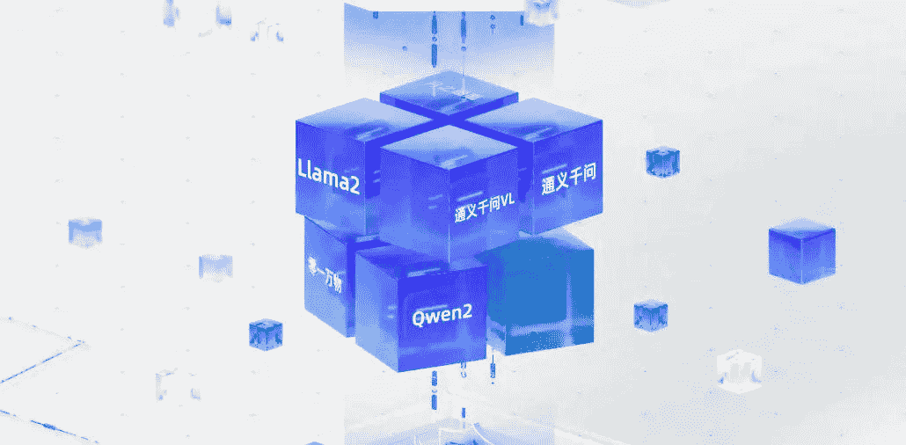
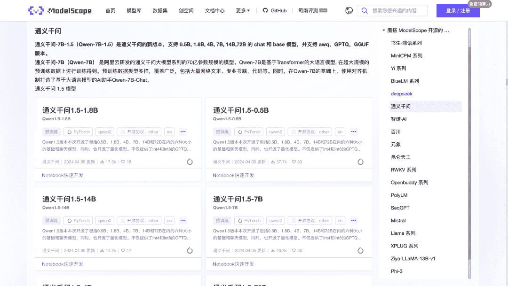
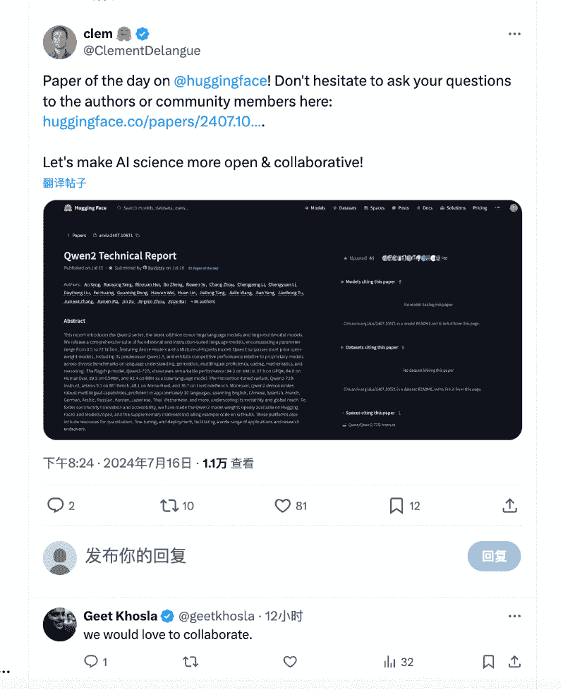
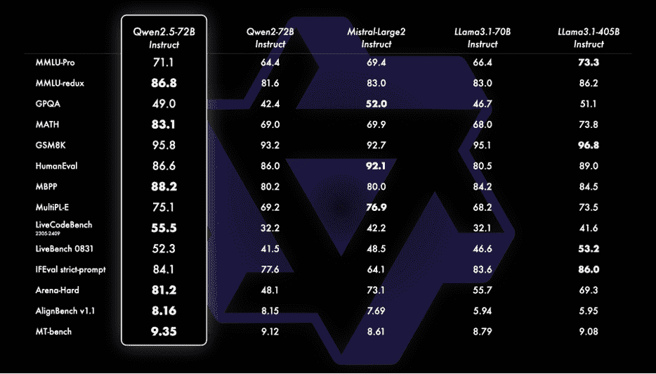
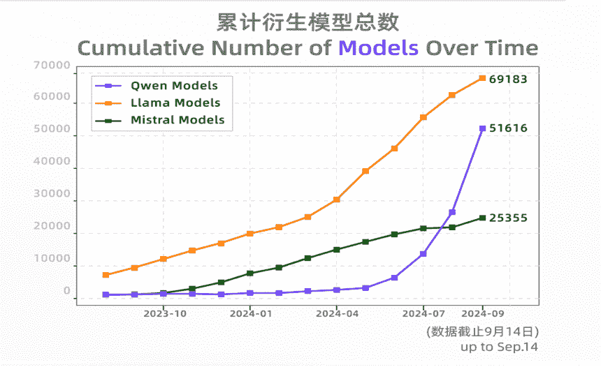
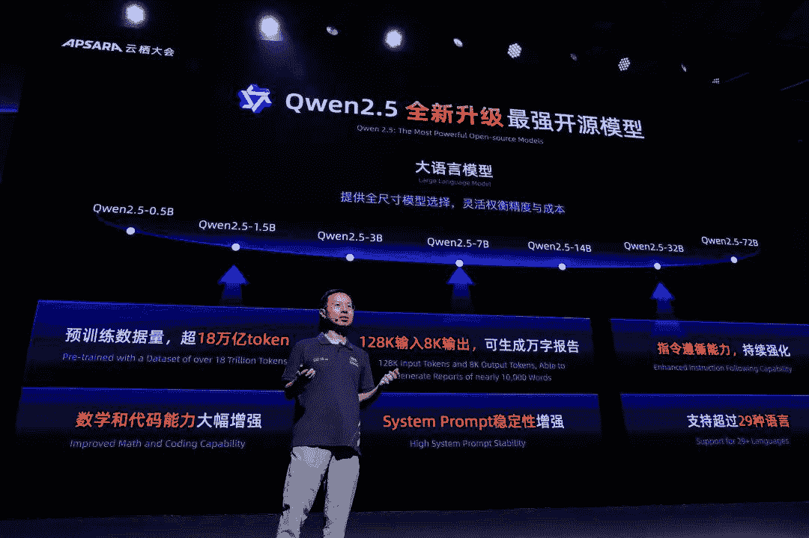
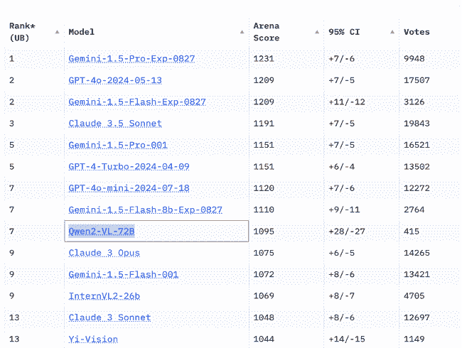
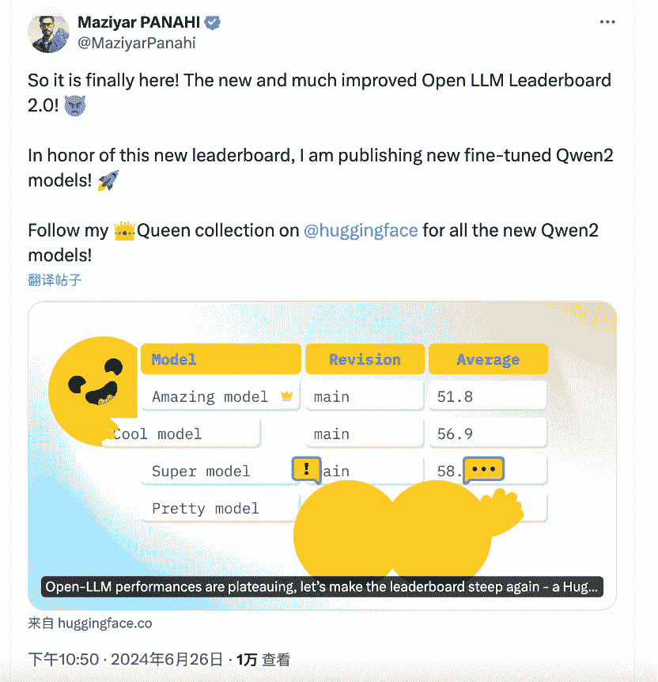
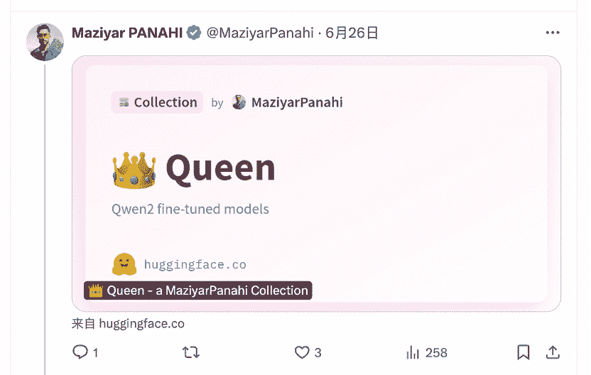
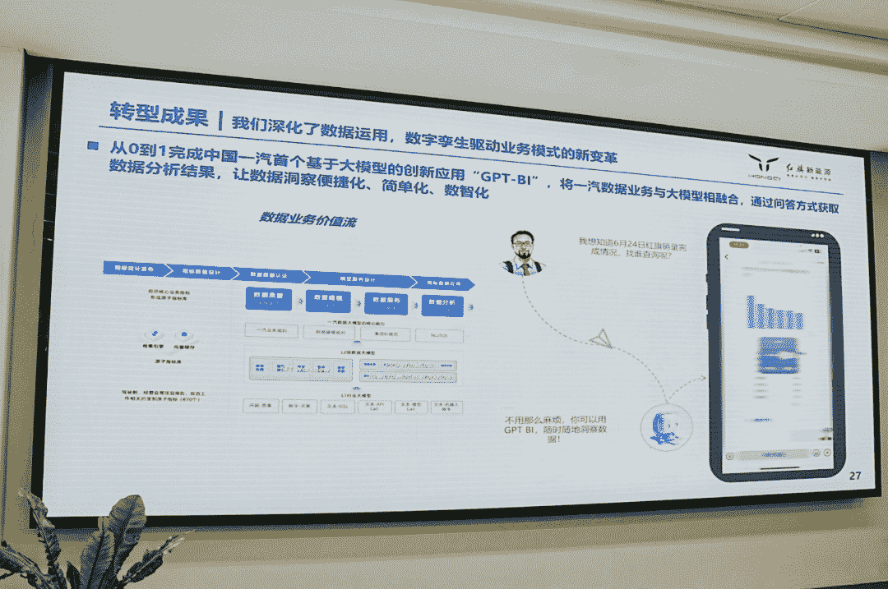

# 大家都说通义大模型好，究竟好在哪？

> 来源：[https://agispace.feishu.cn/docx/IWocd840zoXqpWxd7rPcZztln2f](https://agispace.feishu.cn/docx/IWocd840zoXqpWxd7rPcZztln2f)

> 原创：抄就完了

> 原文：https://mp.weixin.qq.com/s/ePjWxuJqKUBo3gTigyKF8w

> 都说国产大模型“通义千问”能打，到底是真强还是智商税？今天就带你看看，这个国产“AI猛将”凭什么火出圈！

# **从一个问号开始的探索**

如今的AI领域竞争激烈，提到大模型，许多人第一反应可能是GPT、Llama等大牌“选手”。然而，阿里巴巴的“通义千问”却让不少开发者拍案称好。这个国产大模型究竟有什么过人之处，为什么让大家纷纷点赞？今天，我们就来一起揭开通义千问的“好”是如何做到的。

# 开源之路上的“用户之选”——好在哪？

**好在真正让利开发者。**

2023年4月，阿里巴巴推出通义千问，选择了“全开源”的策略，成为全球开发者关注的焦点。而在2024年的云栖大会上，阿里云进一步发布了Qwen2.5系列，包括多个尺寸的大语言模型、多模态模型、数学模型和代码模型，涵盖从0.5B到72B的完整规模。Qwen2.5的开源不仅让开发者能够自由使用，更支持多样化的指令跟随、量化等版本，总计100多个开源模型，刷新了行业记录，大家可以在魔搭社区中自行下载进行应用。

这一策略带来了巨大的影响。在Qwen2.5发布的短短几小时内，Hugging Face联合创始人Clément Delangue迅速发文称赞Qwen2.5为“最强开源模型”，并宣布其性能超越了Llama 405B。这一认可不仅展示了Qwen2.5的技术实力，也说明其开源策略赢得了全球开发者的青睐。

从Hugging Face的反响中可以看出，通义千问“好”在它是真正以开发者为核心的开源模式：不仅让更多小团队以低成本获取一流的AI技术，还能通过自由定制和本地化适配，带来灵活性与创新性。

# 打造开源生态的“顶流”——好在哪？

**好在低门槛、高包容的社区效应。**

得益于通义千问的开源模式，特别是Qwen2.5的高效能表现，通义千问的生态系统逐步发展，成为全球开发者的“顶流”选择。云栖大会上的数据显示，Qwen2.5的下载量已超过4000万。Qwen2.5-72B更是在MMLU-redux等多个全球权威评测基准上表现优异，以不到Llama3.1-405B五分之一的参数超越了后者，成为全球最强开源大模型的代表。

Hugging Face社区上也纷纷涌现出大量基于Qwen2.5的衍生模型，仅在Qwen2系列发布后的数周内，衍生模型数量就突破7.43万个，成为全球衍生数量最多的系列模型。Hugging Face CEO Clément Delangue公开表示，Qwen2.5是当前开源模型的巅峰，而其“高性价比之王”——Qwen2.5-32B更是被誉为开发者首选。

通义千问Qwen2.5的开源生态之“好”，就在于它不仅仅是一个模型，更像是全球开发者间的共享语言和交流空间，使开发者们的想法和创意能够汇聚并迅速落地。

# 从“文字”到“视觉”的进阶——好在哪？

**好在多模态智能的前沿探索。**

2024年9月19日的云栖大会上，阿里云发布了Qwen2.5的视觉语言模型Qwen2-VL-72B。这个模型不仅能处理文字，还能识别图片、理解视频内容，甚至可以操作手机和机器人，成为多模态智能的典范。

Qwen2-VL能识别不同分辨率和长宽比的图片，理解20分钟以上长视频，具备自主操作手机和机器人的视觉智能体能力。日前权威测评LMSYS Chatbot Arena Leaderboard发布最新一期的视觉模型性能测评结果,Qwen2-VL-72B成为全球得分最高的开源模型。

法国工程师Maziyar Panahi在Qwen2发布后不久，便基于Qwen2-7B开发了12种不同的微调模型，并盛赞Qwen2为多模态应用的“最佳选择”。Maziyar还称Qwen2的细致能力超过了同类模型，用在跨语境的视觉处理、翻译和内容生成方面优势显著。这让Qwen2不仅成为开发者的“工具”，更像是一个全能的智能伙伴，能在多场景中实现复杂的多模态处理。

多模态的优势让Qwen大模型在AI应用场景上更进一步，带来了广告、教育、创意设计等多领域的升级体验，这就是Qwen大模型的独特之“好”。

# 普惠之路上的“日常助手”——好在哪？

**好在落地性与生活化。**

通义千问不仅在开发者圈内广受欢迎，也逐步渗透到了普通用户的生活中，成为了“触手可及”的智能助手。云栖大会展示了Qwen2.5在多语言和人机交互方面的进展，Qwen2.5-72B能够支持中文、法文、日文等29种语言，角色扮演、结构化数据处理等任务得到了显著提升。

通义千问的Qwen2.5更是进入了中国一汽等大型企业的工作流程。基于Qwen2.5，一汽开发了智能BI系统，通过自然语言查询生成数据分析图表，极大提高了企业数据分析的效率。无论是教育、制造还是金融，Qwen2.5的高性能、低成本和广泛适应性让AI真正走进了生活。

Qwen2.5的普惠性体现在它让AI触手可及，让每个使用者都能从中体验到智能的乐趣和效率的提升。

从“隐形新秀”到全球开发者心中的“开源巨星”，通义千问以其独特的开源模式、多模态能力和普惠性，成了开发者和用户心中的“国货之光”。尤其在云栖大会上，Qwen2.5的发布让大家见证了国产大模型在技术和生态上的崛起，成为全球瞩目的开源“顶流”。

那么如果你也想向通义千问提一个问题，或者让它帮你完成一件事，你会选择什么？在评论区聊聊你的想法，也许你的创意就是下一次“通义奇迹”的灵感来源！