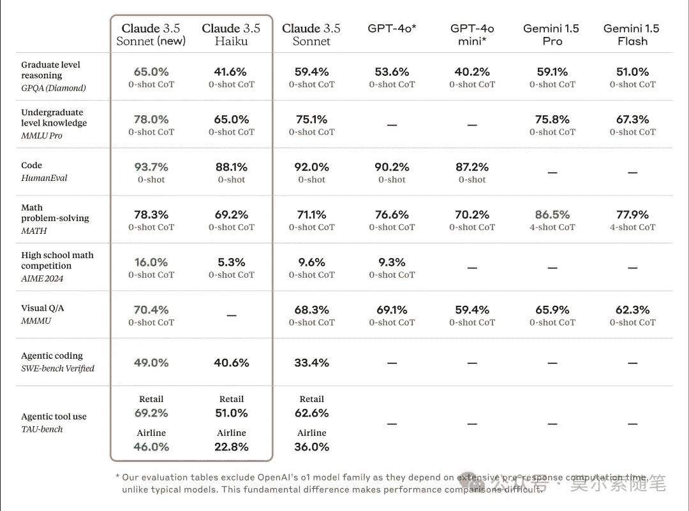

# 刚刚！Anthropic 发布全新 Claude 3.5 Haiku 模型 ，首次引入"计算机使用"能力！

> 来源：[https://agispace.feishu.cn/docx/CYlPd2frXoHMcQxkcBpcQ0jgnbd](https://agispace.feishu.cn/docx/CYlPd2frXoHMcQxkcBpcQ0jgnbd)

> 作者：是莫尔索

> 公众号：莫尔索随笔

> 原文链接：https://mp.weixin.qq.com/s/itq4VvYuTCyTNpFcjC0qjA

> 刚刚，Anthropic 宣布推出Claude 3.5 Haiku模型，并对 Claude 3.5 Sonnet 进行升级，同时推出了公测版的 computer use 功能，教 AI 像人一样操作计算机，下面是具体介绍。

###

# **延伸阅读**[ Claude 2已发布，OpenAI这下彻底慌](http://mp.weixin.qq.com/s?__biz=Mzg2OTk1NDQ4Ng==&mid=2247485347&idx=1&sn=3013027b1a3cef85b5f1035ff2fca401&chksm=ce94617af9e3e86cad028883ed801fce1f68d13de4740cf7ad59d6bb8bdf025a8c0e733b7e9b&scene=21#wechat_redirect)了！超越 GPT-4 ，新一代 Claude 3 震撼发布 刚刚！Anthropic 发布 Claude 3.5 Sonnet，更强，更快，更便宜！

### Claude 3.5 Sonnet 编码和工具使用能力显著提升

升级版的 Claude 3.5 Sonnet 模型在各项性能上都有所提升，尤其在编码和工具使用方面**显著提升，特别是在软件工程领**域的基准测试中，它的性能超过了所有公开可用的模型，包括 OpenAI o1-preview 和专门设计的代理编码系统，新模型编码方面，它在 SWE-bench Verified([1]) 上的性能从 33.4% 提高到 49.0%，得分高于所有公开可用的模型——包括像 OpenAI o1-preview 这样的推理模型和专为代理编码设计的专用系统。它还在 TAU-bench([2]) 上的性能从 62.6% 提高到 69.2%。

升级版的 Claude 3.5 Sonnet 现在对所有用户开放，开发者可以在 Anthropic API、Amazon Bedrock 和 Google Cloud 的 Vertex AI 上使用计算机使用测试版进行构建。

Claude 3.5 Sonnet 编码能力显著提升

### Claude 3.5 Haiku 性价比拉满，价格便宜效果好

Claude 3.5 Haiku 作为 Anthropic 最快的模型，在各项技能上都有所提升，甚至在许多智能基准测试中超过了前一代最大模型 Claude 3 Opus，Claude 3.5 Haiku 在编码任务上的表现尤其出色，在 SWE-bench Verified 上得分为 40.6%，超过了许多使用公开可用的最先进模型的代理——包括第一代的 Claude 3.5 Sonnet 和 GPT-4o。

凭借低延迟、改进的指令遵循和更准确的工具使用，Claude 3.5 Haiku 非常适合面向用户的产品、专门的子代理任务以及从大量数据（如购买历史、定价或库存记录）中生成个性化体验。

Claude 3.5 Haiku 将在本月晚些时候通过 Anthropic API、Amazon Bedrock 和 Google Cloud 的 Vertex AI 提供，最初只开放文本能力，随后将支持图像输入。

### computer use 功能 教 AI 样操作计算机

此外，Anthropic 引入了 computer use 功能的公测版，允许开发者指导 Claude 模型像人类一样使用计算机，包括查看屏幕、移动光标、点击按钮和输入文本。这一功能目前处于实验阶段，但已经有一些公司如 Asana、Canva、Cognition、DoorDash、Replit 和 The Browser Company 已经开始探索这些可能性，执行需要数十个、有时甚至数百个步骤才能完成的任务。例如，Replit 正在使用 Claude 3.5 Sonnet 的计算机使用和 UI 导航功能来开发一个关键特性，用于评估他们正在构建的 Replit Agent 产品中的应用。

开发者可以指导 Claude 像人一样使用计算机——查看屏幕、移动光标、点击按钮和输入文本。Claud**e 3.5 Son**net 是第一个在公开测试版中提供 computer use 功能的 AI 模型。在这个阶段，它仍然是实验性的([3])，容易出错，提前发布 computer use 功能是为了从开发者那里获得反馈，预计这项功能将随着时间的推移迅速改进。

### **模型安全**

为了确保新模型的安全部署，Anthropic 与美国和英国的安全机构合作进行了预发布测试，并对 Claude 3.5 Sonnet 进行了对抗性风险评估，确认了 ASL-2 标准仍然适用。对于计算机使用功能的安全部署，Anthropic 开发了新的分类器来识别潜在的误用和伤害。

# **延伸阅读**

[Claude 2已发布，OpenAI这下彻底慌了](http://mp.weixin.qq.com/s?__biz=Mzg2OTk1NDQ4Ng==&mid=2247485347&idx=1&sn=3013027b1a3cef85b5f1035ff2fca401&chksm=ce94617af9e3e86cad028883ed801fce1f68d13de4740cf7ad59d6bb8bdf025a8c0e733b7e9b&scene=21#wechat_redirect)！超越 GPT-4 ，新一代 Claude 3 震撼发布

刚刚！Anthropic 发布 Claude 3.5 Sonnet，更强，更快，更便宜！

### 参考资料

[1] SWE-bench Verified: https://www.swebench.com/

[2] TAU-bench: https://github.com/sierra-research/tau-bench

[3] 实验性的: https://www.anthropic.com/news/developing-computer-use