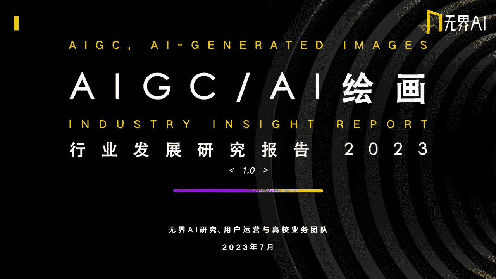
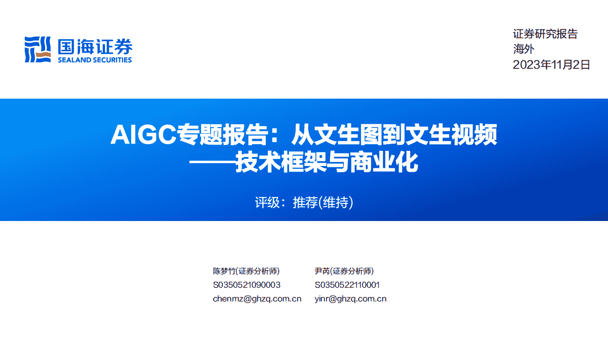
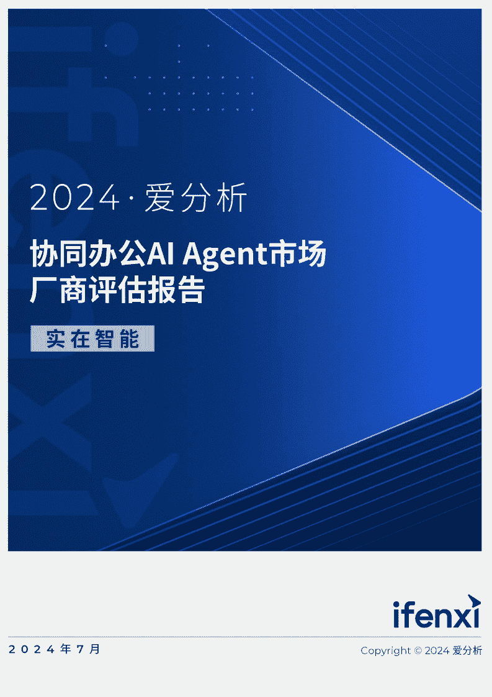
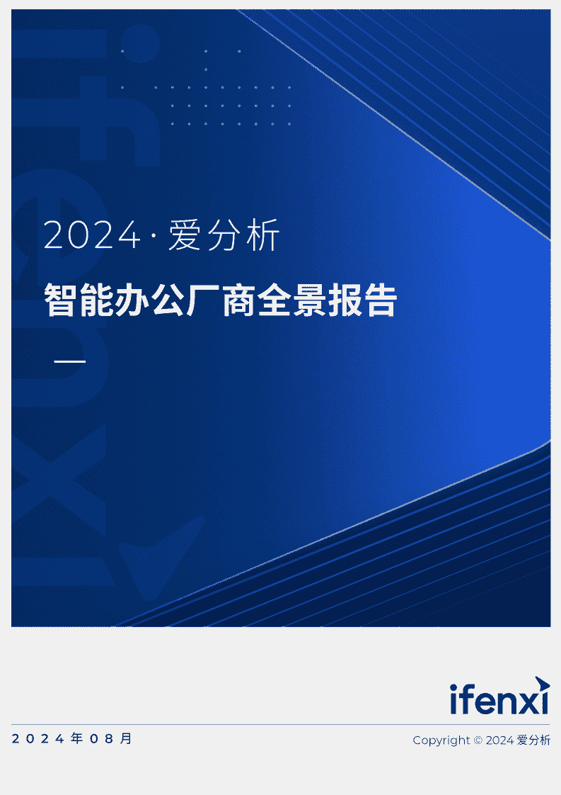
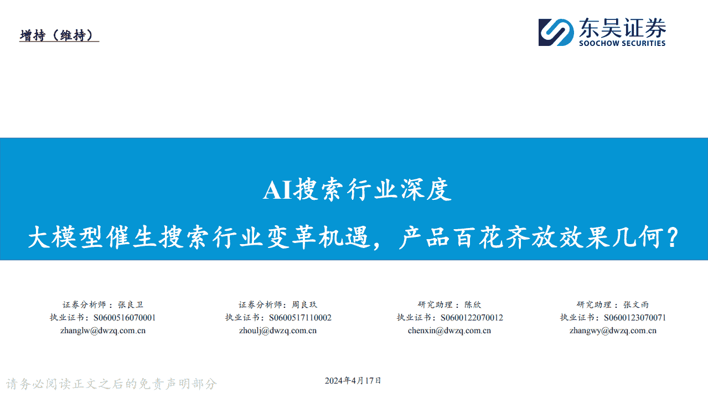
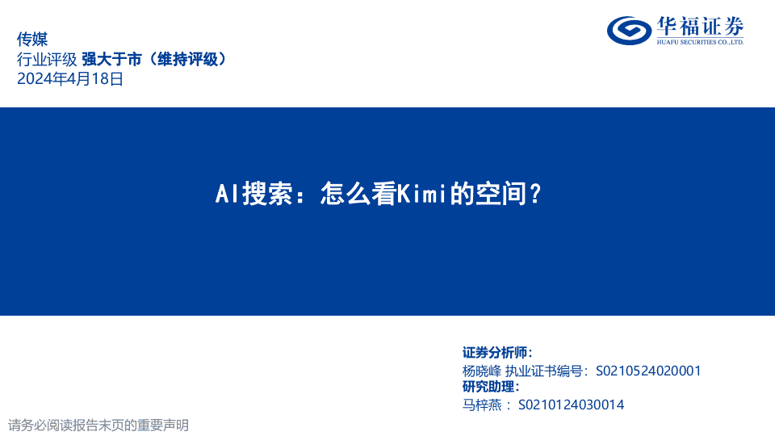
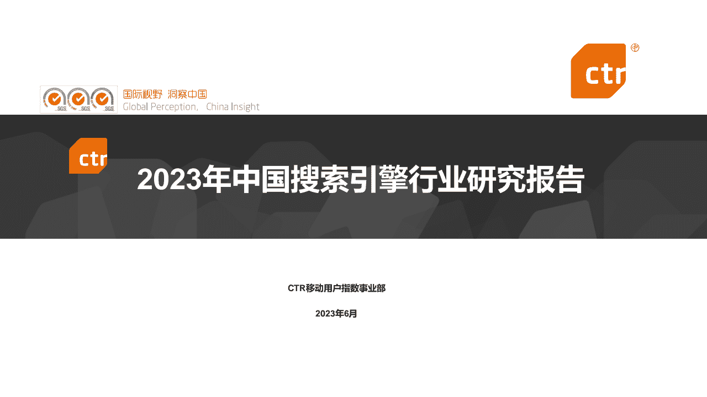
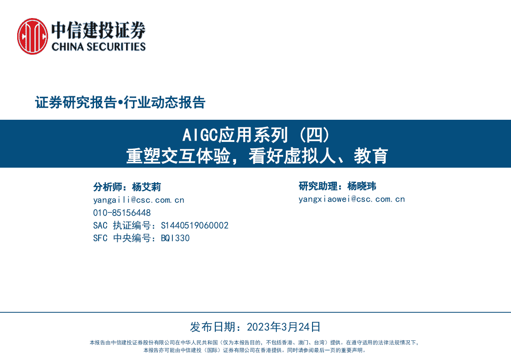
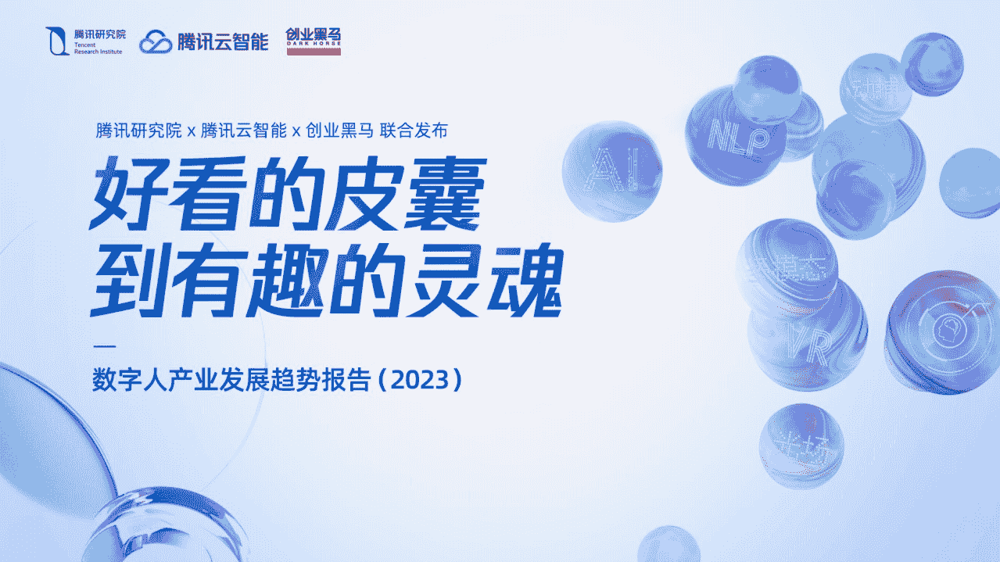

# 1.1 AI工具-个体赋能

> 来源：[https://agispace.feishu.cn/docx/I3nBduOZ5ogQ0XxgBf4c3Qy3nle](https://agispace.feishu.cn/docx/I3nBduOZ5ogQ0XxgBf4c3Qy3nle)

> [路径：认识 AI 工具](https://agispace.feishu.cn/wiki/RAYYw0S3Xivn1BkZLvLcBkejnNg)I 工具简化任务并激发创造力，让创作更高效、更有趣。 （入门）

**内容全景图：**

**分类快捷列表：**

### [**🌈 A**](https://agispace.feishu.cn/wiki/Y9ljw0a6ii56lDkloiccGeWOnql?table=tblMScSmxUwKeA16&view=vewTNa51Tn)[**I 绘画**](https://agispace.feishu.cn/wiki/Y9ljw0a6ii56lDkloiccGeWOnql?table=tblMScSmxUwKeA16&view=vewTNa51Tn)

### **🌟 A**[**I 视频**](https://agispace.feishu.cn/wiki/XTIMwfpO6iQd2KkNV6OcK2OFnLg?table=tblsDz4BZH6NElDK&view=vewhJ9xno5)

> 按用户想法迅速创作出有创意的精美画作。

> 搞定视频的创作、编辑等，让制作更高效出色。

+   [**ComfyUI**](https://agispace.feishu.cn/wiki/ZbCOwtUSkiIaiUkUX3qcxah4nEg)** ｜ **[**Midjourney**](https://agispace.feishu.cn/wiki/EWbFwEzbaiZ3vdkLOdvcWgAsneh)** ｜**Stable Diffusion

+

[2024年AI绘画行业预测报告.pdf](https://internal-api-drive-stream.feishu.cn/space/api/box/stream/download/all/TIKgbwIuMoaVQPxqqJMcAsLMnRf)

+

[AIGC之AI绘画行业发展研究报告2023.pdf](https://internal-api-drive-stream.feishu.cn/space/api/box/stream/download/all/YZazb6rACoZP99xekmqc6s1Jnqd)

+   [**Kling可灵**](https://agispace.feishu.cn/wiki/AMxNwuiSli4SDBkOuMqcgHs7nKg)**｜**[**PixVerse**](https://agispace.feishu.cn/wiki/C24Cw3JN4icn3ZkVZGYc4Ky6nMe)** ｜ **[**Dreamina即梦**](https://agispace.feishu.cn/wiki/PzR3w8ZAXiITy6ksVBKcS6ivnQd)** **

+

[2024年AI视频生成研究报告.pdf](https://internal-api-drive-stream.feishu.cn/space/api/box/stream/download/all/HfynbpN9MooljmxSdnQcNFw7n3a)

+

[从文生图到文生视频——技术框架与商业化.pdf](https://internal-api-drive-stream.feishu.cn/space/api/box/stream/download/all/UdtLbT1IToBxClx033RcMyxtnUh)

---

### **💻 A**[**I 办公**](https://agispace.feishu.cn/wiki/QFLiwI472idFOQkvmn9cgwtnnQb?table=tbltjBMKUU7UWiuW&view=vewhJ9xno5)

### **🔎 **[**A**](https://agispace.feishu.cn/wiki/LSHZw00m6ilGQQk4fJnciM3knVf?table=tblCetadldu4BxiS&view=vewhJ9xno5)[**I 搜索**](https://agispace.feishu.cn/wiki/LSHZw00m6ilGQQk4fJnciM3knVf?table=tblCetadldu4BxiS&view=vewhJ9xno5)

> **让工作更轻松高效、质量更高。**

> 精准明白用户需求，更准更有用的搜索结果。

🔗：百[度文库 AI｜](https://wenku.baidu.com/)C[anva ](https://www.canva.cn/)

+

[协同办公Al Agent市场厂商评估报告.pdf](https://internal-api-drive-stream.feishu.cn/space/api/box/stream/download/all/FdUQblrn0oParOxkkcac7EZjnmf)

+

[智能办公厂商全景报告.pdf](https://internal-api-drive-stream.feishu.cn/space/api/box/stream/download/all/Qku5bj4zZo8O6TxfGBscVnNpnlh)

🔗：秘[塔 AI ](https://metaso.cn/)｜天[工 AI ](https://www.tiangong.cn/)｜P[erplexity](https://www.perplexity.ai/)

+

[AI搜索行业深度：大模型催生搜索行业变革机遇，产品百花齐放效果几何？.pdf](https://internal-api-drive-stream.feishu.cn/space/api/box/stream/download/all/Y93BbO9vaoH8lsxhR2Pcn2xFnUc)

+

[传媒行业AI搜索：怎么看Kimi的空间？.pdf](https://internal-api-drive-stream.feishu.cn/space/api/box/stream/download/all/Zu6TbUoygotrR2xpnJjcs0IZn9c)

+

[CTR发布：2023年中国搜索行业报告.pdf](https://internal-api-drive-stream.feishu.cn/space/api/box/stream/download/all/HydhbiBJsoW7M3xNPmSc2wkinjc)

---

### **🧑‍💻 AI**[** 虚拟数字人**](https://agispace.feishu.cn/wiki/TZM4wu2trigBcbkDB1kcUeSTnPd?table=tblphvZLT3L4tkI3&view=vewhJ9xno5)

### **🎵 A**[**I 3D&音乐**](https://agispace.feishu.cn/wiki/MOUdwGyI7iuiG4kJtvNcdNa9nyd?table=tbldLCPXXJdycfn8&view=vewhJ9xno5)

> 生成逼真的虚拟形象，在很多地方与人交流互动。

> 在 3D 方面做模型，在音乐方面搞创作。

+   [**HeyGen**](https://agispace.feishu.cn/wiki/JYmRwcclri6qdnkrZUgc9OPqnEf)** ｜ **[**Synthesia**](https://agispace.feishu.cn/wiki/KNEBwvhUZihLIck7alCch4qTnLh)** **

+

[中信建投-计算机行业AIGC应用系列 （四）：重塑交互体验，看好虚拟人、教育-230324-报告汇(vicsdf.com).pdf](https://internal-api-drive-stream.feishu.cn/space/api/box/stream/download/all/S24BbTz9loG733xXF5dcgJmUnsd)

[【腾讯研究院】好看的皮囊到有趣的灵魂-数字人产业发展趋势报告.pdf](https://internal-api-drive-stream.feishu.cn/space/api/box/stream/download/all/UkwdbKcNjo57dXx288hcG3sfnHU)

+   [**Suno**](https://agispace.feishu.cn/wiki/Qi5KwlZVsicTQZkQH2ecNLDFnLh) ｜  3DGen  ｜ tripo3D ｜wonder3D

+

[【量子位智库】AI音乐应用产业报告.pdf](https://internal-api-drive-stream.feishu.cn/space/api/box/stream/download/all/AFhZbYCf1ogQZIxt4lCcSjXQnjK)

---

### 精选 AI 工具网站