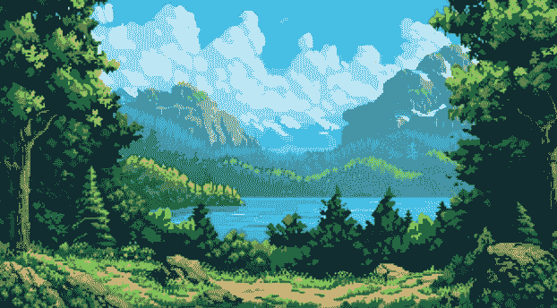
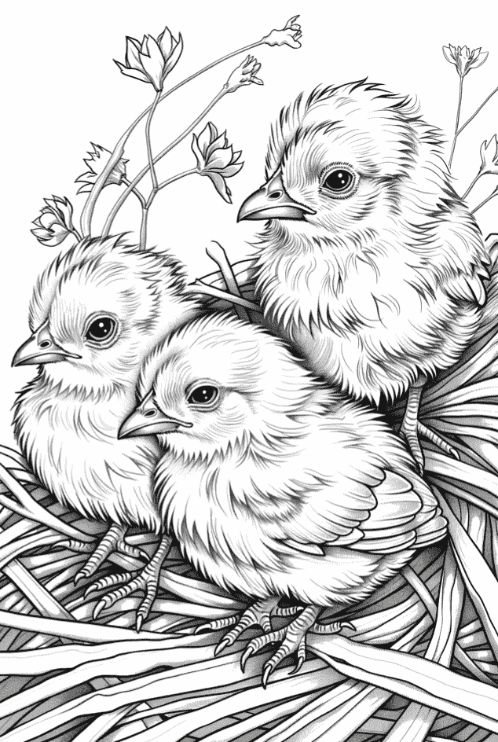

# 工具教程-Midjourney

> 来源：[https://agispace.feishu.cn/docx/GPOndst74oI4UFx1suHcAHCfnpf](https://agispace.feishu.cn/docx/GPOndst74oI4UFx1suHcAHCfnpf)

> **MidJourney 简介**

> "**Midjourney** 是一个独立的研究实验室，致力于探索新的思维媒介并扩展人类的想象力。

>

> **我们**是**一个自筹资金**的**小型团队**，专注于设计、人力基础设施和人工智能。我们拥有 11 名全职员工和一组令人难以置信的顾问。"

> **主要资源展示区**

+   官方首页 ：https://www.midjourney.com/

+   官方学习手册：https://docs.midjourney.com/docs/web-quick-start

> **教程与学习资源区**

+   MidJourney 知识库 https://tob-design.yuque.com/kxcufk/mj/index

+   Midjourney从零基础到落地实践 - 少数派

+   Midjourney 知识库｜语雀 - - 信管网

+   实用Midjourney 知识库 从新手入门到高级进阶 - Zc菌分享

+   设计师的 Midjourney 入门真保姆级教程 - 知乎专栏

+   [保姆级Midjourney教程，](https://zhuanlan.zhihu.com/p/680272055)这本写给大家看的设计书闭眼入！ - 知乎

+   https://www.bilibili.com/video/BV1As4y127HW/?spm_id_from=[333.999](https://space.bilibili.com/1814756990).0.0&vd_source=fb70dcd59097b3df6ebb6003acff9668 （新人推荐Nenly同学）

> **案例分析**

> [1.1.1 AI 绘画 > 画板](https://agispace.feishu.cn/wiki/Y9ljw0a6ii56lDkloiccGeWOnql?blockId=doxcnCf09MNcP1vh0jUo9NrXmsf&blockToken=AzmHwiTQWhBHsTbHvrFcybkGnvh&blockType=whiteboard&table=tblMScSmxUwKeA16&view=vewui8g3eb)

> **最新动态**

> 官网最新动态播客地址：https://www.midjourney-v6.com/blog/

>

+   2023年7 月：Midjourney V6.1 上线，提高图像质量等，开发团队在模型个性化和样式参考代码中加入混合功能。

+   2023年12月：Midjourney v6发布，完全重新训练的模型，图像生成效果与v5.2有很大不同，加入了风格一致性和角色一致性功能。

+   2023年6月：Midjourney 5.2发布，引入了zoom out功能，可以无限扩展原始图像。

+   2023年5月：Midjourney v5.1上线，对提示词表达方式进行了调整。

+   2023年3月：Midjourney v5发布，进一步提升图像质量和通用性。

+   2022年11月：Midjourney v4上线，画质首次突破，支持图像prompts等高级功能，风格一致性高，但角色一致性较低。

+   2022年7月：Midjourney v3发布，进一步提升了图像质量，引入了“风格”和“质量”参数，风格一致性适中。

+   2022年4月：推出Midjourney v2，引入上采样和变化按钮，优化模型，图像更加有创意，颜色丰富。

+   2022年2月：发布了第一个测试版本，图像质量和连贯性尚可，但风格一致性较低。

**展示柜**

---

