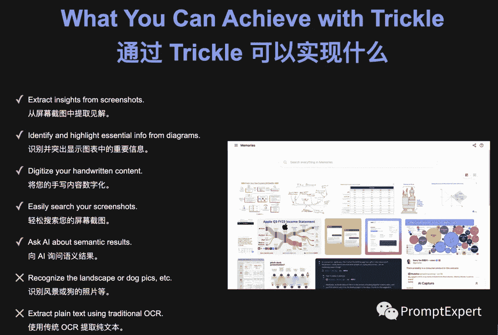
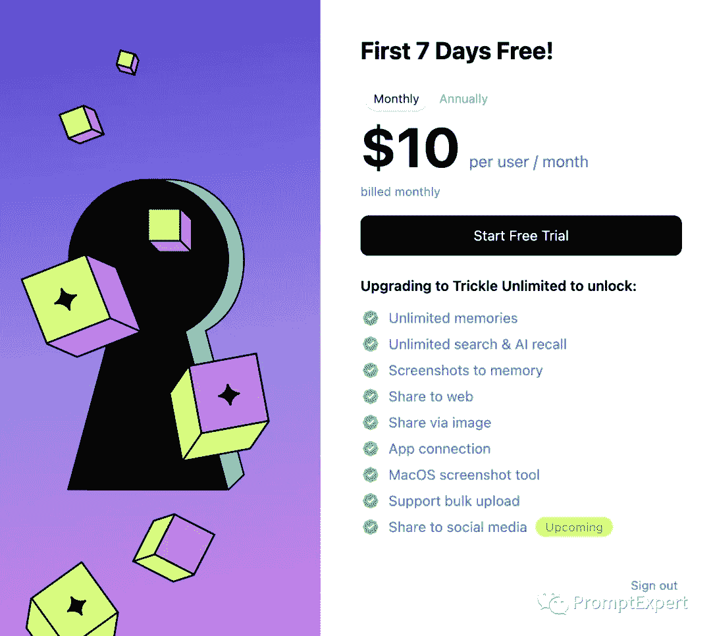
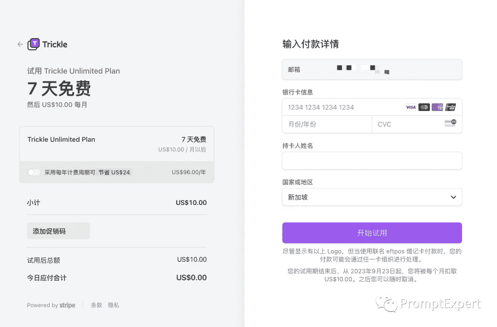
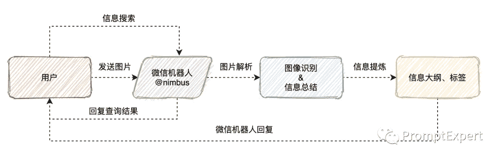
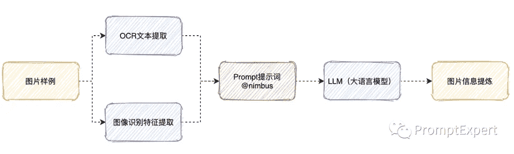
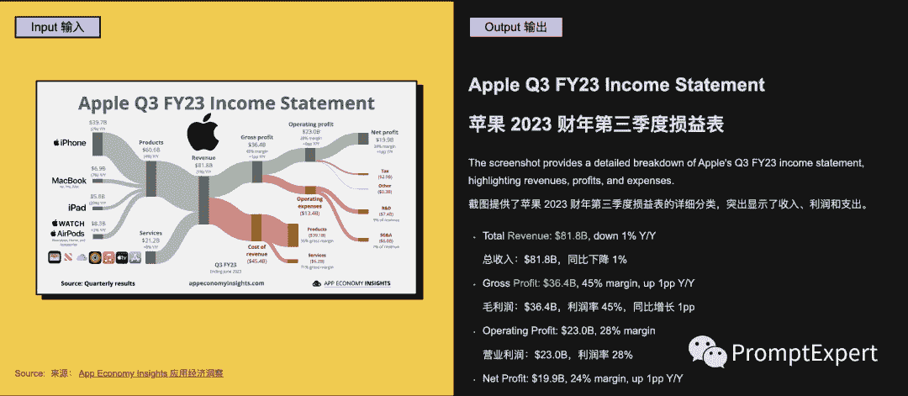
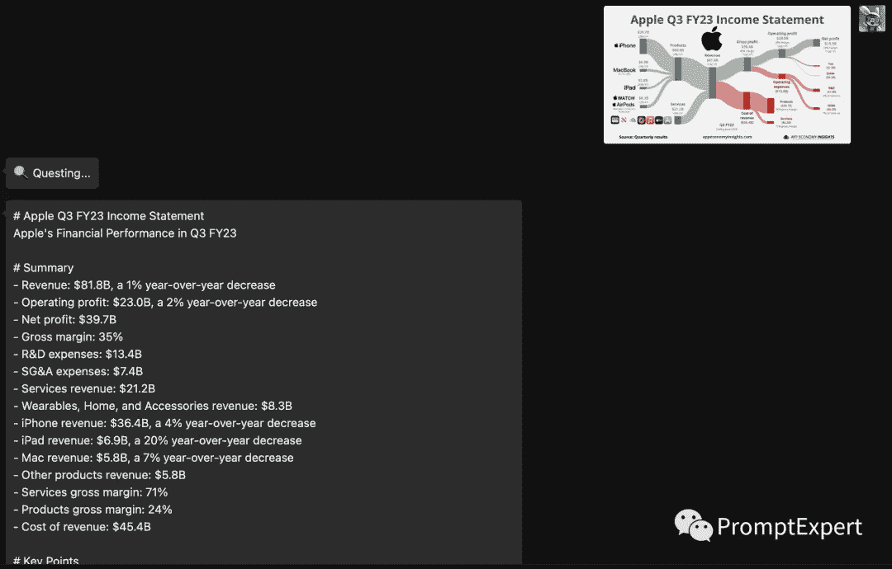
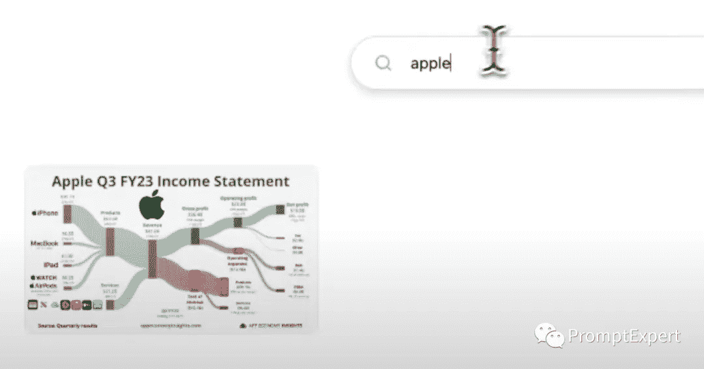
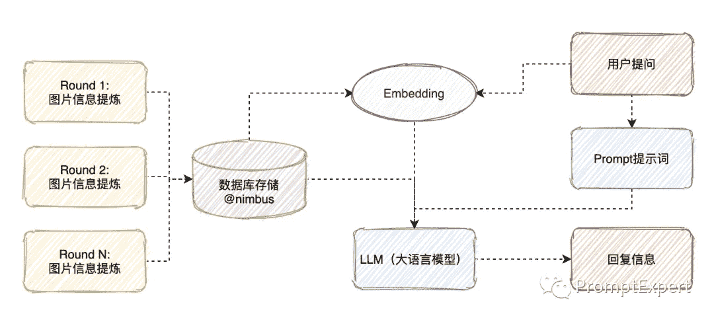

# （图片）对标Trickle的Prompt组合解决方案了解一下吗？Trickle-On-WeChat！

> 来源：[https://agispace.feishu.cn/docx/R6jido12Qo2xiDxA7rScAmSDnfb](https://agispace.feishu.cn/docx/R6jido12Qo2xiDxA7rScAmSDnfb)

> 原创：抄就完了

> 原文：https://mp.weixin.qq.com/s/Q9ubSQHhEgpn2Yf6ndoi5w

## **导读**

> 前几天看到了一款叫做“Trickle”的工具，它主要是解决了碎片化信息场景下图片整理与快速检索的难题。

> 看到这个产品当时，我拍案叫绝，我认为这是Prompt提示词在实际应用场景下一个很巧妙的切入点。当即我便手搓代码，复刻了一个基于微信场景且功能还原度较高的MVP（最小可行产品）应用。

> 下面我将会围绕产品功能实现的角度去分享一下自己的实现思路，整个方案是通过Prompt + LLM + OCR + Insight + Web Server的能力，欢迎大家共同探讨。

> 👀 在本文末，我分享了可以在线体验的二维码。同时我也将自己的MVP项目开源在Github上，欢迎 STAR ⭐。

## **Trickle简介**

Trickle是由 GPT 4 驱动的截图管理工具，可以将你的截图转化为视觉备忘录，不仅能识别你截图里面的内容，还能帮你提取然后整理。

同时，Trickle支持各种截图、图片类型的识别，无论是图表、财报、网页UX原型、邮件截图等都能轻松应对。最重要的是，你还可以根据图片中提取的内容直接进行对话。

（具体功能请看视频演示介绍 👇 ）

银海inhai

，赞 12

## **功能说明**

看完视频后，感觉这款产品特别有意思。当即便到官网（https://www.trickle.so/）去看具体的介绍和相关参数信息，在主页中我也找到了这个产品的价值说明：

其中令我困惑不解的是：“从屏幕截图中提取见解”、“识别并突出图表中的重要信息”这两条与“识别风景或狗的照片等”、“使用传统OCR提取纯文本”似乎有点矛盾？

我理解的是：它是不是想要强调Trickle这个产品虽然是也有用了OCR（光学字符识别），但是要比OCR能力强？并且不具备图像识别的能力？

正当我困惑不解，准备点击“Get Started Free”按钮进行深度体验的时候，好家伙！又进入了一个套路。

熟悉的界面有没有...必须要绑定上你的信用卡了才能给你7天的免费使用...这看着好点像那啥...🤔️

此外，如果按照月付的价格也确实是一笔不小的开支，需要10美金/月。

因此，我开始尝试分析产品功能复现的方案，在接下来，我会分享在个人理解范畴内，Trickle的视频中的每一个功能的实现原理。

## **方案设计**

本方案是基于微信机器人，通过对话的方式，实现了类似Trickle的功能。

为什么选择微信？验证MVP时，在微信上进行对话，交互页面不需要花费过多时间，并且微信端的大多数场景已经将Trickle的很多功能已经集成，如：文字检索、图片发送、信息存储等等。

此外，微信允许用户轻松地分享信息和内容，用户可以在他们熟悉的平台上提供服务，减少了用户学习新应用的障碍，这对于推广和传播AI机器人提供的服务和功能非常有利。用户可以分享有趣的机器人生成的内容，从而快速验证用户对待这个MVP应用的看法。

下面我将整个方案分成4个小角度进行展开讨论：

+   信息数据

+   图像识别&信息总结

+   图片信息检索

+   图片问答

### **信息数据流**

用户和微信机器人之间的信息流交互，主要围绕着发送图片信息、服务端识别、提炼信息返回、信息检索查询这几个核心场景，实现微信机器人调用服务端的能力，去实现自动解析图片格式信息、自动图片识别和文字信息提取服务、自动调用语言模型对话接口（预制Prompt提示词模型）、自动回复信息等能力。

（微信下信息数据流设计说明）

### **🌟 图像识别&信息总结**

（图像识别&信息总结设计说明）

### 图像信息整合+提炼Prompt提示词

下面这段Prompt是我在代码工程中使用的。它简单实现了将OCR文本信息与图片识别信息的关联整合，并按照信息分类分析方法去做整理任务，最终按照我指定的格式进行输出，为了关键词检索方便，我还为输出内容增加了标签分类。

这里要提一下，为什么我这么推荐LangGPT的写法，却在自己的代码工程中的Prompt不再使用LangGPT框架的Markdown格式？

坦诚来说，我确实很喜欢LangGPT的Markdown格式，对于界面段交互来说，是DIY友好型，可以自定义增加各种元素，它可以更注重输出结果即可。

但对于工程来说，成本消耗和输出结果需要有一个平衡。LangGPT整体篇幅相对较长，工程中希望通过精炼的关键词达到同样的效果，此外对于代码工程的Token计算来说，在用户基数和请求次数特别庞大的情况下，每节省一次请求的Token总体来看就节省了一大笔费用。对Token优化感兴趣的朋友我们可以在后续一起讨论一下：如何做到Less Is More的Prompt结构化减法。

当然，下面的Prompt提示词也只是简单实现了初步预期功能，也需要不断的迭代。

# 你会将图片通过OCR后的文本信息整合总结，请一步一步思考，你会挖掘不同单词和信息之间的联系， 你会用各种信息分析方法（如：统计、聚类...等）完成信息整理任务，翻译成中文回复。 输出格式： " 标题   {填充信息：通过一句话概括成标题，不超过15字}                概要   {填充信息：通过一句话描述整体内容，不超过30字}                {填充信息：分点显示，整合信息后总结，最多不超过8点，每条信息不超过20字，保留关键值，如人名、地名...}                标签   {填充信息：为该信息3-5个分类标签，例如：#科学、#艺术、#文学、#科技} "

（Trickle图片信息提炼效果图）

（Trickle-on-wechat图片信息提炼效果图）

### **图片信息检索**

通过关键字检索，可以找到对应图片、已总结提炼的文本信息。

（Trickle信息检索效果图）

基于微信生态，我们仅需在聊天记录中进行关键词检索即可，它已经将我们的对话信息进行本地、云端存储，您仅需点击“定位到聊天位置”即可查看到对应的图片信息。

此外，在手机端也可以直接通过搜索关键词检索图片中的文字信息，也相当方便。

（Trickle-on-wechat信息检索效果图）

### **图片问答**

通过对话提问的方式，检索所有图片总结后的文本信息中的数据信息。

（Trickle效果图）

（Trickle-on-wechat实现原理）

在此处仅作如果要实现对话类的信息检索的一个简要思路参考，本质上是通过结合向量数据库和Langchain的结合，去做知识库检索的能力。当然，也可以直接使用针对用户提问进行语义切分，在针对数据库进模糊查询也是一种在轻量化场景下还可行的方案。

由于某些原因在此不做具体对话类功能实现，我也并不建议基于微信场景做此功能。

## **体验&开源**