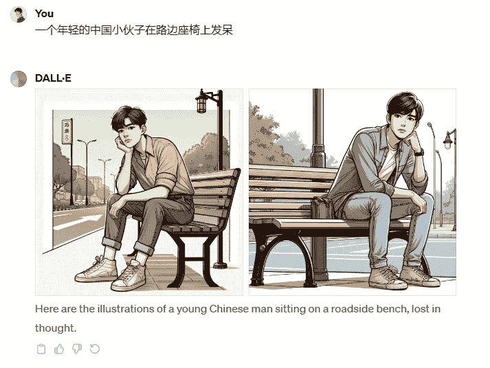
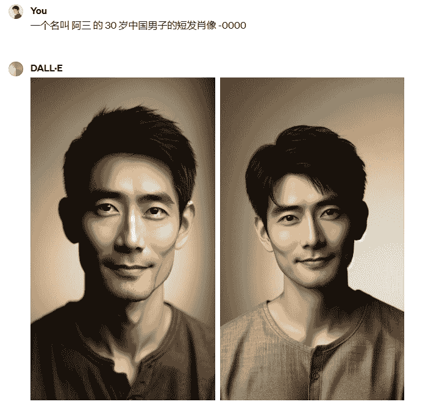
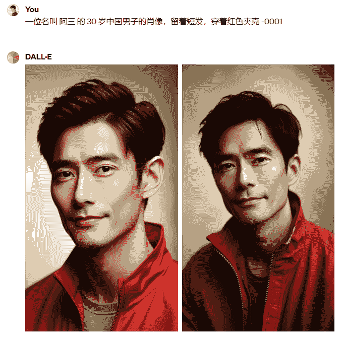
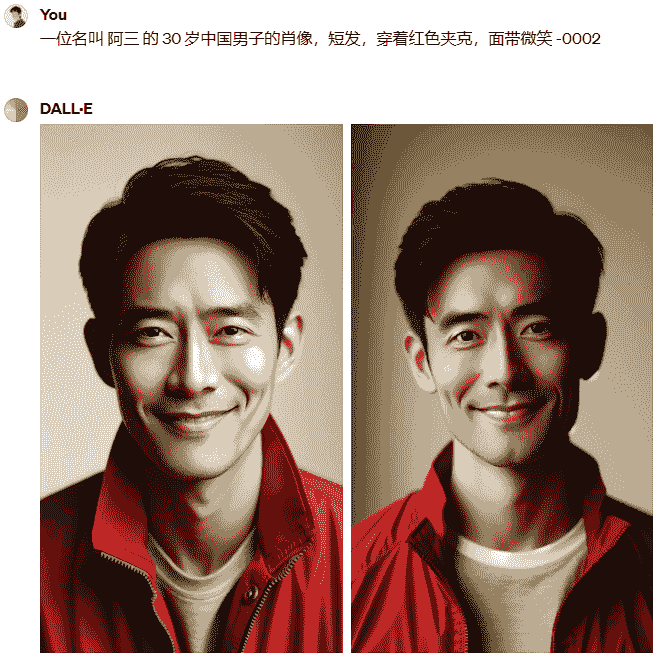
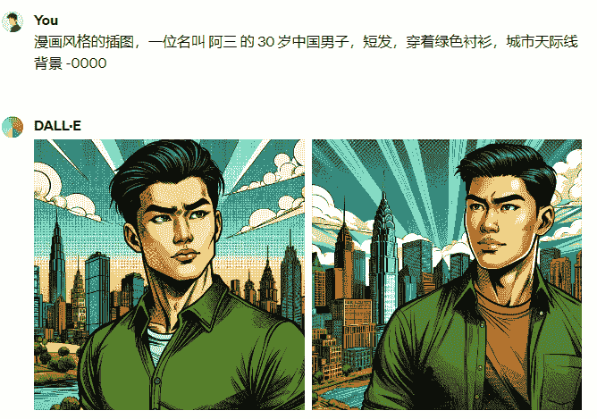
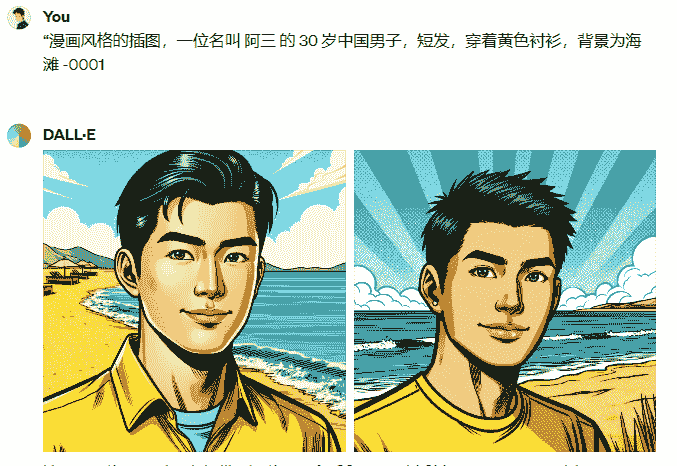
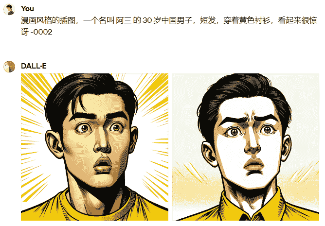
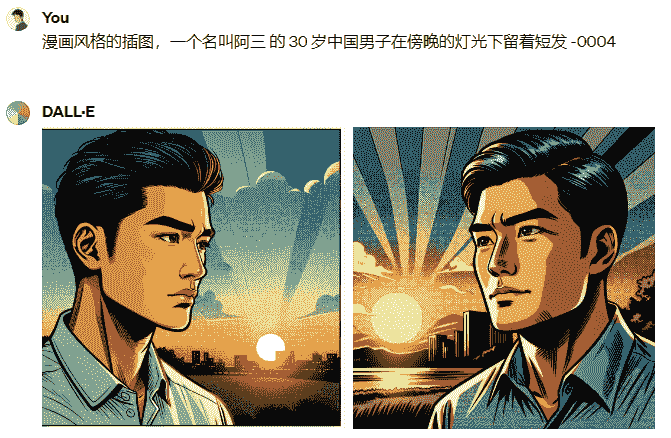

# （AI 绘画）AI绘画：使用 DALL-E 3 制作一致性角色图像的详细指南

> 来源：[https://agispace.feishu.cn/docx/ZZe9dRpv4oszPIxIzwGcZ0IVnqh](https://agispace.feishu.cn/docx/ZZe9dRpv4oszPIxIzwGcZ0IVnqh)

> 原创：AI 洞察笔记

> 原文：https://mp.weixin.qq.com/s/a6kSnEyLPh8EhbQLLKfdEg

AI绘画模型/平台里面的另一个翘楚，则是OpenAI的DALL-E 3，与ChatGPT师出同门。

但是要创建一致性角色的图像一直是一个痛点，什么意思呢？就是你用同样的提示词，很难创建出2张不同图像，但是又是同一个人的形象。

今天要分享的就是怎么去解决这个问题。

**1、确定基本提示词：**

首先简单明了地描述你想要绘制什么什么样的图像。

基本提示示例：“一位名叫 阿三 的 30 岁中国男子的短发肖像。”基本提示示例：“一位名叫阿三 的 30 岁中国男子的短发漫画风格插图。”

**2、分配唯一编号：**每个提示都应以一个数字结尾，该数字从基数开始（例如，-0000），并针对每个变体逐渐增加。

此编号充当图像的唯一标识符或种子。如果未提供数字，可使用 -0000 作为起始种子编号。

3、用于未来图像生成的通用提示格式：使用以下公式在基本提示的基础上构建：第一张图片：[基本提示] + [其他详细信息/变体信息] -开始编号

第二张图片：[基本提示] + [其他详细信息/变体信息] -开始编号+1

第N张图片：[基本提示] + [其他详细信息/变体信息] -开始编号+n

# **案例分享**

##

**

写实风格**：创建阿三的图像

提示：“一个名叫 阿三 的 30 岁中国男子的短发肖像 -0000”

**下一个指令：**让阿三穿上红色夹克

提示：“一位名叫 阿三 的 30 岁中国男子的肖像，留着短发，穿着红色夹克 -0001”

**下一个指令：**让阿三微笑

# **漫画风格：**

**第一个指令：**阿三穿绿色衬衫，城市景观

提示：“漫画风格的插图，一位名叫 阿三 的 30 岁中国男子，短发，穿着绿色衬衫，城市天际线背景 -0000”

**下一个指令：**阿三与黄色衬衫和海滩背景

提示：“漫画风格的插图，一位名叫 阿三 的 30 岁中国男子，短发，穿着黄色衬衫，背景为海滩 -0001”

**下一个指令：**阿三看起来很惊讶

提示：漫画风格的插图，一个名叫 阿三 的 30 岁中国男子，短发，穿着黄色衬衫，看起来很惊讶 -0002

**下一个指令：傍晚灯光下的阿三**提示：“漫画风格的插图，一个名叫阿三 的 30 岁中国男子在傍晚的灯光下留着短发 -0004”

以上分享，你学会了吗？欢迎转发、分享。