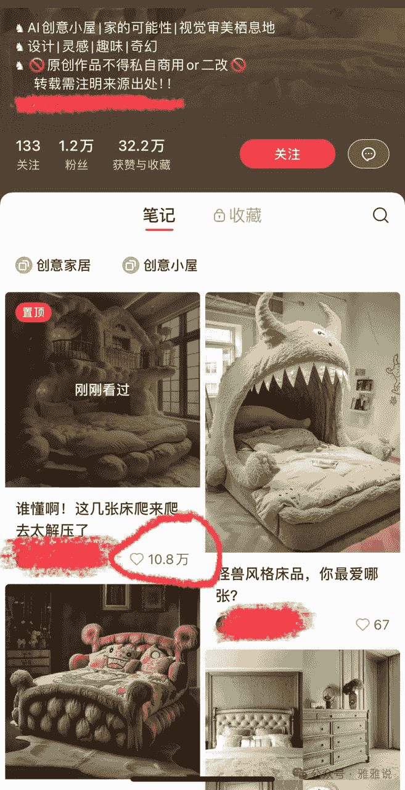
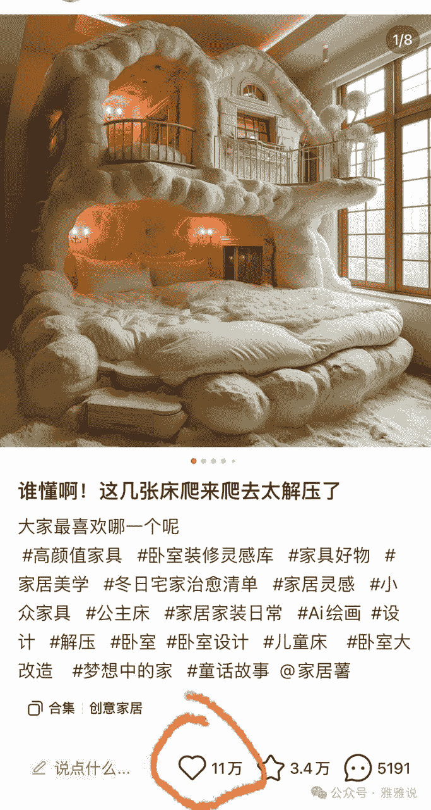

# 用AI做创意家居，流量大，制作简单，轻松过万粉

> 来源：[https://agispace.feishu.cn/docx/ArUyd1amIofTH7xyX0VcL0rOnwh](https://agispace.feishu.cn/docx/ArUyd1amIofTH7xyX0VcL0rOnwh)

> 作者：雅雅说

> 👸号：雅雅说

> 原文链接：https://mp.weixin.qq.com/s/8hJtdmAg7v0H_txkt9IkMw

# **01**

**雅雅叨叨叨**

大家好，我是雅雅，一个还在为理想和兴趣而不断学习成长，拥有两台豪华碎钞机的“中年少女”

突然发现，今天居然是520，不知道你们还过节吗？

反正我已经很久不过任何这类节日了，年纪大了。。。

不过还是遥祝小伙伴们今天开开心心。

虽然今天对我来说就是个普通的工作日吧，不知道你们有多少人跟我一样哈。

但是呢，今天这篇呢，还是来应一下景，画一个女生都喜欢的梦幻家居吧。

我相信每个女生都有一个七彩家居梦，对好看的家居照片天然没有抵抗力。

可能因为女孩从小一路各种玩过家家，另外就是幻想自己住在公主城堡里吧。

哈，这类内容也是特别吸女粉的。

不过喜欢归喜欢，大家千万不要恋爱脑哟，那样的话就没救了。要知道，搞钱脑——需要理性！

# **02**

**项目介绍**

今天给大家介绍的这个账号就是用AI来做创意家居的账号，各种好看的高低床，美美的图片太吸引眼球了。这类账号，制作简单流量大，轻松上万粉。

我们先看一下对标账号的画风。点赞最高的这个已经达到11W了。而且是纯纯的图片账号，没做任何剪辑加工！直接上传A图片，毫无难度。

如果你也对好看的家居感兴趣，现在在AI的加持下，终于也可以体验一把自己做家具设计师了。如果运气好，不小心火了，兴许能小赚一波呢！

**这类**账号的变现方式包括：

接广告，收徒卖课程，定制服务，产品实物变现等。03

**实操经验**

这类账号的制作是非常简单的。只要用AI不断创意出图就可以了。

我们开始不熟练的时候，可以根据对标账号的图片，反推提示词（具体方法可以看我之前的《最近火出圈的AI黏土特效，MJ制作方法来啦！）

具体步骤如下：

第一步，打开工具，使用MJ的反推的提示词功能，得到参考提示词。

第二步、根据自己要画的内容，在此基础上，对参考提示词做适当的调整，

第三步、用整合的新提示词，就可以源源不断的创意出图了。

大家可以看下我实操的效果。

详细的提示词，我放在文末了。大家自取。

另外，绘画工具我用的是国产的镜像MJ绘图工具。具体介绍也放文末了，现在加入永久会员，备注【雅雅说】，限时返现200，折合298元永久会员，在国内无限量使用GPT-4,MJ等热门工具！相当划算！喜欢的小伙伴不要错过哈！

# **04 技术总结**

👸号后台领取AI家居绘画提示词

1：本文末尾点亮“在看” 或 点“赞”   2：关注本👸号，聊天对话发送：家居

