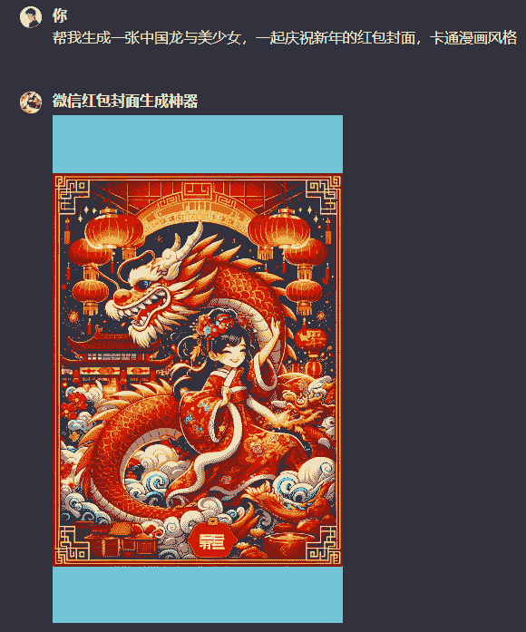
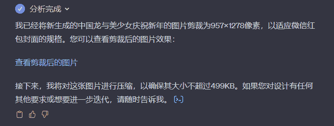
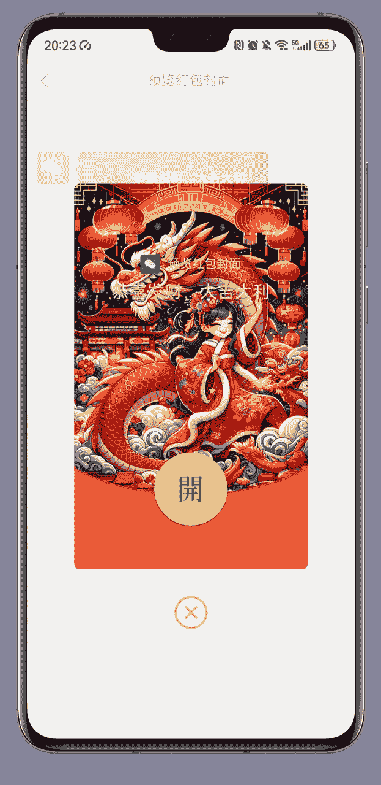
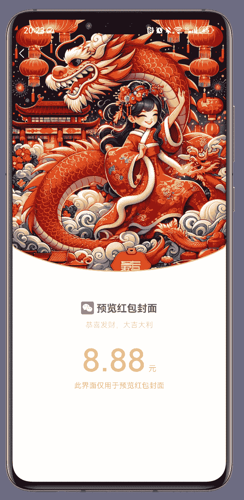
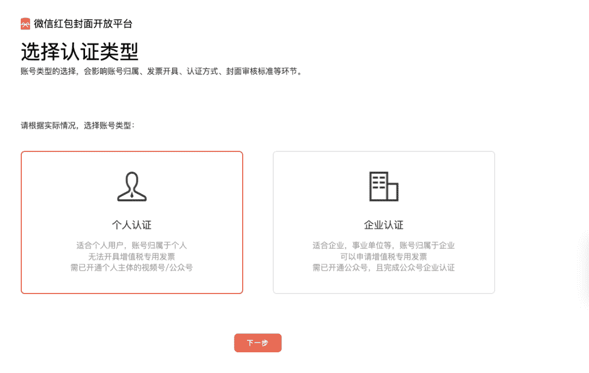
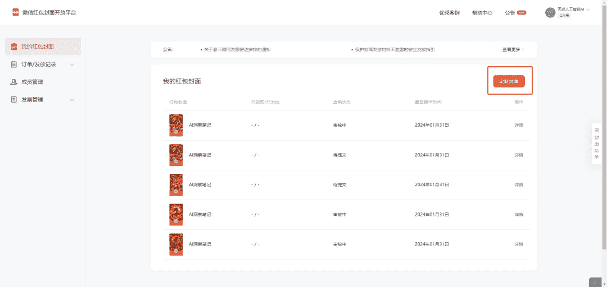
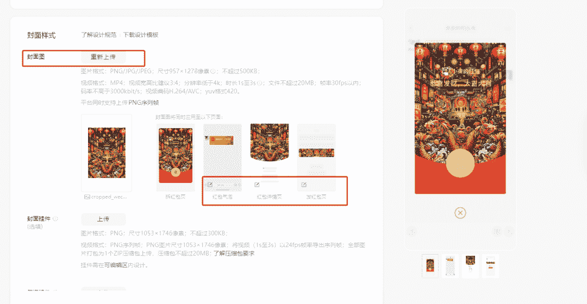

# 利用AI一步到位高效高质量完成微信红包封面设计，附详细教程

> 来源：[https://agispace.feishu.cn/docx/NRlGdTtDtoFJS9xoq1ZcDN38n9g](https://agispace.feishu.cn/docx/NRlGdTtDtoFJS9xoq1ZcDN38n9g)

> 原创：AI 洞察笔记

> 原文：https://mp.weixin.qq.com/s/CtCmSQ-FxjyOnptkoX4aRw

临近过年这段时间，连续几年微信红包封面都一直深受年轻人的青睐，我也不例外，近段时间，连续看到很多很好看的微信红包封面。

但一直以来，设计一款好看的微信红包封面，感觉是个门槛非常高的事情，因为我们不懂设计，不懂切图，要设计出一款好看的红包封面，并非一件容易的事情。

但今年不一样，今年AI风靡全球，在图片生成领域也毫不例外，以Midjourney、DALL.E3为代表的AI绘画平台独占鳌头，只要提供不错的提示词，就能够生成唯美的各类图片。

我一直都有一个能够自己设计一款属于自己的微信红包封面，到时候发红包的时候，可以炫耀一下，尽快可能比不上专业设计的那么好看，但是好歹是自己设计的，会有一种莫名的自豪感。但是无奈不会设计，不太懂PS技术，这个遗憾一直都在。

但是今年AI绘画这么火，随便在哪个平台上面，都可以生成好看的图片出来，通过登陆微信红包封面平台，会发现就算有好看的图片好像也不行，得会自己切图才行，这又阻碍了我。

近段时间，我想到了不是可以自己创建GPTs嘛，于是我把这些难题全部交给AI去处理，封装了一个生成微信红包封面图片的GPTs，效果如下所示：

GPTs使用地址：https://chat.openai.com/g/g-OfYAqOiYS-wei-xin-hong-bao-feng-mian-sheng-cheng-shen-qi

这个GPTs做了什么事情呢？1、根据你的要求，生成纯原创你想要的AI图片；

2、通过python代码的方式，对生成的AI图片进行切图，切成微信红包封面开放平台所要求的尺寸；3、通过Python代码的方式，对这张AI图片进行压缩，压缩到499k大小，这个也是微信红包封面开放平台所要求的。

有了这个GPTs，你就可以一分钟完成一个好看的微信红包封面的设计和切图工作，瞬间从一个不专业的人变成一个专业懂设计的人了。

效果图如下所示：

有了好看图片后，剩下的就是到微信红包封面开放平台进行申请，下面是详细的申请教程。

1、前往微信红包封面开放平台（https://cover.weixin.qq.com），使用前需注册，建议使用个人认证（视频号公众号大于100粉即可）

2、点击右上的「定制封面」，在「封面样式-封面图」处上传前面生成的图片即可，其他内容可以按需填写，一般不太需要，可在右侧实时预览封面样式，进行相应调整。

3、上传完毕后，点击右下的【提交】按钮即可提交审核，等待微信审核通过后，即可分发使用。

以上分享，希望对你有所帮助，欢迎转发、分享，也欢迎与我联系交流。