# 3秒修复老照片！GitHub上超火的镜像教你一键实现！

> 来源：[https://agispace.feishu.cn/docx/LiZddJNeroXXo4xfwIYcSV2Snkd](https://agispace.feishu.cn/docx/LiZddJNeroXXo4xfwIYcSV2Snkd)

> 作者：卡尔

> 👸号： 卡尔的AI沃茨

> 原文链接：https://mp.weixin.qq.com/s/hmFzjaVpBttIn9PEqojDrA

你有没有一些年代久远的老照片，或是网络下载的图片和视频，低分辨率、模糊还有噪点，如果能**一键修复成高清就好了**！今天推荐一个好用的云平台，现在在AI算法工程师圈子里很火的GpuMall智算云，上面的镜像可以一键帮你修复照片！比如我们用Real-ESRGAN镜像尝试修复了1838年法国人路易·达盖尔拍摄于巴黎的这张老照片,优化后的照片明显更清晰了！（后面有具体的操作教程哦~）

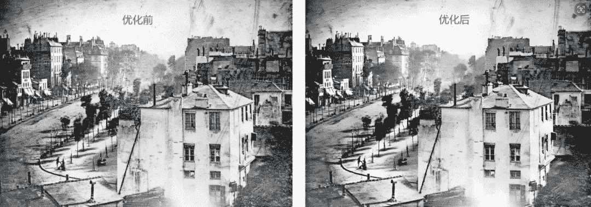

除了可以一键体验Real-ESRGANS等丰富的镜像资源，亮点颇多的GpuMall智算云还有以下几大优势：

1.  灵活适配，性能稳定。GpuMall智算云提供RTX 4090、3090、A800等海量GPU资源，支持社区云与高可用云两种云服务，灵活适配多种业务需求。

1.  数据同步，永久保存。GpuMall智算云支持系统盘、数据盘、网盘等多种数据存储方案，且存储速度快，任务执行效率高。

1.  资源丰富，高效算力。平台支持根据机器特性对机型进行筛选，同时GpuMall数据盘扩容范围最大可达到5T-6T左右。另外拥有Real-ESRGAN、Meta LIama3等优质AI模型、热门镜像免费在线体验。

1.  价格划算，高性价比。通过GpuMall可以以最低成本获得高性能计算服务，费用低，关机**不付费，还支持包年包月或按**量计费的灵活计价模式。尤其是网盘存储的价格超级香，只有0.0001元/GB/时！

下面！附上保姆级Real-ESRGAN操作指南，让小白也可以轻松上手！

## Real-ESRGAN 操作指南

**1.创建实例**

登入GpuMall，点击高可用云，使用 “社区镜像”“Real-ESRGAN-v0.2.5.0” 创建GPU实例

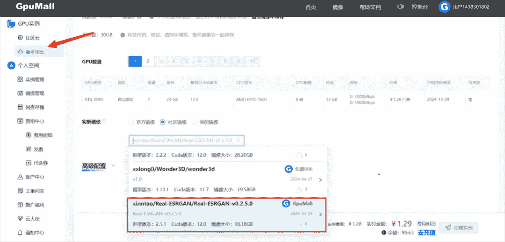

**2.上传图片/视频**

①　点击Jupyter进入web控制台

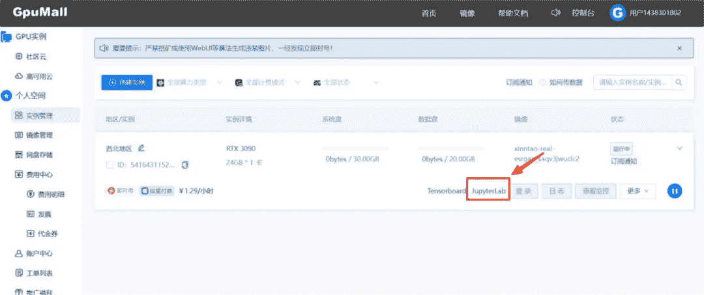

②　点击“终端”进入命令

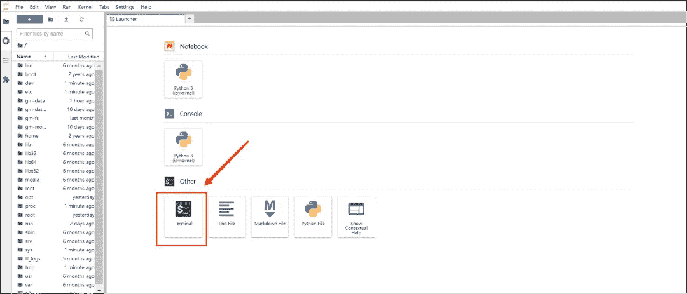

③　点击左侧目录，根据文件形式进入指定路径

-上传图片，进入/opt/Re-2.5.0/Real-ESRGAN/inputs

-上传视频，进入 /opt/Re-2.5.0/Real-ESRGAN/inputs/video

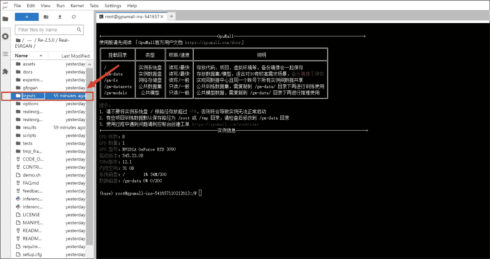

④　点击此处上传按钮选择本地文件上传

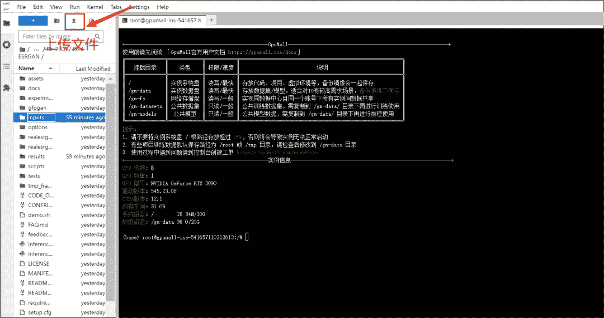

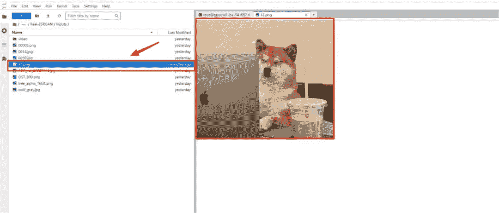

**3.执行快速推理**

①　点击“终端”进入命令行，执行以下命令，以推理动漫图像为例

# **命令：推断一般图像**

# **“**

> cd /opt/Re-2.5.0/Real-ESRGAN && python inference_realesrgan.py -n RealESRGAN_x4plus -i inputs --face_enhance

# **命令：推理动漫图像**

# **“**

> cd /opt/Re-2.5.0/Real-ESRGAN && python inference_realesrgan.py -n RealESRGAN_x4plus_anime_6B -i inputs

# **命令：推理动漫视频**

# **“**

> cd /opt/Re-2.5.0/Real-ESRGAN && python inference_realesrgan_video.py -i inputs/video/onepiece_demo.mp4 -n realesr-animevideov3 -s 2 --suffix outx2

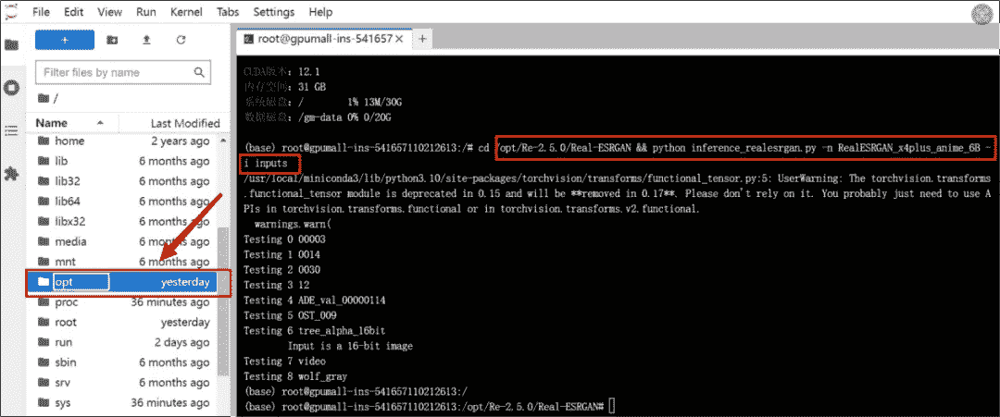

②　执行命令完成推理后，点击左侧目录”/opt/Re-2.5.0/Real-ESRGAN/results”查看结果

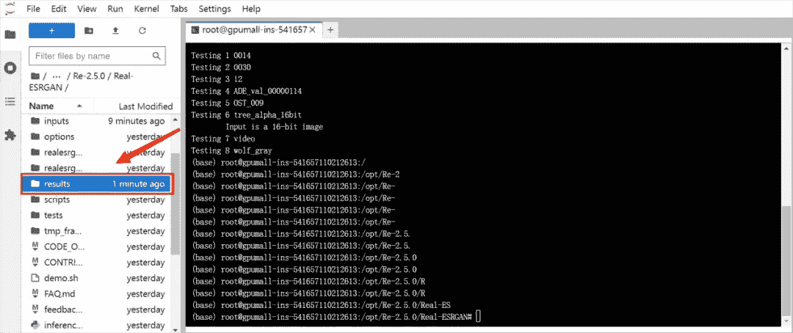

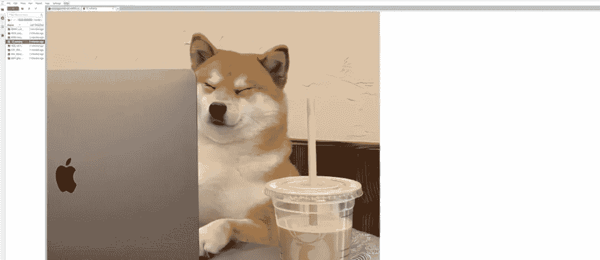

③　双击左侧目录对应图片可打开预览，右击可直接下载到本地

# **“**

> 视频不支持预览，需下载到本地播放

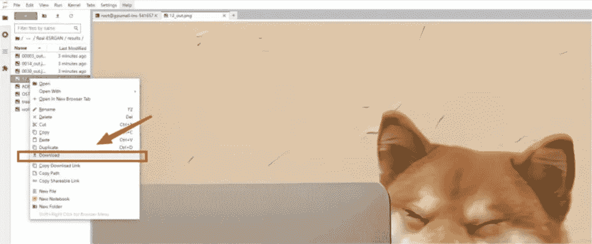

**案例效果：**

左侧为优化图，右侧为原图

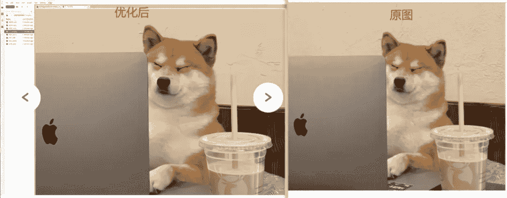

左侧为原视频-尺寸640 * 480， 右侧为优化视频-尺寸1280 * 960

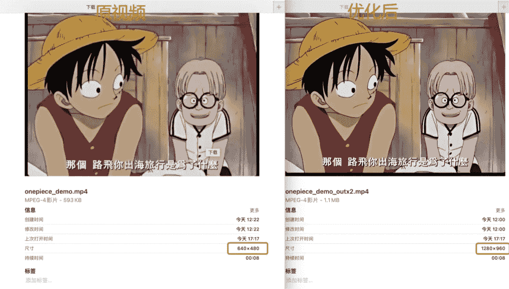

**如果大家**也想和我一起动手放大自己的童年回忆的话！点击阅读原文或搜索gpumall.com输入邀请码：A540372069进入注册入口，领取专属新人券，这次我问官方要了很多优惠，来一键开启你的神奇镜像体验之旅吧

+   **【🛰️认证】**完成🛰️认证，获得15元无门槛代金券

+   **【学生认证】**完成学生认证，获得10元无门槛代金券+ 立享95折会员权益

+   **【实例奖励】**首次实例完成得10元无门槛代金券

+   **【额外加赠】**通过点击**阅读原文**链接或通过我的邀请码注册，额外加赠10元代金券

扫码进群，进群即得15元专属代金券