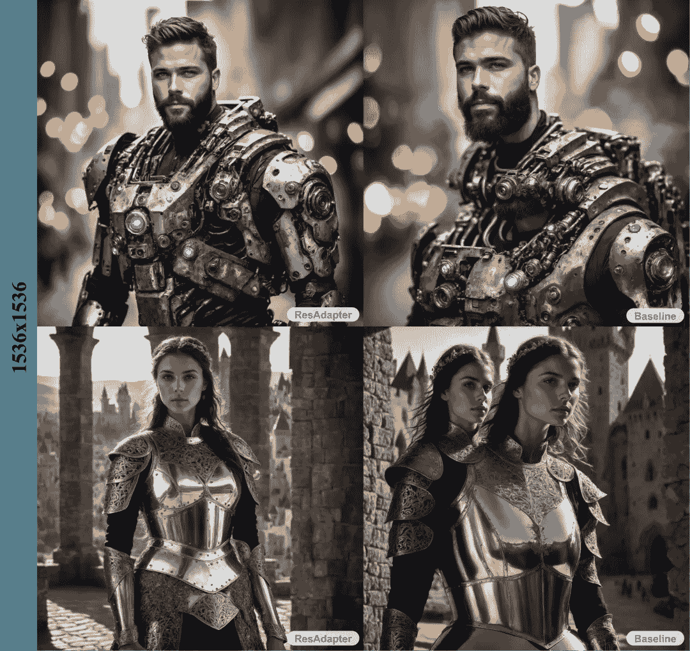

#  （图片）字节跳动 ResAdapter：告别分辨率限制，让AI图像创作更自由。

> 来源：[https://agispace.feishu.cn/docx/RazfdtE6foNIWVxu0F5ckgjxnqb](https://agispace.feishu.cn/docx/RazfdtE6foNIWVxu0F5ckgjxnqb)

> 原创：黔岭苗七哥

> 原文：https://mp.weixin.qq.com/s/FgahYAtN7qK8U6OjGVjLHA

在人工智能的浪潮中，图像生成技术正变得越来越成熟，不仅在艺术创作中大放异彩，也在娱乐、设计、教育等多**个领域展现出其独特的**价值**。今天，我要介绍的是字节跳****动公**司最新研发的图像生成技术：ResAdapter，这是一种专为扩散模型设计的分辨率适配器，能够突破传统模型在分辨率生成上的局限，为图像生成领域带来革命性的变革。什么是ResAdapter()ResAdapter，全称为Resolution Adapter，是一种插件式适配器，它能够使扩散模型生成任意分辨率和宽高比()的图像，同时保持原有的风格域。这项技术的核心在于两个创新点：分辨率插值和分辨率外推。分辨率插值指的是生成低于训练分辨率的图像，而分辨率外推则是生成高于训练分辨率的图像。

**ResAdapter的工作原理**ResAdapter通过两种主要方法来实现其功能：ResCLoRA和ResENorm。ResCLoRA是一种分辨率卷积LoRA，它能够动态匹配卷积的感受野和图像的特征**图大小。而ResE**Norm，即分辨率外推归一化，则是用来减少在分辨率外推时，LoRA和全微调之间性能差距的技术。此外，ResAda**pter采用了**多分辨率训练策略，使其能够同时学习不同分辨率的图像生成。实验结果与应用前景在实验中，ResAdapter展现了其卓越的性能。与传统的多分辨率图像生成模型相比，ResAdapter在图像质量上有着显著的提升，同时在推理时间上也更加高效。此外，ResAdapter还显示出与其他模块如ControlNet()、IP-Adapter和LCM-LoRA的兼容性，这表明它可以轻松集成到现有的图像生成流程中，为开发者和用户提供更大的灵活性和创作空间。未来展望与局限尽管ResAdapter在图像生成领域展现出巨大潜力，但技术仍有局限。例如，在处理一些通用提示输入到个性化扩散模型时，可能会出现性能不佳的情况。未来的工作可能会集中在通过大型语言模型来优化用户提示，以及探索超分辨率模型来加速高分辨率图像的生成过程。ResAdapter的推出，不仅为图像生成技术的发展提供了新的可能性，也为AI领域的研究者和爱好者带来了新的启示。随着技术的不断进步和优化，相信，ResAdapter将在未来的图像生成任务中扮演更加重要的角色，为人们带来更加丰富和精细的视觉体验。项目链接：https://github.com/bytedance/res-adapter