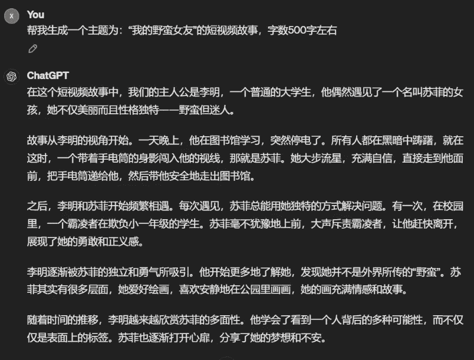
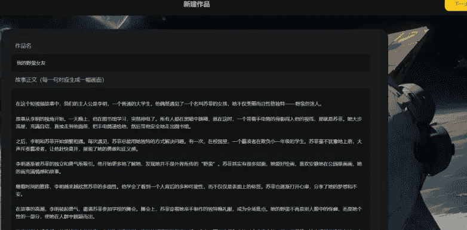
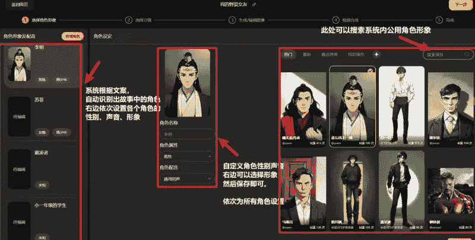

# （视频）AI长视频工具火了！最长6分钟！附教程

> 来源：[https://agispace.feishu.cn/docx/DcXCdnyPUoJce4xqgv7cVA0Ens7](https://agispace.feishu.cn/docx/DcXCdnyPUoJce4xqgv7cVA0Ens7)

> 原创：AI生活研究所

> 原文：https://mp.weixin.qq.com/s/e1TOHSY8xHfuIW8kWBhKlA

你以为的AI视频，只能生成4秒？

NO，今天要给大家分享一款,不一样的AI视频生成工具

**最长可生成6分钟视频**

它借助AI，构建了一个长视频生成工作流。

从文生图，图生成视频，再到配音、后期剪辑等，一站式完成从故事文案到视频生成的全流程。

可以将2000字以内的文案，生成一个完整的原创IP故事视频。

+   允许用户自定义个性化的IP形象。

+   确保多个IP角色形象的一致性。

+   提供多种风格选择，包括动漫、写实以及迪士尼风格等。

+   提供分镜头模板，用户可以控制构图。

目前，该工具正在进行全网公测，用户可以无限制地免费使用。

可以通过以下网址进行体验

https://brmgo.com/signup?code=kakarfrfy

**下面是详细的使用教程**

1.  **故事创作**

可以使用chatgpt或国内类似工具如豆包、kimichat等生成故事文本，然后进行适当的修改和润色。

在官网上点击“开始创作”，并将故事文本粘贴到相应的位置，为作品命名后，点击“下一步”。

1.  **选择风格**

根据您的喜好选择动漫或现实风格。这里我选择了日式可爱风格，然后点击“创建作品”。

1.  **角色设置**

系统会根据故事文本自动确定所有角色，并允许您为每个角色设置性别、声音和外观。

如果您想要一个角色库中没有的特定角色，比如您自己的形象，可以点击“我的演员”旁边的“+”号，上传几张照片即可创建一个专属的角色形象。

1.  **AI生成草图分镜**

AI会根据文本自动生成所有分镜头草图，您可以单独选择每张草图，调整文本、视频中的人物角色和构图等元素。

1.  **根据分镜成图**：

确认分镜头草图无误后，点击“生成”以创建具体的分镜图片。

如果需要动态效果，点击“一键转动态”；若对细节不满意，可以点击“编辑图片”进行修改；若对某个分镜头不满意，可以点击右侧的“重新生成”。

1.  **最终视频生成**：

一切就绪后，点击右上角的“生成视频”，大约2分钟，您就可以观看到最终的视频成品了。

，时长02:02

以上步骤仅用于展示，如何使用该工具，但要创作出高质量的内容，还是需要亲自动手，细致地打磨文案和制作流程。

如果您有兴趣制作这类故事视频，不妨亲自尝试。