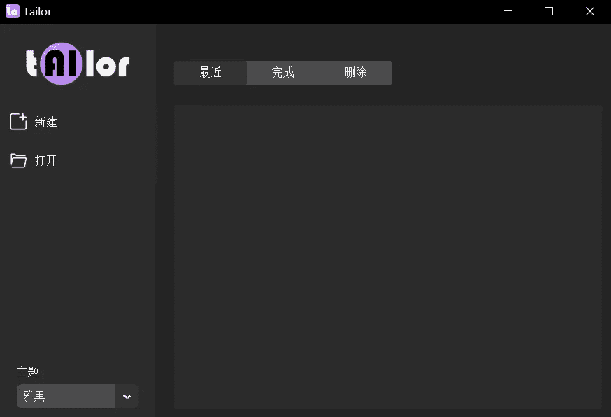

# Tailor：开源的视频编辑神器，让视频剪辑变得简单。

> 来源：[https://agispace.feishu.cn/docx/KB0xdKEZvorVLwxu0UCc8c8FnWb](https://agispace.feishu.cn/docx/KB0xdKEZvorVLwxu0UCc8c8FnWb)

> 原创：苗七哥

> 原文链接：https://mp.weixin.qq.com/s/zfWPsIFgKMs8ZjcpcLMWmw

在这个视觉为王的时代，视频已成为我们表达自我、分享故事的重要媒介。但你是否曾因视频编辑**的复杂性而望**而却步？今天，我要给大家介绍一款能够颠覆你视频编辑体验的开源项目——Tailor。

### **Tailor：视频编辑利器**

Tailor是一款集视频剪辑、生成和优化于一体的智能工具。它利用最新的人工智能技术，简化了视频编辑的流程，让每个人都能成为视频编辑的大师。

#### 视频剪辑：精准捕捉，一键裁剪

**人脸剪辑**：Tailor的人脸识别技术能自动捕捉视频中的人脸瞬间，无论是家庭聚会的欢笑，还**是孩子成**长的每一个瞬间，Tailor都能帮你精准捕捉并裁剪，让你的视频更加生动。语音剪辑：Tailor的语音识别功能，能够清晰地展示视频中的语音内容。无论是重要的演讲，还是朋友间的对话，Tailor都能根据你的需求，精准裁剪出你想要的语音片段。

#### **视频生成：创意无限，一键实现**

**口播生成**：只需上传一张人脸图像，选择语音音色，输入内容，Tailor就能为你生成一个有声视**频。无论**是**制作教学**视**频，还是**制作个性化的问候视频，Tailor都能助你**一臂之力**。字幕生成：Tailor的字幕生成功能，能够智能识别音视频内容并转化为文字。多种字体和颜色选择，让字幕与视频完美同步，提升视频的易懂性和吸引力。色彩生成：Tailor的一键式黑白视频上色功能，能够让你的老视频焕发新光彩。无论是黑白电影，还是旧时的家庭录像，Tailor都能让它们重新焕发生机。音频生成：将静态图和文字转化为生动的视频，Tailor的音频生成功能，让你的创意无限延伸。语言更换：Tailor的语言更换功能，能够将视频中的语音转换成不同语言，让你的视频跨越语言障碍，与全世界的观众进行交流。

#### 视频优化：提升品质，增强体验

**背景更换**：Tailor的背景更换功能，能够智能识别并分离前景人物与背景。无论是更换办公室背**景，还是将**背**景换成梦幻**的星空，Tailor都能轻松实现，让你的视频更加引人入胜。流畅度优化：Tailor采用先进技术提高视频的流畅度，让原本卡顿、跳帧的视频变得流畅丝滑，给观众带来极致的观看体验。清晰度优化：对于清晰度较低的视频，Tailor能进行清晰度的提升，让画面更加清晰锐利，细节尽显无疑。

Tailor不仅仅是一款视频编辑工具，它是创意与精彩的钥匙。无论你是专业的视频编辑者，还是视频编辑的初学者，Tailor都能为你提供强大的支持。

项目链接：https://github.com/FutureUniant/Tailor

> **如果对您有点帮助💡

> **记得点赞👍、收藏⭐、在看👀、分享📤

---

**推荐阅读:**

1.文字变画，就这么简单！腾讯混元DiT，免费开源等你来玩！

2.IC-Light ：照片光影不够美，别怕，AI技术，一键帮你搞定！

3.Viva AI：让视频和图像创作变得轻松自如，智象未来重磅推出。

4.字节跳动出新招，用PuLID轻松定制你的AI肖像画，想要啥风格都有。

5.[超越Notion与Miro？AFFi](http://mp.weixin.qq.com/s?__biz=Mzg3MTc1NDY3NA==&mid=2247494628&idx=1&sn=4545e9789221552710a0371bf5fa54f0&chksm=cefb1539f98c9c2ff0ac48c9df9e54f102fa20f0cf673e232fce68a91e5107e8f0f7453fbeb0&scene=21#wechat_redirect)NE：你的下一代知识管理库，开源、免费。

6.三个高质量的、免费的资源网站：免费AI图片与AI音乐资源，无需花钱。

7.[网页信息提取，就是这么简单！Crawl](http://mp.weixin.qq.com/s?__biz=Mzg3MTc1NDY3NA==&mid=2247494930&idx=1&sn=e4615a9d8013567d53841418fecae479&chksm=cefb13cff98c9ad9f9c7d31b162114624611c6a2a43c7f97bd4987cea61b849e64931fd2354f&scene=21#wechat_redirect)4AI智能爬取，你值得拥有！开源、免费。

8.[Idefics2：Hugging Face带你玩转多](http://mp.weixin.qq.com/s?__biz=Mzg3MTc1NDY3NA==&mid=2247495716&idx=1&sn=2238235def4d3ea695e7fc873b5cdb75&chksm=cefb0ef9f98c87ef1c990ed69c8b316b145c3701a290af69cfd56a6426b75dd78b557f9d51d6&scene=21#wechat_redirect)模态AI，文字、图片、音频、视频全搞定！