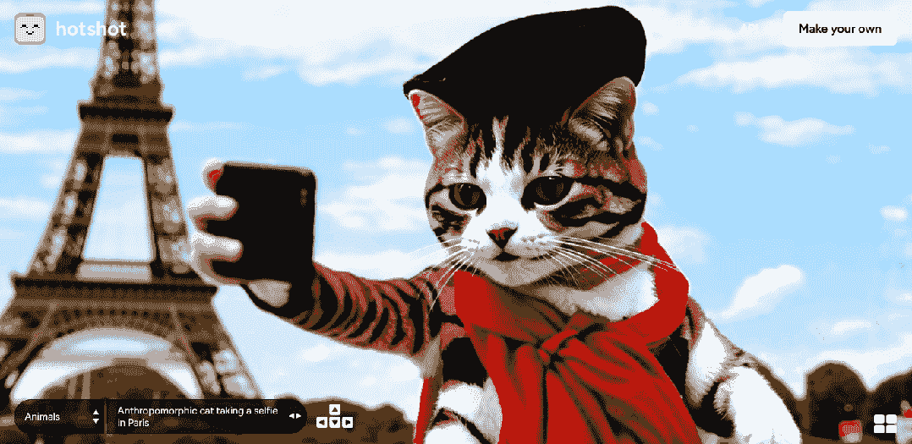

# Hotshot ：正在崛起的 AI 视频生成新势力，可生成高清的视频。目前可免费体验。

> 来源：[https://agispace.feishu.cn/docx/Ox61dG5tpoQpDrxC1OQcbltTnDh](https://agispace.feishu.cn/docx/Ox61dG5tpoQpDrxC1OQcbltTnDh)

> 原创：黔岭苗七哥

> 原文：https://mp.weixin.qq.com/s/45w_D7NnWF08nSSlB6MMTA

AIGC开源项目免费工具/软件

在**这个信息爆炸、****创意涌动的时代，人工智能**（AI）正以其前所未有的速度和广度，重塑着我们对内容创作的认知。Hotshot，这家由AI驱动的初创公司，以其创新性的文本到视频AI生成大模型，不仅为AI视频生成领域带来了新的活力，更为我们打开了一扇通往创意无限世界的大门。

#### Hotshot的诞生：从照片到视频的飞跃

Hotshot的故事始于一款AI照片编辑应用。然而，这家公司的野心远不止于此。Hotshot的AI视频生成模型在四个月内由四位工程师打造而成，这一成就本身就是对团队技术实力和创新精神的最好证明。他们处理了6亿个视频片段和无数GPU，这一过程中的挑战和困难可想而知。然而，正是这种对技术的执着追求，让Hotshot的AI视频生成模型得以问世。

#### **用户体验：免费试用，无水印限制**

Hotshot为用户提供了免费试用的机会，且生成的视频无水印限制。这一开放的姿态，不仅体现了Hotshot对自身技术的信心，也为广大创作者提供了一个自由发挥的平台。在这里，每个人都可以成为自己故事的导演，用AI的力量将创意变为现实。

#### 行业影响：AI视频生成的未来趋势

Hotshot的加入，预示着AI视频生成技术将成为未来内容创作的主流。随着技术的不断进步，未来的视频内容将更加个性化、多样化，且更具互动性。Hotshot的AI视频生成模型，正是这一趋势的先行者和推动者。

#### **创意无限：艺术风格的多样性**

Hotshot的AI视频生成器不仅能生成标准的视频内容，还能模仿多种艺术风格，从传统的漫画书动画到现代的转描技术，为创作者提供了广阔的创意空间。这种多样性，让每一个创意都能在Hotshot的平台上找到属于自己的表达方式。

#### 竞争与合作：AI视频生成领域的多元化

随着Hotshot等新玩家的加入，AI视频生成领域正变得更加多元化和竞争激烈。这种竞争不仅推动了技术的快速发展，也为用户带来了更多的选择和更好的体验。在这场创意革命中，每个人都可以是参与者，每个人都可以是变革者。

Hotshot的AI视频生成模型，不仅仅是一项技术的突破，更是对创意表达方式的一次革新。随着越来越多的创作者开始利用这项技术，我们将迎来一个全新的创意时代，一个每个人都能成为故事讲述者的时代。

体验链接：https://hotshot.co/

> **如果对您有点帮助💡

> **记得点赞👍、收藏⭐、在看👀、分享📤

---

**推荐阅读:**

1.Tailor：开源的视频编辑神器，让视频剪辑变得简单。

2.快手 LivePortrait：AI技术让静态肖像“活”起来，开源。

3.[浦语灵笔IXC-2.5：开源的多模态大模](http://mp.weixin.qq.com/s?__biz=Mzg3MTc1NDY3NA==&mid=2247499783&idx=1&sn=1226f44ec850c274aad242647a776cb5&chksm=cefb3edaf98cb7cc0ce50a6bda72a82694a5f4b6216444b480745f8ffbaa91e7214b0994fb6b&scene=21#wechat_redirect)型，[性能媲美OpenAI GPT-4V。4](http://mp.weixin.qq.com/s?__biz=Mzg3MTc1NDY3NA==&mid=2247499458&idx=1&sn=f2a35e5381709eeddb905935ec3556a1&chksm=cefb001ff98c8909e8dd7de837d6a6c6fcb79f22cb5723c0d1fd263a213aafb954f689b297a0&scene=21#wechat_redirect).老[旧视频秒变高清，DiffIR2VR-Zero让你的影](http://mp.weixin.qq.com/s?__biz=Mzg3MTc1NDY3NA==&mid=2247500286&idx=1&sn=4dc37c16e7e9aea41d98858a6e969914&chksm=cefb3f23f98cb6359748ae7b210a66528d8aa144c10e7cf6fde61636692f4fe24241ab135961&scene=21#wechat_redirect)片焕[然一新，你值得知道。

5.AuraFlow v0](http://mp.weixin.qq.com/s?__biz=Mzg3MTc1NDY3NA==&mid=2247499666&idx=1&sn=549ec1166ea8ed8fbe64c18f1fc94c92&chksm=cefb014ff98c8859b12906ea8918677f1b1ebd2718f598727ba44816c8c2e859d20bfe9f2edf&scene=21#wechat_redirect).1[：让 AI 图像生成变得简单又有趣，Fal.AI ](http://mp.weixin.qq.com/s?__biz=Mzg3MTc1NDY3NA==&mid=2247500512&idx=1&sn=305886d32a457c7394c3153a293ea3cc&chksm=cefb3c3df98cb52b0111bd2ed6b48fba541958fa4f48747b8088f57b3159ab71810513cff69f&scene=21#wechat_redirect)重磅[推出，开源。6.别了，Photoshop。IOPa](http://mp.weixin.qq.com/s?__biz=Mzg3MTc1NDY3NA==&mid=2247500445&idx=1&sn=f7d412d652b8fd3dc73c68ed571a8a73&chksm=cefb3c40f98cb5565088e75ab4c93330b77e862fd8c2d4612115b8b33103db3645ec4fec0ba4&scene=21#wechat_redirect)int 重新定义图像编辑，开源、免费。设计师值得拥有！7.腾讯 SEED-Story ：一款多模态长故事生成模型，借助 AI 之力帮您创作长篇故事。8.阿里巴巴 EchoMimic ：通过音频来驱动人物肖像，并将其转为视频，定制你的数字分身。