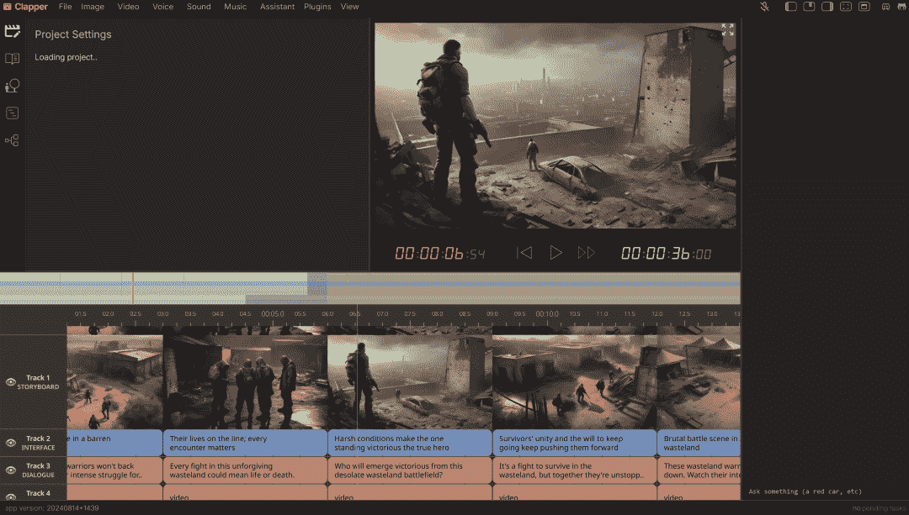

# Clapper ：一款开源的 AI 故事可视化工具，凭借 AI 技术，普通人也能成为AI导演。

> 来源：[https://agispace.feishu.cn/docx/W2GQd57N5o4jsMxoKUwcnhL3nkg](https://agispace.feishu.cn/docx/W2GQd57N5o4jsMxoKUwcnhL3nkg)

> 原创：黔岭苗七哥

> 原文：https://mp.weixin.qq.com/s/EFnRRB7SB5mZCp1plERCEw

AIGC开源项目免费工具/软件

随**着人工智能技术****的飞**速发展，AI在创意领域的应用越来越广泛。视频创作，作为创意产业的重要组成部分，正经历着一场由AI技术引领的革命。Clapper()，一款开源的AI故事可视化工具，以其创新的理念和强大的功能，为视频创作者提供了一个全新的创作平台。

### Clapper简介

Clapper不仅仅是一个视频编辑工具，它是一个全新的创作伙伴。通过AI的力量，Clapper能够帮助创作者以一种更加直观和互动的方式构建故事。它的核心理念是让视频创作变得更加简单、高效，让创作者能够专注于故事本身，而非技术细节。

**主要特点**

**开源免费**：这意味着开发者和用户可以自由获取其源代码，并根据自己的需求**进行修改和定制，**同时**也无需支付使用费**用。**集成多种AI**技术：巧妙地整合了当前最先进的AI技术，如图片生成、大型语言模型、语音生成、音乐生成和视频生成等各类相关的API。用户在一个平台上就能完成从创意构思到最终成片的全过程，大大简化了工作流程。交互性与直观性强：用户无需直接编辑复杂的视频和音频文件序列，而是通过调整诸如角色、位置、天气、时间段、风格等高级抽象概念，在AI助手的帮助下对故事进行迭代优化，这种创新的工作方式使得视频创作变得更加灵活和富有想象力。降低创作门槛：其设计目的是让任何人都能通过交互式、迭代和直观的过程使用AI创建视频，无需具备专业的电影制作或AI工程技能，使更多人能够参与到视频创作中来，模糊了专业创作和业余创作之间的界限。

**功能介绍**

**内置强大模型**：像GP**T-4、Cla**ude 3.5（Sonnet()）等一系列“顶流”大模型，如同一个由业内最强AI组成的“剧组”。其中第一条**轨道代表故事版，与内置大模****型对话，可通过AP**I调取文生图模型，让AI“分镜老师”生成对应的图片，以此作为视频画面的基础。丰富的轨道设置：每条轨道对应着一个具体的工种，比如接下来的轨道依次对应场景、旁白、摄像机的视角、背景音乐以及音效等，用户可以要求ElevenLabs或Fal.ai为视频生成特定的声音效果，如西部废土世界的故事中废墟的风声或者枪战的爆炸声等。支持剧本导入与角色人设创建：用户可以直接向Clapper导入剧本，并且在“故事”一栏细致地为主人公创造人设，甚至可以上传图片为角色设置视觉形象，还能调整人物的年龄和音色以及每个场景的陈设等细节，具有很强的个性化设置功能。

导演模式（开发中）：目标是让使用者可以全屏播放视频，舒适地坐在导演椅（或沙发）上，向AI布景助手发出指令，仿佛在真实的片场指导拍摄，这种沉浸式的创作体验会让视频制作变得更加有趣和富有成就感。

### **应用场景**

Clapper作为一个多功能的AI视频创作工具，它的应用场景几乎覆盖了视频制作的各个领域。以下是一些具体的应用案例，进一步展示了Clapper的广泛适用性和实用性：

+   **独立电影制作**：对于追求个性化和艺术性表达的独立电影制作人来说，Clapper提供了一个强大的创意伙伴。它不仅能够帮助他们快速搭建起故事的骨架，而且通过AI的辅助迭代，能够深入挖掘剧本的潜力，实现故事的深度和情感的丰富性。这使得独立电影制作人能够在保持创作独立性的同时，提升作品的艺术水准和观众的接受度。

+   **短视频创作**：在快节奏的社交媒体时代，短视频成为了吸引观众注意力的重要手段。Clapper的AI辅助功能特别适合短视频创作者，它能够在短时间内提供创意灵感，快速生成引人入胜的视频内容。无论是搞笑短片、生活记录还是知识分享，Clapper都能帮助创作者以高效的方式产出高质量的作品，迅速抓住观众的眼球。

+   **企业视频制作**：企业在进行品牌宣传、产品介绍或员工培训时，常常需要制作各种视频材料。Clapper能够帮助企业视频团队节省大量的策划和制作时间，同时通过AI的智能编辑，保证视频内容的专业度和吸引力。无论是内部培训视频还是对外的营销视频，Clapper都能提供个性化和高效的解决方案，增强企业视频的传播力和影响力。

+   **教育和培训视频**：教育机构和培训师可以利用Clapper来制作教育视频和在线课程。AI的辅助可以帮助他们以更生动、更吸引人的方式呈现复杂的知识点，提高学习材料的趣味性和易理解性。此外，Clapper的迭代功能也能够帮助教育工作者不断优化教学内容，提升教学质量。

Clapper不仅仅是一个技术产品，它代表了一种全新的视频创作理念和方法。它为各个领域的视频创作者打开了一扇通往无限可能的大门。

项目链接：https://github.com/jbilcke-hf/clapper

> **如果对您有点帮助💡

> **记得点赞👍、收藏⭐、在看👀、分享📤

---

**推荐阅读:**

1.Tailor：开源的视频编辑神器，让视频剪辑变得简单。

2.快手 LivePortrait：AI技术让静态肖像“活”起来，开源。

3.[浦语灵笔IXC-2.5：开源的多模态大模](http://mp.weixin.qq.com/s?__biz=Mzg3MTc1NDY3NA==&mid=2247499783&idx=1&sn=1226f44ec850c274aad242647a776cb5&chksm=cefb3edaf98cb7cc0ce50a6bda72a82694a5f4b6216444b480745f8ffbaa91e7214b0994fb6b&scene=21#wechat_redirect)型，[性能媲美OpenAI GPT-4V。4](http://mp.weixin.qq.com/s?__biz=Mzg3MTc1NDY3NA==&mid=2247499458&idx=1&sn=f2a35e5381709eeddb905935ec3556a1&chksm=cefb001ff98c8909e8dd7de837d6a6c6fcb79f22cb5723c0d1fd263a213aafb954f689b297a0&scene=21#wechat_redirect).老[旧视频秒变高清，DiffIR2VR-Zero让你的影](http://mp.weixin.qq.com/s?__biz=Mzg3MTc1NDY3NA==&mid=2247500286&idx=1&sn=4dc37c16e7e9aea41d98858a6e969914&chksm=cefb3f23f98cb6359748ae7b210a66528d8aa144c10e7cf6fde61636692f4fe24241ab135961&scene=21#wechat_redirect)片焕[然一新，你值得知道。

5.AuraFlow v0](http://mp.weixin.qq.com/s?__biz=Mzg3MTc1NDY3NA==&mid=2247499666&idx=1&sn=549ec1166ea8ed8fbe64c18f1fc94c92&chksm=cefb014ff98c8859b12906ea8918677f1b1ebd2718f598727ba44816c8c2e859d20bfe9f2edf&scene=21#wechat_redirect).1[：让 AI 图像生成变得简单又有趣，Fal.AI ](http://mp.weixin.qq.com/s?__biz=Mzg3MTc1NDY3NA==&mid=2247500512&idx=1&sn=305886d32a457c7394c3153a293ea3cc&chksm=cefb3c3df98cb52b0111bd2ed6b48fba541958fa4f48747b8088f57b3159ab71810513cff69f&scene=21#wechat_redirect)重磅[推出，开源。6.别了，Photoshop。IOPa](http://mp.weixin.qq.com/s?__biz=Mzg3MTc1NDY3NA==&mid=2247500445&idx=1&sn=f7d412d652b8fd3dc73c68ed571a8a73&chksm=cefb3c40f98cb5565088e75ab4c93330b77e862fd8c2d4612115b8b33103db3645ec4fec0ba4&scene=21#wechat_redirect)int 重新定义图像编辑，开源、免费。设计师值得拥有！7.腾讯 SEED-Story ：一款多模态长故事生成模型，借助 AI 之力帮您创作长篇故事。8.阿里巴巴 EchoMimic ：通过音频来驱动人物肖像，并将其转为视频，定制你的数字分身。