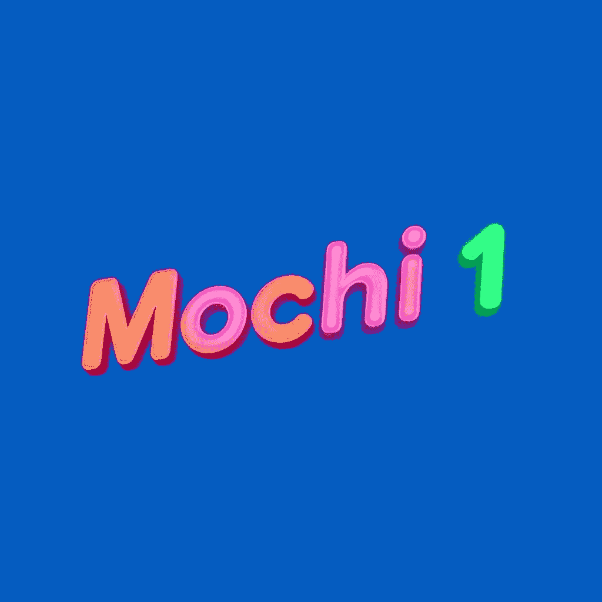

# 简直太棒啦！Mochi 1：Genmo AI 开源的、最先进的AI视频生成模型，能够生成高质量且具有一致性的视频内容。

> 来源：[https://agispace.feishu.cn/docx/FFeKdOTPoo76vOxFfTvcY7xlnFg](https://agispace.feishu.cn/docx/FFeKdOTPoo76vOxFfTvcY7xlnFg)

> 原创：黔岭苗七哥

> 原文：https://mp.weixin.qq.com/s/TE4MN4ZyaGvqS-cxW8ZSMA

在**人工智能技术飞速**发展**的当下，视频生**成领域正经历着一场史无前例的变革。今天，我要给大家介绍一款由Genmo公司新推出的开源视频生成模型——Mochi 1。这个模型拥有高质量运动生成、精准提示控制等诸多优势，能够生成自然流畅且符合物理规律的视频，在人物动作和表情的连贯性上表现出色。

## **Mochi 1的诞生背景**

随着人工智能技术在各个领域的广泛应用，视频生成技术也取得了长足的进步。然而，现有的视频生成模型仍然面临着诸多挑战，如生成视频的质量不高、对文本提示的遵循能力不足、模型的可扩展性和开放性较差等。为了解决这些问题，Genmo公司投入大量资源进行研究和开发，最终推出了Mochi 1这一具有创新性的开源视频生成模型。

## Mochi 1的模型架构

Mochi 1的模型架构是其成功的关键之一。它基于新型的Asymmetric Diffusion Transformer（AsymmDiT）架构构建，这一架构具有独特的优势。

### 1、大规模参数与高效处理

Mochi 1是一个拥有100亿参数的扩散模型，如此大规模的参数为其提供了强大的学习和表达能力。同时，AsymmDiT架构通过优化设计，能够高效地处理用户提示和压缩视频令牌。它简化了文本处理过程，并将神经网络的能力集中在视觉推理上，从而在保证性能的同时提高了处理效率。

### 2、非对称设计与模态融合

在AsymmDiT架构中，采用了非对称设计来处理不同模态的信息。它通过使用非方形的QKV和输出投影层，实现了文本和视觉令牌的联合关注。并且，为每个模态学习单独的MLP层，使得模型能够更好地理解和融合不同模态的信息。这种非对称设计不仅提高了模型的性能，还降低了推理内存的需求，使得模型在实际应用中更加可行。

### 3、单一语言模型编码提示

与许多现代扩散模型不同，Mochi 1采用单一的T5 - XXL语言模型来编码用户提示。这种简洁的设计方式避免了使用多个预训练语言模型可能带来的复杂性和兼容性问题，同时也保证了模型对提示信息的准确理解和处理。

## Mochi 1的功能特性

### 1、高质量运动生成

Mochi 1在视频生成过程中，能够生成遵循物理运动规律的高质量视频。无论是人物的动作、物体的运动，还是场景的动态变化，都显得自然流畅。它能够准确地模拟流体、毛发等物理现象，为视频增添了逼真感。例如，在生成一个人物奔跑的视频时，人物的肢体动作协调自然，头发随风飘动的效果也栩栩如生，仿佛是真实拍摄的场景。

### 2、精准的提示控制

用户可以通过详细的文本提示对生成的视频内容进行精准控制。无论是角色的设定、场景的布置，还是动作的描述，Mochi 1都能够高度契合用户的提示要求。例如，用户输入“一个穿着红色连衣裙的女孩在花海中翩翩起舞，阳光明媚，周围有蝴蝶飞舞”这样的提示，Mochi 1能够生成一个符合描述的视频，女孩的服装、花海的场景以及蝴蝶的飞舞都与提示一一对应。

### 3、一致性与连贯性

Mochi 1在生成视频时，能够保证人物动作和表情的一致性与连贯性。它解决了生成视频中常见的“拟人不协调”问题，使得视频中的人物看起来更加自然真实。例如，在一个对话场景中，人物的面部表情、肢体语言以及说话的节奏都能够保持一致，给观众带来更好的观看体验。

### 4、开放性与易用性

作为一个开源项目，Mochi 1具有很高的开放性和易用性。用户可以通过GitHub或HuggingFace轻松下载模型，并在Genmo提供的Playground平台上免费试用。同时，其模型架构设计简单，易于开发者使用和扩展。这为广大开发者和研究人员提供了一个良好的基础平台，他们可以在此基础上进行进一步的研究和开发，探索更多视频生成的可能性。

## Mochi 1的适用人群

### 1、开发者和研究人员

Mochi 1为开发者和研究人员提供了视频生成领域的前沿技术。他们可以利用Mochi 1的模型架构和代码进行深入研究，探索新的算法和技术，开发更复杂的视频生成应用。例如，研究人员可以通过对Mochi 1进行微调，使其适用于特定领域的视频生成任务，如医学影像视频生成、工业过程视频生成等。

### 2、创意工作者和艺术家

对于创意工作者和艺术家来说，Mochi 1是一个强大的工具。他们可以利用Mochi 1将自己的创意转化为视觉效果，创作出高质量的视频作品。在广告、影视和动画等领域，Mochi 1可以帮助艺术家们快速生成创意概念视频，节省制作时间和成本。例如，广告设计师可以利用Mochi 1生成一个产品宣传视频的初稿，然后在此基础上进行进一步的创意加工和完善。

### 3、产品开发者和工程师

产品开发者和工程师可以将Mochi 1集成到自己的应用中，为产品增添视频生成功能。在娱乐、教育、广告等多个领域，都可以利用Mochi 1开发出具有特色的产品。例如，在教育领域，可以利用Mochi 1生成教学视频，帮助学生更好地理解知识；在娱乐领域，可以利用Mochi 1开发视频游戏中的动画效果等。

Mochi 1作为一款开源视频生成模型，在模型架构、功能特性以及适用人群等方面都具有独特的优势。尽管它还存在一些局限性，但随着技术的不断发展和社区的积极参与，其未来发展前景十分广阔。

项目链接：https://github.com/genmoai/models