# （PPT）Gamma：目前最好用的 AI 生成 PPT 工具

> 来源：[https://agispace.feishu.cn/docx/ZXXldfz6mo04iFxDt9IcyzC1nKc](https://agispace.feishu.cn/docx/ZXXldfz6mo04iFxDt9IcyzC1nKc)

> 作者：王平安

> 👸号：AI工具派

> 原文链接：https://mp.weixin.qq.com/s/uUxxA7cpHAb9uWxBpPIgUg

> **「近期热门」**

1.  DeepL：无比强大的免费 AI 翻译工具

1.  Quivr：基于 ChatGTP 的可交互 AI 知识库

1.  AIDesign：腾讯智能 AI 在线 Logo 生成器

1.  Wiseone：用 AI 帮助你高效阅读和学习

1.  Knit：专业的 Prompt 管理和调试工具

1.  Claude2：GPT4 强劲竞争对手来了，完全免费！

1.  AI Colors：轻松定制你的网页配色方案

1.  [Albus：探索你的无限创意](http://mp.weixin.qq.com/s?__biz=MzA5MjU0NzQ3Ng==&mid=2651421224&idx=1&sn=d1dd9e33faee14117acdc0a1b0376071&chksm=8b96aad3bce123c531a13f154d0a08aff2f76d6fde88f3f0d1b128f4644a22c306557d5451d8&scene=21#wechat_redirect)

1.  PMAI：优秀的产品经理 AI 帮手

1.  Forefront Chat：免费的 GPT-4 聊天机器人

1.  Codeium：强大且免费的AI智能编程助手

> 今天 Chris 给大家推荐的工具是 Gamma，一款可以说是目前最好用的 AI 生成 PPT 工具，快来一起看看吧。

> 工具地址：https://gamma.app/

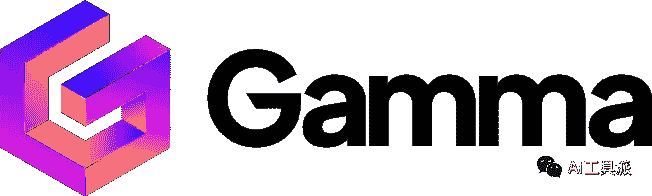

## **一、工具介绍 🛠️**

Gamma 是一款基于 AI 驱动的 PPT 生成工具，可以高度自动化地生成高质量的 PPT 内容，打造全新体验。它有以下优点：

+   **「效率高」**：用户只需要输入题目，AI 将自动生成大纲，然后修改大纲，选择标题，创作内容，自动排版。

+   **「效果好」**：Gamma 可以理解用户的需求，生成符合主题的、视觉效果良好的幻灯片。

+   **「功能丰富」**：支持多种功能，包括插入图片、视频、图表等，并支持协作编辑。

+   **「自由度高」**：用户可以更加自由地设计和布局，达到更好的呈现效果。

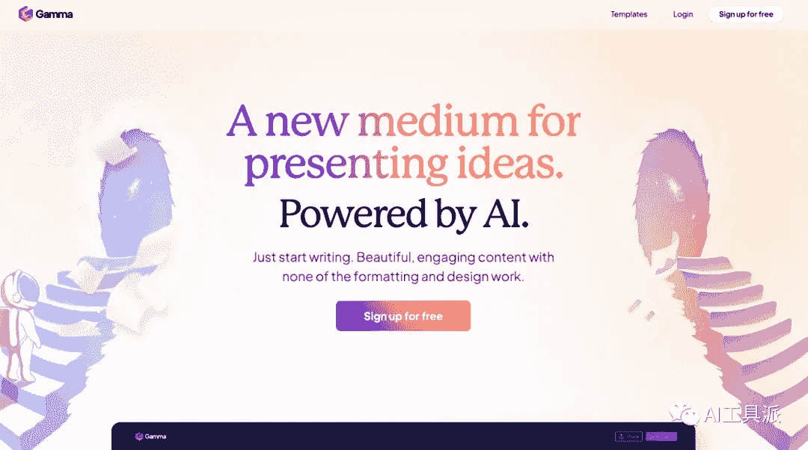

## **二、快速上手 🚀**

Gamma 使用起来非常简单，Chris 接下来创建一个示例：

1.  **登录并创建新项目**

**进入首页登录账号后，即可****进入管理页面，点击“**「Create new」”创建一个新项目，Chris 这里使用“「Generate」”的生成方式：

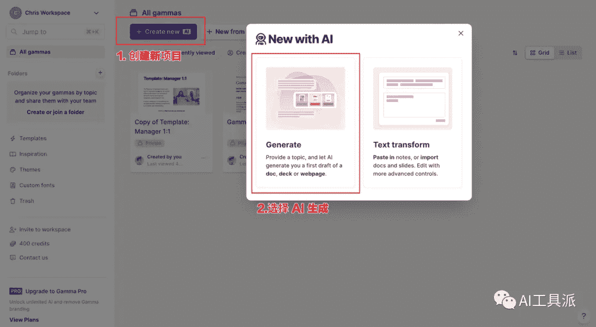

1.  **选择创建类型**

**接下来选**择需要**创建的 **PPT** 类型，**Gamma 支持“「介绍」”**、“「文**档」”和“「网页」”三种类型，Chris 使用「网页」类型，然后输入主题内容：

1.  **优化大纲内容**

G**amma 会按照 C**hris 输入的内容生成一份大纲，Chris 接下来要做的就是调整和优化这份大纲内容，然后点击“「Continue」”继续下一步操作：

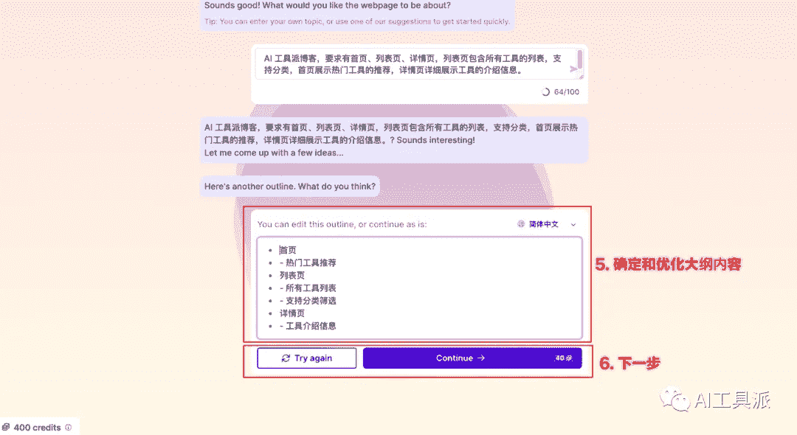

1.  **选择主题**

这里 Gamma 会提供很多 PPT 主题给用户选择，选择好直接下一步：

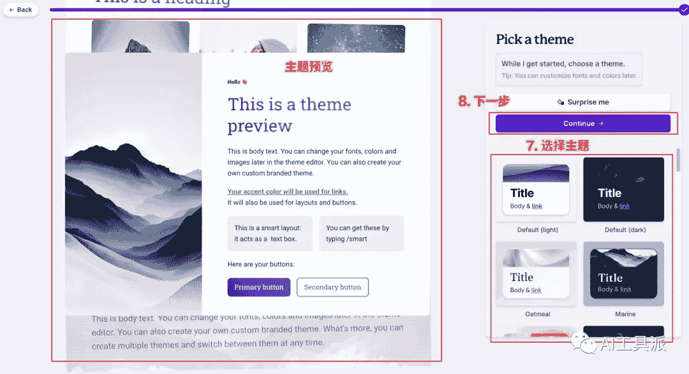

1.  **完成生成**

接下来就只要静静地看着 Gamma 在页面上自动生成 PPT 内容，实在是赞！效果如下：

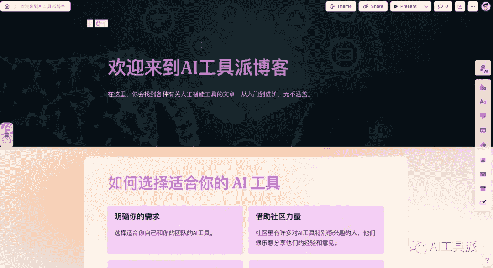

> 生成的网页链接：https://gamma.app/public/AI-1032wcco83o8jj2

## **三、核心功能 🔍**

1.  **支持在线预览**

Gamma 提供了**「当前标签页预览」**和**「全屏预览」**：

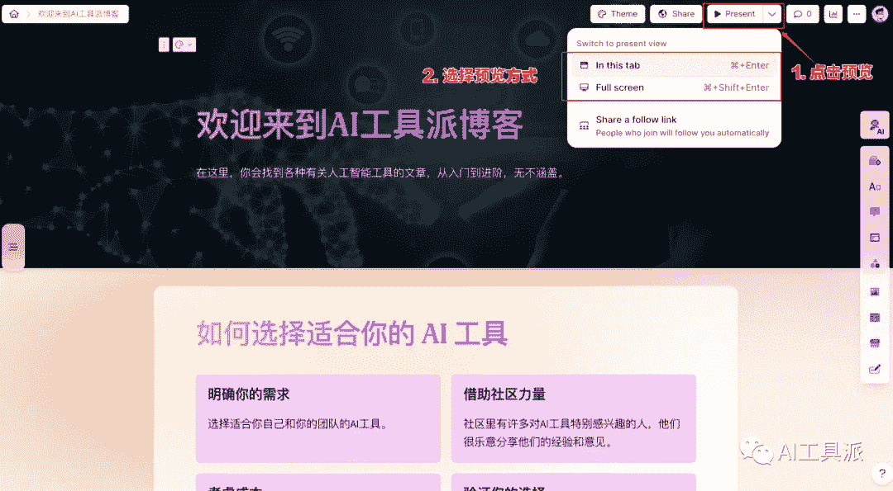

预览效果如下：

1.  **支持多种分享方式**

Gamma 支持协作、分享公开链接、导出、内嵌网页等分享方式，实在是太方便了：

1.  **支持用户进行页面调整**

用户可以对 Gamma 生成的页面进行调整，比如文案、样式等，Gamma 提供了一个右侧工具栏：

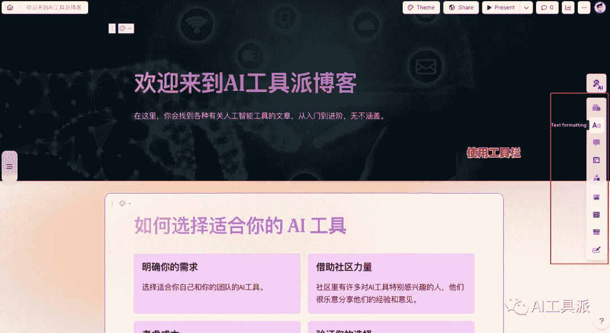

并且还提供了 AI 对话能力，方便修改内容：

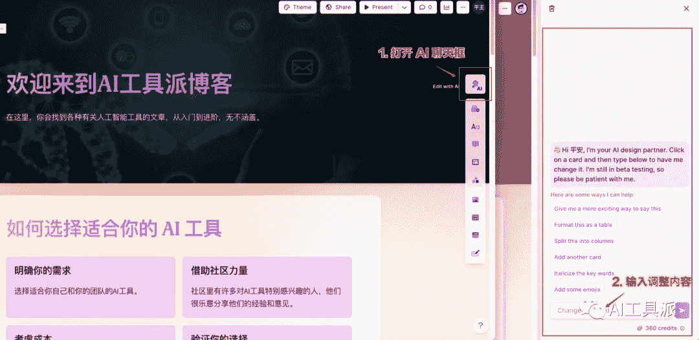

1.  **支持数据分析**

Gamma 还支持数据分析能力，不仅可以统计页面访问数据，还可以统计每张卡片的访问数据：

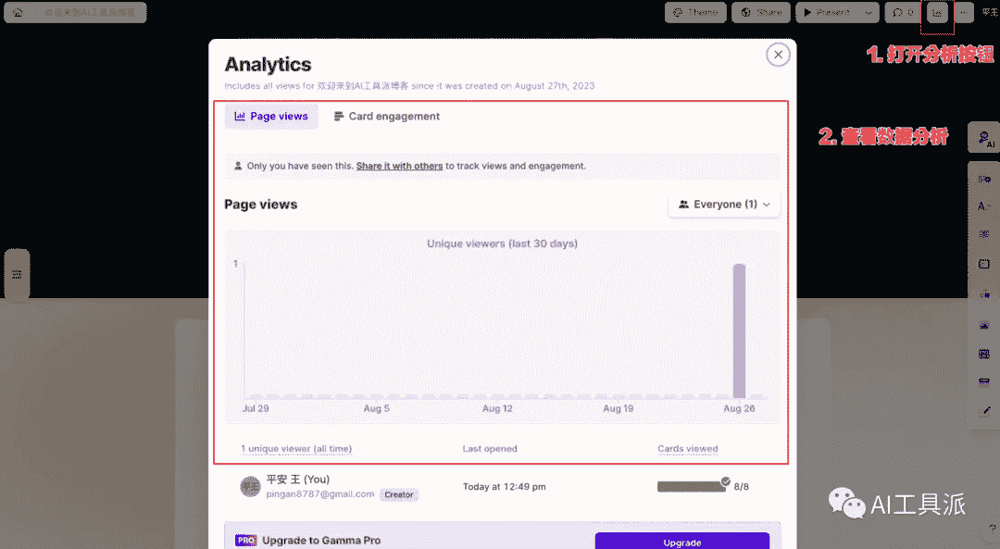

## **四、收费情况 💰**

目前 Gamma 免费赠送 400 积分，不同功能消耗积分如下：

+   使用 AI 创建项目：每个项目消耗 40 积分；

+   与 AI 聊天：每个建议消耗 10 积分，如添加卡片、查找图片、重写内容等；

+   AI 图片：每生成一张图片消耗 10 积分；

+   AI 续写内容：每次续写消耗 2 积分；

完整收费情况如下：

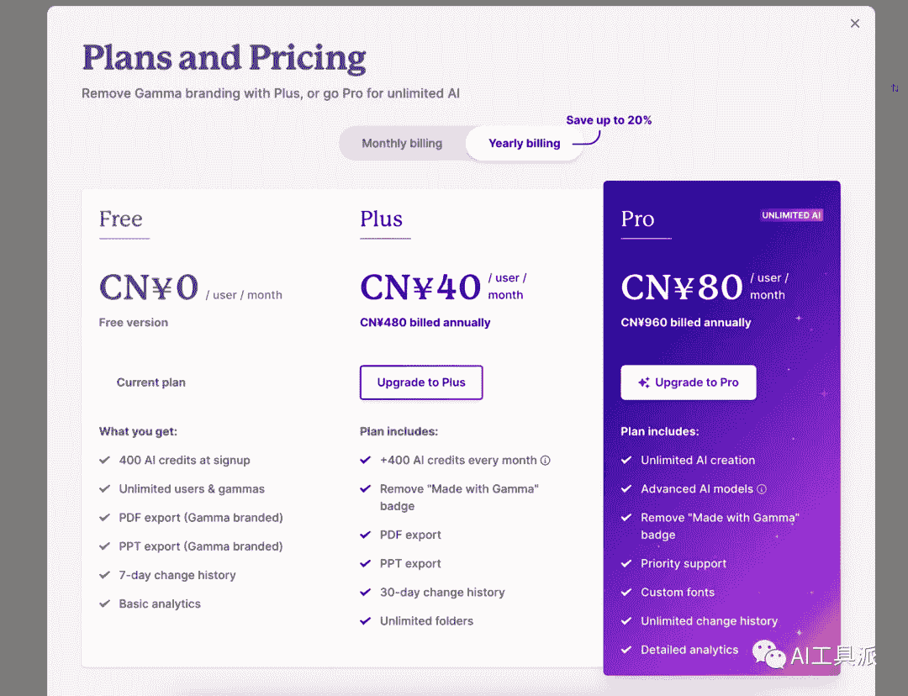

Chris 觉得如果你是经常需要做 PPT，可以考虑专业版，如果只是尝鲜，完全可以先消耗完 400 积分后，再按照实际需求进行购买。

## **五、总结 📝**

Chris 今天向大家推荐了一款强大的 AI 生成 PPT 工具 Gamma，它可以高效自动地生成高质量的 PPT 内容。并详细介绍了 Gamma 的优点、快速上手方法以及核心功能，大大提高工作效率。

这里是“**「AI工具派」**”，探索最新AI工具，发现AI带来的无限可能性。我们下一期见。