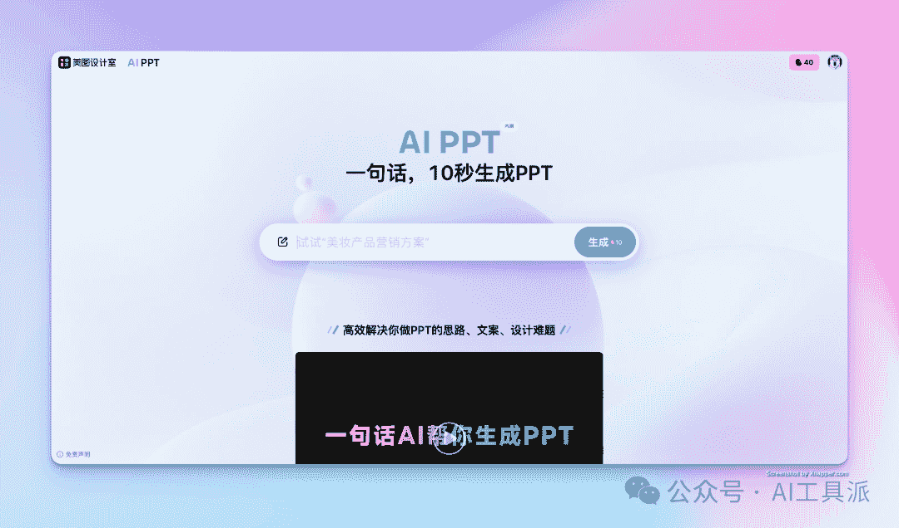
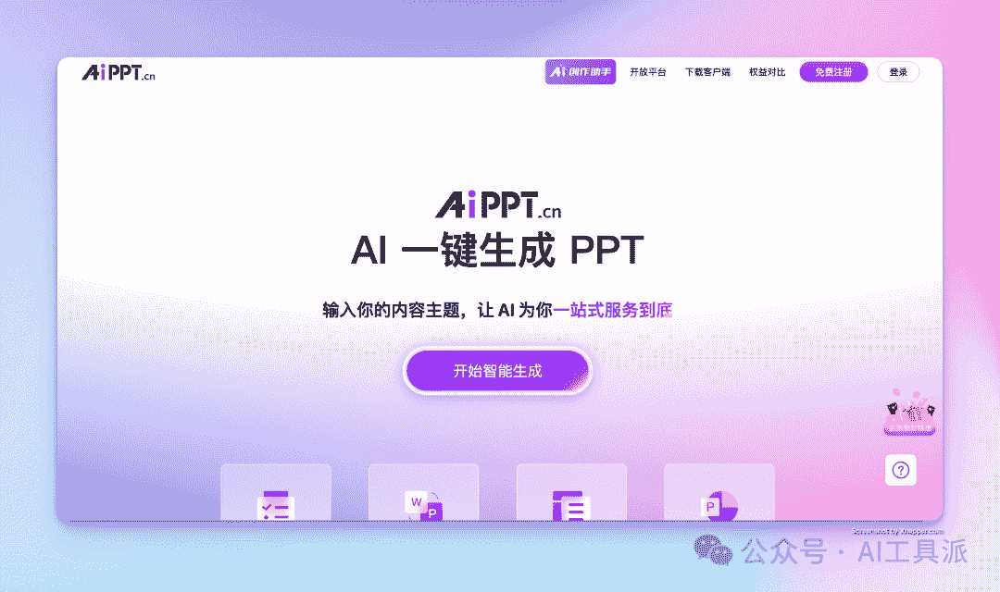
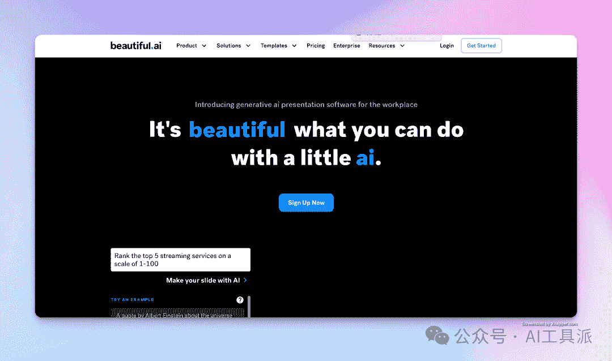
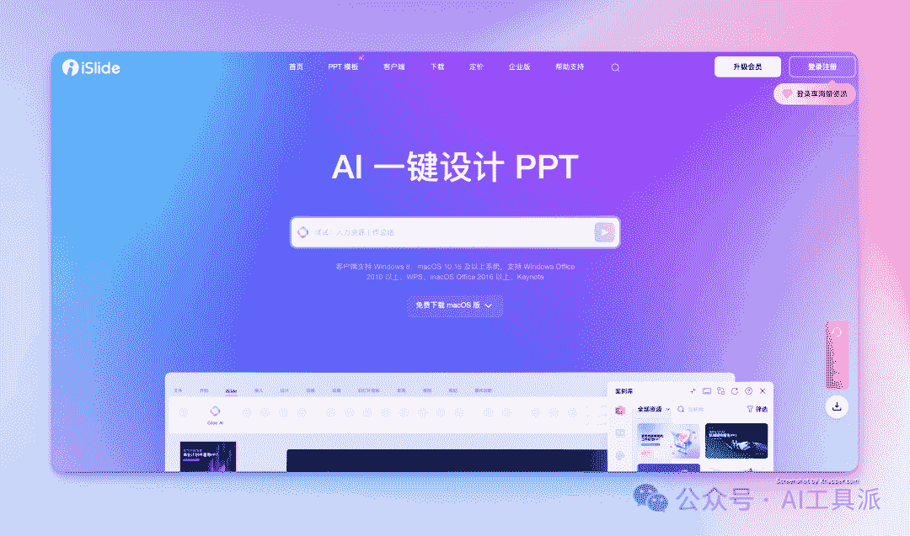
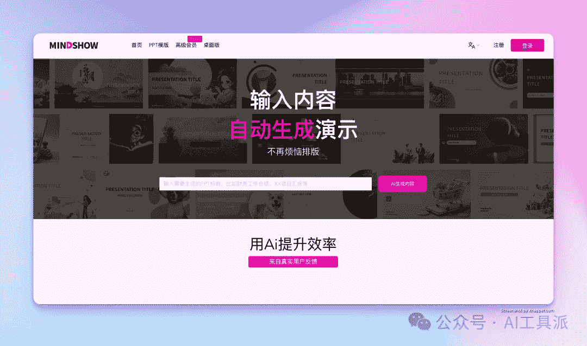
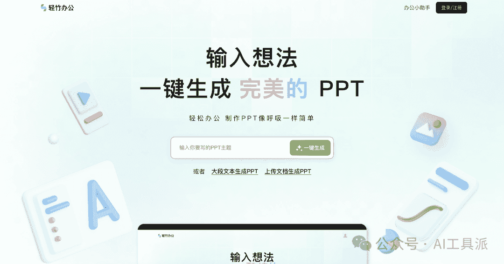
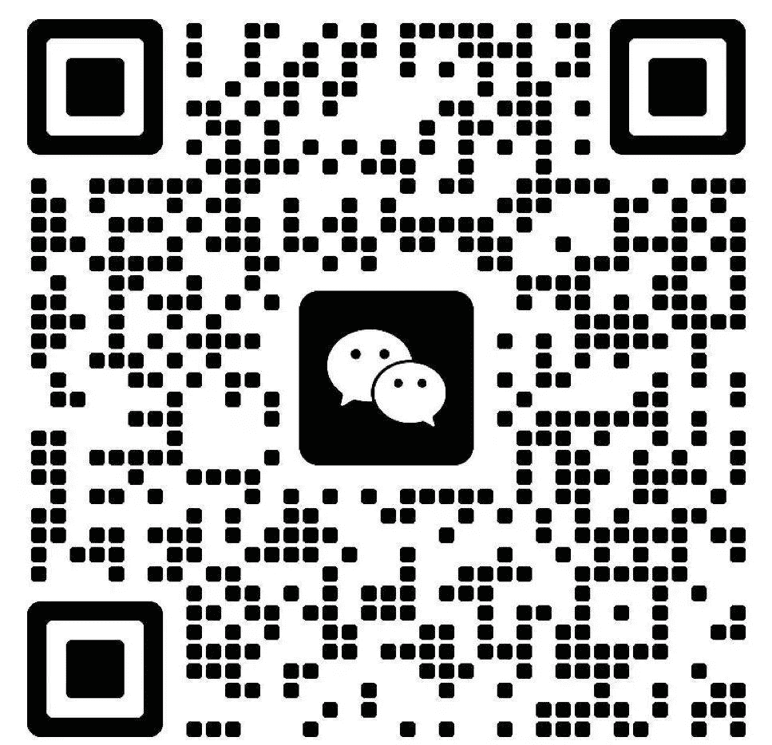

# （PPT）2024 年必备的 9 款 AI PPT 生成工具

> 来源：[https://agispace.feishu.cn/docx/OYBLdjTBJoE6agx7RObcRn7rntm](https://agispace.feishu.cn/docx/OYBLdjTBJoE6agx7RObcRn7rntm)

> 作者：王平安

> 👸号：AI工具派

> 原文链接：https://mp.weixin.qq.com/s/2vSvFcz5pwtPimZqv36d-w

**

近期推**荐

+   PPT：[Tome](http://mp.weixin.qq.com/s?__biz=MzA5MjU0NzQ3Ng==&mid=2651422220&idx=1&sn=53c877ebc4ae8bb93680cd616e46d7ea&chksm=8b96aef7bce127e14a1f0427e7bdaf65813c5f56ad28b6c41df869a9d86aed4ffba8af4717c2&scene=21#wechat_redirect)｜[美图PPT](http://mp.weixin.qq.com/s?__biz=MzA5MjU0NzQ3Ng==&mid=2651422061&idx=1&sn=b63315fcf9f8be34d1d28a0d76824bfb&chksm=8b96ad96bce12480b6cd01e9fdbf91a1d8bfc975afb33b5f13086e06e8b1327a480b8ff8f755&scene=21#wechat_redirect)｜[AiPPT](http://mp.weixin.qq.com/s?__biz=MzA5MjU0NzQ3Ng==&mid=2651421536&idx=1&sn=14a3424fc4f5dd8636686ccccdfb1bde&chksm=8b96ab9bbce1228d94e3ac0d5f5f8609fb3b0b67f8b6a89c647081de79822314ea7b896a9184&scene=21#wechat_redirect)｜[Gamma](http://mp.weixin.qq.com/s?__biz=MzA5MjU0NzQ3Ng==&mid=2651421496&idx=1&sn=e67161b6699514f1f986bb20e5ce83d3&chksm=8b96abc3bce122d565165a2628de0644f8e37ad9a4c721fd735331ed4176b95b9c08a9153c81&scene=21#wechat_redirect)

+   图片处理：[Pikaso](http://mp.weixin.qq.com/s?__biz=MzA5MjU0NzQ3Ng==&mid=2651422373&idx=1&sn=55b17238df29f9921c4e7d5900c4eb64&chksm=8b96ae5ebce12748a72db5394adbff763a115c3e76e1e7a6f33ea9033b160606ada1c06a8749&scene=21#wechat_redirect)｜[图片修复](http://mp.weixin.qq.com/s?__biz=MzA5MjU0NzQ3Ng==&mid=2651422123&idx=1&sn=0127e001fd7ece71cf0c0e5fadfafe57&chksm=8b96ad50bce1244693d7e2ea560cefc65faf8a9584710f631142b36c41425e88955c44630e7d&scene=21#wechat_redirect)｜[DeOldify](http://mp.weixin.qq.com/s?__biz=MzA5MjU0NzQ3Ng==&mid=2651421677&idx=1&sn=485e538b3b67e26dce4f2b254703eb3d&chksm=8b96ab16bce1220042ff1ca12110eef16a800358969633ece567561b5cf24a8f1c928b2873e1&scene=21#wechat_redirect)｜[BgSub](http://mp.weixin.qq.com/s?__biz=MzA5MjU0NzQ3Ng==&mid=2651422691&idx=1&sn=635141817f7b564b7b5552dbe7a95e2b&chksm=8b96af18bce1260e7c1f2cd6f965110750d995c8ed787f5b6c877ea3563dd556bf50b0557a09&scene=21#wechat_redirect)｜[Dreamina](http://mp.weixin.qq.com/s?__biz=MzA5MjU0NzQ3Ng==&mid=2651422635&idx=1&sn=d099bd8d6d132a3c53c39b54c2c6d36f&chksm=8b96af50bce126467455cc4d0540dd5feac739b4a0b5862d564a672ae4b7c4a15e199a4f5fc3&scene=21#wechat_redirect)

+   学习工具：[据意查句](http://mp.weixin.qq.com/s?__biz=MzA5MjU0NzQ3Ng==&mid=2651422237&idx=1&sn=dfd41201f7645cdb1c36bbe0ba1bdbd6&chksm=8b96aee6bce127f0edecdd167b554a34641d09d9af745f7f8932657325e7b7210f21831729a8&scene=21#wechat_redirect)｜[Grammarly](http://mp.weixin.qq.com/s?__biz=MzA5MjU0NzQ3Ng==&mid=2651422176&idx=1&sn=f5d1b04d855eea565389f9f16bcc5059&chksm=8b96ad1bbce1240d57eff5b66688fe5ff14966bd4912132696a2214d8226ad0d573784d54cad&scene=21#wechat_redirect)｜[灵动翻译](http://mp.weixin.qq.com/s?__biz=MzA5MjU0NzQ3Ng==&mid=2651422109&idx=1&sn=ef7514c2f7c35daba677d67095bebe57&chksm=8b96ad66bce12470290cc434e657fc4ab55782f0f629b6bf3056193eb561b635a02e3ac955c4&scene=21#wechat_redirect)｜[Wiseone](http://mp.weixin.qq.com/s?__biz=MzA5MjU0NzQ3Ng==&mid=2651421296&idx=1&sn=916d9c7a4cd471eafad351ff961eacdf&chksm=8b96aa8bbce1239d8e30ba8bec1ef422f7b087502b1fbdfeeb1b9d87b8b6c1e8e8a8d718da4e&scene=21#wechat_redirect)｜[Hama](http://mp.weixin.qq.com/s?__biz=MzA5MjU0NzQ3Ng==&mid=2651421079&idx=1&sn=16deee4fa63d43bc75a5531365fe2bd6&chksm=8b96a96cbce1207a7c69d28a693f2ddd932aa213fa8e6021bd966007895cd7b35b27f3cc3d90&scene=21#wechat_redirect)｜[DeepL](http://mp.weixin.qq.com/s?__biz=MzA5MjU0NzQ3Ng==&mid=2651421361&idx=1&sn=dc558dfe6c4160f422c7167da98936c8&chksm=8b96aa4abce1235c23277fed8b47a75251a293e205b1272bffe25dfe141af9c8bbd0814db92c&scene=21#wechat_redirect)

+   编程工具：[Codeium](http://mp.weixin.qq.com/s?__biz=MzA5MjU0NzQ3Ng==&mid=2651421012&idx=1&sn=2a4677436b40a15fb8189ee1aecb6557&chksm=8b96a9afbce120b9e735c65a981b535ea2f98094b94291974de6a1910eb1547f9fa29ecd4e97&scene=21#wechat_redirect)｜[通义灵码](http://mp.weixin.qq.com/s?__biz=MzA5MjU0NzQ3Ng==&mid=2651421780&idx=1&sn=17d5269512f352eaa6fe3799b334d090&chksm=8b96acafbce125b94dc2fab8dcd77147dbf632ea014324fe2f47bc041e53532c8883f8bf1fce&scene=21#wechat_redirect)｜[SafurAI](http://mp.weixin.qq.com/s?__biz=MzA5MjU0NzQ3Ng==&mid=2651421101&idx=1&sn=58d03185eb035993837ed83d1ffd787a&chksm=8b96a956bce120404c0592f21edb0d44d8131a73ef5a434fca9f2bf089100c3b22e29e9a3bb5&scene=21#wechat_redirect)

+   其他工具：[TinyWow](http://mp.weixin.qq.com/s?__biz=MzA5MjU0NzQ3Ng==&mid=2651422540&idx=1&sn=f18e437fe87ba2e3d8dc0c3e945a48a2&chksm=8b96afb7bce126a1d0c9cd0b3f96fba68feea7ee19229c83df7b812c1a89006b7b3bd6397028&scene=21#wechat_redirect) | [PixVerse](http://mp.weixin.qq.com/s?__biz=MzA5MjU0NzQ3Ng==&mid=2651422514&idx=1&sn=8a442f259596f8c854eeecd891a8e76a&chksm=8b96afc9bce126df35b7bea38880cf38e5835709b1e11473583c22afed56a91e7f71348d9d30&scene=21#wechat_redirect) | [Toolkit](http://mp.weixin.qq.com/s?__biz=MzA5MjU0NzQ3Ng==&mid=2651422450&idx=1&sn=bfed0494c542be5a3f209cfeb8304f4f&chksm=8b96ae09bce1271f9c6abce9c302c84a064ef64b4d61789d1b978d365142846a97ce74a03704&scene=21#wechat_redirect) | [SeekAI](http://mp.weixin.qq.com/s?__biz=MzA5MjU0NzQ3Ng==&mid=2651422402&idx=1&sn=3ebfd9cc4901ddc207d4e5dc6d72fcac&chksm=8b96ae39bce1272fd37b35fd82de1ab241acb9d5be7ab92f9df617dea9dcfb72dc796d95c3ed&scene=21#wechat_redirect) | [Summarizer Tool](http://mp.weixin.qq.com/s?__biz=MzA5MjU0NzQ3Ng==&mid=2651422559&idx=1&sn=14f365d2890c3db7c8472f9693a5f6f4&chksm=8b96afa4bce126b21cae16985b435627aca10ec39249c25fe476c3f28506a644e88649d897a7&scene=21#wechat_redirect)

+   👉 2[023 年度 AI 工具汇总](http://mp.weixin.qq.com/s?__biz=MzA5MjU0NzQ3Ng==&mid=2651422281&idx=1&sn=2d86a38e6e6364f1342e41efb686152d&chksm=8b96aeb2bce127a459e502e9d7e0f04596a5fd5a34e4041781097bccb5a6c0fca0e7fe39c945&scene=21#wechat_redirect)

+   👉 A[I工具派在线知识库 ](http://mp.weixin.qq.com/s?__biz=MzA5MjU0NzQ3Ng==&mid=2651421710&idx=1&sn=98e2e4930f6686d84f549a226d2d1a0e&chksm=8b96acf5bce125e3ca332b8873c39f0c414cee73d2a7779a0d94ddb43b2f748ff2f99d90f40b&scene=21#wechat_redirect)✨

AI** 工具派的社群中**，经常会有小伙伴请教 AI 制作 PPT 的工具，看来这类工具的需求量还是蛮大的，今天 Chris 整理了 9 款不错的 AI PPT 制作工具，希望能够帮助到大家，「收藏备用起来」。

本文介绍的工具**「全部无需🪜」**，**「国内可访问」**，包括：

+   美图 AI PPT

+   AiPPT

+   Boardmix AI PPT

+   Beautiful.ai

+   iSlide

+   MindShow

+   讯飞智文

+   轻竹办公

+   MotionGo

# **1.美图 AI PPT**

> 🔗 工具地址：https://www.x-design.com/ppt/

美图 AI PPT 是「美图秀秀」旗下的「美图设计室」推出的「免费在线 AI 生成 PPT 设计工具」，用户通过输入自然语言，即可轻松打造精美 PPT。无论是什么类型风格的 PPT，美图 AI PPT 都可以帮你打造，如行业分析、工作汇报、创意设计方案、企业团建策划、部门工作总结等。

Chris 之前写了篇《美图 AI PPT：免费在线 AI 生成 PPT 设计工具详细介绍，大家可以查看一下。

# **2.AiPPT**

> 🔗 工具地址：https://www.aippt.cn/

AiPPT 是一款 AI 驱动的 PPT 在线生成工具，只需要输入主题，AI 即可一键生成高质量 PPT，操作简单。

并且还支持在线自定义编辑和文档导入生成，提供 10w+ 个优秀模板和素材，帮助用户快速生成专业级 PPT。

Chris 之前写了篇《AiPPT：全智能 AI 一键生成 PPT详细介绍，大家可以查看一下。

# 3.Boardmix AI PPT

> 🔗 工具地址：https://boardmix.cn/ai-powerpoint/

Boardmix AI PPT 是一款强大的在线 AI 白板软件，它不仅支持 AI 自动生成 PPT，还提供了丰富的模板和编辑工具。用户可以通过简单的输入，快速创建出结构化的演示文稿，同时支持多人在线协作和演示。

**Boardmix AI** **PPT 支持「一句话生成 PP**T」、「AI 提炼文档生成 PPT」、「导入思维导图文件生成 PPT」。

# **4.Beautiful.ai**

> 🔗 工具地址：https://www.beautiful.ai/

Beautiful.ai 以其直观的界面和智能设计建议著称，能够帮助用户轻松创建好看的 PPT。它提供了可定制的模板、智能图表以及分析工具，让设计过程变得简单而高效。

Beautiful.ai 支持**「智能设计建议」**、**「数据分析可视化」**、 **「PPT 数据分析」**。

# **5.iSlide**

> 🔗 工具地址：https://www.islide.cc/

iSlide AI 可以帮助用户轻松生成 PPT，节省大量的时间和精力。基于智能算法，自动分析用户主题内容，并生成逻辑清晰、结构完整的大纲，使用户可以更快速地规划和组织幻灯片演示内容。

用户输入一个主题，iSlide AI 可以快速辅助撰写 PPT 大纲，并且还可以选择【生成 PPT】直接应用到 PPT 主题模板中。

# **6.MindShow**

> 🔗 工具地址：https://www.mindshow.fun

MindShow 是一个智能的 PPT 生成器，它是国内独立开发者()开发的输入内容自动生成演示工具，通过强大的 AI 人工智能技术，可以根据用户输入的大纲文字，自动生成精美的 PPT 页面。

# **7.讯飞智文**

> 🔗 工具地址：https://zhiwen.xfyun.cn/home

讯飞智文，由科大讯飞推出的一键生成 ppt/word 产品。根据一句话、长文本、音视频等指令智能生成文档，同时支持在线编辑、美化、排版、导出、一键动效、自动生成演讲稿等功能，让 AI 全流程服务到底。

# **8.轻竹办公**

> 🔗 工具地址：https://qzoffice.com/dashboard

轻竹办公 AI PPT 是一款专为国内用户设计的 AI PPT 工具，它结合了清华智谱 AI 技术，生成内容更符合中国人的需求。用户可以一键生成 PPT，并享受在线编辑和模板切换的便捷。

轻竹办公 AI PPT 支持 **「AI 一键生成 PPT」**、**「在线编辑与模板切换」**、**「高速下载」**。

# **9.MotionGo**

> 🔗 工具地址：http://motion.yoo-ai.com/

**MotionGo 源**于原口袋动画团队，特长是 「PPT 动画生成」。MotionGo 插件拥有全网独家智能动画库，允许用户一键生成专业 PPT 动画演示效果，让你的 PPT 表达更简单高效。

# **总结**

今天介绍这些工具还挺多的，各有各的亮点，大家可以尝试看看，找到适合自己的 AI 工具，提高效率，这也是 Chris 一直以来对 AI 工具的看法～

赶紧去试试吧。

创作不易，还请点赞支持～我们下期见

**探索 AI 无限可能**

👸号：AI工具派扫码加群/商务合作

王平安

喜欢作者