# （PPT）万知，PPT排版配图轻松搞定，还能看懂图表！

> 来源：[https://agispace.feishu.cn/docx/GY2bd6hrYo9ftWxcSD8cCxGfnvd](https://agispace.feishu.cn/docx/GY2bd6hrYo9ftWxcSD8cCxGfnvd)

> 作者：特工少女

> 公众号：特工宇宙

> 原文链接：https://mp.weixin.qq.com/s/ZvrR-nBsMAUKgITfM0K16Q

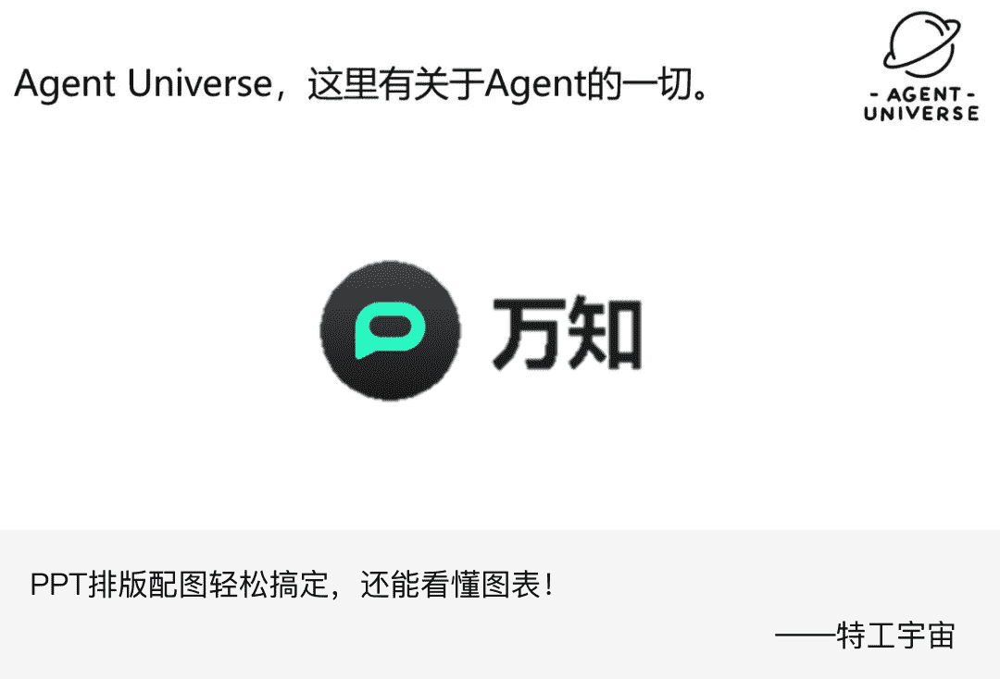

无论求职述职还是做项目汇报、路演，我们日常有太多的工作场景需要使用PPT了。有时候我们需要快速梳理思路和文稿，有时候则需要更加精细精美。可以说老板 or 打工人经常为做PPT做得人憔悴，发际线堪忧。

那么，如果能用AI做PPT，会是一种怎么样的体验？

想必大家也使用过一些AI生成文稿，AI生成PPT的产品，我今天推荐的这款，有点不一样。

**万知**是一个集合阅读、创作、分享一站式AI工作平台，包含了AI读文档、AI对话、AI生成PPT等功能。

官网戳这里👉🏻：https://wanzhi.com。

更香的是它还**免费**，这是我这个白嫖党选择的一大理由。

另外我发现它最近悄悄更新了，具体更新了什么呢，且随本少女一一探索。

基于我最近的一个需求——给大学生简单科普大语言模型，给大家演示下它相比于其他产品的惊艳功能。首先我们先选择新建演示文档，可以看到弹出来了一些PPT的基本预设，有页码、字数、受众、演示场景、图片来源等设置。

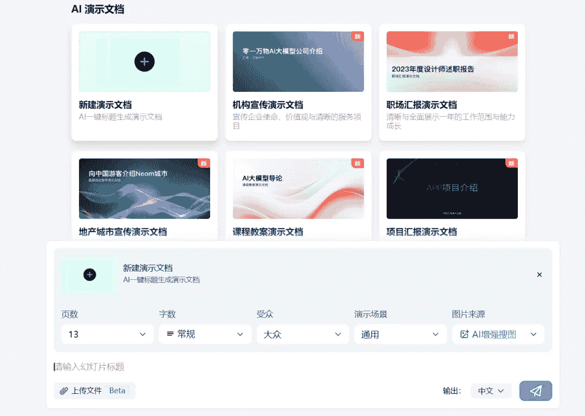

我们按自己的需求修改好，页数改多一点，字数设置为常规就好。

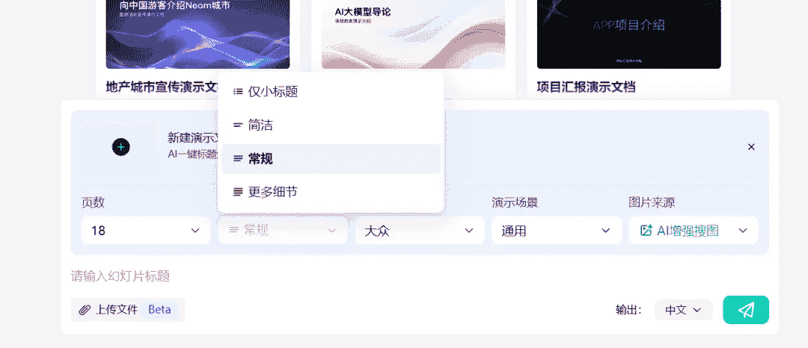

受众改为学生，场景改为公众演讲（可以看到可选择的还是很多的，基本覆盖了所有场景）。

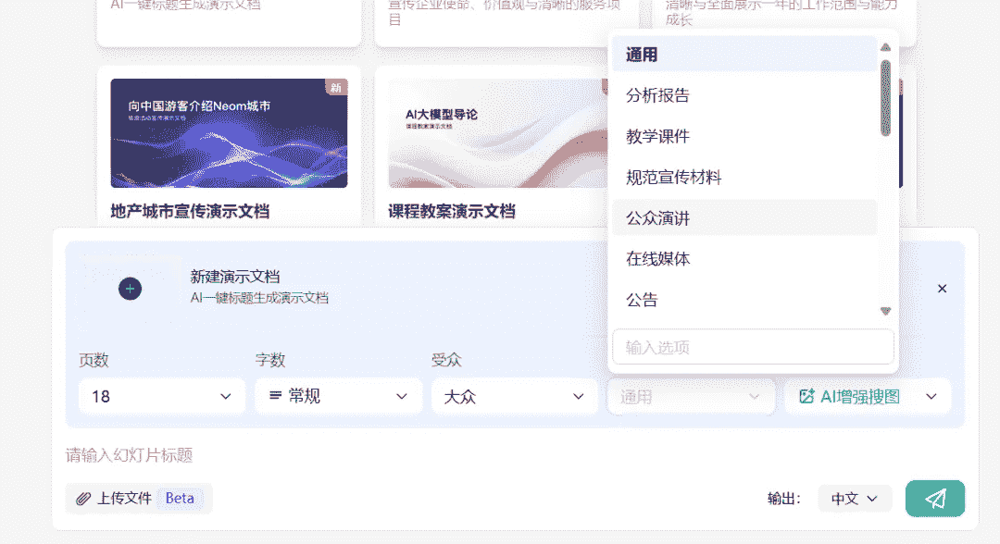

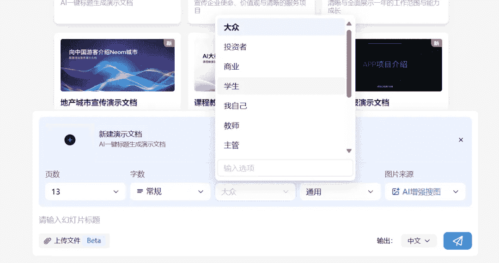

最后这个默认选AI增强搜图，意思应该是从网上给我找点配图上去（貌似是Bing搜索，不过如果后续能AI生图就更好了）

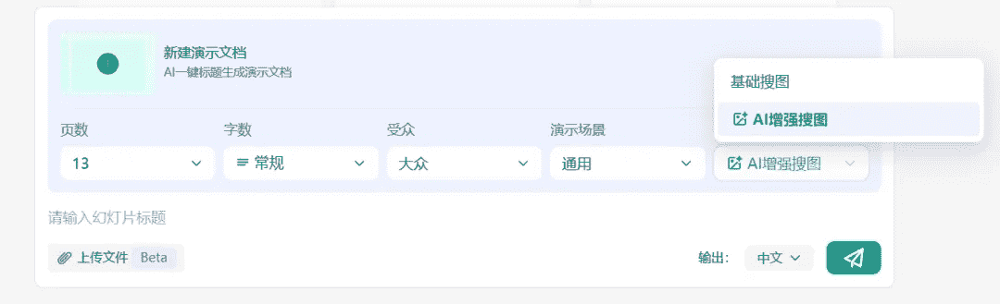

我**们可以看到左下角最近更新**了有一个上传文件的功能，但需要是PPT格式，我测试了下，这个功能的意思是可以上传PPT模板，根据你的模板来生成PPT，这个还是蛮不错的。

右下角可以看到，ppt支持输出中文版或英文版。

最后输入标题，我们点击生成，可以看到首先是生成了一个详细**的PPT大纲**，我们对于其中一些部分，可以直接上手修改。

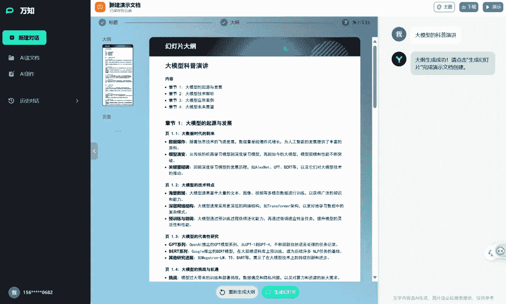

最后也返回了一些参考信息来源。

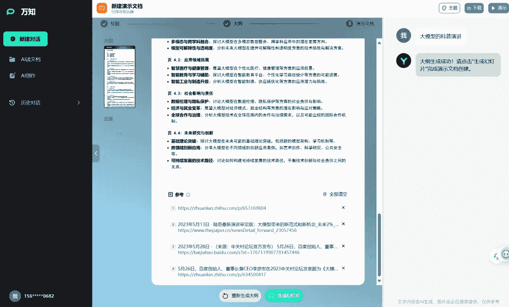

我们点击最下方的生成幻灯片，稍等片刻，即得到了一份虽然不完美，但是已经有个八分水平的PPT文档，排版和内容都是比较美观和有逻辑的。

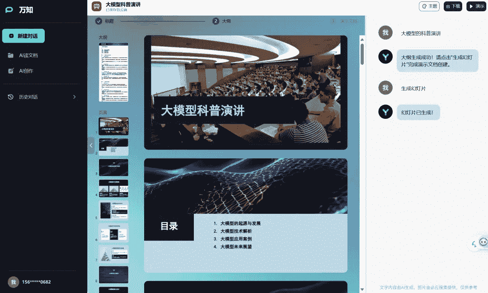

每一页的细节也支持更改，如果想修改内容，可以选中直接修改，或者让AI帮你扩写、缩写、续写。

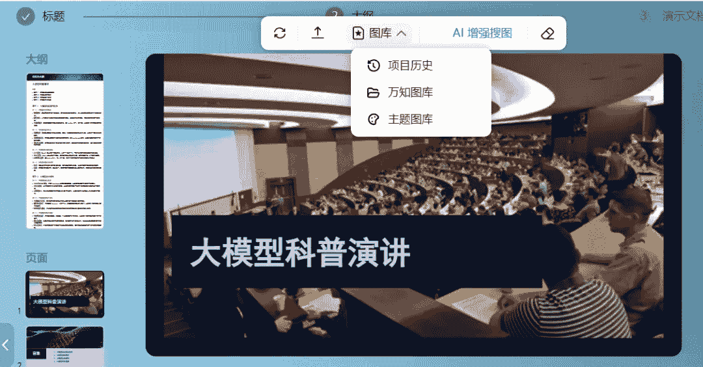

第一次有些Slide配图不太满意，没事。可以在想替换的图片上继续用“AI增强搜图”搜索，省去自己去搜索的过程，换到自己满意为止。

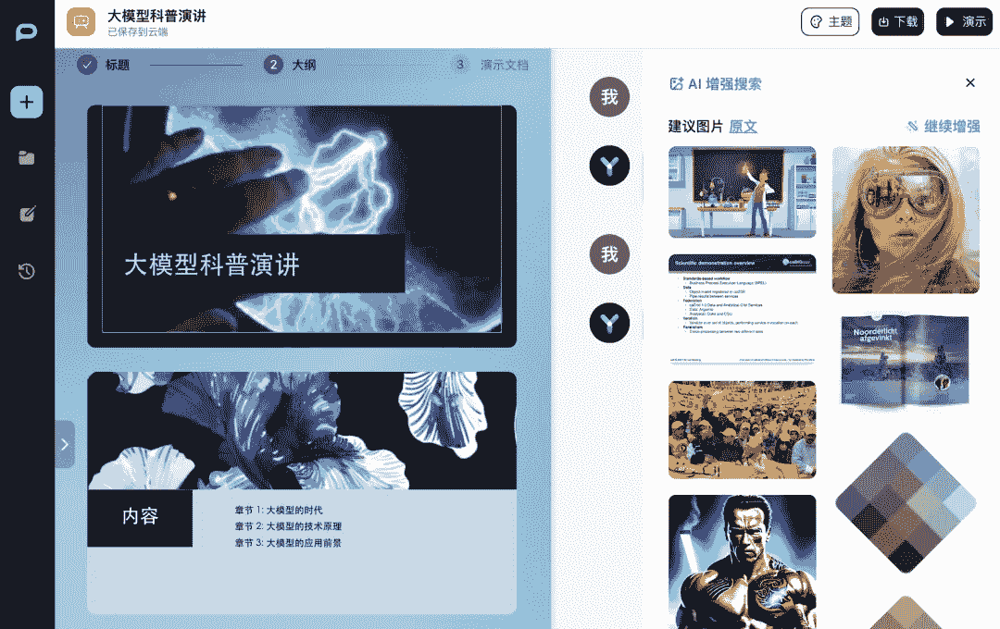

修改完成之后右上角一键下载，且无水印。

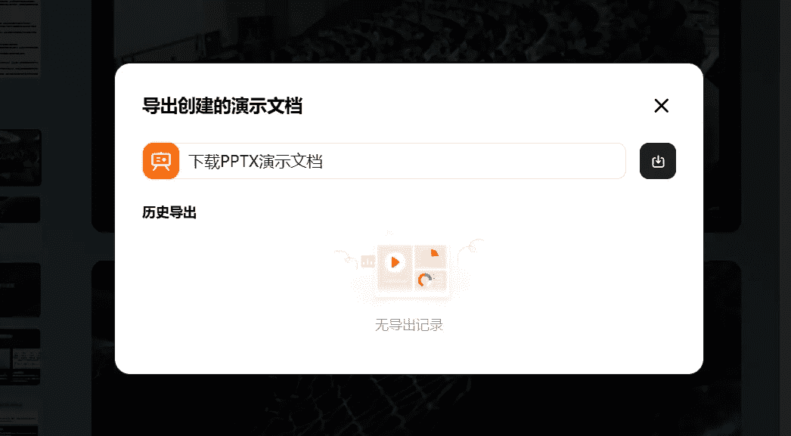

**除了生成PP**T之外，还有一个比较经验的功能是可以进行文档问答，且能看懂图表。

比如制作上份PPT时，我需要查看一些论文等资料，但很多内容看不懂怎么办，那么我们可以上传到万知。可以看到有两个模型，检索模型擅长更快速的文档检索，可一次性上传10个PDF文档。

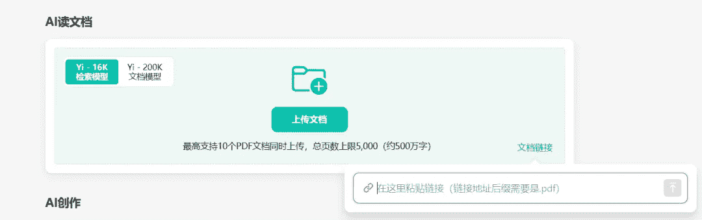

文档模型支持单个PDF的详细问答与总结。

最多可以上传大概500万字的文档，本少女上传了200多页的ppt文档，发现效果还挺好。

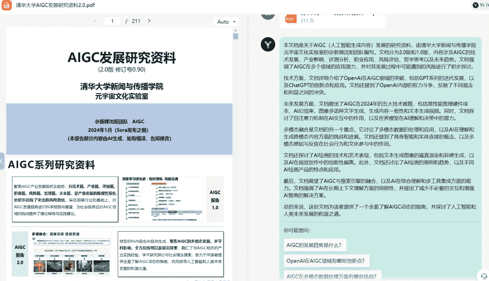

对于不懂的问题可以直接问答。

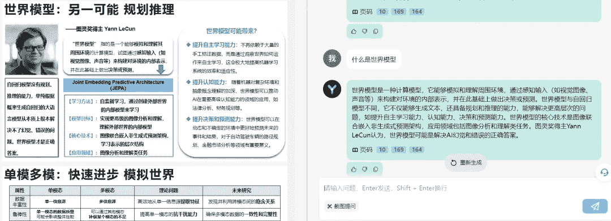

最后，多模态的能力也很强大，即使是图表，也可以读懂，进行问答。

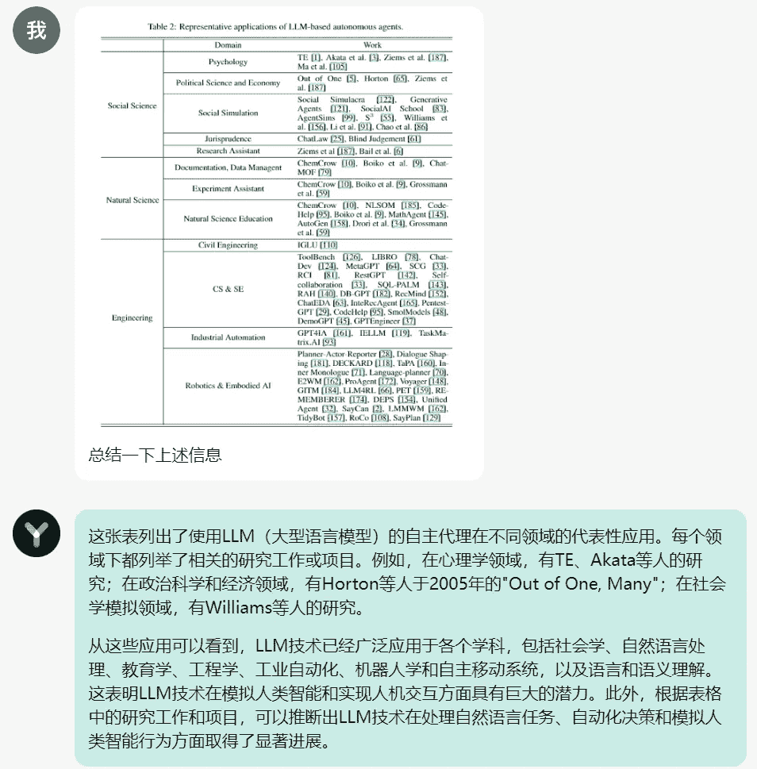

就是这样一款免费的AI效率工具，有朋友知道是哪家做的吗？

对了，手机端现在登录万知wanzhi.com，可以看同一账号的历史对话、分享，上述的PC端PPT操作都可以无缝切换。

对该产品感兴趣的朋友，欢迎添加本少女备注【加入万知用户群】，加入官方用户群~

