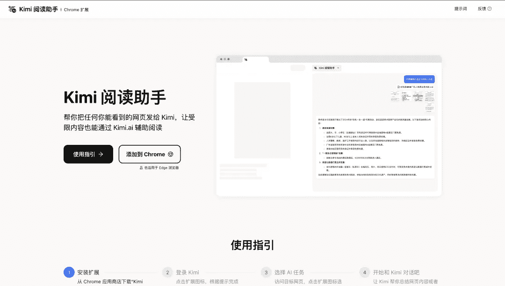
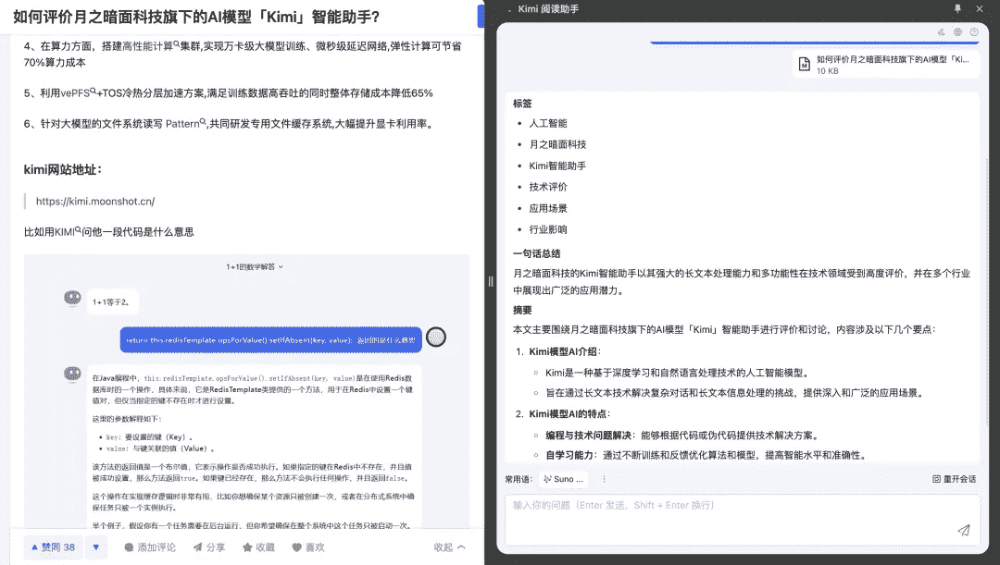
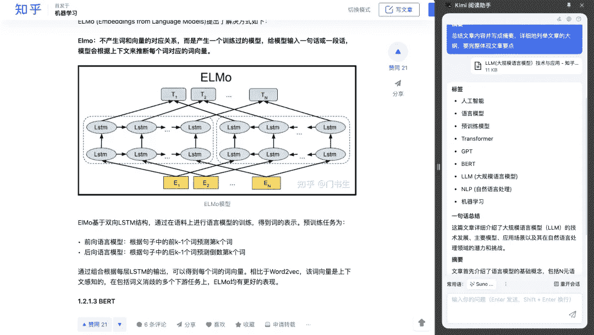
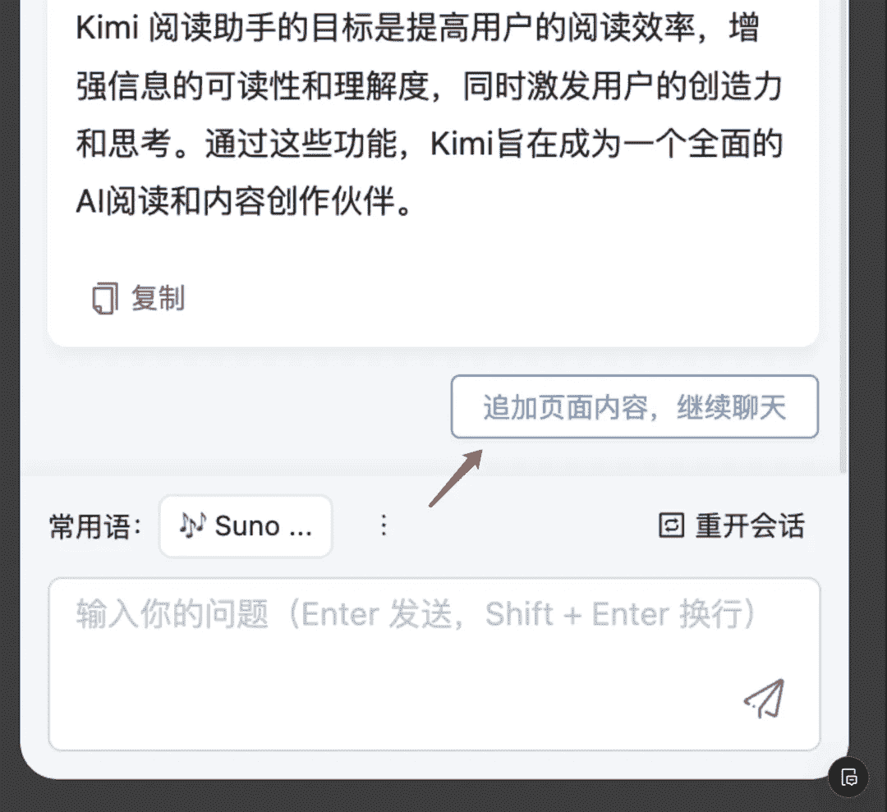
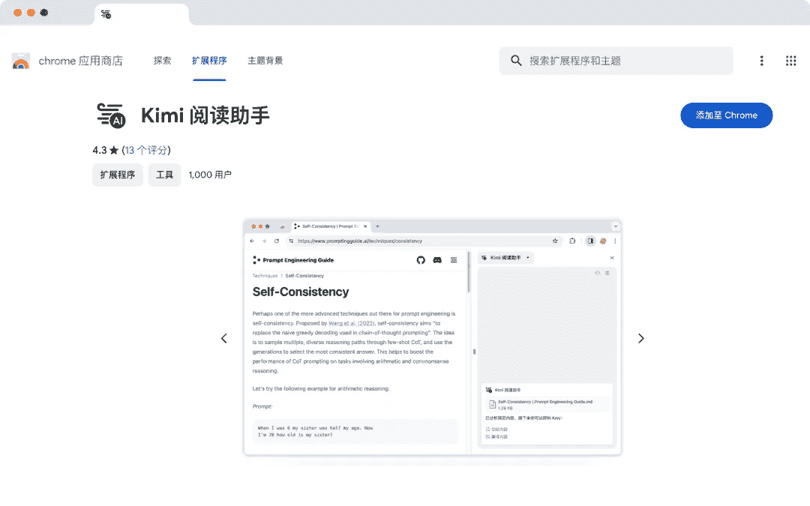
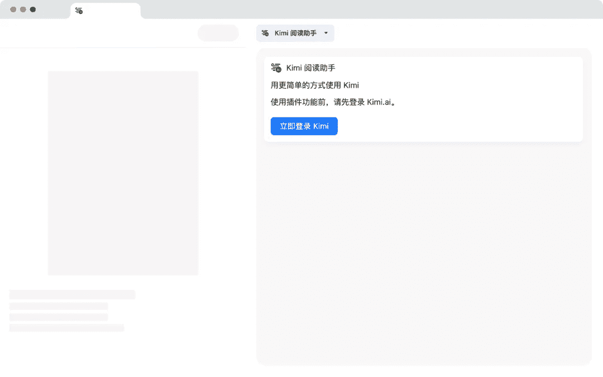
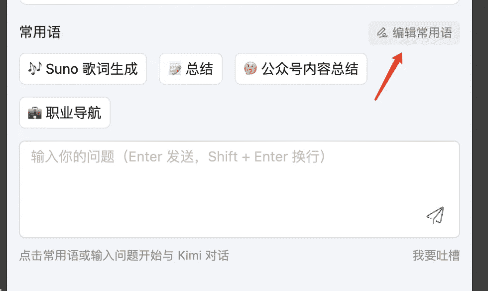

# （Kimi插件）真的太香了！（附常用模版）

> 来源：[https://agispace.feishu.cn/docx/Q8YFdPewRoRlSIxnfr9cFMH9nlf](https://agispace.feishu.cn/docx/Q8YFdPewRoRlSIxnfr9cFMH9nlf)

> 原创：抄就完了

> 原文：https://mp.weixin.qq.com/s/42QYb4ZSnJAxnVVTPo2Rmg

> Kimi最近属实火，这款插件让Kimi更香了。

近期，Kimi智能助手的热度不断攀升，民间高手们已经纷纷推出了各式各样的插件，让人目不暇接。在测评体验两款Kimi相关插件后，我在此特别推荐「Kimi阅读助手」这一款，并在此与大家分享我的使用体验，文章附安装教程和常用提示词模版。

Kimi阅读助手简介

Kimi阅读助手是一款非常实用的工具，它能够智能地解析用户正在浏览的页面内容，并根据要求提取出关键信息，以标签和简洁的总结形式呈现给用户。

快速总结并读懂知乎文章

**我认为这种设计对于**那些追求高效、喜欢直接获取信息精华的用户来说，无疑是一大福音！！

同时，让我非常惊喜的是，它还可以自己预设各种各样的提示词：可以根据自己的实际场景进行自定义，让它更懂你。当然你也也可以直接用这个默认的「总结网页内容」常用语。它主要辅助你快速总结各个网页内容的主要信息，提示词如下

# 你是一个擅长总结长文本的助手，能够总结用户给出的文本，并生成摘要。 工作流程让我们一步一步思考，阅读我提供的内容，并做出以下操作： 标签阅读文章内容后给文章打上标签，标签通常是领域、学科或专有名词 一句话总结阅读文章内容后，总结文章内容，并写成一句话总结这篇文文章 摘要总结文章内容并写成摘要，详细地列举文章的大纲，要完整体现文章要点

我也整理了超多常见的常用语模版，翻译、数据分析、排版、推文快写...在本公众号后台回复「kimi」即可获取完整提示词模版。

公众号文章快速阅读？一键总结！

Github项目复杂？快速读懂！

百度百科内容太长？一键总结！

知乎知识内容专业化？一键总结！

更令人惊喜的是，如果你对Kimi提供的总结感兴趣，想要深入了解更多内容，只需轻轻一点，即可通过内置的进一步对话功能，无缝跳转到官方页面，省去了在不同应用间切换的麻烦。

意犹未尽？继续追问！

**免登录阅读——**这应该是「Kimi阅读助手」的强大杀手锏。

有时候，我们在网络上找到的优质内容往往需要登录后才能查看完整版，而Kimi阅读助手能够帮你“绕过”这一门槛，直接获取文章的全部内容，让阅读体验直线拉升。

部分页面访问受限，它依旧能够绕过门槛

# **使用指引**

1.  **安装浏览器插件**

> 访问下方链接从 Chrome 应用商店下载「Kimi阅读助手」

> https://chromewebstore.google.com/detail/kimi-%E9%98%85%E8%AF%BB%E5%8A%A9%E6%89%8B/iejcbdponpipehjlchccknbmnkonnmji

Chorme应用商店搜索一键添加

1.  **用户授权登录 Kimi**

点击扩展图标，根据提示「立即登录」完成 Kimi 认证。

一键登录认证

1.  **添加常用语模版**

插件默认使用的是“页面总结”模版，为了更加方便的使用，插件支持预设一些常用语模版。使用常用语模版可以辅助我们一键执行，同时也能很好的避免反复手动填写内容。

我也整理了超多常见的常用语模版，翻译、数据分析、排版、推文快写...在本公众号后台回复「kimi」即可获取完整提示词模版。

预设常用语，开箱即用

1.  开始用「Kimi阅读助手」和网页对话吧

在您访问网页的时候，点击扩展图标选择对应的常用语，或者输入您想要了解的信息，就可以让 Kimi 帮你快速总结网页内容或者其他任务。

快速阅读真的太方便了！

「Kimi阅读助手」以其高效的信息提取、便捷的操作体验和强大的免登录阅读功能，为我们带来了前所未有的便捷。

如果你也是追求效率、喜欢精简阅读的朋友，那么「Kimi阅读助手」绝对值得一试。