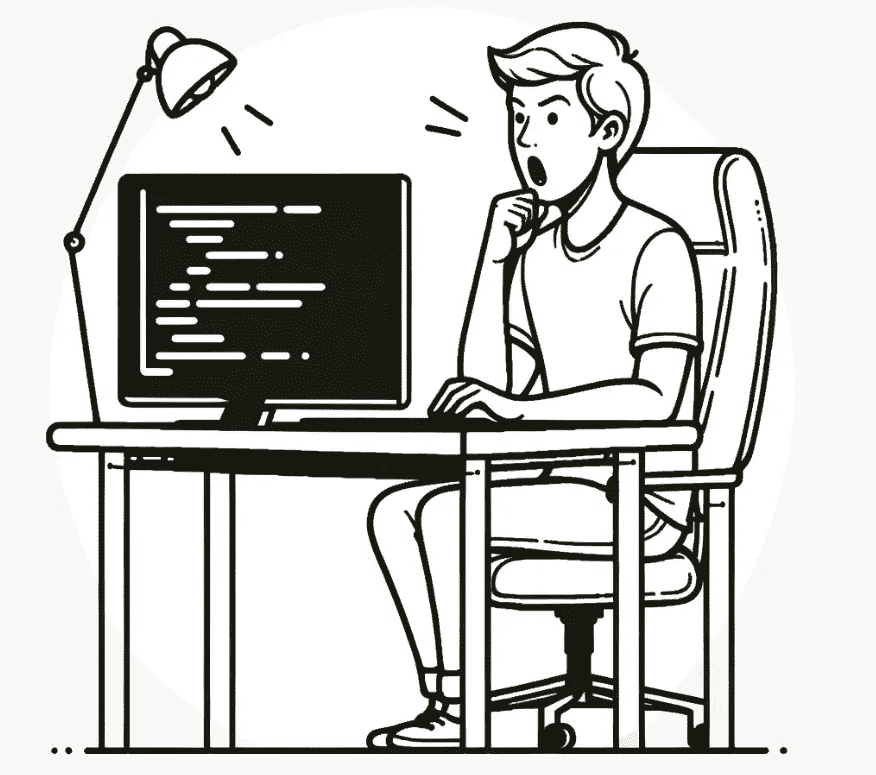
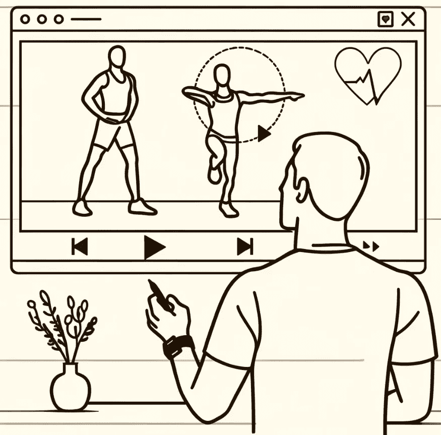
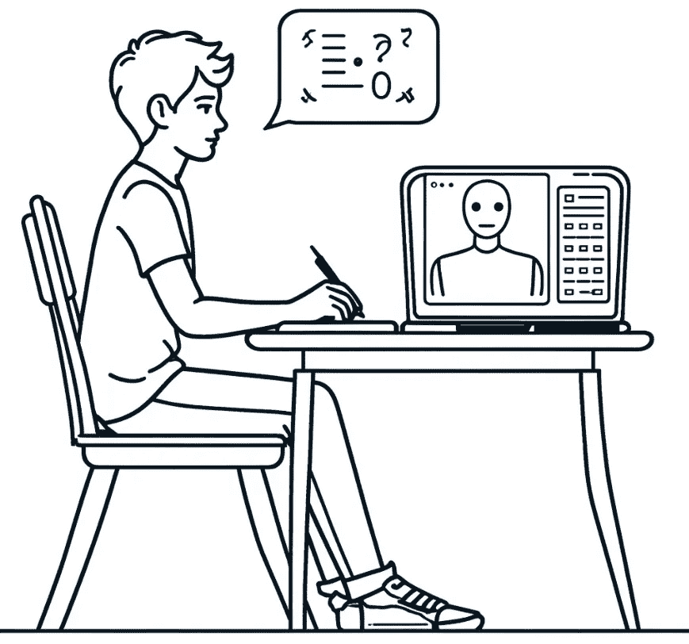

# （GPT-4o）如何颠覆我们的生活？看5个具体案例场景

> 来源：[https://agispace.feishu.cn/docx/VV7ZdMx8Po0cshxjVkScNRhjnTc](https://agispace.feishu.cn/docx/VV7ZdMx8Po0cshxjVkScNRhjnTc)

> 原创：AI生活研究所

> 原文：https://mp.weixin.qq.com/s/ZniLfb7lgP3zY68NbRMZEA

### 现在，大家应该很了解GPT-4o了

我想聊点不一样的话题

GPT-4o在多模态感知能力，以及反应速度的巨大提升，让新版ChatGPT在生活中有更加落地的使用场景。

GPT-4o,它如何颠覆我们的生活呢？

我这里总结了以下日常生活场景，完全可以用起来，体验直接起飞！

1.  **AI辅助写代码**

举个例子：小张是个程序员，经常需要快速找到代码中的bug。

他以前用的AI工具需要等待一段时间才能得到反馈，但GPT-4o几乎是秒回！小张只需要输入问题，GPT-4o立刻就能提供解决方案和优化建议，让他的工作效率提高了不止一个档次。

1.  **分析数据**

举个例子：小李在做市场调研，需要分析大量的图表和数据。

有了GPT-4o，他只需上传图片和表格，AI不仅能识别图像中的信息，还能结合文字说明给出详细的分析报告。再也不用花费大量时间手动整理数据了，轻松搞定各种复杂的报告。

1.  **动作项目辅助**

举个例子：小美是一名健身教练，她希望能更好地指导学生的动作。

有了GPT-4o，她只需上传学生的训练视频，AI能分析出动作中的错误并给出纠正建议。这不仅提高了教学效果，还让小美的课程更加专业和有针对性。

1.  **语音和文本的无缝转换**

举个例子：小明是个播客主持人，他每天要录制大量的音频内容。

以前他需要手动将录音转成文字稿，但有了GPT-4o，他只需上传音频文件，AI立刻就能生成高质量的文字稿，还能进行语法和内容优化。小明的工作效率大大提升，他有更多时间去准备新的节目内容。

1.  **教育领域的私人导师**

举个例子：小刚的数学成绩一直提不上去，家长也没时间去辅导她。

有了GPT-4o，家长只需要给他一部手机，让GPT-4o视频通话辅导作业，她不会的题目，GPT-4o就会一步步为她解答。

不仅如此，它还能根据小红的学习进度，推荐适合她的学习资料和练习题，完全是个全天候不下线的私人导师！

当然，视频能力未来几周才会陆续开放，得先等等。

GPT-4o的出现，让AI更加落地了，无论是医疗、教育、工作还是日常娱乐，真正可以用来改善我们的生活，而不再是生成文字的工具。