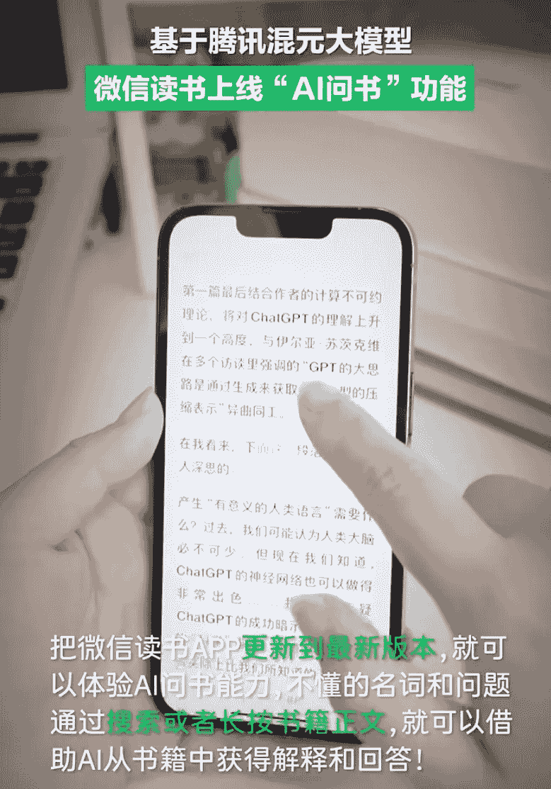
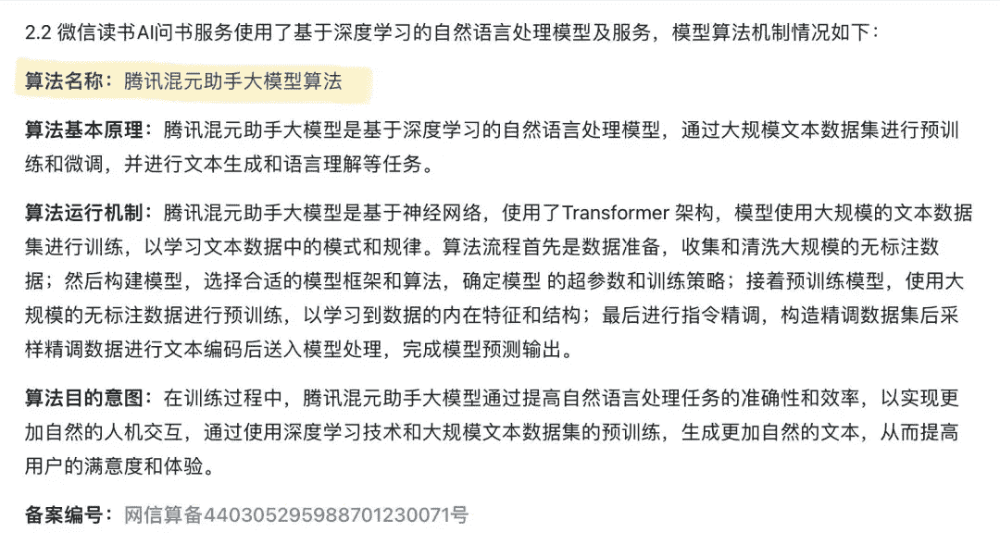
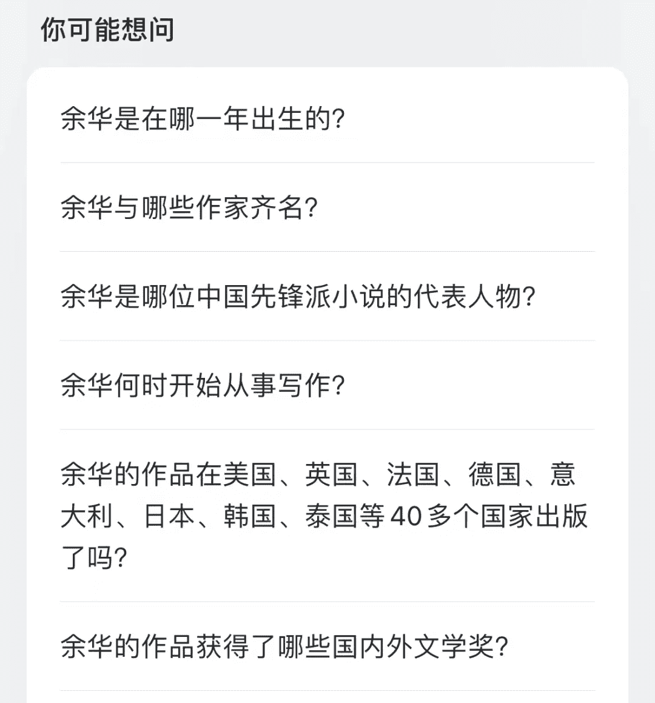
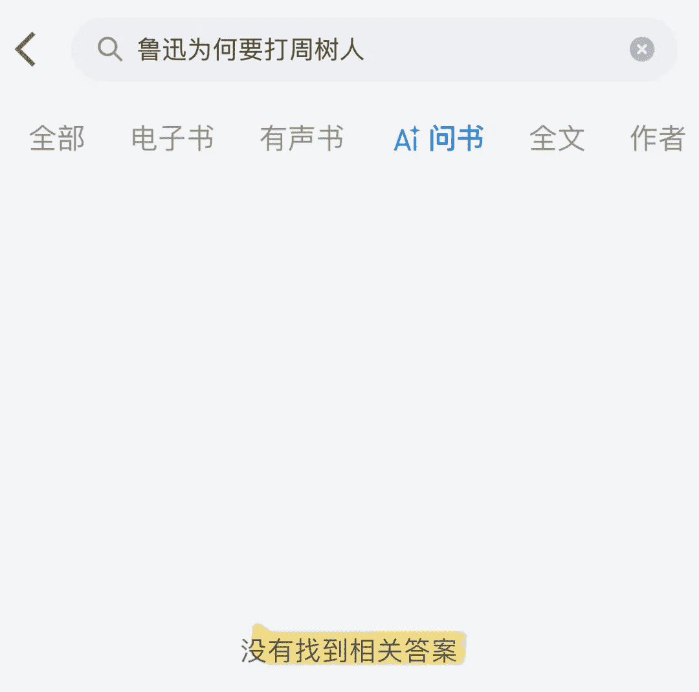
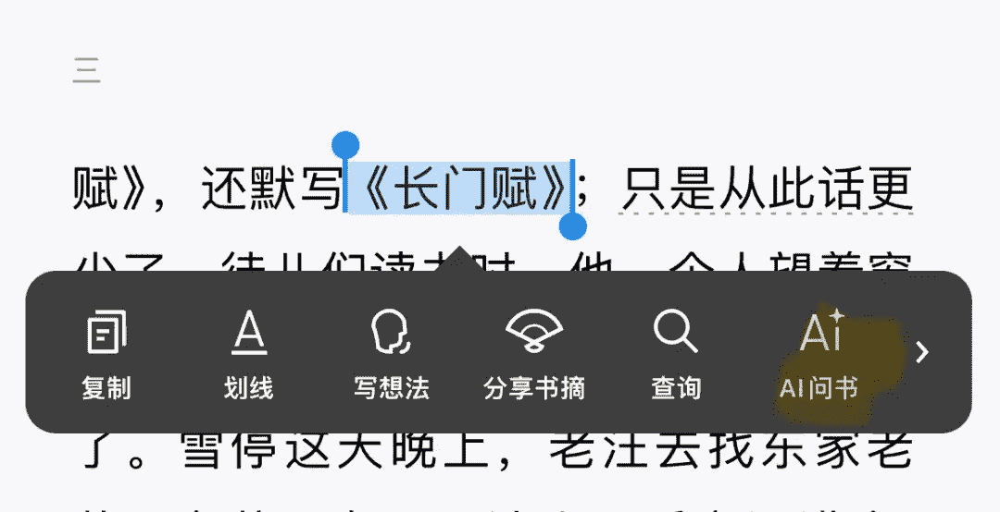
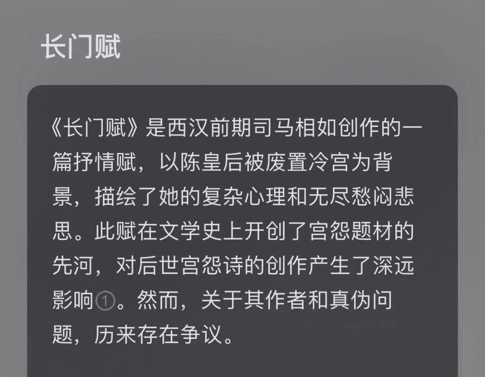
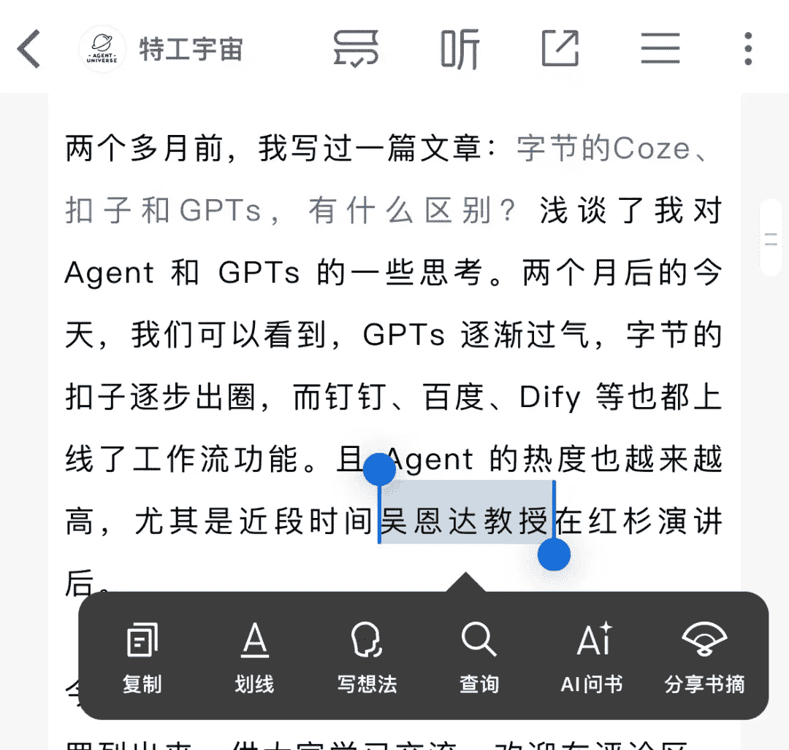
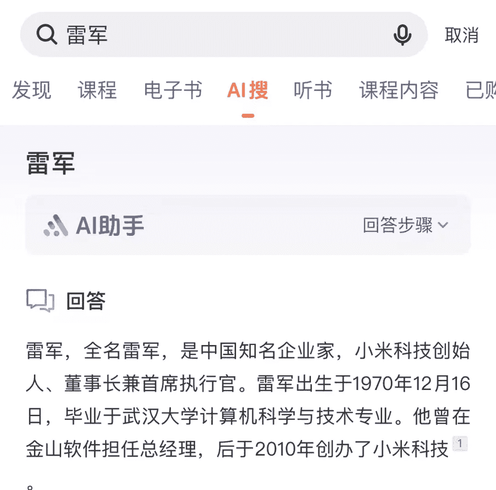
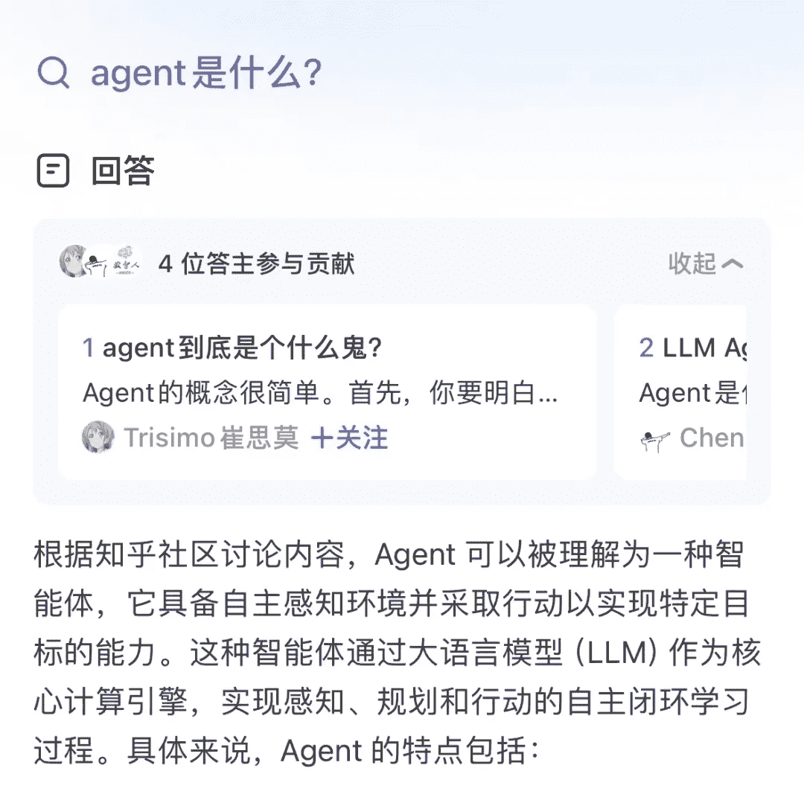
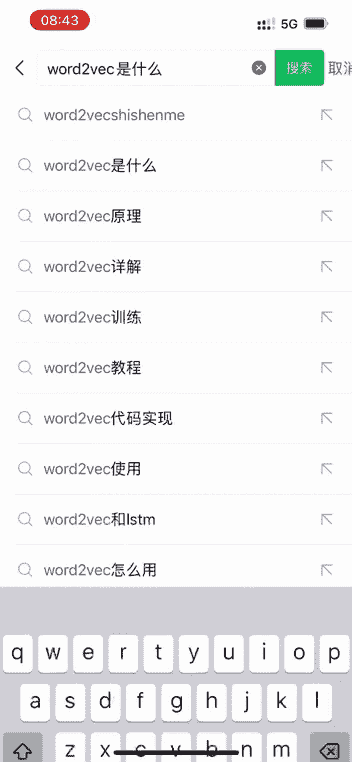

# （读书）混元大模型接入🛰️读书，AI 问书功能正式上线。

> 来源：[https://agispace.feishu.cn/docx/CNEkdXKC0oNENixB2H7c9hjxnge](https://agispace.feishu.cn/docx/CNEkdXKC0oNENixB2H7c9hjxnge)

> 作者：特工少女

> 👸号：特工宇宙

> 原文链接：https://mp.weixin.qq.com/s/prftVeWtKw918t-wpz71kA

早在一个多月前，就已经有很多小伙伴拿到了🛰️**读书的 AI 新功能内测，**而就在一天前，AI 问书功能正式全量上线。

移动端需要更新到最新版，PC 端暂不支持。

什么是 AI 问书功能？

🛰️读书会根据用户输入的问题或提交的搜索指令，利用大语言模型引用、整理书中相关观点生成答案回复用户提问，并生成与用户提问相关的问题供用户进一步提问。

简单来说就是内嵌了个 AI 搜索功能，基于🛰️读书生态海量的内容资源，给予回答，基于 RAG() 技术，将内容的分发和呈现做了重塑。

而实现此功能，使用的是**腾讯混元助手大模型**。

AI 问书的功能分为两部分，**回答问题**和**解释概念**。

**回答问题**，即在头部搜索框中，输入相关提问，选择“AI 问书”，等待回答。

回答生成完毕后，还会返回引用的书籍资料列表，用户点击后，直接跳转到该书籍论文等资料的指定片段。

再之后，还有提供的“猜你想问”功能。

不过目前该功能比较受限，大部分高自由度的提问，无法回答。

在我们的测试中，也出现了部分幻觉问题。

AI 问书的第二部分是**解释概念**。

即在用户阅读某一本书某一章节时，对于不明白的名词或片段，可选中，再点击“AI 问书”。

功能类似飞书的企业百科，还是挺不错的。

以**前有陌生**的概念，词段，少些有热心的网友做了批注，但大部分情况还得复制了再去搜索，再返回🛰️读书做笔记，现在直接内部闭环了。

还有个玩法是，将自己本地的文件，或者喜欢的👸号文章，上传至🛰️读书，也可以使用此功能。

比如拿一个比较优质的👸号的优质内容来举例，也可以使用“AI 问书”功能。

**AI 重塑内容平台，是大趋势**，🛰️读书并不是第一个。

比如得到APP，就早已上线 AI 搜功能。

知乎也上线了知海图 AI.

此外，值得一提的是，🛰️这个巨无霸本身，也已经算是一个搜索引擎，不少用户会选择在🛰️“搜一搜”中获取信息。

而我们也看到，🛰️在内部测试 AI+搜索的功能。

1.  OpenAI() 也即将发布 ChatGPT Search，近几个月，AI+搜索工具如雨后春笋般出现。不少用户表示，在使用了 360 AI() 搜索，秘塔 AI 搜索等工具后，很难再适应传统搜索模式。AI+搜索已初步被市场验证，技术实现难度不大，但如何精准的回复高质量信息，是一个需要不断打磨的工程化问题。最后，关于🛰️ AI 和 AI+搜索，可以看往期这两篇文章：🛰️，悄咪咪上线了这三款 AI 产品！AI 搜索个人玩家，3 天独立开发上线！

