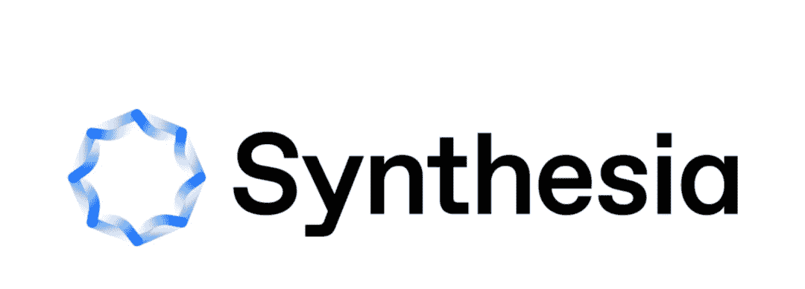
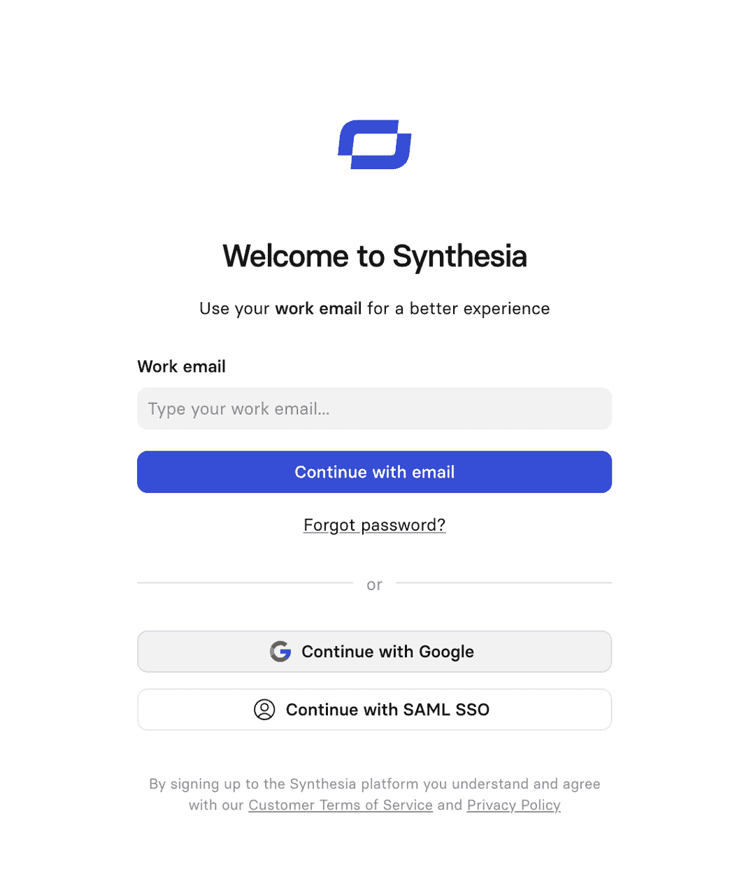
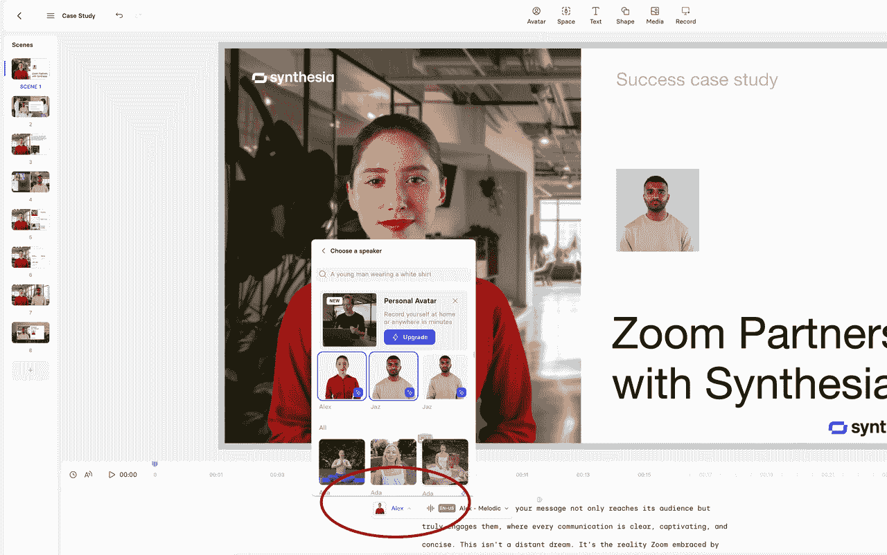
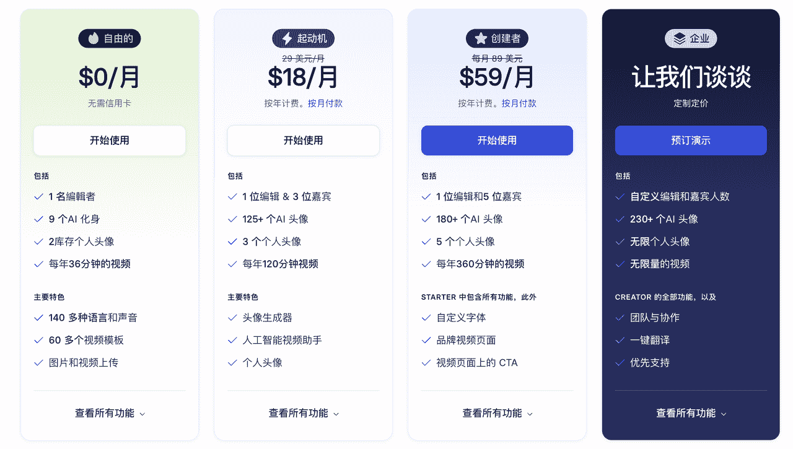

# Synthesia

> 来源：[https://agispace.feishu.cn/docx/MHK4dbScqoAxQ9xyexPcT4xDnAR](https://agispace.feishu.cn/docx/MHK4dbScqoAxQ9xyexPcT4xDnAR)

## 简介

Synthesia是一款基于人工智能的视频生成平台，它能够将你的文字脚本转化为生动的视频。通过AI技术，你无需摄像机、演员或复杂的后期编辑，就能制作出专业水准的视频。

Synthesia由来自加州大学洛杉矶分校、斯坦福大学、TUM和剑桥的人工智能研究人员和企业家团队于2017年创立。

## **应用场景**

**企业培训**：制作培训视频，帮助员工快速掌握新知识。

**产品营销**：创建吸引人的产品介绍视频，提升产品吸引力。

**广告宣传**：快速生成广告视频，扩大品牌影响力。

**教育内容**：制作教育视频，提高学习效率和兴趣。

**如何使用Synthesia？**

**注册账号**：访问官网 https://www.synthesia.io

**选择模板**：选择一个你喜欢的视频模板。

**编辑脚本**：输入你的脚本，或上传文本文件。

**选择虚拟人物**：挑选一个合适的虚拟人物。

**收费情况**

**使用条件：**需要特殊网络