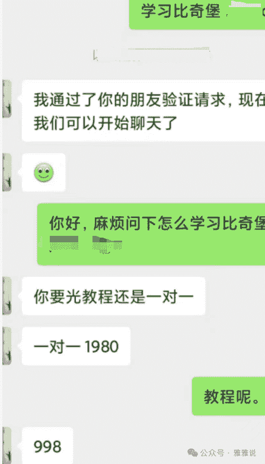
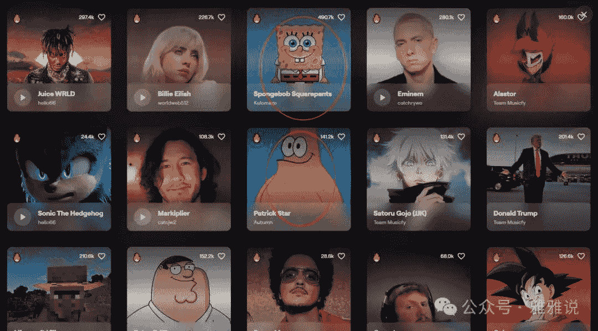
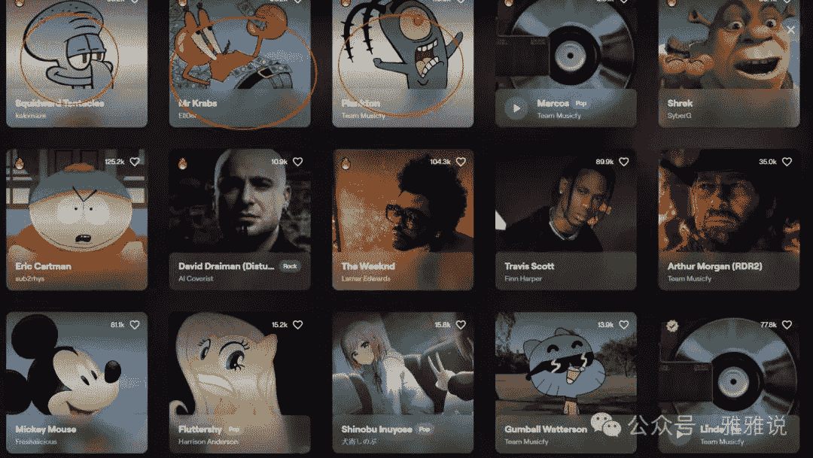
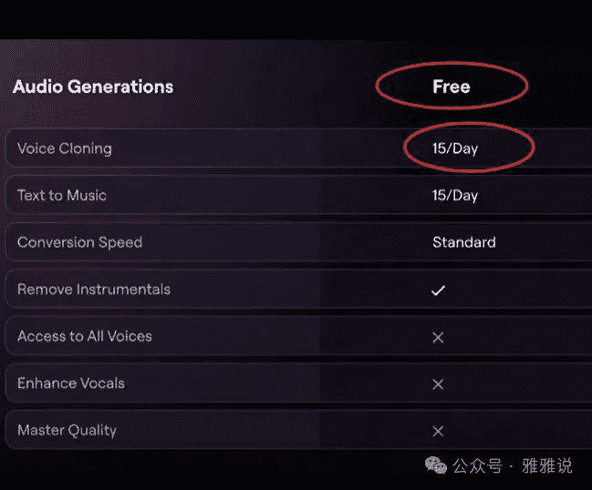
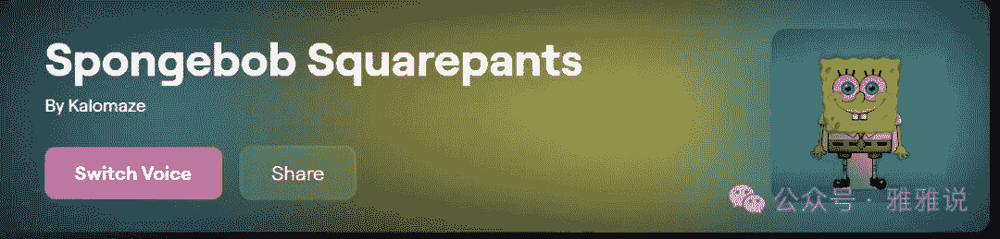
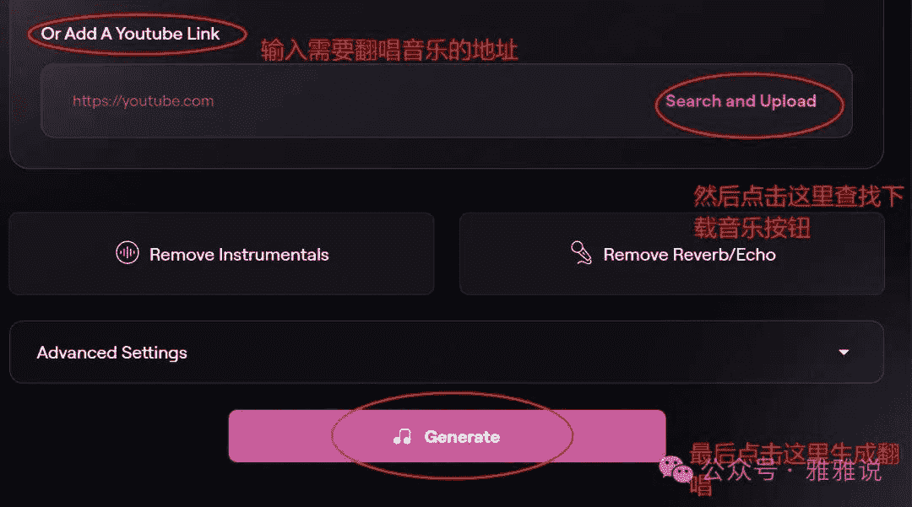

# 比奇堡乐团AI翻唱账号，最简便免费的方法来了！无需电脑配置无需魔法！

> 来源：[https://agispace.feishu.cn/docx/LrURdDNHzocxKnxUia7ctYbtnJe](https://agispace.feishu.cn/docx/LrURdDNHzocxKnxUia7ctYbtnJe)

> 作者：雅雅说

> 公众号：雅雅说

> 原文链接：https://mp.weixin.qq.com/s/jYic0NW_JgpDl35QPGGOpA

# **01**

**雅雅叨叨叨**

大家好，先给大家汇报个情况吧，前几天我中奖了，是在剧分钱的免费直播教学课堂上，参加公屏抽奖中的：百度网盘会员+价值698的陪跑课(据说买会员以后是198)，还蛮开心的。

其实我一直属于运气比较一般的人，从小到大，真的是大奖绝缘体，我的大奖规格，一般就是洗衣粉，卫生纸这类非常实用的！这次还真挺意外的！！

那，现在请容许我厚着脸皮大胆说出来：

原来运气真的会青睐一直努力的人呀！

另外就是我账号的文章居然被当作课堂案例讲解了，还挺意外的，没发现自己账号居然做得这么”好“！

~总之还是感谢剧分钱短剧平台吧。

最后想聊聊直觉这个东西，好像有点玄学了，我发现我的直觉特别准，就是事情发生之前，脑子里会有个强烈的意念，暗示自己，而且最终会跟事情发生走向完全一致。

就比如这次中奖，我在中奖之前，脑子里面就有个强烈的意念，我会中奖，结果真的中奖了，再比如之前有次我走在路上，预感到自己会摔倒，结果真的摔破了胳膊。。。

这难道就是传说中的宇宙无敌的吸引力法则？？？？~~~那我们以后还是多想想好事吧

小伙伴们，你们有没有这样直觉超准的情况？？？欢迎加微交流讨论！！！

# **02**

**项目介绍**

2个月之前我就发了比奇堡乐团AI翻唱方法，不过当时不是要收费，就是需要电脑配置，但做的人很少，属于市场的蓝海期，所以也很值得去做。

当然市面上教程也是很贵的，据雅雅了解是这种画风的，你们感受一下（图1）！

不过，随着信息差被逐渐抹平，做的人越来越多，技术门槛也一步步降低，前一段教学价格降下来了，但也要198。。。而且还买的特别好。。。（图2）

图1                                                                                           图2

今天之所以再次介绍：一是因为发现了很简便免费的方法，无需魔法，无需电脑配置！二是发现很多人还不知道这个免费项目！三是市场流量还在！！！从网站截图中，大家可以看到，所有的比奇堡模型和其他的热门声音模型，都帮你训练好了！

而且完全免费：免费版每天可以生成15次，新手是足够了呀！

# **03**

**实操经验**

操作步骤如下:

1、随便选择了海绵宝宝的声音模型。

2、然后选择了热门歌曲《离别开出花》，点击生成按钮。

3分41秒的音频，只用了8秒就翻唱完成了，最后下载到本地。简直太方便了，这个必须安利给大家！赶紧去任意翻唱吧！太帅啦！