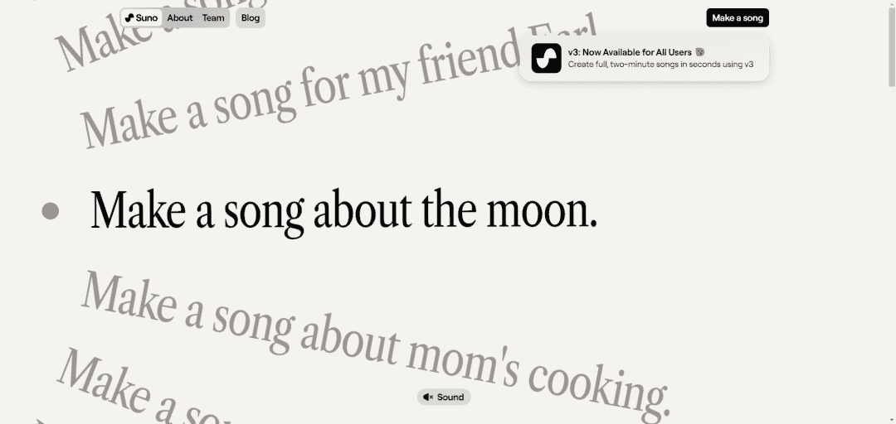
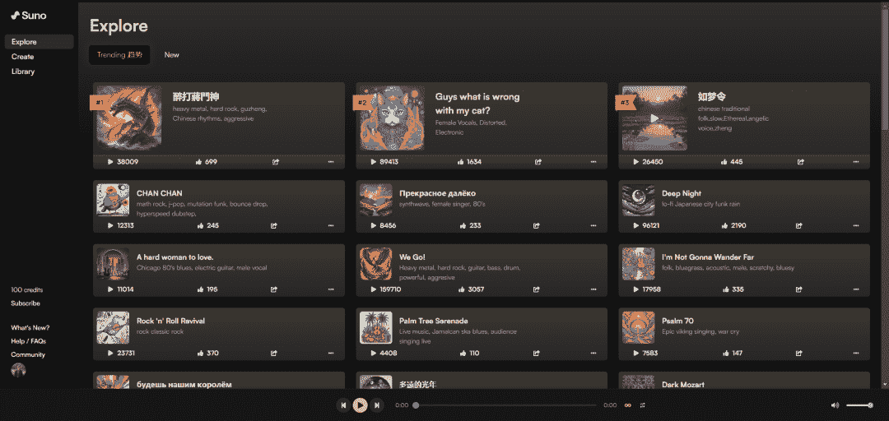
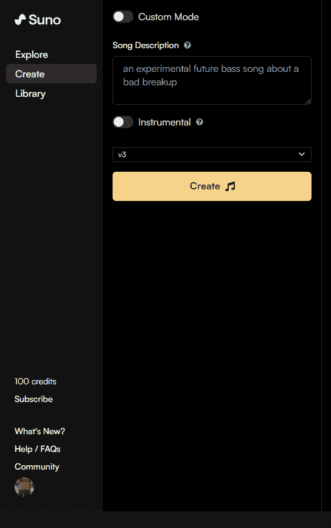
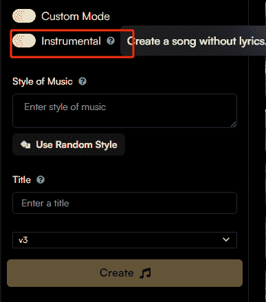
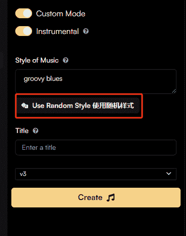
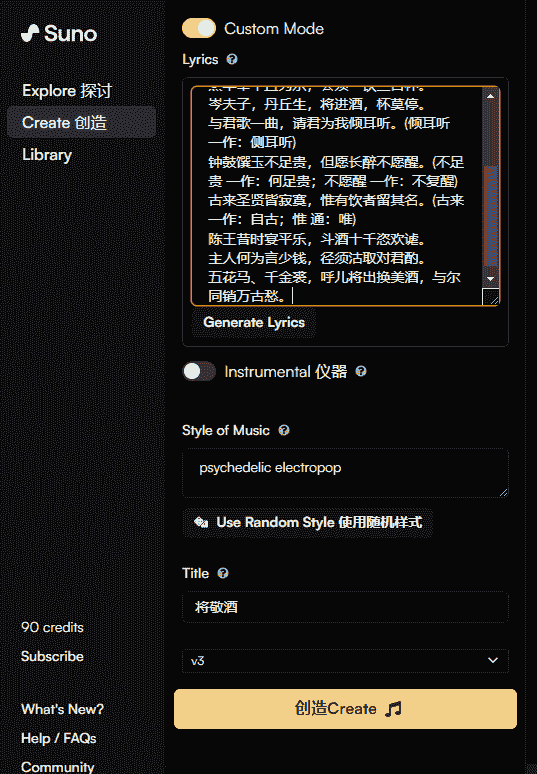
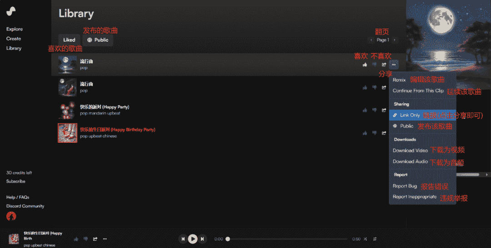
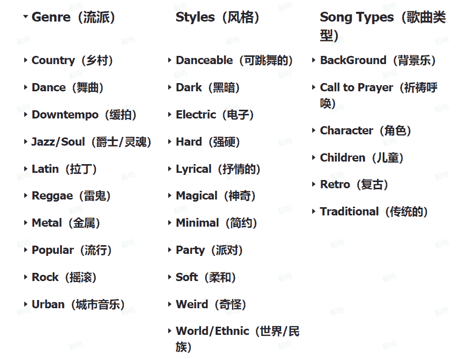

# AI音乐生成工具Suno详细操作指南，手把手教你创作一首AI音乐

> 来源：[https://agispace.feishu.cn/docx/DmCAd3zmKousH5xJ7KdcTG1ZnUg](https://agispace.feishu.cn/docx/DmCAd3zmKousH5xJ7KdcTG1ZnUg)

> 作者：毅鸣

> 公众号： AI洞察笔记

> 原文链接：https://mp.weixin.qq.com/s/-esuEM2ArPLqG-T7C47z2w

最近，AI音乐生成很火，Suno这个平台在AI音乐生成这个领域独树一帜，之前我有分享过如何5分钟原创一首属于自己的音乐：手把手教你利用AI 5分钟原创一首属于自己的音乐music，附详细教程

那时候的Suno，虽然也能根据提示词生成出带完整歌词和旋律的歌曲，但是毕竟刚推出，各方面的能力都还差点意思。但最近Suno推出了V3新版本，不仅在质量上有了大幅提升，还支持自定义歌词，然后让 AI 生成旋律并演唱，这让用户可以更准确地表达自己的情感和思想，而且歌曲的整体效果也非常不错，因此目前非常火热。

今天就为大家详细介绍一下 Suno V3 的用法以及一些音乐相关的基础知识。

# **Suno背景介绍**

Suno 是一家研究驱动型的人工智能公司，其专门研发生成式AI()模型，为创意工作者提供强大的创作工具。公司推出的Chirp模型，通过文字描述就能生成逼真的音乐和声音效果。用户只需输入文字，Chirp就能即时转换生成配乐、人声、音效等，可广泛应用于游戏、短视频、播客等创意领域。作为行业领军企业，Suno正在以科技改变音乐内容创作，为更多创意工作者提供帮助。Chirp模型的推出标志着Suno在AI生成音频领域取得新的进展，有望迎来行业变革。

官方地址：https://www.suno.ai/

Suno V3 目前是免费开放给所有人使用的，新用户每天登录后会赠送的 50 积分，可以生成 10 首歌曲，额度还是非常充足的，如果需要商用则必须购买会员。登录后主页是 「Explore / 探索」界面，收录了社区内热度最高以及最新的 AI 歌曲，它们都非常值得一听，不仅曲风、节奏旋律多样，还支持多种不同的语言，与真实的音乐网站几乎没有差别。

我在下面附上目前热度排名第一、第三的中文歌曲《醉打蒋门神》、《如梦令》，让大家直接感受一下 Suno v3 的生成效果（注意调低音量）。《醉打蒋门神》、《如梦令》歌曲结构非常工整，有前奏、主歌、副歌、导歌、桥段、solo 和 结尾。在此基础上，Suno 生成的旋律风格与歌词非常匹配，并且 AI 虚拟人声的演绎也很有力量，音乐一起感觉情绪就被调动起来了，听完后让人不得不感叹 AI 的强大 。

# **创作步骤**

1、登陆进入主页后，点击左侧“Create”按钮，即可看到如下图所示页面；

2、分为两种模式，一个是默认模式，一个是自定义模式，两者的区别在于：默认模式是通过AI prompt提示词来进行创作，这就很考验对AI提示词的掌握，以及对音乐领域专业知识的掌握；

而自定义模式，则可以自己自定义歌词，可以自己写，也可以复制一些古诗词，或者是比较熟悉的歌曲的歌词进去，或者说直接使用ChatGPT之类的AI进行歌词创作。

3、选择是否纯音乐，如下图所示，在选择了模式之后，可以选择是否开启纯音乐选项，开启后，则没有歌词，默认是纯音乐；

4、填写音乐风格，是流行乐？还是摇滚？还是民谣？在这里也可以选择随机风格，如下图所示。

5、填写歌曲标题，也就是我们俗称的歌名。

6、选择生成的模型版本，默认这里开启的是v3。

7、一切准备就绪之后，则点击Create按钮即可。

如上图所示，我选择的音乐风格是psychedelic electropop（迷幻电子流行音乐），歌词是复制的李白的《将敬酒，生成出来后的效果，如下所示：

### **Library**

你可以在这个界面查看生成记录，以及点赞和发布的歌曲，同时支持对歌曲进行编辑操作。

### credits left和Subscribe

该处显示用户剩余积分，新用户注册后会有 50 积分，如果没有显示积分，请退出后再重新登录。

# 音乐知识科普：什么是流派？什么是风格？

**流派(Genre)：**

音乐流派是指一群共享特定音乐特性和传统的作品集合，是分类音乐多样性的一种方式。诸如摇滚、爵士、古典、电子和乡村音乐等，都是独具特色的流派。这些分类主要基于作品的结构、节奏、和声以及乐器使用等关键因素。每个流派都是音乐历史长河中的一部分，不仅代表了一段时间的音乐趋势，还深受其历史和文化背景的影响。音乐流派的形成和发展，不仅是艺术表达的演变，也是文化交流和社会变迁的见证。

**风格(Style)：**

风格在艺术领域，尤其是音乐创作中，主要指艺术家或作品所展现的独特特征和创作手法。它是艺术家个性化的音乐表达，不受限于单一流派，而是可以跨越和融合多种音乐风格。例如，一位流行音乐艺术家可能通过其特有的唱腔或舞台表演风格，展示其独特的艺术个性。这些元素共同构成了艺术家独一无二的音乐风格，使其作品与众不同，成为其艺术标识的一部分。

关于流派和风格，这里有一份文档，可以收藏查看：

飞书文档：[音乐流派、风格词汇参考](https://i0x94xzpjmh.feishu.cn/docx/S4vwdn9gio8LuCx3ehlcAqfOnSd)

### **歌词提示**

歌词提示功能常见有三种输入形式，分别是元标签 + 文本、纯元标签、纯文本。

**元标签：**

元标签(Metatags)是一种特殊的提示，用来在创建内容时提供方向性的指引，但它们自身并不会被直接说出或演唱。元标签可用来指导歌词和音乐的间断，帮助 Chirp 从一个部分过渡到另一个部分。

官方最早提出的元标签是诸如 [verse] [chorus] 这类歌曲结构。

官方链接：

https://suno-ai.notion.site/Using-Metatags-34944efe09ec41d693e314f13af44695

#### **书写格式**

+   使用像 [verse]、[chorus] 这类元标签格式来引导文本生成(元标签内容不区分大小写)。

+   歌词行数官方建议是 4-8 行，生成效果最好，但具体还是看个人需要，无硬性要求。

+   每个部分(比如verse—chorus)之间要空一行。

+   歌词中的即兴或旁白的部分，用 () 表示。

**歌曲结构**

+   Intro(引子或前奏)：歌曲的开始部分，通常用来建立歌曲的基调和氛围。引子可能包含一些基本的旋律或节奏元素，但通常不包括主要的歌词。

+   Verse(诗歌部分/主歌)：这部分是歌曲的主体，通常包含歌曲的主要故事或情感内容。每个诗歌部分可能有不同的歌词，但通常保持相同的旋律和节奏模式。

+   Chorus(合唱部分/副歌)：通常是歌曲中最具辨识度的部分，重复出现，包含主要的主题和旋律。合唱部分是歌曲中最易被记住的部分，往往包含“钩子”(hook)—— 一种特别引人入胜的旋律或歌词。

+   Bridge(桥接部分)：这一部分出现在歌曲后半部，提供了与前面诗歌和合唱部分不同的旋律和节奏，用来增加歌曲的多样性和深度。

+   Outro(尾奏)：歌曲的结尾部分，与引子相似，但用来结束歌曲。尾奏可以是对引子的重复，或者提供一种平静下来的感觉，渐渐带出歌曲。

+   Pre-Chorus(前副歌)(可选)：在某些歌曲中，前副歌作为从诗歌部分到合唱部分的过渡。它可以增加歌曲的动态范围，为合唱部分的到来建立情感张力。

+   间奏(Interlude)(可选)：间奏是歌曲中的一个部分，其中不包含歌词，只有乐器演奏，通常用于连接两个不同的歌唱部分，如两个诗歌部分或诗歌部分到合唱部分之间，提供歌曲的情感转换或增强歌曲的整体感觉。