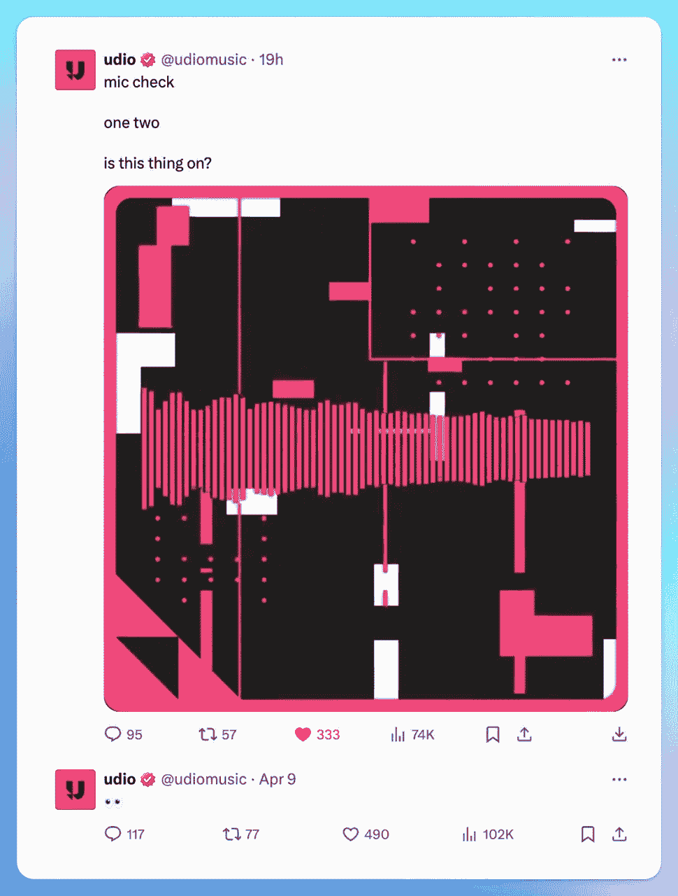
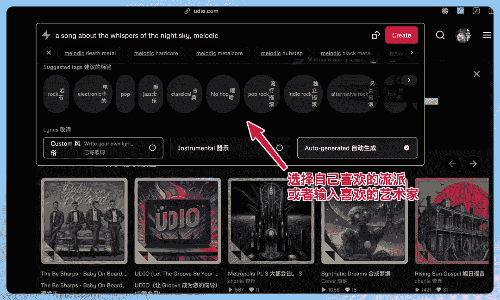
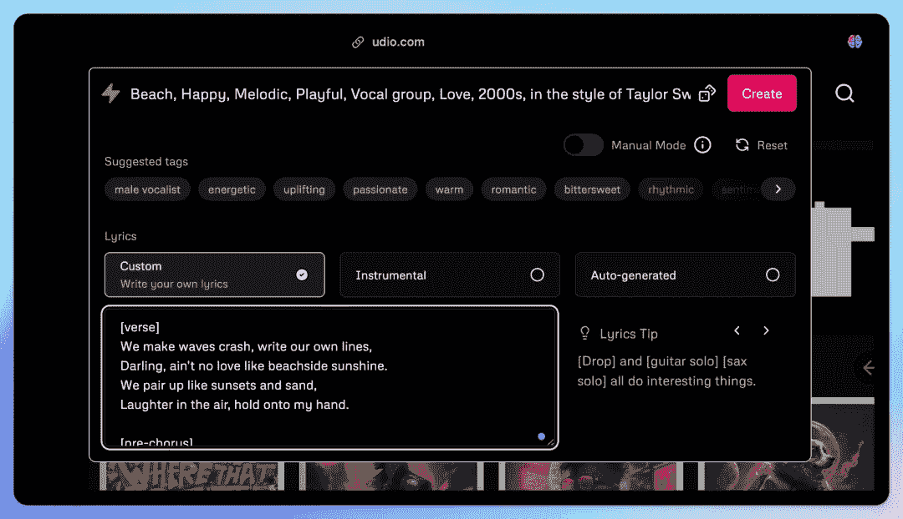
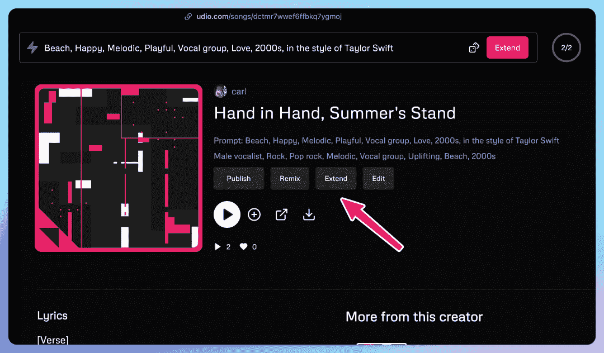
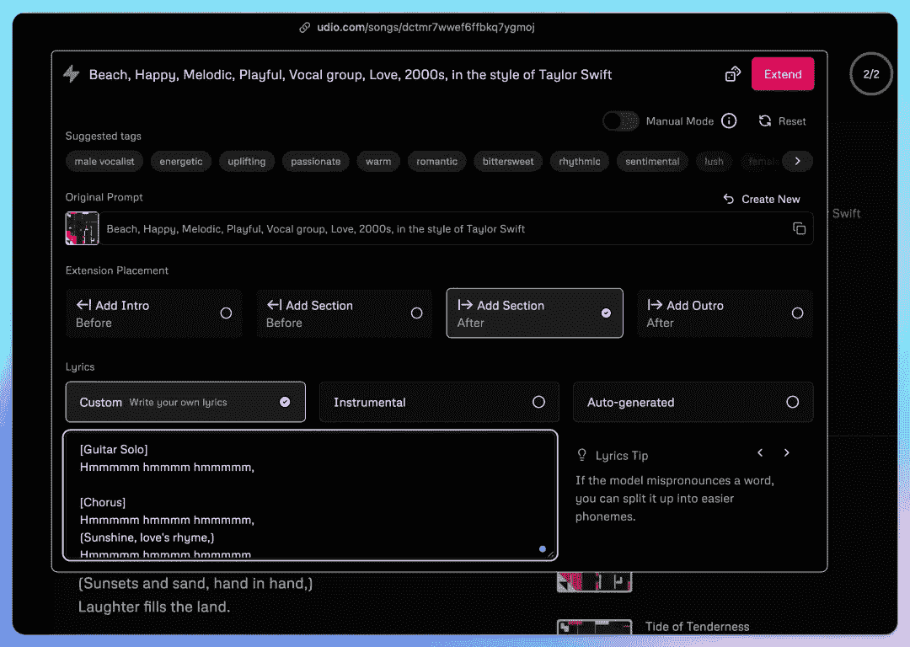
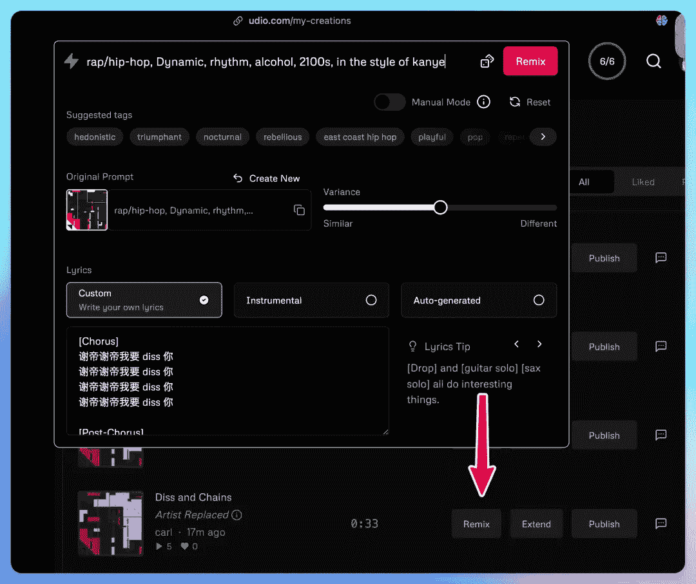

# AI音乐界的“GPT4” Udio 横空出世 - Suno被超越了吗？

> 来源：[https://agispace.feishu.cn/docx/EgagdgBOUoYZGzx7JE2cxyjsnfn](https://agispace.feishu.cn/docx/EgagdgBOUoYZGzx7JE2cxyjsnfn)

> 作者：  卡尔

> 👸号： 卡尔的AI沃茨

> 原文链接：https://mp.weixin.qq.com/s/rnirr2ZXgwBzUClA9UCzTw

文中提及的音频视频可点击原文链接查看！

2024年4月9号，一个名叫udio的X账号👀“看”了眼大家，随后就“唱”🎤出了它的第一首歌，仅仅一天不到被全网转发，它真的可能是Suno最大的竞争对手！所以Udio是怎么诞生的？



# **“**

> Udio 由前谷歌 DeepMind 的领先 AI 研究员和工程师创立，得到 a16z 的支持，并且由艺术家 like @iamwill和 @common背书。重要‼️的是每人每月可以免费生成1200首音乐‼️

**友情提示：**Udio效果真的超级好，实测也能支持中文歌曲，人声还比Suno清晰。因此我们建议大家都打开Udio，跟着我们边听边做一个自己的歌曲🎵～

界面非常简洁，一共**3**个步骤，你甚至可以简化成两步



#### 第一步 - 输入你要创建的歌曲的描述

典型的提示由自由文本和标签组合而成。例如

# **“**

> "Beach, Happy, Melodic, Playful, Vocal group"

> “海滩，快乐，旋律，俏皮，声乐团体”

#### **第二步 - 融入艺术家风格**

你可以使用艺术家风格来描述音乐，我们将用相关流派标签替换艺术家参考。双手赞同！不会出现DALLE3不能使用艺术家名字来参考画风的情况了！

# **“**

> “Beach, Happy, Melodic, Playful, Vocal group, Love, 2000s, in the style of Taylor Swift”

> 海滩，快乐，旋律，俏皮，声乐团体，爱情，2000年代，泰勒·斯威夫特的风格

#### 第三步（可选）- 自定义歌词 & 乐器演奏

默认情况下，Udio 会**自动**为你的提示选择适当的歌词。如果你想使用自己的歌词，请在提示框的歌词部分选择自定义模式，然后将歌词放入文本输入中，如下所示：



如**果你没有歌词**灵感的话，可以在第二步自动生成的歌词上修改。编写歌词的时候，只需将文本添加到提示下拉列表中的自定义歌词 Custom 即可。

尝试在歌词框中添加 [Chorus]、[Hook]、[Verse]、[Sax Solo]、[Guitar Solo]  或 [Drop] 等描述符。你还可以使用括号指定和声。歌词不必是英文。Udio 识别的一些语言包括：中文、日语、俄语、波兰语、德语、法语、意大利语。

**自动生成的歌词：**

**We make waves crash, write our own linesDarling, ain't no love like beachside sunshineWe pair up like sunsets and sandLaughte**r in the air, yeah, hold on to my handSalty sea breeze whispers 'just because'Darling, ain't nobody do it like this summer does, summer does

**重新排版并加上描述符的歌词**:

```
[Verse]
Waves crash, we write,
Sunshine, love bright.
(Sunsets and sand, hand in hand,)
Laughter fills the land.

[Pre-Chorus]
Sea whispers, &#x27;cause,
Summer&#x27;s magic, just us.

[Chorus]
Hmmmmm hmmmm hmmmmm,
(Summer&#x27;s song, free and bold,)
Hmmmmm hmmmm hmmmmm,
(Hand in hand, stories told.)

[Verse]
Day&#x27;s glow, night&#x27;s dream,
Together, by the sea&#x27;s gleam.
(Moments shared, joy and smile,)
In every mile.
```

Hand in Hand, Summer's Stand,卡尔的AI沃茨,32秒

**音乐小知识🎵**

# **“**

1.  [Chorus]：这是流行歌曲中最常见的结构之一，用于设置叙述或故事的背景，而副歌则展示了主要的钩子。通过重复副歌和钩子，使得歌曲更加朗朗上口和难忘。

1.  [Verse]：verse部分通常用来讲述故事或设定场景，是歌曲中的一部分，用于展示歌词内容和情感。

1.  [Hook]：叠句（hook）是一种旋律或节奏模式，容易让人记住并“被钩住”，能够吸引听众听完这首歌，并且想要重复听这首歌。

1.  [Sax Solo]：虽然原始证据中没有直接提到萨克斯独奏（Sax Solo）的具体作用，但在现代音乐中，萨克斯独奏是一种常见的表现形式，用于展示乐器的技巧和情感表达，增加歌曲的表现力和感染力。

1.  [Drop]：在现代舞蹈和电子音乐中，drop是指音乐的一个部分，通常伴随着强烈的节奏和音效，用于创造高潮或转折点。

Udio 会生成 30 秒的音频剪辑，因此歌词的数量应适合持续时间

+   大多数流派的歌词数量约为 6 行，较慢的歌曲则较少，较快的歌曲则较多。

**如果想要曲目为乐器演奏，**请选择 Instrumental （乐器演奏模式）。

# **“**

> Beach, Happy, Melodic, Playful, lovers rock, romantic, 2000s, in the style of Taylor Swift

Tide of Tenderness,卡尔的AI沃茨,32秒

## **延伸音轨**

U**dio 以 32** 秒为单位生成音乐。通过这种方式，你可以相对快速地筛选多个选项，并决定哪一个值得延长长度。你可以通过单击歌曲页面上的“Extend”按钮访问扩展模式。



在此模式下，提示框会更改其外观并显示公开额外的控件：



默认情况下，主提示输入已预先填充原始提示。这可以确保你要创建的扩展在风格上与原始扩展保持一致。也就是说，你可以将提示更改为任何内容，有时这会产生非常有趣的结果。例如，你可能希望将曲目从柔和的原声吉他线发展为伴随着严重扭曲的强力和弦的咆哮吉他独奏 。

你可以通过单击扩展放置区域中的选项之一来选择扩展的方向：

Udio 允许你在原始剪辑之前或之后添加一个部分。可以重复此过程以构建最多 10 个部分的链。你还可以添加前奏或结尾部分，从而可以创作完整的曲目。

构建 1.5 分钟长的独立歌曲的最简单工作流程如下：

+   **生成**中间（主要）部分。这是曲目的“核心”，也是最令人兴奋的部分。

+   扩展 Extend 你刚刚创建的部分。

+   在扩展放置区域中选择添加介绍选项，然后单击扩展。这将为你的主要部分创建一个构建。生成的两部分轨道现在长 1 分钟。

+   进入 1 分钟曲目的扩展模式。

+   选择“添加尾奏”并单击“扩展”。就是这样 - 现在你已经创作了一段有正确开头和结尾的音乐。这都是你的！

Summer Serenade - v1,卡尔的AI沃茨,1分钟

Summer's Embrace - v2,卡尔的AI沃茨,1分钟

大家喜欢哪个版本呢？🆚

# **“**

> 你可以扩展其他用户最初创建的歌曲。

## Remixing tracks 重新混音曲目

Udio 的另一个很酷的功能是混音。混音是现有剪辑的微妙或不那么微妙的变化。要创建一个，请首先选择适当的曲目（目前你只能重新混合 30 首曲目），然后在曲目页面或上下文菜单中单击“重新混合”。

与标准模式相比，提示框中新增了一个区域：



# **“**

> 这里我打算做一首不一样风格的《诺米么(Lodmemo) – 谢天谢帝Lyrics》，对✅就是那首很火的“谢帝谢帝我要 diss 你”

右侧的滑块允许你控制混音效果的强度。在最薄弱的时刻，当滑块一直向左移动时，重新混合不会改变原始音频。当你将其移动到右侧时，效果会变得更加明显

默认情况下，与扩展模式类似，初始提示文本采用原始曲目。如果你希望混音的风格与原始风格相似，这非常有用。

但是，当你尝试调整提示符或编写一个全新的提示符时，重新混合变得真正有趣。例如，你可以通过这种方式添加新乐器。

**Remix前：**

谢天谢帝,卡尔的AI沃茨,32秒

**Reminx后：**

谢天谢帝 - Remix,卡尔的AI沃茨,32秒

## **写在最后**

除了我上面提供的功能外，Udio还有更进一步的手动模式 ，大家可以直接跳转到官方FAQ深入学习，这里我顺带附上Udio的内测地址！大家快去玩起来！

https://www.udio.com

最后附上Udio目前发布的音乐混剪合集🎵，Enjoy～

，时长12:11

可以肯定的是，Udio为更多人提供了音乐创作的可能性。

这个可能，不仅仅是降低了创作的门槛，更是带来了更广阔的灵感。

从Suno的初声到Udio的壮响，我们见证了AI音乐的力量。

我想我听到了，

AI时代声声不息的回响🎵🎵

Hotel California (2004墨尔本告别巡回演唱会),Eagles

**最后，谢谢你看到了这里👏 想要第一时间接收到我们的推送，可以点个星标 ⭐ 如果喜欢这篇文章，**不妨随手来个 点赞、在看、转发 一键三连👍 你的支持将是我们更新的最大动力！

**如**果希望一起交流讨论，或参与AI音乐相关的讨论群，或者建立合作的话，加我个好友位吧！我们Udio新群里马上破千啦！