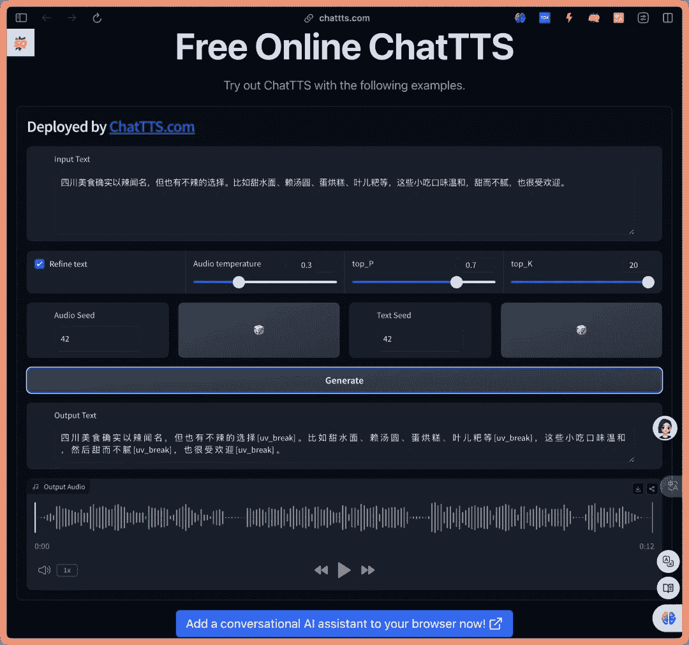
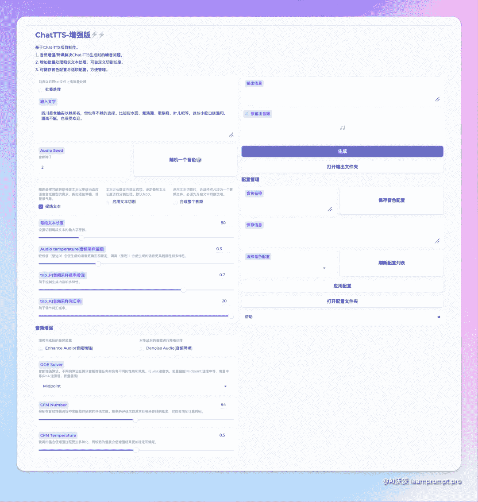
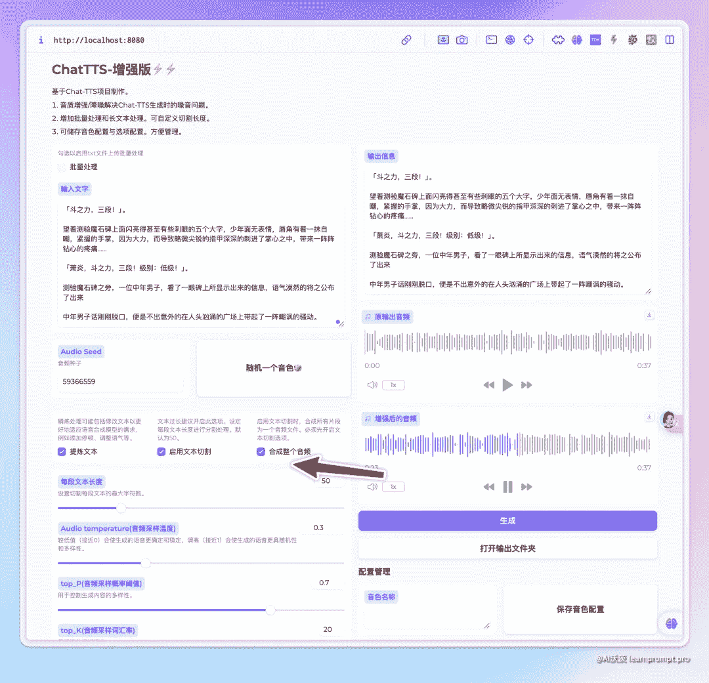
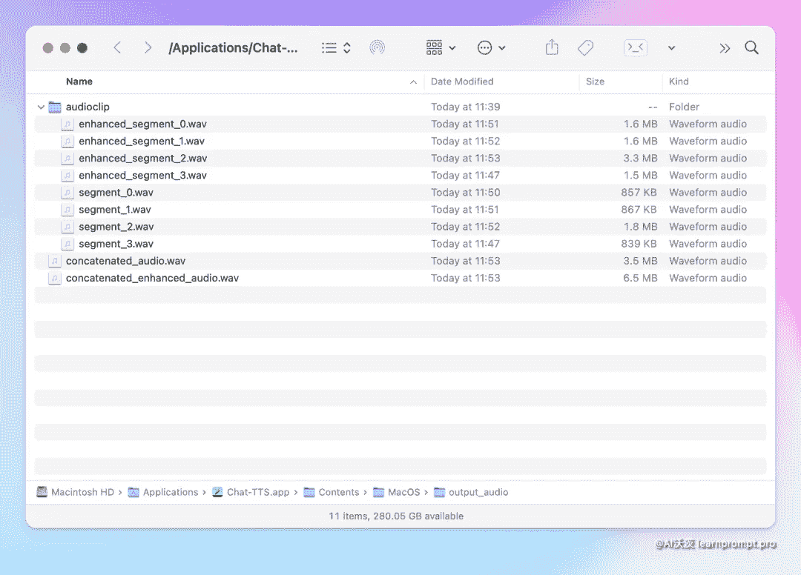
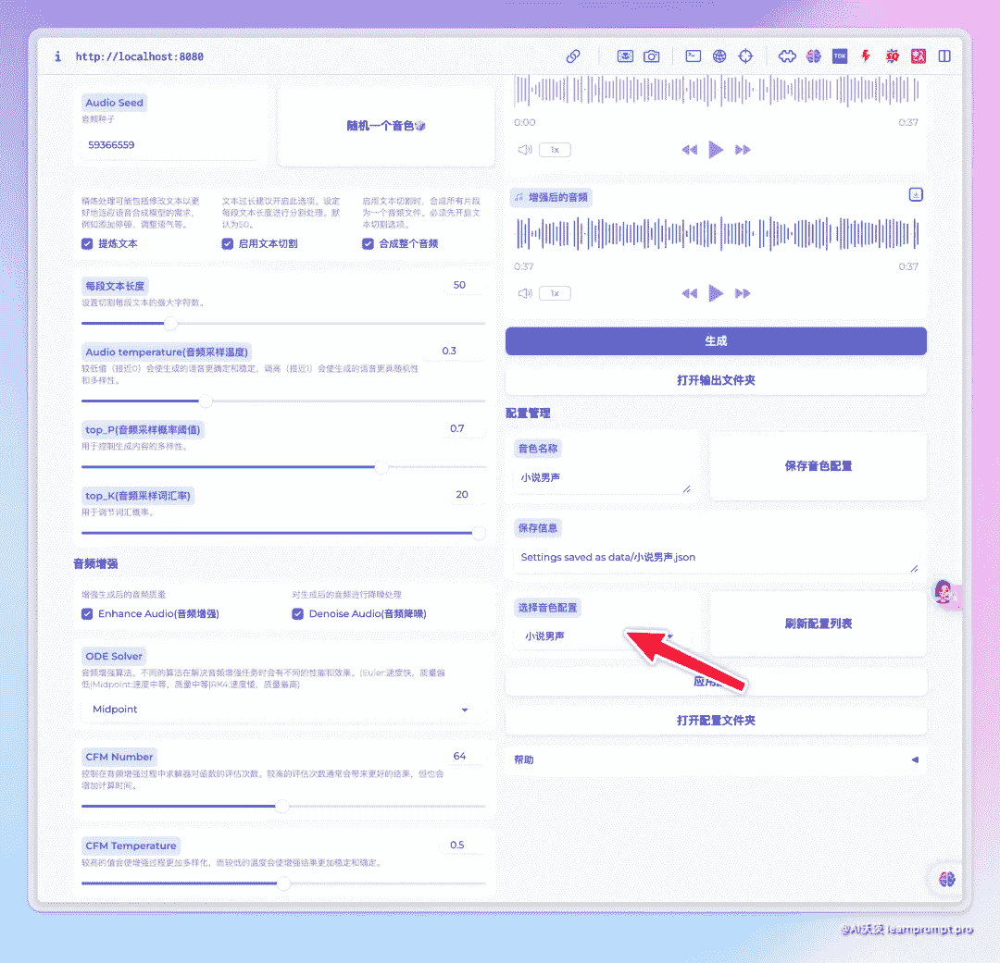

# 终于蹲到ChatTTS增强版整合包，AI视频配角们有了自己的声音～

> 来源：[https://agispace.feishu.cn/docx/Dc2qd6rxDo6vrAxko00cQ66Kn4b](https://agispace.feishu.cn/docx/Dc2qd6rxDo6vrAxko00cQ66Kn4b)

> 作者：卡尔

> 👸号： 卡尔的AI沃茨

> 原文链接：https://mp.weixin.qq.com/s/pXwe5pZ76CqC_8DLlbs2gw

文中提及的音频视频可点击原文链接查看！

ChatTTS，一个用于对话的生成式语音合成模型。

语音界真的人才辈出，时不时给我们带来大惊喜，从之前的Bert-Sovit，到GPT-Sovits，再到现在一周飙升了 1w+ Star的ChatTTS，这些都说明了大家对声音合成技术的热爱和认可。今天，让我们一起来体验一下ChatTTS的神奇效果吧！

> 参数设置：Audio Seed = 42 | Text Seed = 42 | 其他设置保持默认

> 输入文本：四川美食确实以辣闻名，但也有不辣的选择。比如甜水面、赖汤圆、蛋烘糕、叶儿粑等，这些小吃口味温和，甜而不腻，也很受欢迎。

ChatTTS样例1,卡尔的AI沃茨,11秒

生成的语音已经达到了“以假乱真”的程度。更扯的是，为了限制ChatTTS生成的语音质量，作者在训练过程中添加了少量高频噪音，并压缩了音质，使其更容易分辨。这是为了防止模型被用于诈骗等违法行为。看来效果好到连作者自己都“害怕”了。

除了刚刚听到的短短12秒音频外，ChatTTS还有哪些优势和不足呢？

1.  ✅对话式TTS：ChatTTS针对对话式任务进行了优化，实现了自然流畅的语音合成，同时支持 多说话人。

1.  ✅细粒度控制：该模型能够预测和控制细粒度的韵律特征，包括笑声、停顿和插入词等。

1.  ✅更好的韵律：ChatTTS在韵律方面超越了大部分开源TTS模型，并提供预训练模型。

1.  ❌模型稳定性：自回归模型存在稳定性不足的问题，可能会出现声音突然变成其他人的声音，或者音质突然变差，可以通过多次尝试来寻找更好的音频效果。

1.  ⭕️ 情感控制：目前发布的模型版本中，情感控制仅限于笑声（[laugh]）以及一些声音中断（[uv_break], [lbreak]）。作者计划在未来的版本中开源更多情感控制的功能。

几天前，我们还需要在本地和云端安装环境才能运行ChatTTS，玩法较为复杂。如今，陆续出现了在线网站和本地增强整合包。这里给大家介绍一下玩法，首先是网站：

我们直接访问 https://chattts.com/

在作者提供的样例中，中英文混合和语气停顿效果令人印象深刻。这里我用这两个例子教大家如何使用。

> 输入文本1📕

> 这些元素其实是glam rock，然后加这种bling的感觉. 我觉得像这个衣服有一些jacket, 比如说那个oversized的那个丹宁的jacket, 我觉得我是可以offduty的model.

ChatTTS中英混样例【网页端】,卡尔的AI沃茨,13秒

除了文字本身和控制符号外，常调整的参数主要是Seed，也就是种子数。不同的Seed对应不同的声音。目前还没有看到有人收集好听的Seed列表，不过有一个2222比较火。

> 输入文本2📕

> 那chatTTS不仅能够生成自然流畅的语音[uv_break]， 还能控制[laugh]笑声[laugh］, [uv_break]停顿啊和语气词啊等副语言现象[uv_break]。其这个韵律呢超越了许多开源模型。

ChatTTS控制停顿和笑声样例【网页端】,卡尔的AI沃茨,12秒

线**上体验下来，ChatTTS在功能上少了微**调、长文本等模块，现阶段略显不足。不过，幸运的是我在B站找到了一个整合包，增加了音质增强、批量处理、长文本切分等功能，并制作了Mac和Windows版本。

> 安装前说下显卡限制：对于30s的音频，需要4G的显存。

> 整合包也存在需要优化的点，Mac版本默认绑定8080窗口，在你推出应用后，可以执行“lsof - i :8080” 得到程序的PID后kill程序，不然下一次启动会设置端口被占用。

首先试试**增强音质**，在我们输入文本准备生成时，可以勾选下面的音频增强和降噪进行进一步处理。增强后的音频会更加清晰减少的噪音，但会增加处理时长⏰

ChatTTS原声【本地端】,卡尔的AI沃茨,16秒

ChatTTS声音增强版【本地端】,卡尔的AI沃茨,16秒

**其次，当**文本内容很多时, 可以勾选文本切割来进行处理，默认为五十字符进行切割，还可以将音频片段合并为一整段音频，切割的音频片段也支持增强处理

ChatTTS念斗破-文本切割【本地端】,卡尔的AI沃茨,36秒

保存后的音频文件结构相当清晰，

+   concatenated Audio是合成的一整段音频，Enhanced Audio是增强处理后的整段音频

+   Audio clip文件夹中是切分的音频片段。Enhanced开头的就是增强处理的音频片段，不带Enhanced就是生成的普通的音频片段。

该个版本还增加了**批量处理**功能，勾选后可以上传一个TXT文本，TXT文本需要按照每句换行的格式。

ChatTTS念斗破-批量版【本地端】,卡尔的AI沃茨,41秒

最后就是**音色固定**，前面提到这个项目不同的音频种子生成的人物说话音色会不一样。我们可以点击随机按钮，多尝试几次，找到自己满意的音色后，可以将设置和音色种子保存到配置文件中，方便下次使用。

ChatTTS刚放出来的时候，我很惊讶于它的效果，

随后就重新思考，基于目前只能随机音色的情况，它在AI配音领域会有什么样的应用呢？

本来是打算等到它后面提供微调版本，再给大家出一篇教程来复刻名人声音。

但昨晚在做AI短片的时候，突然想起我们视频里的配音，

通常会出现旁白、配角、龙套等声线，

而目前ChatTTS支持的30s人声，就目前AI视频时长来说，其实相当够用！

所以就有了这篇文章，来给大家讲讲目前的效果和我现在的想法。

我想我解开了ChatTTS的使用秘诀，

以后，我们AI视频里的人物都会拥有自己的声音了🔊

📁 为了方便大家下载，👸号回复 [ChatTTS] 就可直接领取整合包～

**最后，谢谢你看到了这里👏 想要第一时间接收到我们的推送，可以点个星标 ⭐ 如果喜欢这篇文章，**不妨随手来个 点赞、在看、转发 一键三连👍 你的支持将是我们更新的最大动力！

**如果希望一起交流讨论，或参与相关的讨论群，或者建**立合作的话，加我个好友位或者扫码进群吧～