# 智能营销

> 来源：[https://agispace.feishu.cn/docx/WufKdFSAdojDRZxK8PTcVp30nNf](https://agispace.feishu.cn/docx/WufKdFSAdojDRZxK8PTcVp30nNf)

# 序言

> 智能营销的核心在于数据。

> 通过对消费者数据的收集、分析和挖掘，企业可以深入了解消费者的需求和行为，

> 为营销策略的制定提供有力支持。

> 在新的生产关系中，所有的营销工作流程和工作任务，都值得用AI再做一遍。

> **营销阶段**

> 第一阶段：传统营销基础阶段

> 第二阶段：互联网营销兴起阶段

> 第三阶段：大数据精准营销发展阶段

> 第四阶段：人工智能驱动营销阶段

**AI+营销六大领域应用**

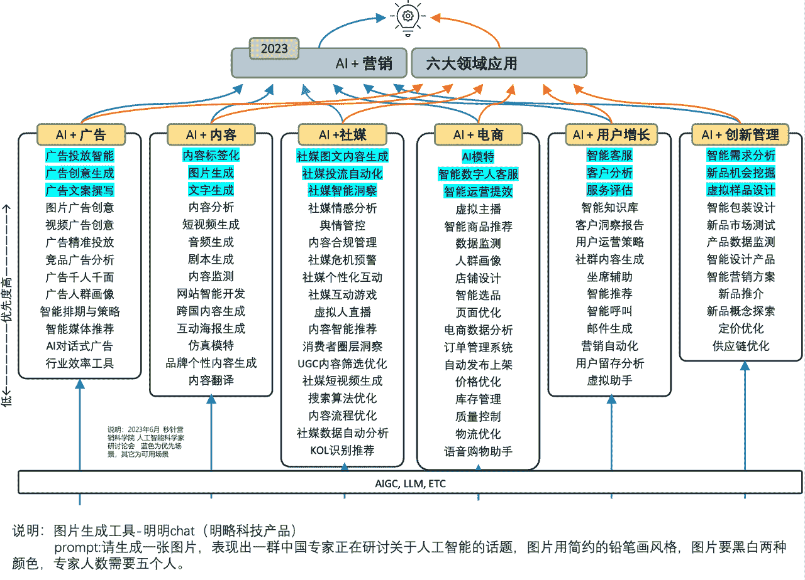

# 案例实践

### (AI+ 广告)  应用场景

> 广告的AI优先场景为广告投放智能、广告创意生成、广告文案撰写

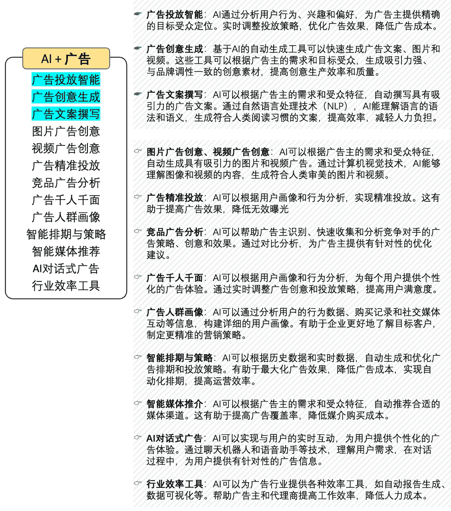

#

#### **应用方向：视频广告创意**

应用案例：可口可乐2023年3月《Masterpiece》创意广告•

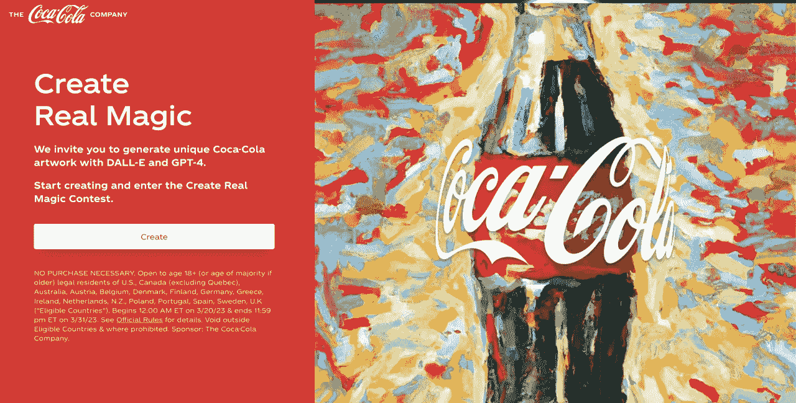

案例描述：可口可乐利用 Stable Diffusion AI 和 3D 技术结合实拍，创作出一则短片。这部短片巧妙地将《戴珍珠耳环的少女》等名画融入广告剧情，展示了名画角色互传可乐的有趣场景。这不仅展现了 AI 技术在创意广告领域的潜力，也增强了消费者的视觉体验和品牌记忆。

#### **应用方向：海报广告创意**

**应用案例：钟薛高的 AI 海报**

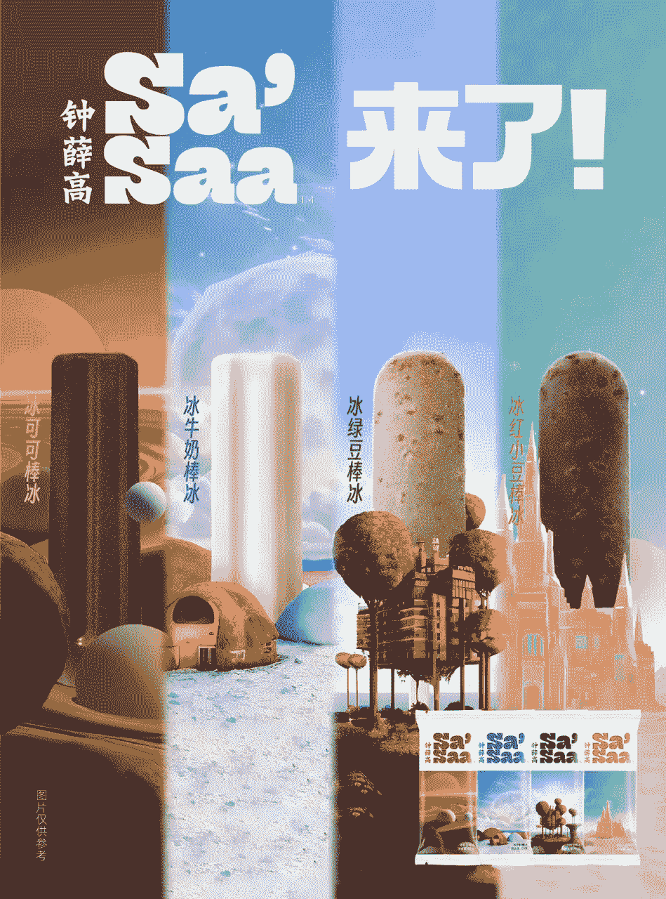

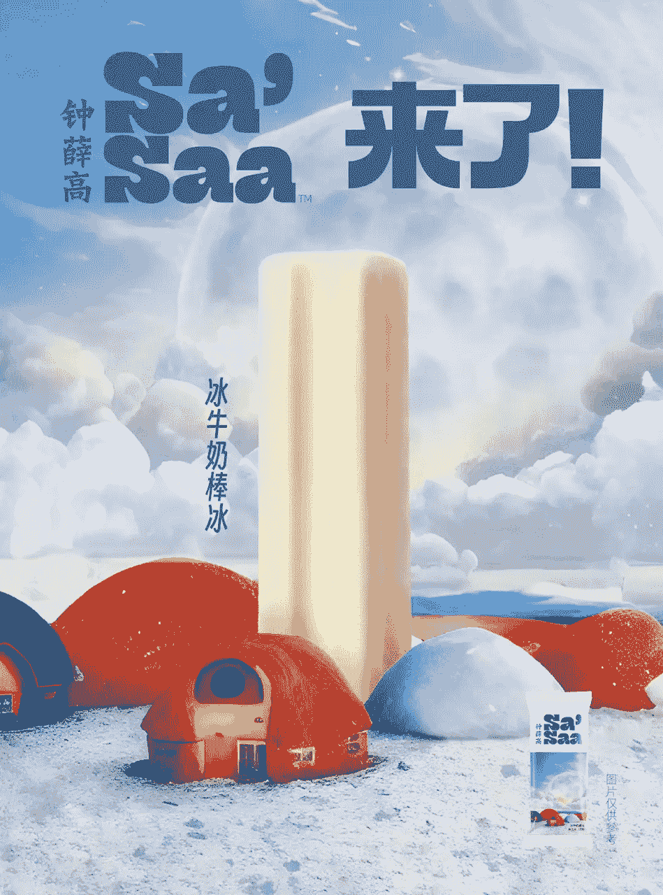

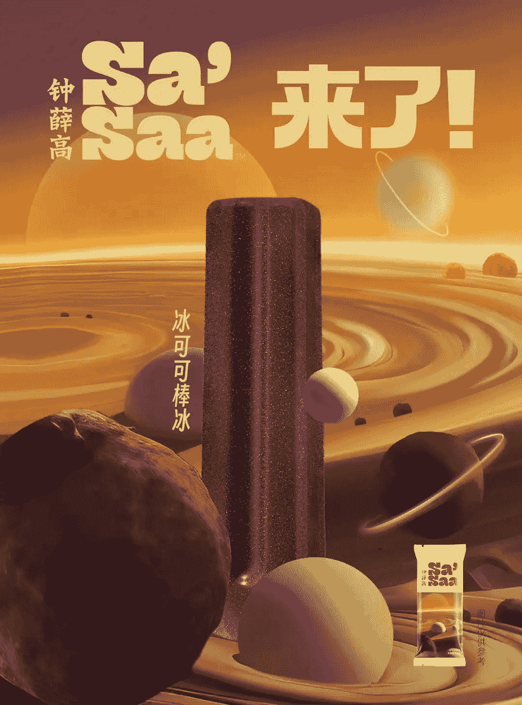

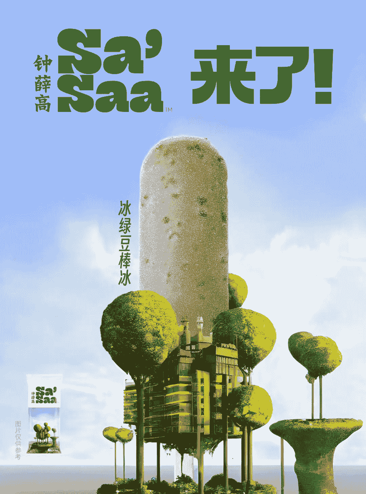

案例描述：钟薛高公司通过 AI 技术的应用，在产品开发和市场策略上实现了显著的创新。AI 建议的四种新口味（牛奶、可可、红豆、绿豆）及产品名称“Sa'Saa”，加上 AI 设计的包装，不仅提升了产品的吸引力，还成功地在消费者心中树立了钟薛高的独特品牌形象。

#### **应用方向：图片广告创意**

应用案例：飞猪2023年4月地铁广告

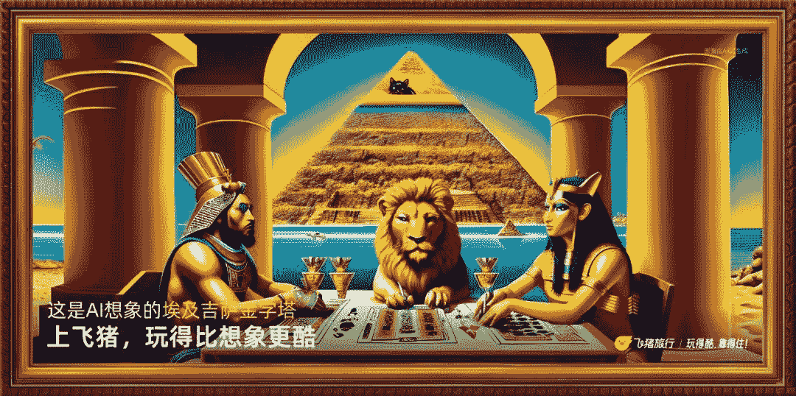

案例描述：旅游服务平台飞猪在上海和杭州地铁站投放的 AI 设计平面广告，是 AI 在线下营销领域的一个突破。这些广告由 AI 在短时间内大量生成，不仅提高了设计效率，也展示了 AI 在广告创作中的实用性和创新性。

### (AI+ 内容)  应用场景

> 内容的AI优先场景为内容标签化、图片生成、文字生成

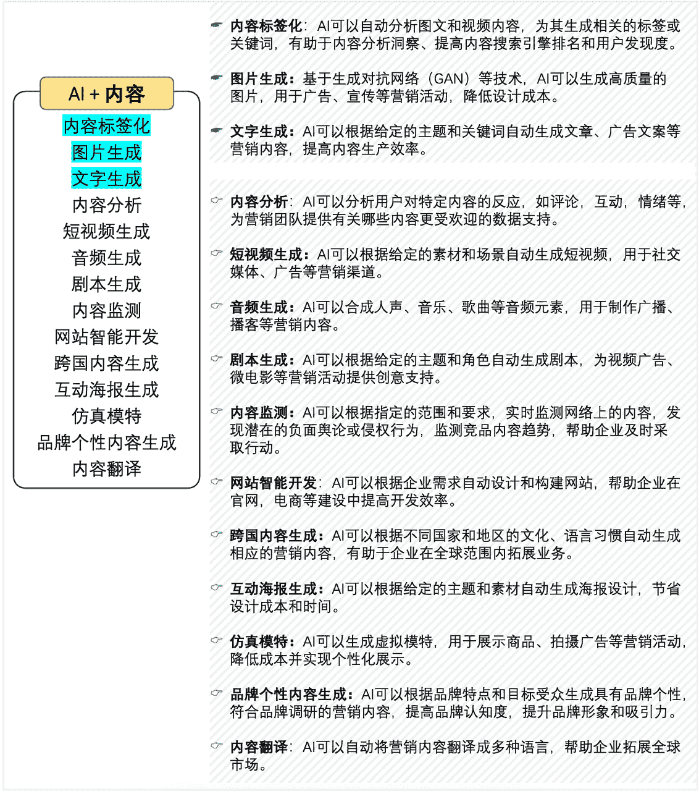

#### **应用方向：音频生成**

**应用案例：网易严选AI 主题曲**

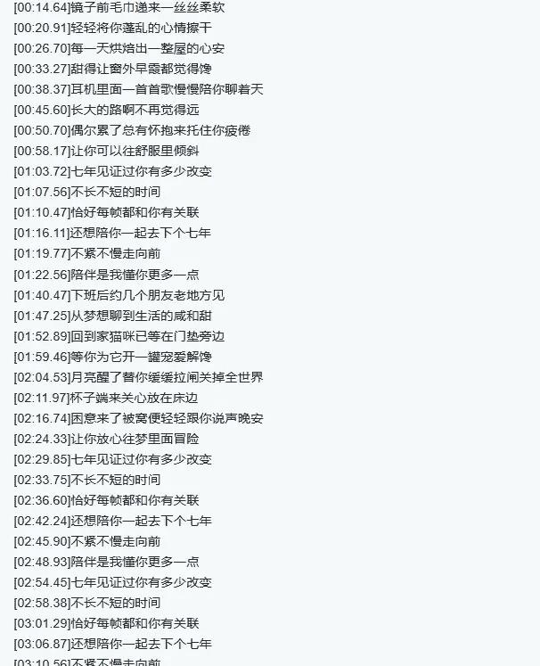

案例描述：网易严选成立七周年时联合网易云音乐用AI 创作一首主题曲《如期》。这首歌的作词、作曲、编曲、演唱全部都由AI完成。MV 中用AI 与人类对话的形式，回顾网易严选七年的发展历程。《如期》基于大量用户真实评论创作。歌词中唱到爆款产品，还唱了产品与用户生活变化间的关联。

作曲试听地址：https://www.bilibili.com/video/BV17a4y1V7GE/?vd_source=fb70dcd59097b3df6ebb6003acff9668

#### **应用方向：视频生成**

应用案例：支付宝营销短片《支付往事》

案例描述：短片讲述了中国支付从钱包、互联网，到二维码的手机的故事，并且展望未来的万物互联，用拐杖支付的畅想。其中所有的视觉呈现都由AI 完成。

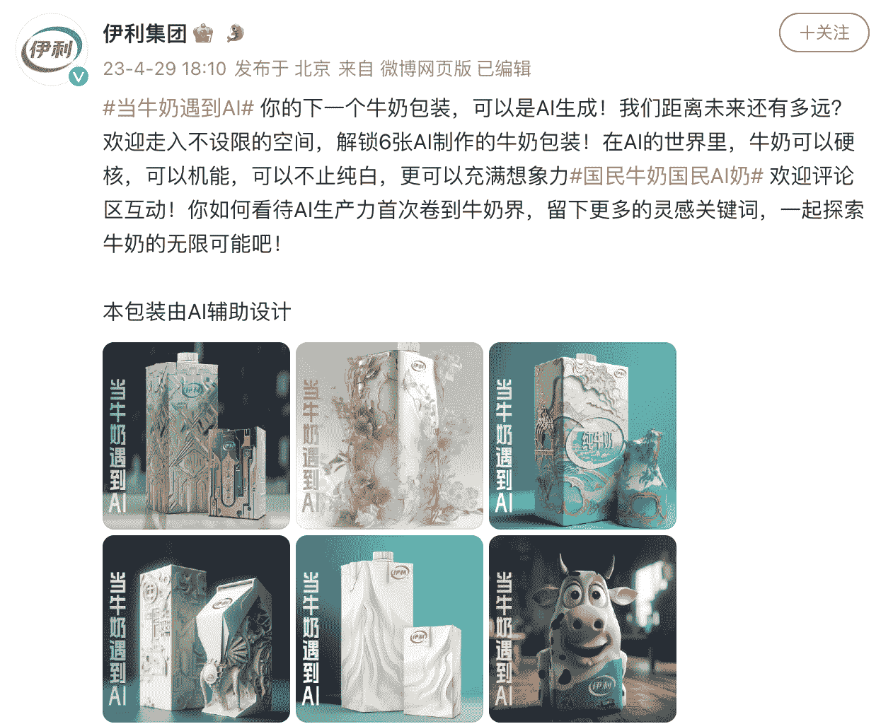

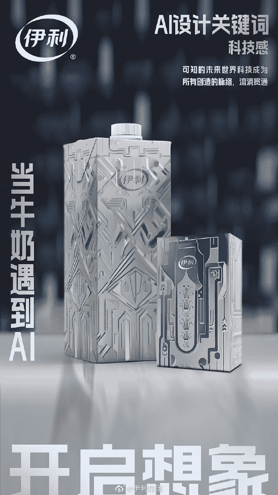

1.  **伊利集团的 AI 文化营销**：在杭州亚运会期间，伊利集团通过 AI 技术，以产品为载体推出新包装。在 AI 技术的加持下，盒面以中国水墨风的形式绘制了烟雨入江南的朦胧美感，将三款盒装正面进行拼接，还可组成一幅完整的画卷--归鸟、白堤、湖畔、拂柳、轻舟等各种江南水色的结合。https://weibo.com/5236823068/MEfskdLBw

1.  电商平台：许多电商平台通过智能推荐系统，为用户提供个性化的购物体验。系统根据用户的浏览记录、购买历史等信息，推荐相似的商品或优惠活动，从而提高购物转化率和客户满意度。

1.  金融行业：金融机构利用智能营销技术，对潜在客户进行精准画像，制定个性化的金融产品和服务。这不仅有助于扩大市场份额，还能降低风险成本。

1.  社交媒体：社交媒体平台通过智能算法分析用户兴趣和行为，为用户推送相关的广告和内容。这种“千人千面”的营销方式，大大提高了广告的点击率和转化率。

# 智能营销工具

多维表格（A32xbxg18aPnHgsagVecxzN5nOh_tblhSWFM3k2zNaFS）

# 企业相关

### 选择AI模型

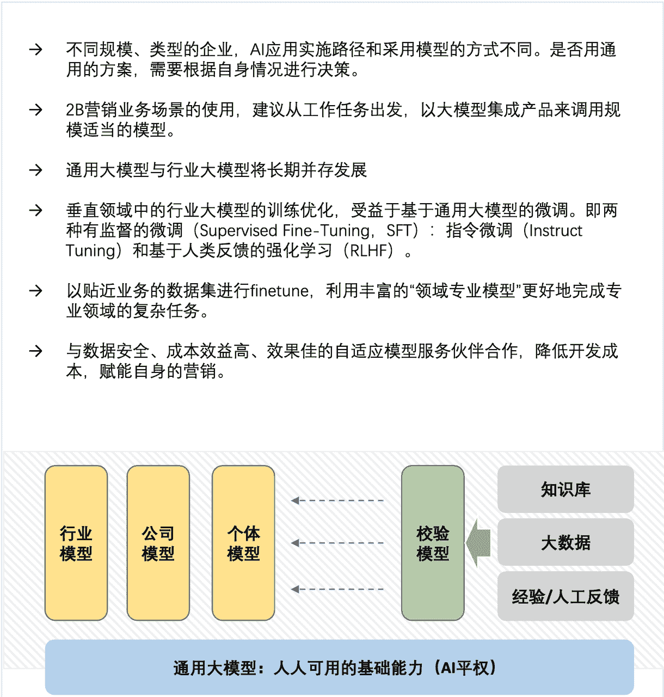

### 有哪些优势

竞争优势来源于差异化的定制模型、战略性的投入、数据知识累积、业务场景选择等

> **战略地位：一把手工程**

> AI应用是企业的“一把手工程”，不仅是技术问题，也不仅是营销部门的业务问题。AI实施后，一方面随着AI对个人的赋能，“超级员工”出现，随之而来必将引发团队重组、组织改造，以及相应考核、管理制度等改变，因此需要在企业内部把AI实施提升到战略位置，自上而下的推动实施，配合以相应的管理动作，来保障应用成功，获得市场中的竞争优势。

> **定制化模型，打破AI平权**

> AI通用大模型虽然可以为企业提供解决方案，但与云服务类似，作为IT基础类设施，未来将像水电煤服务一样容易获取。在这点上，无论规模大小，各类企业间是平等的，可称之为“AI平权”。企业竞争优势只能来自于差异化的定制模型，如行业模型，及企业私有化模型。企业需要深入了解自身业务需求和数据特点，与技术提供商合作开发定制化的AI模型。

> **数据、知识、经验的积累**

> ✓AI模型都依赖于高质量的数据，企业自有积累的数据、知识、模型使用经验（提示词库等）是形成竞争差异的最重要能力。良好的数据积累有助于更好的训练改进模型，更优化的提示词等，将得到更好的数据产出，从而进一步积累企业独有的优秀行业数据，形成AI应用的正向反馈闭环。因此面向大模型应用场景，优先积累数据，投入数据治理，确保数据准确性、一致性和完整性，将有先发优势且可持续增强。

> **业务场景探索和选择**

> ✓AI先期能帮企业解决的核心问题是效率问题（做得比真人更快、更多），未来有可能解决效果问题（做得比真人更好），因此，找到并选择核心业务场景非常重要，谁能尽快在核心业务中应用谁就能获得先发优势，如果只是全员用AI写周报、做会议纪要，并不能赢得竞争

> **有保障性的投入**

> ✓AI是一项创新，创新必伴随着一定的投入，在应用初期，大量的模型训练，需要硬件、资金、人才的投资。特别是培养和吸引“帮助企业更好应用AI能力的人才”，例如数据科学家和AI工程师。

> **持续改进和优化**

> ✓AI技术是一个不断发展的领域，企业需要不断关注最新技术和趋势，不断改进和优化自身的AI解决方案，以保持住竞争优势。

# 拓展

### 政策方面

> **2022 年相关政策**：

+   7 月，科技部《关于加快场景创新以人工智能高水平应用促进经济高质量发展指导意见》：推动人工智能场景创新对于促进人工智能更高水平应用。

+   8 月，科技部《关于支持建设新一代人工智能示范应用场景的通知》：围绕构建人工智能行业应用生态，支持一批基础较好的人工智能应用场景。

>

> **2023 年相关政策**：

+   4 月，国家网信办《生成式人工智能服务管理办法（征求意见稿）》：对生成式人工智能产业给出包括定义、准入资格、责任义务和处罚措施等规定，支持算法、框架等基础技术的自主创新、推广应用、国际合作，鼓励优先采用安全可信的软件、工具、计算和数据资源。

### 相关报告

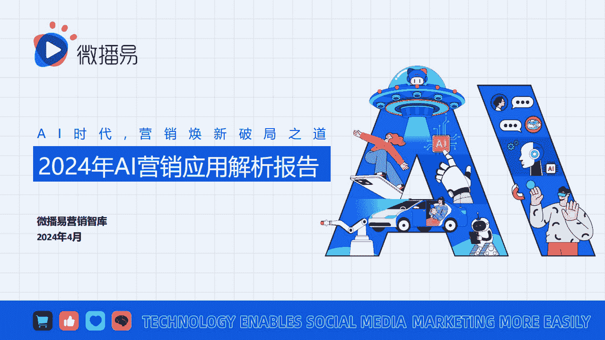

[【微播易】2024年AI营销应用解析报告.pdf](https://internal-api-drive-stream.feishu.cn/space/api/box/stream/download/all/YhurbjFOCoEz4vxi3zoc5Gz4nIh)

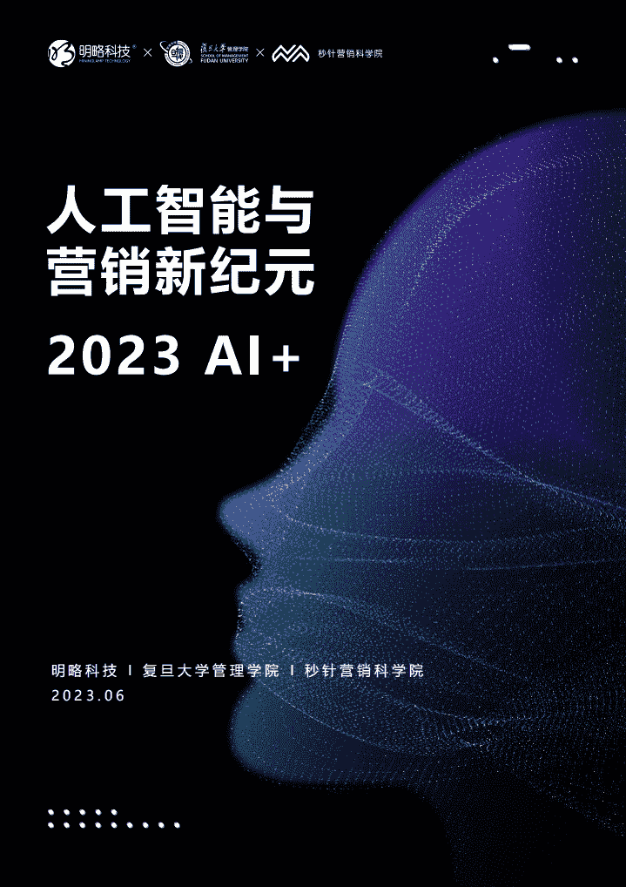

[2023人工智能与营销新纪元白皮书.pdf](https://internal-api-drive-stream.feishu.cn/space/api/box/stream/download/all/JW8bbXjw4oXOvjxXhQNcVczynwh)

+   《2023人工智能与营销新纪元白皮书》：由明略科技、复旦大学管理学院和秒针营销科学院联合发布，探讨了 AI 对营销行业的影响，包括提升效率、创新体验等方面。

### 推荐阅读

**来源**：[红杉汇](https://mp.weixin.qq.com/s/HGy32-r8mhj1stkCJ28OBw)

**标题**：《实现智能营销自动化、最优化，不妨看看这一篇 》

**推荐理由**：文章详细介绍了如何利用智能工具优化数据驱动营销（DDM）策略，实现智能营销自动化和最优化

**来源**：[微播易](https://mp.weixin.qq.com/s?__biz=MzA3MTEzOTUxMQ==&mid=2811943799&idx=1&sn=01573c5b441345b79ea15a015a8af686&chksm=bd5c52af8a2bdbb908b79250f97760b10ea15d5f02ec7d6d841017ce2a0e3e794a18d643152f&token=861415603&lang=zh_CN)

**标题**：《30+AI应用场景，探究营销焕新！》

**推荐理由**：这篇文章全面解析了AI在营销中的32个应用场景，预测了未来发展趋势，并提供了实操性强的建议，助力企业把握AI营销的新机遇。

> 智能营销系统的发展趋势，将随着人工智能、大数据等技术的进步而日益明显。未来的智能营销系统将更加智能化、个性化，能够更好地满足消费者的个性化需求，同时也能帮助商家实现更高效的营销和管理。