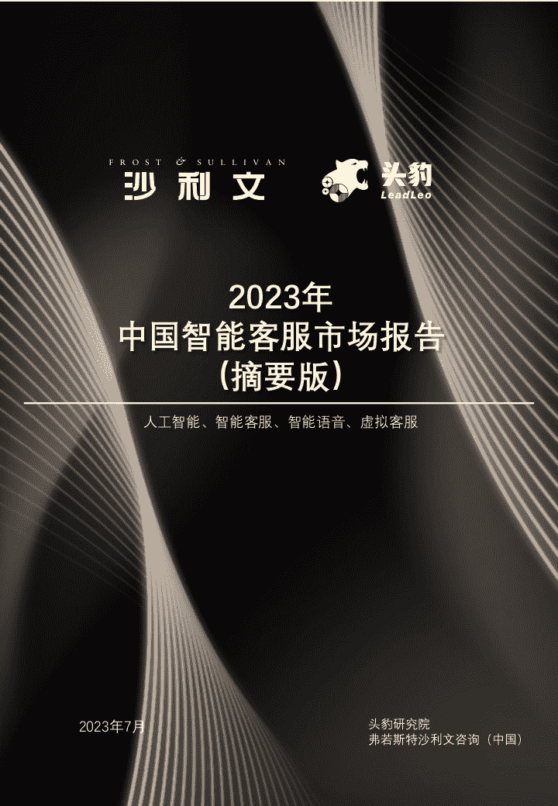

# 智能客服

> 来源：[https://agispace.feishu.cn/docx/N3lOdZGVToPhVwxnWS4cUW8Mncc](https://agispace.feishu.cn/docx/N3lOdZGVToPhVwxnWS4cUW8Mncc)

### 智能客服概述

**定义**：

智能客服是运用人工智能技术，自动回复用户咨询、解决问题，在线提供服务的智能化系统。

**类型：**

智能客服有六种主要类型：基于规则的（按固定规则回答）、基于检索的（从知识库中查找答案）、基于生成的（动态生成回答）、混合型（结合规则和AI模型）、虚拟助手型（提供全面对话体验）、社交媒体客服（处理社交媒体上的请求）。

**重要性：**

客户服务对品牌好感度和忠诚度至关重要。根据Forrester的报告，57%的顾客如果未能快速获得问题解答，会放弃购买商品，显示了客户服务的重要性。优质的客户服务能够显著提升消费意愿。

传统上，人工客服需要一对一提供服务，且难以做到全天候支持，导致高人力成本和低效率。随着AI的进步，智能客服系统可以实时回应、多位顾客同时服务，提升效率。它还具备成本低、稳定性高等优点，并能快速调整回复内容，避免信息差异，成为企业发展的重要工具。

### 推荐阅读

**来源**：[ 沙丘社区](https://mp.weixin.qq.com/s?__biz=MzkyMzM0NzEwNg%3D%3D&mid=2247487053&idx=1&sn=0c720ea8b45d6dcb0c07e078db8ca2e2)

**标题**：《2024中国“大模型+智能客服”最佳实践案例TOP10重磅发布》

**推荐理由**：详细介绍了2024年中国“大模型+智能客服”最佳实践案例TOP10的评选结果和入选案例，展示了大模型技术在智能客服领域的应用价值和实际成效，为行业提供了宝贵的参考和启发。

**来源**：[人人都是产品经理](https://www.woshipm.com/ai/5880394.html)

**标题**：《智能客服是人工智能领域的“急先锋”》

**推荐理由**：本文深入剖析了智能客服在人工智能应用领域的三个发展阶段，揭示了大语言模型对智能客服领域的革命性影响，为产品经理和企业提供了宝贵的参考和启示。

**来源**：[AI产品经理研习与实践](https://www.53ai.com/news/hangyeyingyong/323.html)

**标题**：《AI+智能客服：大模型可落地的最成熟场景之一》

**推荐理由**：这篇文章详细探讨了AI大模型在智能客服中的应用，展示了其在提升服务效率、降低成本和个性化服务方面的巨大潜力，并提供了丰富的实际案例和技术细节。

### 分析报告

[uXsSDWwL3Tk4ZzH26PMk3W.pdf](https://internal-api-drive-stream.feishu.cn/space/api/box/stream/download/all/U8Jpbf9F9ok2q4xC5UxcDy2KnCf)

2024年中国智能客服市场调研报告

[2023年中国智能客服行业发展趋势分析：随着人工智能技术的](https://mp.weixin.qq.com/s/1iDp13__mCZBqaVbJeFsmg)不断发展，市场正朝着更加智能化发展[图]

2023年中国智能客服行业在AI技术的助力与加持下，发展前景广阔

2023年中国智能客服市场前景及投资研究报告（简版）