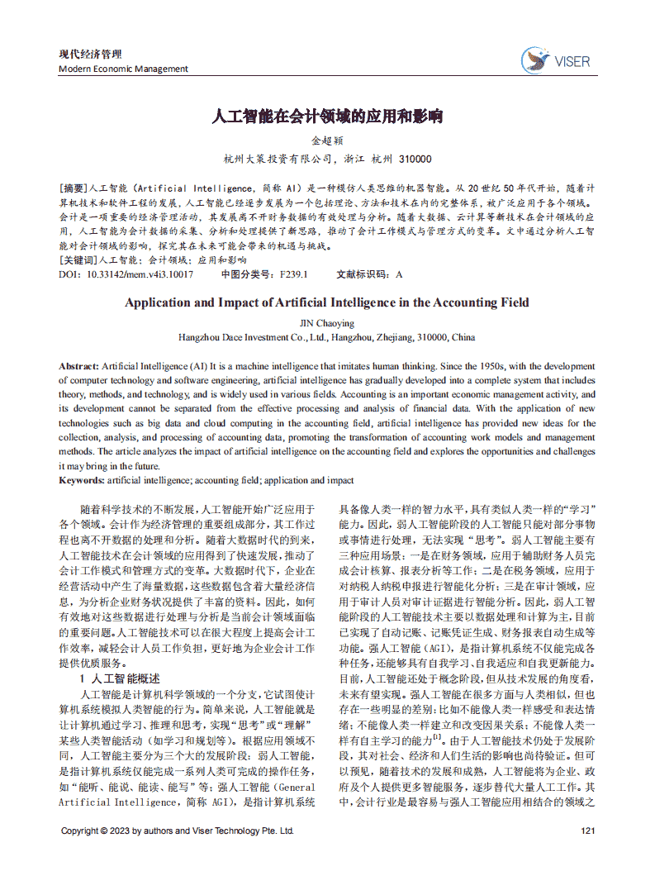

# 智能财务

> 来源：[https://agispace.feishu.cn/docx/KdPAdjguRosTu8xRvmQcdmwMnAS](https://agispace.feishu.cn/docx/KdPAdjguRosTu8xRvmQcdmwMnAS)

## 引言

> **背景**

随着数字化时代的发展，企业面临着日益复杂的财务环境，传统财务模式已难以满足企业快速决策、风险防控和高效运营的需求。智能财务作为新兴技术与财务领域深度融合的产物，正逐渐成为企业提升竞争力的关键因素。

> **目的**

本文档旨在阐述智能财务在企业中的应用现状、优势、面临的挑战以及未来发展的展望，为企业决策层、财务部门及相关利益者提供关于智能财务的全面理解。

## 智能财务概述

> **定义**

智能财务是将人工智能、大数据、区块**链、云计算等先**进技术**应用于财务**领域，**实现财务流程自**动化、财务决策智能化、财务风险防控实时化的新型财务管理模式。

## 智能财务在企业中的应用

1.  财务流程自动化

+   报销流程

+   智能财务系统可以实现员工报销的自动化。员工只需通过手机或电脑上传报销凭证，系统利用图像识别技术自动读取发票信息，进行费用类型分类，并根据预设的报销规则进行初审。例如，系统能够识别出差旅费发票中的日期、地点、金额等关键信息，并判断是否符合公司的差旅政策。

+   账务处理

+   传统的记账、算账、报账等账务处理工作可以由智能财务系统自动完成。系统通过数据接口与企业的各个业务系统（如销售系统、采购系统等）相连，实时获取业务数据，并按照会计准则自动生成记账凭证、财务报表等。这不仅提高了账务处理的效率，还减少了人为错误。

+   资金管理

+   智能财务系统能够实时监控企业的资金流向，实现资金的自动收付和调配。例如，通过与银行系统的直连，系统可以根据企业设定的资金阈值自动发起资金转账操作，确保企业资金的流动性和安全性。同时，系统还可以对资金的使用效率进行分析，为企业的资金决策提供依据。

1.  财务分析与决策支持

+   数据分析

+   智能财务系统可以对海量的财务数据进行深度分析。例如，利用数据挖掘技术分析成本结构，找出成本控制的关键环节；通过关联分析发现不同业务指标之间的关系，如销售量与销售收入、成本之间的关系，为企业制定定价策略提供参考。

+   预算编制与控制

+   在预算编制方面，智能财务系统可以根据企业的历史数据、战略目标和市场趋势，自动生成预算草案。在预算执行过程中，系统实时监控预算的执行情况，及时发现预算偏差并发出预警。例如，如果某项费用的支出超过预算的一定比例，系统会向相关责任人发送提醒信息，以便及时采取措施进行调整。

+   战略决策支持

+   企业的高层决策往往需要财务数据的支持。智能财务系统能够提供多维度的财务分析报告，包括财务状况、经营成果、现金流量等方面的分析，同时结合外部环境数据，如行业发展趋势、竞争对手情况等，为企业的战略决策提供数据依据。例如，在企业进行并购决策时，智能财务系统可以对目标企业的财务状况进行全面评估，分析并购的可行性和潜在风险。

1.  财务风险管理

+   风险识别

+   智能财务系统利用大数据分析和机器学习算法，能够识别各种财务风险，如信用风险、市场风险、流动性风险等。例如，通过分析客户的信用数据、交易记录和市场动态，系统可以提前预测客户的违约风险，为企业的应收账款管理提供决策支持。

+   风险评估与预警

+   对于识别出的财务风险，智能财务系统可以进行定量和定性的评估，并根据风险的严重程度设置不同的预警级别。当风险指标达到预警阈值时，系统及时向企业管理层和相关部门发出预警信号，以便企业能够及时采取风险应对措施。

+   风险应对策略

+   智能财务系统可以根据企业的风险偏好和实际情况，提供不同的风险应对策略建议。例如，在面对汇率波动风险时，系统可以建议企业采用套期保值工具或者调整国际业务布局等策略。

## 案例一：**TCL财务共享服务中心**

> TCL是一家全球化经营的智能科技产业集团。提供消费电子、半导体显示、新能源光伏、金融互联网等多业态服务，现已为亚太、美洲、欧洲、中东非等全球160多个国家和地区提供全品类智慧科技产品服务。为深化运营、打造全球化账务核算体系、促进会计核算向经营核算转型。TCL于2020年开展了全球化智能财务运营建设工作。构建了“1个全球智能技术架构、1个全球账务管理体系、1个全球资金管理平台”的智能财务平台。利用云化多租户、BI大数据、RPA、OCR、数电票、区块链等智能技术，探索出一条从核算到报告全过程智能运营的数字化实践路径。助力集团全球资金透明安全高效运营、提升全球从核算到报告全链条质量和效率，打造特大型企业集团全球化智能财务运营的成功范例。

## 案例二：一汽大众

> 一汽-大众汽车有限公司（以下简称一汽-大众）于1991年2月6日成立，是我国第一个按经济规模起步建设的现代化乘用车生产企业。一汽-大众始终坚持将质量至上作为企业经营方针，而财务数智化转型已成为企业推动创新与高质量发展的关键要素。

> 汉得与一汽-大众的合作已有多年，深度支撑一汽-大众在财务共享、资金管理、资产管理及问题管理平台等财务领域系统的建设及运营。

> 多年来一汽-大众一直坚持在智能财务领域探索深耕，智能财务生态平台的建设帮助一汽-大众在财务、税务、金融和资产领域取得明显收益，财务流程运行效率处于行业领先水平。

> 不仅打造了目前国内汽车行业领先、业务体量庞大的全模块财务共享服务中心，还先后荣获国内财务数智化领域多项大奖。

## 案例二：蒙牛集团

> 蒙牛将RPA、AI、BPC智能创新应用于从业务起点至报表出具全流程，AI识别查重验真、RPA人机协同智能审核结合、RPA+BPC报表出具提效3天，整体节约25个FTE，成本节约200万元左右。

> 费用申请、审核、预订、报销全流程移动化，年单量超50万，节省4分钟/单；OCR与国税直联校验，发票识别自动填单；错、假、废票自动拦截；从消费到收款，同一平台无缝链接，全生态集成；AI自动提取结构化数据，校验稽核 RPA 深入学习，智能审核。

> 供应商SRM管理系统和合同平台，包括 VAT 增值税发票管理平台、税局系统，借助OCR光学字符识别技术形成全流程的智能化连接。在此流程中，蒙牛以制式合同付款账期为标准，到期付款时系统中自动生成付款单据，推送到报账系统和业务负责人的邮件系统，审核无误后付款单自动流转到金蝶EAS资金平台，通过银企直联完成实时支付。

> 流程智能化实现之后，整体给业务提效70%。目前，共享中心直接对接2000多家供应商开展日常业务，包括供应商的票据和对账线上可视。另外，预算的全流程线上自动管理，使公司整体运营效率提效90%。

## 智能财务给企业带来的优势

## 拓展资料

以下是一些以智能财务为主题可能获取优秀文档范文的来源：

+   **中国知网（CNKI）：**https://www.cnki.net/

它是一个收录大量学术文献的平台，能找到很多关于智能财务的研究论文。

+   **万方数据知识服务平台：**https://www.wanfangdata.com.cn/

包含丰富的财经管理类文献，可获取智能财务相关资料。

+   **用友官网：**https://www.yonyou.com/

财务软件企业，会有智能财务解决方案相关内容。

+   国际会计师联合会（IFAC）官网：https://www.ifac.org/

发布包含智能财务内容的国际财务相关报告。

+   中国注册会计师协会（CICPA）官网：https://www.cicpa.org.cn/

提供国内智能财务行业研究报告。

中国知网有关智能财务的学术论文：

https://kns-cnki-net-443.webvpn.las.ac.cn/kns8s/defaultresult/index?crossids=YSTT4HG0%2CLSTPFY1C%2CJUP3MUPD%2CMPMFIG1A%2CWQ0UVIAA%2CBLZOG7CK%2CPWFIRAGL%2CEMRPGLPA%2CNLBO1Z6R%2CNN3FJMUV&korder=SU&kw=%E6%99%BA%E8%83%BD%E8%B4%A2%E5%8A%A1

[人工智能在会计领域的应用和影响.pdf](https://internal-api-drive-stream.feishu.cn/space/api/box/stream/download/all/GRIvbXmtBovBZexsRE2cABX3nef)

**来源**： [财务管理研究](https://mp.weixin.qq.com/s/2f8KtCiS82pDc4mC8mMucQ)

**标题**：GPT-4o发布：财务的活儿，AI学的差不多了，财务人如何应对？

**推荐理由**：这篇文章深入探讨了AI技术对财务管理领域的影响与挑战，特别是在财务职能转变上的前瞻思考。文章不仅列举了AI在财务领域的具体应用场景，如自动化报表生成、合同审核等，还分析了AI难以替代的复杂任务，如战略制定等。更重要的是，它描绘了未来财务部门可能的转型方向，即从传统的会计核算转向更高层次的财务管理与资本运作，并提出了“大运营”概念，预示着财务人员需要具备更广泛的技能和视野。对于财务专业人士来说，这是不可多得的行业趋势洞察。

**来源**： [ 管理会计研究网](https://mp.weixin.qq.com/s/CwE_WePC8zv28B7RFS__qA)

**标题**：《管理会计研究》 | 如何利用生成式AI进行财务决策？

**推荐理由**：ChatGPT、Midjourney等生成式AI产品的火爆出圈，掀起了全球范围的AI大模型开发浪潮。百度、华为、阿里、中科院、智源人工智能研究院、清华、北大等国内各大科技公司、学术研究机构和高校纷纷发布了大模型产品，开启了“百模大战”的时代。生成式AI将对企业财务管理产生怎样的影响？以ChatGPT为代表的大模型如何赋能企业决策？基于生成式AI的财务决策智能化实现路径是什么？阅读本文，你会有更清晰的答案！

**来源**： [陈天AI实战笔记](https://mp.weixin.qq.com/s/pn9s7IOESjiS8KVM_ww5ag)

**标题**：AI+财务，人工智能如何赋能财务10 倍提效？

**推荐理由**：这篇文章提供了AI在财务领域应用的实际见解，包括当前AI技术在财务知识提供、报告生成等方面的成熟应用，同时也诚实地讨论了AI与财务结合的难点，如数据敏感性和AI准确性等问题，适合希望了解AI如何切实改善财务管理效率的专业人士阅读。

**来源**：[财务管理研究](https://mp.weixin.qq.com/s/uNEvKuoUkfm7YjF1vWta1A)

**标题**：ChatGPT热潮下，AI+财务将走向何方？

**推荐理由**：这篇文章深入探讨了AI技术在财务领域的应用现状与未来展望，涵盖了从政策推动到具体应用场景的广泛内容，并提出了人机协同共生的生态发展方向，对于理解AI如何重塑财务行业具有重要参考价值。