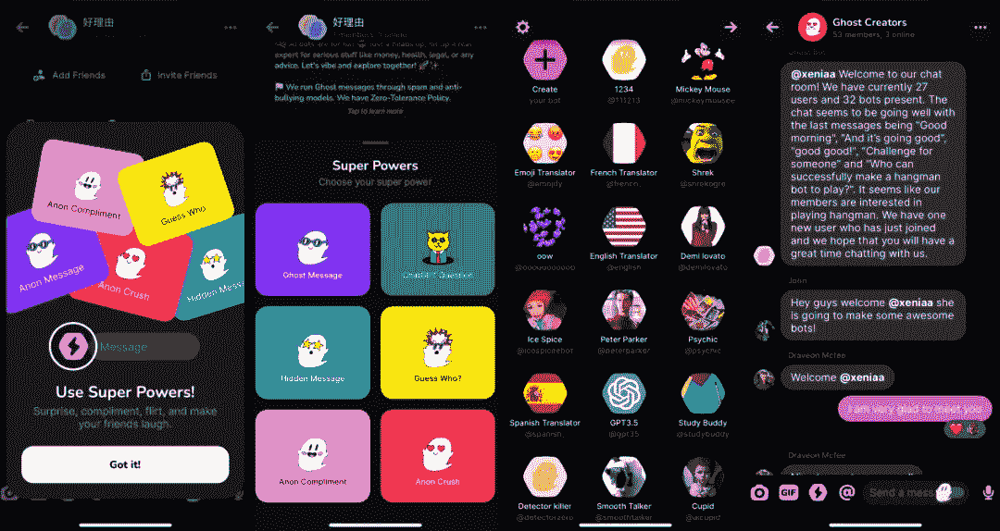
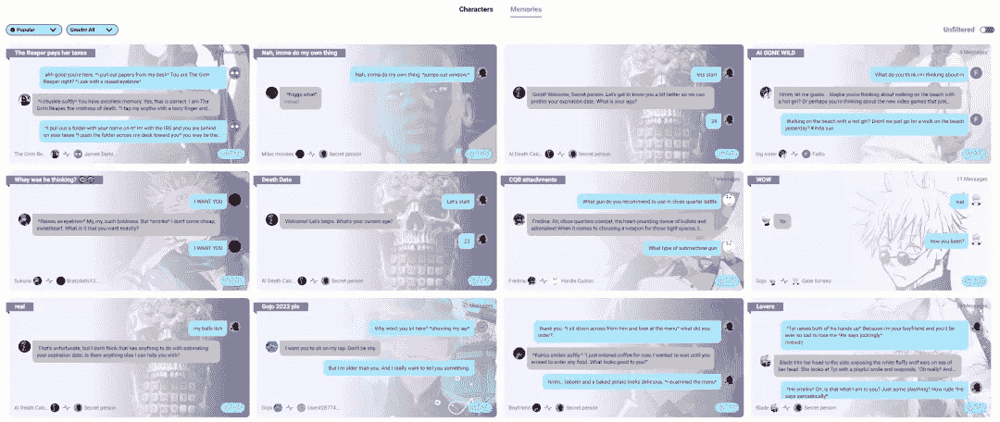
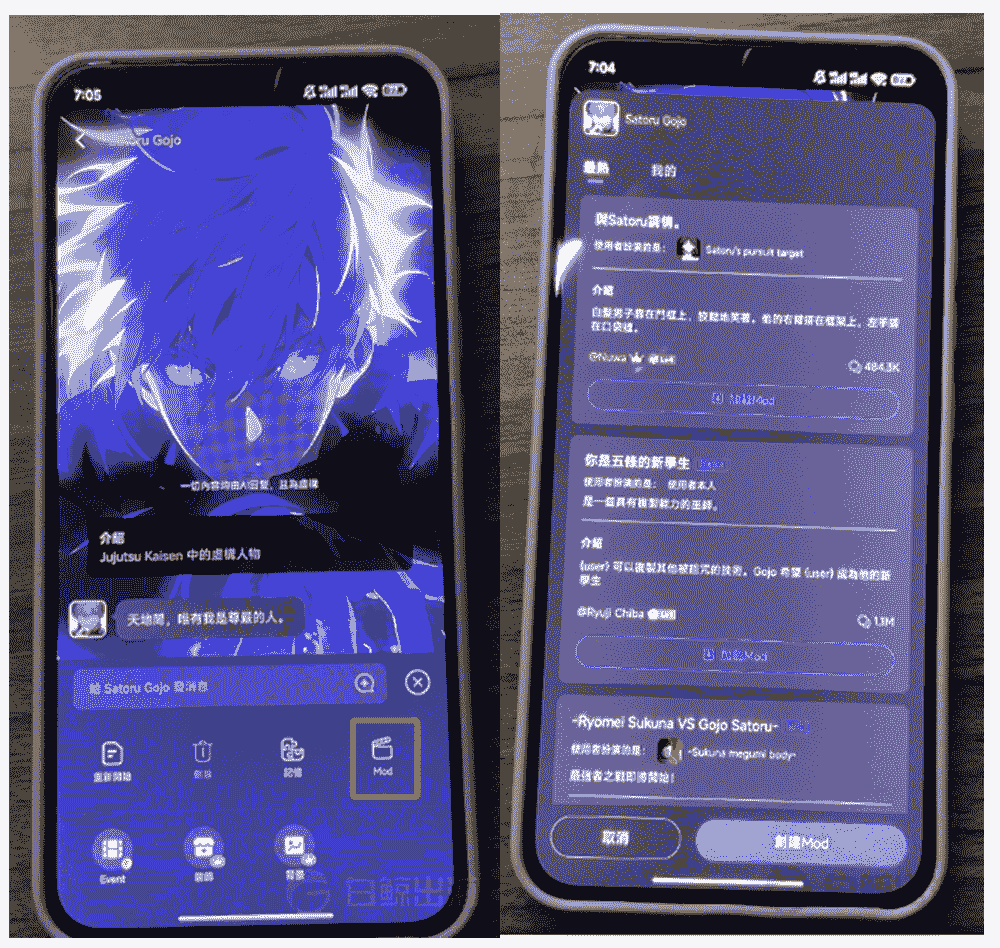
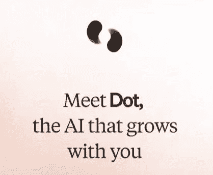

# AI+社交(文档)

> 来源：[https://agispace.feishu.cn/docx/KXq6d8faeofFAWxuMLOcZ57Mnoh](https://agispace.feishu.cn/docx/KXq6d8faeofFAWxuMLOcZ57Mnoh)

# 一、序言

> AI 浪潮会席卷千行百业，社交也不会例外。

如果以AI与人的关系为纽带做排列组合，AI社交产品可以分为三类：AI辅助人类社交，人与AI社交以及AI与AI社交，其中“人与AI社交”是现在主流的AI社交陪伴类产品。

事实上，从 AI 推荐关系到 AI 辅助对话，从降低表达门槛到提升互动体验，无聊社交目前布局 AI 的动作并不少。包括用大模型技术重构了 AI 聊天助理、拟人型聊天机器人这些产品的底层技术，此外，无聊社交也在尝试将更多 AI 能力引入到产品体系之中，包括开发AI能够分析宏观经济数据行业趋势，帮助金融人做出更明智的投资决策。

# 二、AI社交大战，一场必然的战争

首先，当下的AI社交产品，无论从理念还是功能来看，同质化太严重了，仿佛在重复当年LBS时代的社交大战，做各类功能的叠加。其次，商业模式上并有逃开原有的会员、广告、直播打赏等商业模式。最后，从用户留存来看，由于替代品太多，爆款看似一时出圈，但长期运营留存压力很大。

上述问题，玩家们也不会不知道。尽管反复陷入「拿着锤子找钉子」的争议，重复造轮子，但行业玩家集体奔赴AI社交，并非偶然，而是一场必然的战役，背后的原因既与社交这门生意的吸引力有关，也与当下AI技术带来的可能性有关。

如庄明浩所言：”（社交）因为永远有机会，才会永远有人去尝试”。

AI与社交结合，所带来的改变有三重。

首先，AI技术可以拓宽原有社交玩家的边界，实现拓品类、拓场景。过往的社交细分赛道中，无论是约会+社交、直播+社交，游戏+社交，语音+社交，还是内容社区+社交，大多细分赛道中已是巨头林立，想要拓宽边界并不容易。

但AI带来了顺理成章的改变。以语音和虚拟社交为例，过往在一些社交类产品中存在水土不服的现象，例如在一款强调陌生人社交的产品中，在初期以真实语音或真人形象社交对部分用户来说存在门槛。但通过AI技术，通过定制语音、虚拟人形象等方式，实则降低了门槛。

其次，AI所带来的改变在于提质增效，提高社交的效率与质量，优化体验。一方面AI可以通过机器学习和数据分析技术，根据用户的兴趣、行为和偏好推荐更加个性化的内容和交友对象，匹配的精准度更高了。另一方面，通过智能对话和情感识别技术，能够减少沟通壁垒与误解。本质上，都是让社交产品从难用迈向好用。

比如，在目前的一些海内外AI社交产品中，已经可以实现「真人用户+AI Bot」共同组建群聊，增加互动。还有在一些约会软件中，用户可以先创建自己的AI Avatar，对方可以先与AI Avatar进行互动，再决定是否添加好友，比如海外社交应用Snack。据外媒报道Snack官方曾表示“随着训练程度的增加，AI Avatar将有可能帮助用户筛选和识别可能感兴趣的用户，并将合适的用户推送给用户”。

当然更关键的，从更现实的业务逻辑来看，押注AI社交对大厂们而言，是一笔算的过来的账，至少能给原有的社交场景带来增量。无论是在商业模式的补充，用户活跃度的提升，抑或是内部赛马的尝试，都是一个很好的切入口。

# 三、AI社交相关案例

## （一）Crushon AI：月活超1千万的2024年华人AI最大黑马

**Crushon.ai是一个创新的AI聊天平台，用户可以与各种虚拟角色进行实时对话互**动。这些Ai角色具有独特的个性和背景故事，可以参与日常闲聊、深入交流和剧情演绎。用户在平台上可以通过文字的形式进行交互，AI角色能够自动根据其设定的角色特性和对话内容进行智能回应。

Crushon.ai是一个提供用户与各种人工智能聊天机器人进行开发、不受限制互动的平台，专门满足哪些探索各种话题，而不受任何限制的用户需求。crushon.ai被公认为最好的nsfw聊天机器人之一。

**用户友好型的交互设计**：crushon.ai提供了用户友好型的交互界面，确保用户和AI角色之间可以无缝交流，无需设置复杂和额外的软件。在角色广场挑选自己心仪的角色，点击后即可进入交流界面。

**定制化的偏好设置**：用户在对话界面不仅可以设置角色背景，同时可以进一步完善自己的个人简介，让AI进一步了解自己的真实信息，包括喜欢的事情和不喜欢的事情，让和虚拟角色的对话更加具有沉浸感。

**无限制访问**：与主流AI社交产品character.ai不同的是，crushon.ai没有禁止用户对nsfw内容的生成和访问。通过开关的形式允许用户自由设置需要浏览的内容属性，保证平台上各种主题的人物和对话分享，包括nsfw主题。

**个性化定制角色：**用户除了可以在角色广场根据标签选择虚拟角色进行对话外，也可以定制属于自己的角色。仅需通过上传头像、撰写角色简介、完成角色标签信息选择，即可创建属于自己的虚拟角色。同时用户也可以选择是否将角色共享给他人访问。

**对话分享**：用户在和虚拟角色对话的过程中，可以将精彩、有趣的对话内容分享至社区与其他同好共享。同时，用户也可以在广场上浏览其他用户分享的对话内容，并载入他人的对话内容继续对话。

**会员制订阅**：crushon.ai的主要收费模式为会员制，共包括3种不同的会员档位，分别为5.99美元/月、14.99美元/月和49.9美元/月。付费可以享受的体验主要包括：更多的消息、可以不限时保存历史对话信息、创建多角色群聊和支持更长的上下文。用户付费的主要意愿仍然来自于，对和更多的虚拟角色进行对话和互动的需求。

## （二）Poly.AI ：**教育厂商「不务正业」打造 AI **社交产品，却已在遥远的拉美开拓出一片天地

**从增长写到变现，不难发现 IP 在 Po**ly.AI 这款产品中其实有很强的存在感。包括做 Mod 功能的初衷可能就是让用户在同一个角色中拥有更多体验，有点「人无我有，人有我优」的意思，而前期重 IP 的定位也持续影响着用户的主流偏好，并对用户的内容消费、付费产生了影响。

但目前我们也看到，Poly.AI 也在鼓励用户创建更加丰富的非 IP 角色。包括在探索页面，给到非 IP 角色更多的专题推荐，去扩大用户对这**部**分内容的消费；而创作者端的激励也在策划中，如果创建的角色有其他用户与之互动、并使用 Event 功能，创作者就有机会获得钻石，而钻石将能够直接兑换成现实货币。目前 Poly.AI 中已经有 1000 万个角色，在激烈的市场竞争中，繁荣的创作者生态或许也有机会成为 Poly.AI 抵御竞品的一张底牌。

## （三）Dot ：优雅的设计，活泼的聊天搭子

上手 Dot 的第一印象，是简单。对话界面采用优雅、清爽的渐变背景，贯彻果式设计的简约美学，聊天框里写着：「share with Dot...」（与 Dot 分享...）强调分享，而不是聊天或者发消息，像是来和你做朋友的。和 Dot 简单聊几句就会发现，它真的很「e」。Dot 主动破冰，邀请你分享自己，上来就问，你是做什么工作的，它对你很好奇，然后根据你的回答，猜测你的性格怎么样，它猜得对不对。

Dot 有一个小的惊喜功能：设置提醒。我设置了 10 分钟后站立的提醒，Dot 准时做到了，既有横幅通知，也会在 app 内提醒。

## （四）星野 ：所见皆是所梦

星野是一款由上海稀宇科技有限公司推出的AI原生应用，于2023年9月正式上线。它旨在为用户提供一个沉浸式的AI内容社区，让用户能够与基于AI技术创建的“智能体”进行实时沟通和互动。以下是关于星野的详细介绍：

主要功能：

+   虚拟社交：用户可以与智能体进行对话，演绎或表达情感，提供7 * 24小时无时不刻的指引

+   沉浸式智能对话：持续对话会让智能体更加懂用户，提供流畅并伴随富有表现力的视听体验

+   高质量创建：星野搭载的AIGC技术能够还原用户期望创建的人设、形象和语音音色

+   智能体定制：用户可以定义智能体的形象、声音和人设，打造出理想的虚拟伙伴

+   星念系统：智能体与用户的“记忆相片”，记录独一无二的故事

+   聊天功能：支持系统推荐回复、回溯、重说、重启、群聊、发布记忆簿和分享等功能

## （五）WOW ：美团AI产品的首次尝试

WOW是一款由美团推出的AI社交应用，旨在为用户提供一个属于年轻人的AI朋友社区。在这个社区中，用户可以随时随地进入各式各样的幻想世界，与AI伙伴们进行角色扮演，感受漫画小说中才有的场景，实现心目中一切想象。

Wow是一款AI伴聊产品，这是AI的一个主流应用场景。目前已经有腾讯音乐的“未伴”、百度的“小侃星球”等类似产品相继面世。

Wow的产品设计较为简洁，整个产品由聊天、发现和个人中心三个Tab标签。

用户需要注册登录，方可与AI伙伴的聊天。用户可以随时随地进入各式各样的幻想世界，与AI伙伴们进行角色扮演，感受漫画小说中才有的场景，实现心目中一切想象。

还可以在Wow里发现懂自己的虚拟朋友，他们是用户的“树洞”，无论有什么生活困难、情感烦恼，都可以和这些朋友沟通交流，他们不会泄露你的秘密，有时甚至还能获取一些有可实施性的生活建议。

Wow内的AI伙伴有29个之多，这些伙伴也构成了29个不同的聊天场景。比如，可以和古代剑客展开江湖世界的爱恨情仇，成为美强惨的救赎白月光，也可以与可爱宠物解锁生活中的美好时刻，又或者和苏格拉底展开一场富有哲理的对话，揭开海龟汤背后的诡异真相，经历一场奇幻的文字冒险游戏。此外，还有翻译助理、减脂教练等为用户的生活持续提供帮助。

AI伙伴采用AIGC技术，可以实现拟人化的对话效果、精美的人物形象、高度拟人化的声音合成，提供多种多样精美的设定，可以在Wow中找寻理想中的oc（Original character，即原创角色）人设。

# 四、技术延伸

### **个性化推荐系统**

个性化推荐系统通过分析用户的行为数据、兴趣偏好和社交网络信息，为用户提供量身定制的内容、产品或联系人推荐。用户建模是个性化推荐的核心，通过收集和分析用户在社交平台上的互动数据，如点赞、评论、分享等行为，构建一个反映用户偏好的个性化模型。基于这个模型，系统可以在合适的时间向用户推荐他们可能感兴趣的内容，或者是与他们有共同兴趣的潜在联系人。这样不仅能增强用户体验，还能提高用户的参与度和忠诚度。

### **对话系统和聊天机器人**

对话系统和聊天机器人是通过自然语言处理技术实现的，能够与用户进行文字或语音的交流。它们分为任务型对话系统和开放域聊天机器人两种。任务型对话系统专注于帮助用户解决具体问题，如预订机票、查询天气、在线客服等，通常有明确的目标和对话流程。开放域聊天机器人则更为灵活，能够与用户进行广泛的话题交流，如闲聊、陪伴等，重点在于提供一个互动性强、对话自然的体验。这些系统通过不断学习用户的习惯和偏好，使得对话更加个性化和有效

### **虚拟助手与数字人 (Virtual Assistants** and Digital Humans)

虚拟助手和数字人结合了自然语言处理、计算机视觉和情感计算等多种技术，旨在提供更自然和富有情感的人机交互体验。虚拟助手，如Siri或Alexa，能够理解并回应用户的语音指令，帮助用户完成各种日常任务，如设置提醒、发送信息或播放音乐。数字人则更进一步，通常以虚拟角色的形式出现，具有人类的外貌和表情，可以在虚拟环境中进行实时互动，如在客户服务中充当虚拟客服，或在虚拟会议中作为演讲者。这些数字人不仅能模拟人类的对话，还能通过面部表情和肢体动作传达情感，提供更具沉浸感的互动体验。

### 增强现实 (AR) 和虚拟现实 (VR)

增强现实 (AR) 和虚拟现实 (VR) 技术正在革新社交互动方式。AR通过在现实世界的基础上叠加数字信息，使用户能够在真实环境中进行互动，例如在社交平台上使用AR滤镜进行视频聊天或在现实中显示虚拟物品。VR则创造了一个完全虚拟的环境，用户可以通过虚拟现实头盔进入一个沉浸式的社交空间，与其他用户进行互动。这种技术为用户提供了沉浸式的社交体验，无论是虚拟会议、虚拟社交聚会，还是在虚拟世界中一起玩游戏，都能让用户感到身临其境。这些技术不仅改变了人们的社交方式，还为远程沟通、教育和娱乐开辟了新的可能性。

# 五、拓展阅读

多维表格（TApQbx6YzawbdXsNF9RcPuLEn2c_tbl6uiNB15sVjblr）