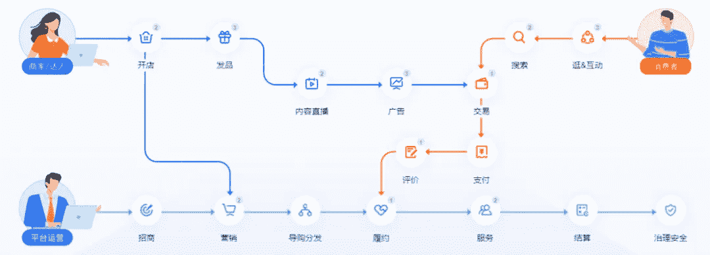
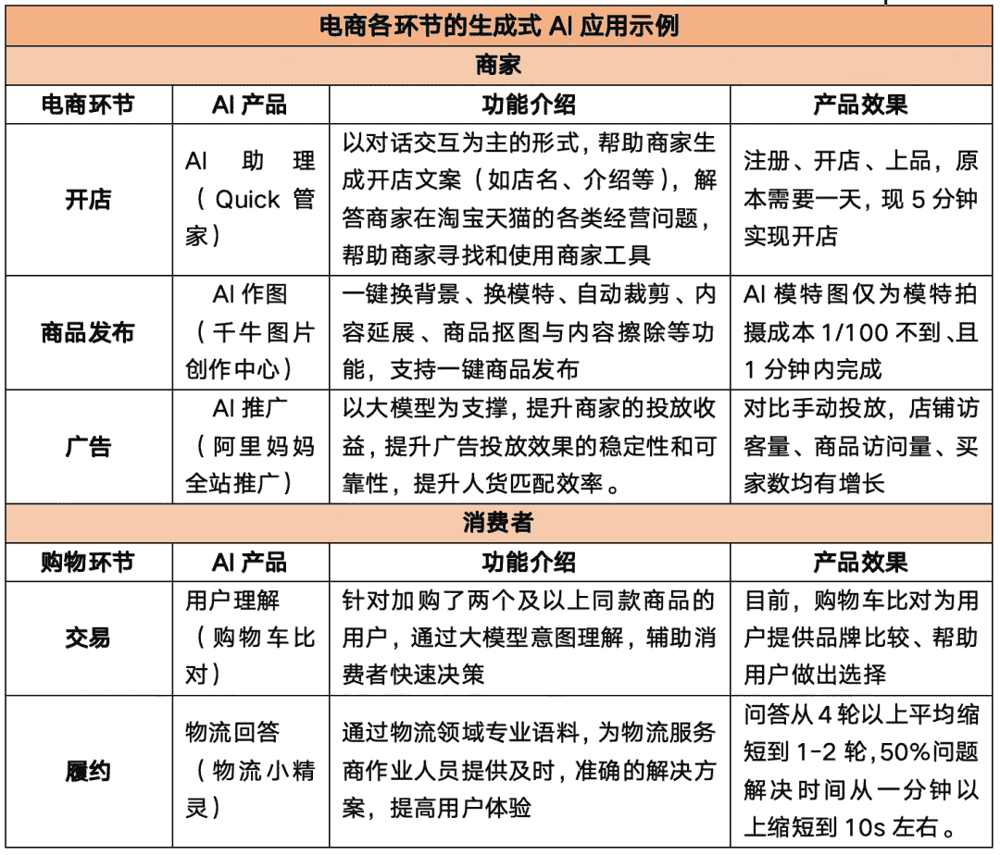
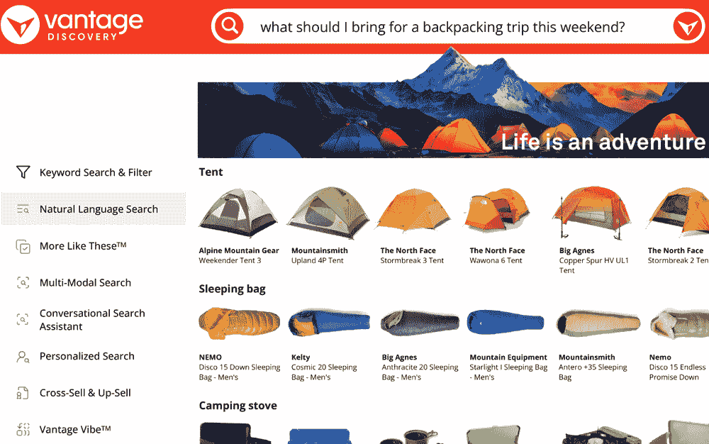
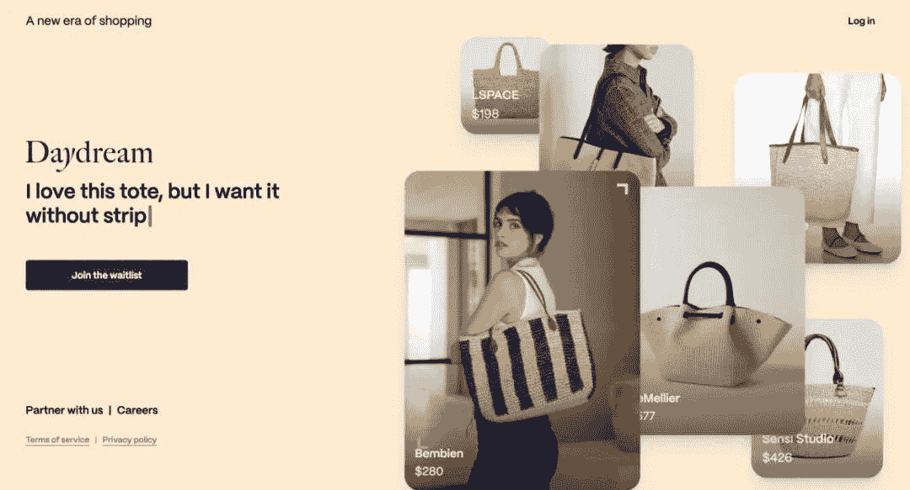
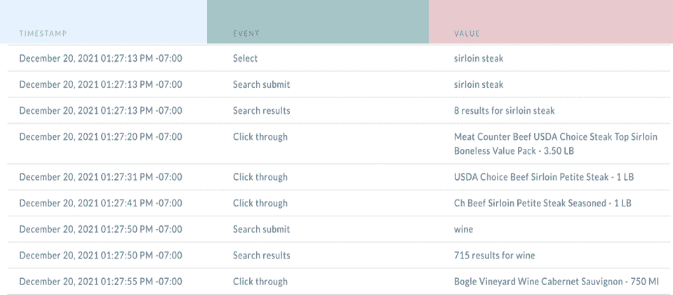
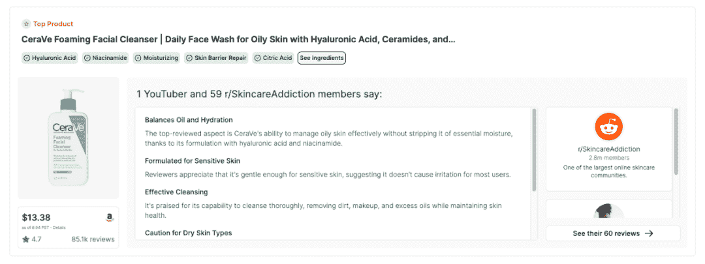
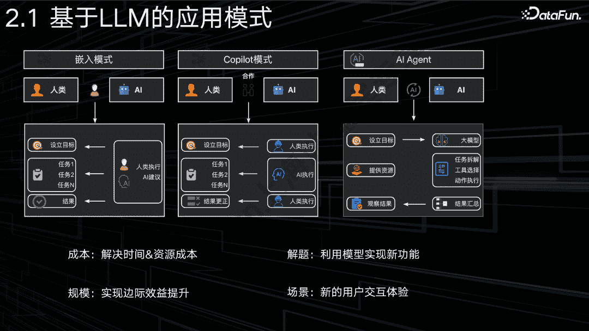
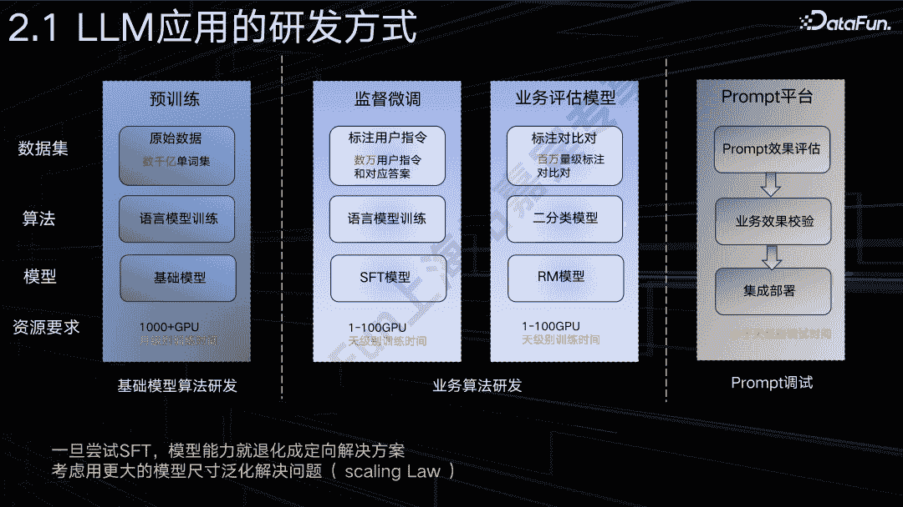

# AI+电商(文档)

> 来源：[https://agispace.feishu.cn/docx/T65LdlkBoo3YPBxGqF8ch3rPnOf](https://agispace.feishu.cn/docx/T65LdlkBoo3YPBxGqF8ch3rPnOf)

# 一、序言

> 在数字时代，我们获取和互动信息的方式经历了持续的变革。传统搜索引擎长期**以来作为数据宝库的大门，通过查询和链接列表以**相对静态的方式提供了无限的信息访问。随着信息量和复杂性的增长，这种体验迅速恶化，使得个性化、智能发现的需求变得尤为明显。

2**0**24年，AI+电商搜索正在成为一个新的热门赛道，除了像 Google、Amazon 和 TikTok 这些更接近用户和场景的巨头外，近期已经有多家创业公司布局该领域并拿到融资，期待通过AI驱动的搜索、发现和个性化技术，彻底改变这一局面。

# 二、生成式AI在电商场景的应用日渐丰富

## （一）电商平台是生成式AI技术普惠的最佳试验场

电商是一个技术应用更贴近“钱”的场景，而电商运营又高度依赖于内容生成，包括文字、图片、视频等。据研究机构调查显示，约70%的用户在购物前会浏览商品图片，42%用户因观看视频而购买商品。这决定了AI是电商行业发展的新引擎，电商也成为生成式AI应用最佳试验场，并在技术初期可以直接产生实用价值。

为**什么电商能够成为生成式AI转化最快的**应用场景，原因或有二：第一，电商在过去二十年的发展，数字化积累深厚。电商生态内的从业者和消费者，都实现了软件、硬件以及观念上的数字化转型，生成式AI应用出现后，有意愿、有条件也有能力接受创新并为之投入。第二，电商是典型的平台经济，多边市场结构让AI应用的创新和推广“扬鞭奋蹄”。生成式AI的功能优势与电商行业应用高度匹配，商家的各个环节为生成式AI创新提供了丰富的场景。头部平台企业扮演着重要角色，长期的技术储备和丰富的产业经验，让平台企业既懂AI又懂产业，能够快速切入有价值的赛道，让商家、消费者、服务商成为生成式AI的使用者。据调研，近60%受访商家是通过电商平台提供的产品体验生成式AI，高于外部网站/APP（45%）

## （二）AI技术正渗透到电商的各个环节

电商这一“最佳试验场”，带来“AI+”丰富应用。在淘宝平台，从商家经营（开店、发品、直播、广告、营销）到消费者体验（互动、搜索、交易、支付、评价、履约），每一个环节都有基于AI的工具创新探索，在不同程度上提升商家运营的效率（详见下表）。据淘宝平台调研，得益于广泛应用场景，约30%受访商家已使用生成式AI。

从长远看，新旧动能/模式的转换是需要时间的。现阶段AI技术与完全成熟还有一定差距，但在电商平台，更多商家对新技术新应用都持着积极和开放的态度。淘宝平台调研发现，未使用生成式AI的商家之中，近84%是因没有接触过或不会用，认为没有效果（6.6%）、不安全（1%）均占少数。如何更加便捷易用是生成式AI应用于电商的关键，正如一位经营农资农具的商家所言，“（AI）搞来搞去花样多了，也一样增加成本。人为了适应AI而去增加更多的精力学习，就好比我买了很多智能的电子产品，如果不能简单快速地上手使用，学习该如何使用这些电子产品和AI都是一种时间成本，当然，真正非常实用且高效的AI另说。”

# 三、**AI电商相关案例**

## （一）VantageDiscovery：突破关键词和语义搜索

今**年** 6 月初，VantageDiscovery 完成了1600万美元的A轮融资，致力于打造一个生成式 AI 驱动的搜索和产品发现平台。该项目获得了 Twitter 联合创始人Biz Stone 以及 Pinterest 联合创始人 Evan Sharp 的投资。

Van**tageDiscovery 由两位前 Pinteres**t 搜索专家构建。创始人 Lance Riedel 和 Nigel Daley 都曾花费数十年时间研究搜索发现，曾帮助 Pinterest 推出了 Pinterest Shopping。他们在 Pinterest 上学习到如何使用大型语言模型和图像识别 AI 来不仅根据关键词而且根据用户之前的行为来定制搜索结果。

创始人表示，**VantageDiscovery **最大的竞争力来自他们的自定义向量数据库。将用户查询的语义理解和对用户个人风格的语义理解结合起来，在几毫秒内从数百万个项目中检索出最个性化、最有针对性的结果。

**V**antageDiscovery 的商业策略是为那些独立站卖家、集合店、大型购物网站提供面向商业的搜索引擎。其产品支持客户定制模型，重新对搜索结果排名。目前已经与一些全球最大的零售商、以及Cooklist、Koodos、West.co 和 Bookopolis 等客户合作。通过调用 API，这些传统零售网站能够增加用户的生命周期价值（LTV）并降低获取成本（CAC），同时为用户提供仅靠关键词和语义搜索无法实现的超预期购物体验。

## （二）DayDream：从搜索走向发现

6月20日，电子商务搜索引擎公司 Daydream 宣布其获得5000万美元种子轮融资，Forerunner Ventures 和 Index Ventures 共同领投，Google Ventures 和True Ventures 也参与其中。

AI + 电商是一个拥挤的赛道，老玩家众多，大型企业如亚马逊、谷歌、万事达卡和TikTok已经在其购物平台上应用了不同类型的 AI 技术。AI 能力颠覆传统购物体验的方式也大同小异。DayDream 追求的理念并非独创，在如此竞争环境中仍获得了顶级资本青睐，在定位和团队能力上还是有不少亮眼之处。

DayDream 的创始团队在电子商务领域有着很深的积累，其创始人 Julie Bornstein 曾在多个零售品牌（Nordstrom、UrbanOutfitters）、零售渠道商（Sephora）、基于算法的购物平台（StitchFix）担任高管，对电商有着极深的行业认知。Bornstein 此前创业的 AI 驱动购物服务 TheYes 出售给了 Pinterest。

创始团队表示，**DayDream 最大的竞争力来源于良好的执行力、**精准的模型调整，以及出色的用户界面构建。

在行业选择上，DayDream 计划先集中攻克男装和女装赛道，计划在今年秋季向美国消费者推出平台的测试版，暂时专注于时尚领域。目前它已经吸引了超过2000个品牌，包括Net-A-Porter、Altuzarra、JimmyChoo、Doen、AloYoga和LaDoubleJ。

## （三）Constructor：用户点击流的信奉者

Constructor 是一家老公司，不同于那些在 2023 年和 2024 年成立于 GenAI** 浪**潮中的公司，Constructor 在 2015 年成立，定位于一家为营收导向电商企业量身定制的搜索和产品发现平台。Constructor 的 AI 解决方案帮助购物者更容易找到他们想要购买的商品，也在帮助电商团队为用户提供个性化购物体验的同时，持续优化关键绩效指标，如收入、转化率和利润等。

**在 Con**structor 的加持下，头部B2C和B2B电商品牌如 Sephora、Petco、Birkenstock、The Very Group、home24、Grove Collaborative 和 Fisheries Supply 等已持续带来超过 1000 万美元的提升。Constructor 的业务数据增长良好，已经连续三年实现了收入翻倍增长，并且保持着全行业最高的 98.5% 的客户留存率。

**这家公司在 2024 年 6 月再次获得资本关注，拿到了 Sapphire Ven**tures 领投的 2500 万美元 B 轮融资，估值翻三倍至 5.5 亿美元。

在电商搜索这个赛道，但凡拥有竞争**力的产品都有1-2个与众不同的产品亮点，**而 Constructor 是用户点击流（ClickStream 技术）的信奉者。公司认为，用户的点击流数据是客户网站中积累的最核心数据资产，基于这些活动轨迹，购物网站能够更好的优化搜索结果，改善转化率、AOV、RPV等网站指标。

## （四）**YC： AI 时尚买手平台**

YC 也在 AI +电商赛道有所布局，只不过相比上述的几个创业项目，YC 选择下注了两家直接面向 To C 消费者的 AI 购物产品。

这两个创业项目有一个共同点，都是来自麻省理工学院的创业团队。Y Combinator 分别在 S23 和 W24 两届项目中布局。

Lumona 是 YC W24 的项目，该项目的三位创始人均来自麻省理工学院。CEO Dylan 在在麻省理工学院学习计算机科学与工程。凭借在 Google 和 Stripe 的工作经验，他深入了解了大规模系统和 API 的工作原理。CTO Qiong 曾在麻省理工学院学习计算机科学，并在麦戈文大脑与认知科学研究所进行机器学习研究。

**L**umona 想做一个嵌入产品社交评论的购物搜索引擎，使用 AI 迅速帮助你完成产品调研，从而降低购物决策难度。

“作为 Z 世代，我们在成长过程中受到每天观看的内容创作者和在线购买产品的影响。” Lumona 的创始人 Dylan 花了几个小时梳理 r/SkincareAddiction 帖子并观看 YouTube 视频，以了解现在的护肤程序。

Lumona 直接在产品旁边提供 AI 提炼后的 Reddit 和 YouTube 评论， 将产品研究过程简化为一个选项卡和搜索，同时让用户在购买产品时更为准确、方便快捷。目前该产品仍没有上线对外开放测试，但很难说这种方式是增加了决策时间还是缩减了时间。视频内容虽然被压缩成了简洁的观点，但也一定程度上丧失了用户购物时的直观性和信任感。

# 四、技术延伸

1.  **基于 LLM 的应用模式**

大模型在电商领域的应用展现出了其强大的潜力和广泛的标准定义。从在人做事的过程中融入大模型的生成能力，到能够在助手体系中实现人机深度交互，进而通过 Agent 执行体实现有效任务级的代理。这一概念不仅深化了我们对 Agent及 AI 交互的理解，也为我们提供了综合运用的模式。具体而言，这种模式允许我们在 Agent 内部结合多种算法，或在 copilot 中实现多任务并行处理。在电商领域，大模型的应用首先解决了成本和规模问题，展现了其确定性和平台的投入价值。其次，大模型还能解决传统方法无法处理的问题，实现新的深度能力，进一步推动了电商领域的发展。与传统的大模型泛化应用不同，大模型在电商领域的应用更加专注于解决特定领域的深度问题，根据需求对模型进行训练和微调。展望未来，我们期待大模型与电商场景实现深度融合，打造 AI native的深度交互场景，为用户带来更加自然、智能的购物体验。

1.  **LLM 应用的研发方式**

模型应用的过程可以分为三个阶段。首先，当模型需要预训练时，其迭代周期与训练要求均属高标准，这一阶段依赖于基础设施和长期的研发积累。进入第二阶段，若涉及监督微调和业务评估模型，如 reward model 等体系，并辅以少量的强化学习（尽管该领域目前尚未成熟），则算法的深度介入变得至关重要。最后，当模型应用进入 prompt 的调试和整体数据效果优化阶段时，算法与工程均可灵活切入，共同推动模型性能的提升。这三个阶段在投入量与产出效果上各有差异。我们期望模型能根据不同场景和问题类型进行适配。对于解题型任务，我们希望模型能更深入、更实用，因此会加大中间环节的投入。而若希望模型应用场景广泛，则更需依赖 prompt 的构造和基础模型的能力。这些经验来源于我们在模型开发过程中的实践与思考。

# 五、拓展阅读

多维表格（PFbfbkVGBaRHwUsBKAnc0UdUnlb_tblNL7Vqt6fmg7CQ）