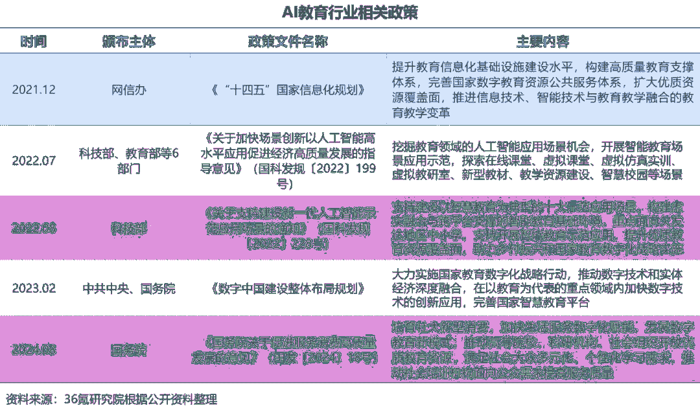
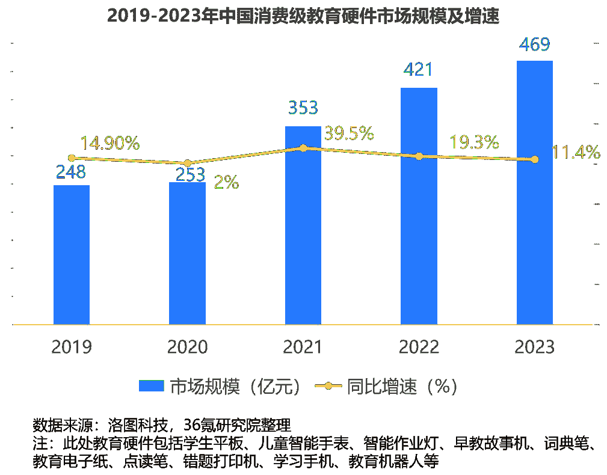
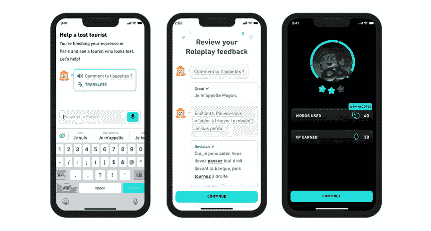
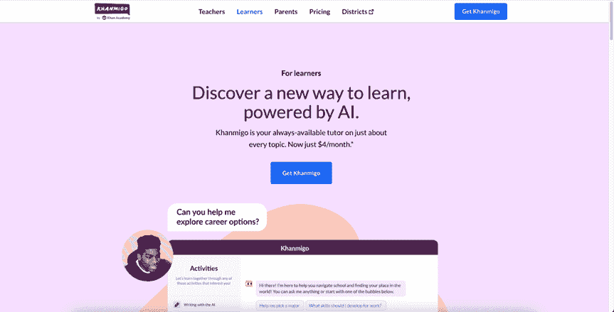
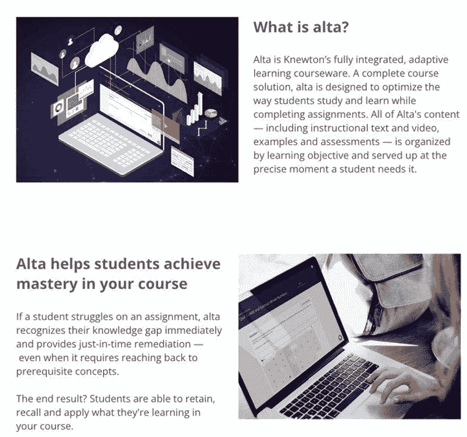
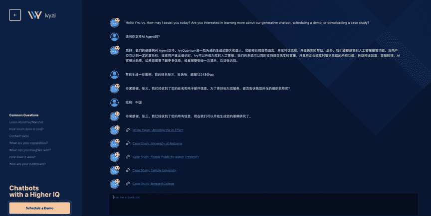
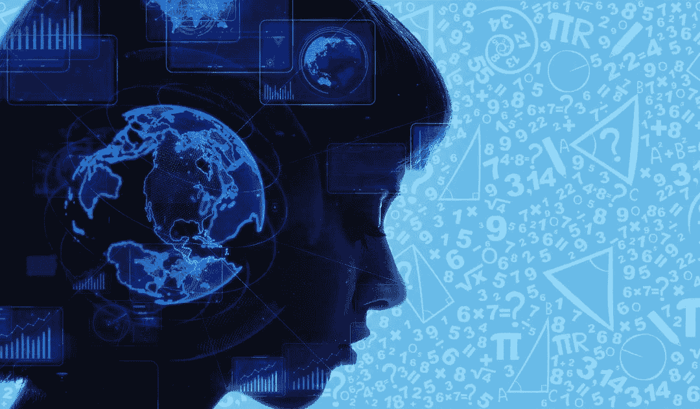

# AI+教育(文档)

> 来源：[https://agispace.feishu.cn/docx/FNJidSV2qoE1u4xBNuzcOzOunfg](https://agispace.feishu.cn/docx/FNJidSV2qoE1u4xBNuzcOzOunfg)

# 一、序言

> “教育兴则国家兴，教育强则国家强”

教育，作为国家发展的基石，承载着培养未来社会栋梁的重任。伴随着我国教育强国战略的出台，AI与教育的深度融合已成为推动教育现代化、实现教育强国战略的关键举措。从政策的顶层设计到技术的创新实践，AI教育正逐步从理念走向现实，展现出其在提升教育公平与效率、培养面向未来的复合型人才方面的巨大潜力。

# 二、AI教育行业发展概览

“教育兴则国家兴，教育强则国家强”，作为国之大者，教育始终位于优先发展的战略位置。为提升教育现代化水平，由教育大国向教育强国迈进，我国政府坚持推动教育领域的综合改革，以科技手段升级教育内容质量、优化教育资源配置，引导以人工智能为代表的新一代信息技术和教育核心场景的深度融合。

2017年，我国首个国家级人工智能规划《新一代人工智能发展规划》出台，将智能教育作为智能服务的重点发展方向。此后，针对技术与教育融合的政策陆续出台，旨在加强教育信息化和智慧教育场景的建设。2024年3月，教育部正式启动人工智能赋能教育行动，推出“AI学习专栏”、国家智慧教育公共服务平台升级、教育系统人工智能大模型应用示范、搭建数字教育国际交流平台等4项具体行动。8月3日，国务院发布《国务院关于促进服务消费高质量发展的意见》，旨在培育壮大以数字教育这一新模式为典型的新型消费，更是为AI教育行业的高效有序发展注入新动能。

教育强国战略引导下，我国教育质量取得显著进步。然而，公平与效率问题依旧是横亘在教育领域的两座大山。一方面，我国城乡间、地区间教育水平存在一定差异：教师、教学设施、教育财政投入等必要教育资源多集中在发达地区及城市，由此带来教育质量、资源配置及教育信息化水平的区域间不平衡。另一方面，优质教育的核心资源之一——教师，天然带有稀缺属性，而高水平教师数量则更为有限，难以兼顾学生在答疑辅导、情绪陪伴、心理疏导等方面的需求，更是难以真正实现因材施教和精准教学。教育部数据显示，2022年我国专职教师与学生人数之比近1:16，教师资源供给不足。

AI在教育场景下的应用，则为纾解公平与效率困境提供可实现路径，通过远程教育叠加数字化教育内容，创新课堂授课模式，将部分有形的教育资产变为无形的教育资源，打破固有的空间与时间限制，带来资源的自由流通与互通。搭载AI功能的教育软硬件与平台，则扮演“私人教师”角色，为学生提供针对性教学、辅学、纠错、答疑等服务，以个性化能力辅助提升教育效率。

传统教育模式多以集体化的统一班级授课为主，以作业、试卷、教学观察等作为主流评价工具，重视基础知识学习成果而忽视综合素养表现。随着数字化时代呼啸而至，社会环境的变迁带来人才培养需求的变化，传统教育模式已无法更好地应对时代变迁。根据世界经济论坛发布的《未来就业报告2030》，未来5年内，社会对于人工智能、商业分析师、数据科学等跨学科职位的需求增长最快，而具备创造性思维、技术素养、好奇心和学习能力的复合型人才则是面向未来的核心人才。AI驱动的教育模式顺应时代发展趋势和人才培养需求，受到家校的共同关注。相较传统教育模式，AI教育以学生为中心，通过虚拟教学空间、智能评价工具及多维测评手段，重视学生的综合素养，因而也有利于培养兼具创新思维和基础能力的综合性人才。

目前，AI对教育的赋能主要包括面向政府及学校、以校内场景为主的智慧教育管理，以及面向学生及家长群体、以校外场景为主的辅助教育。前者融合大数据、云计算、数字孪生等其他技术，依托电脑终端、智慧黑/白板、教学管理系统、学习平台、内容资源库等软硬件，为教育教学、学生管理、校园安全等提供高效运行保障，是教育信息化的重要构成。在“教育强国”战略指引下，各地政府及学校愈发认识到，新一代信息技术与校园教育和学校管理的深度融合，对提升教学质量、教学效率、校园服务体验、家校互动及学生安全等大有裨益，因而持续加大教育信息化的财政资金保障力度，由此带来相关软硬件服务市场的扩容。锐观咨询数据显示，我国教育信息化市场规模由2017年3.4亿增长至2023年近5.8亿元，年均复合增长率高达9.21%。

面向学生及家长群体的辅助教育则多为消费级智能教育硬件、在线教育产品及服务、学习类APP及资源平台等软件系统，覆盖K12、素质教育、高等教育、职业教育等多个领域。得益于AI，特别是自然语言处理（NLP）、知识图谱、深度学习、大模型等技术的革新，消费级教育软硬件正历经底层应用能力的升级跃迁。相关企业多以自研或生态协作模式，围绕教育大模型打造技术底座，以AI技术能力再造教育流程，AI原生应用层出不穷。以学习平板、词典笔、电子纸单词卡等为代表的教育硬件更是通过AI实现与用户间的个性化交互，获得学生及家长的青睐。根据洛图科技数据，2023年我国消费级智慧教育硬件产品市场规模约为469亿元，同比上升11.4%，韧性增长态势明显。

来源：2024年中国AI教育行业研究报告｜36氪研究院

# 三、**AI教育相关案例**

## （一）Duolingo**：用AI打造全新的学习体验**

2023年3月14日，Duolingo宣布推出由OpenAI 提供支持的新产品“Duolingo Ma**x”，通过使用 G**PT-4 构建全新的学习功能，打造更加先进的学习体验。而最新推出的Duolingo 主要有两个新功能，Role Play(角色扮演）以及Explain my Answer（解释我的答案）。

## （二）Khanmigo：提高老师教学效率

AI学习助手Khanmigo，不仅能为学生在数学、科学、人文科学等领域进行教学辅导，而且能够帮助老师编写教案、规划课程，将AI深入融合进了教学工作的各个环节，让老师能够更专注于学生的综合能力培养。

Khanmigo目前有以下帮助学生和教师的功能：

聊天机器人：Khanmigo 通过对话式与学生互动，通过提出问题、提供提示、答案和反馈来辅助学生学习。

个性化辅导：Khanmigo 通过AI Agent方式，为每个学生制定适合个人需求和学习方式的教学计划。

教师分析：Khanmigo 通过AI为教师提供有关学生学习进展的详细见解，帮助他们更有效地实施个性化教学。

## （三）Querium：Agent分析学生的学习情况

Querium是一家专注于STEM（科学、技术、工程和数学）教育的公司，其AI Agent可以提供个性化的数学辅导和题目练习。该Agent根据学生的学习情况和错题分析，推荐适合的练习题目，并提供实时的解题策略和反馈。

Queirum 的人工智能对教师非常有帮助。它通过分析学生的答案和完成辅导课程所需的时间，帮助教师深入了解学生的学习习惯及需要改进的领域。

## （四）Knewton’s Alta： 完全集成的人工智能教育工具

Knewton’s Alta是一种完全集成的人工智能教育工具，通过类似于AI Agent的技术，Knewton’s Alta可以深入了解每个学生的知识和学习差距，从而实现量身定制的学习体验。这种自适应学习技术提供个性化的反馈和帮助，持续监控学生的进步，并实时调整优化学习成果。

## （五）Ivy.ai： 缩小教育机构与其学生社区之间的差距

Ivy.ai 是一款先进的人工智能驱动的聊天机器人，旨在简化高等教育机构的交流。该平台通过促进个性化和简化的互动，缩小教育机构与其学生社区之间的差距。Ivy.ai 强大的功能确保全天候高效解决学生的疑问。同时该聊天机器人支持AI Agent，它能够处理自然语言，开发对话流程，并提供实时帮助，可以同时支持数百名实时客服，并具有企业级实时聊天系统的所有功能，包括预设回复、客服转接、AI客服协助等。

# 四、AI重塑教育格局

1.  **AI导师：个性化学习的新范式**

Khanmigo，一个基于GPT-4的AI教育助手。Khanmigo不仅能够回答学生的问题，还能提供即时反馈，并根据学生的学习进度动态调整教学内容。 例如，当一个学生在解决复杂的微积分问题时遇到困难，Khanmigo不会直接给出答案，而是通过苏格拉底式的提问引导学生思考。它可能会问：“让我们回顾一下微分的基本概念。你能告诉我导数的定义吗？”然后，“现在，看看这个函数，它的变化率是如何随x变化的？”通过这种方式，Khanmigo帮助学生逐步理解问题的本质，培养他们的数学思维。

比如，对于一个在代数方面表现出色但在几何上遇到困难的学生，AI可能会建议增加几何练习的时间，同时在代数方面提供更具挑战性的问题。这种方法不仅提高了学习效率，还能增强学生的自信心和学习动力。

1.  教师角色的转变：从知识传授者到学习引导者

当AI承担起知识传递和基础训练的任务后，教师就能从繁琐的事务性工作中解放出来，将更多精力投入到培养学生的批判性思维、创造力和情感智能等高阶能力的开发上。

在一堂历史课上，AI系统为学生提供了美国内战的基础事实和背景知识。教师不再需要花时间讲述这些基本信息，而是组织学生进行一场模拟辩论，让学生分别扮演南北双方的代表，讨论战争的起因和影响。在这个过程中，教师的角色从知识的传授者转变为讨论的引导者和思维的启发者。 这种角色的转变不仅提升了教育的质量，也重新定义了教师这一职业的价值和意义。教师可以更多地关注学生的个性化需求，培养他们的批判性思维和创新能力，这些都是AI难以替代的。

1.  **协作学习：打破孤立，促进互动**

在一个项目式学习的场景中，AI可以根据每个学生的特长和兴趣，智能地组织学习小组。例如，在一个环保主题的项目中，AI可能会将一个对生物学感兴趣的学生、一个擅长数据分析的学生和一个有创意写作天赋的学生分到一组。AI还为小组提供了一个具体的任务：研究当地河流的污染状况并提出改善方案。 在项目进行过程中，AI还可以监测每个学生的参与度，确保每个人都有机会贡献自己的想法。如果AI发现某个学生参与度较低，它可能会提示教师或直接向该学生提供鼓励和建议。这种方式不仅培养了学生的协作能力，还让学习过程变得更加吸引和有趣。

1.  **全球教室：缩小教育鸿沟**

AI可以自动将教学内容翻译成不同的语言，并根据不同文化背景进行适当的调整。例如，在讲解经济学概念时，AI可能会根据学生所在的地区，使用当地的经济现象作为例子，使抽象的概念变得更加具体和易懂。 这一构想不仅有望缩小全球教育鸿沟，更可能成为促进文化交流、增进国际理解的有力工具。

1.  革新评估和招生：全方位的人才评价

传统的标准化测试往往难以全面评估学生的能力，而AI驱动的多维度评估系统则有望改变这一局面。AI系统不仅分析了申请者的学业成绩，还通过分析他们的项目经历、课外活动、写作样本等多方面信息，生成了一份全面的人才画像。例如，对于一个申请计算机科学专业的学生，AI不仅会评估他的数学和编程能力，还会分析他在GitHub上的开源项目贡献、他在黑客马拉松中的表现，甚至他在线上论坛中与他人的技术讨论。 更进一步，AI还可以模拟真实的问题解决场景，评估学生的批判性思维和创新能力。比如，给学生一个复杂的社会问题，让他们提出解决方案，AI可以评估学生的思维过程、创新性和可行性。 这种评估方式不仅考察了学生的知识储备，还包括了创造力、领导力、抗压能力等软实力，为招生决策提供了更全面、更公正的依据。

1.  心理健康支持：AI作为情感智能教练

AI可以作为一种“心理健康教练”，为学生提供全天候的情感支持和指导。 AI系统可以通过分析学生的学习行为、社交互动和情绪表达，及时识别可能出现的心理健康问题。例如，如果系统检测到一个学生最近的学习时间急剧减少，同时社交活动也明显减少，它可能会向学生提供一些应对压力的建议，或者提醒辅导员进行干预。 一个高中生在准备大学申请时感到极度焦虑和压力。AI系统通过分析她的日记内容和学习行为，识别出了这一问题。AI首先提供了一些放松和减压的技巧，如冥想和深呼吸练习。同时，它也建议学生与学校辅导员或信任的成年人谈谈。此外，AI还帮助学生制定了一个更加合理的学习计划，避免过度疲劳。这种支持并不是要替代专业的心理咨询，而是作为一种补充，帮助学生更好地管理自己的情绪和压力。AI的优势在于它可以提供24/7的支持，而且一些学生可能更愿意向AI倾诉他们的问题。

来源：Salman Khan的《Brave New Words》

# 五、拓展阅读

多维表格（Kxfvb780ba3xJTs5xGmcp3mwn2I_tblyt6IMiQ8NcpnJ）