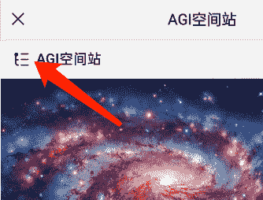
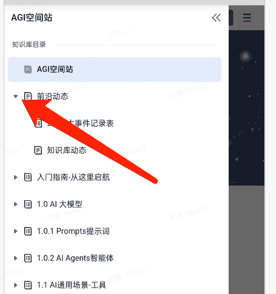
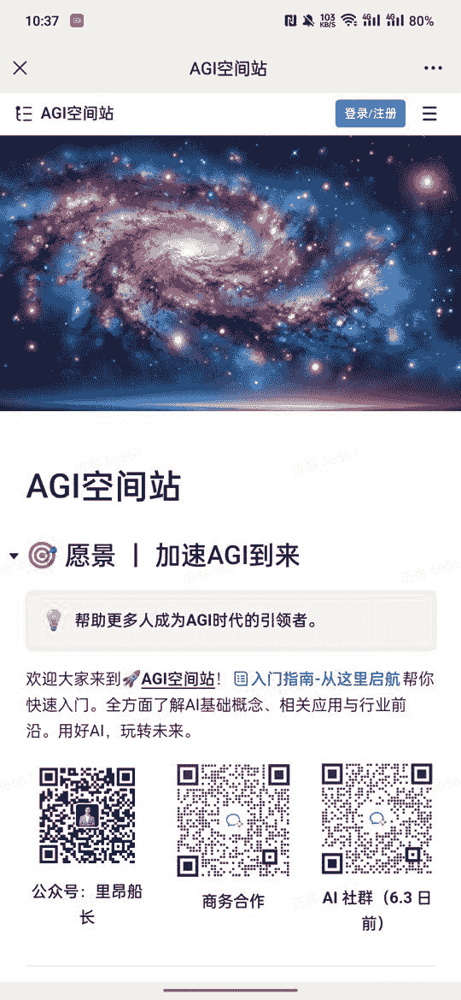
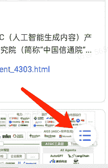
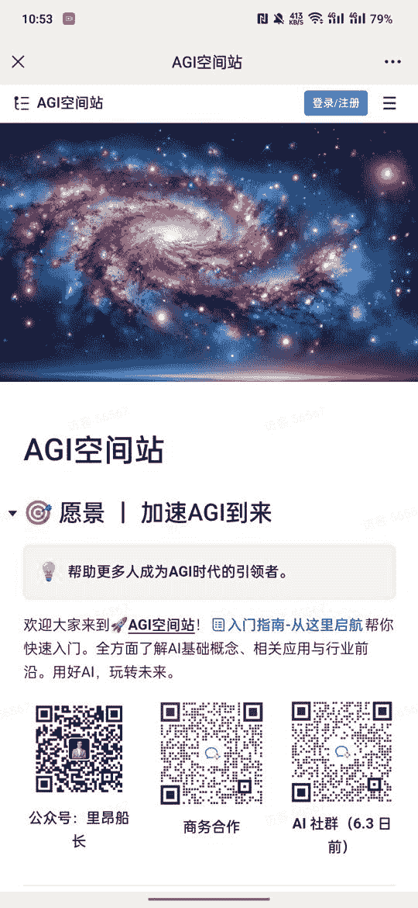

# 知识库手机端观看技巧

> 来源：[https://agispace.feishu.cn/docx/DCIqd71gzo6JNlx5C6lcpcZKnZe](https://agispace.feishu.cn/docx/DCIqd71gzo6JNlx5C6lcpcZKnZe)

### 为什么只有一个页面？**网站其实有主目录**

以首页举例，1️⃣**点击****左上角****即可进入主目录，2️⃣点击****小箭头****即可打开分类**

[20240529-103838.mp4](https://internal-api-drive-stream.feishu.cn/space/api/box/stream/download/all/OMSgbV69gohBQzxfU2rcKNMdntc)

**（辅助视频）**

### 还有一种目录不要忽略了，隐藏了很多知识！（多维表格）

AI 驱动千行万业为例，1️⃣**右下角按钮****即可进入多**维表格的目录，2️⃣通常画廊、表格两种形式

[20240529-105453.mp4](https://internal-api-drive-stream.feishu.cn/space/api/box/stream/download/all/VfpZbI93coJoLSxKaFycWpXpnyb)

**（辅助视频）**

> 建议使用**飞书客户端**或者**电脑端**访问，展示更加友好。

>

> 点击返回首页[AGI空间站](https://agispace.feishu.cn/wiki/Xs6HwsNyDi92O8kayXJclpcZnsd)