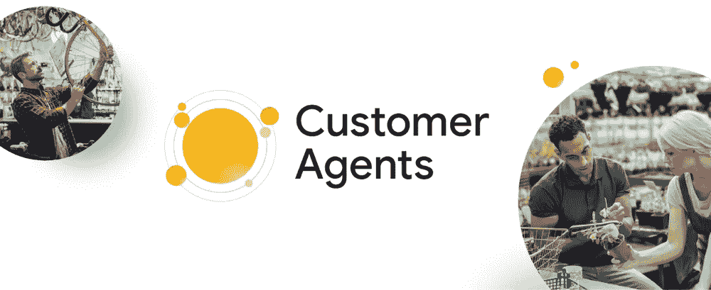
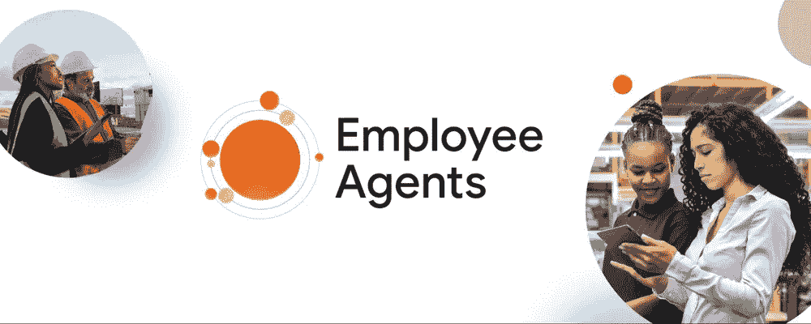
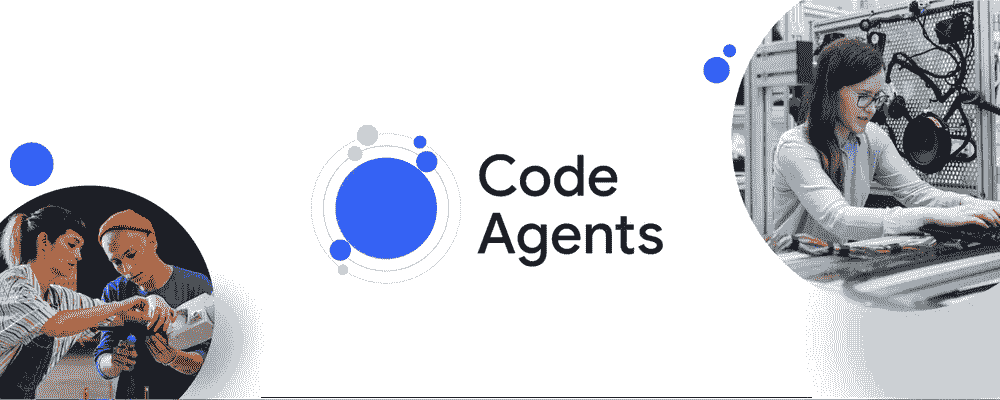

# 来自世界领先组织的 185 个现实世界的新一代人工智能用例

> 来源：[https://agispace.feishu.cn/docx/LgIIdazGgocLbOxBj6ecAY0RnGC](https://agispace.feishu.cn/docx/LgIIdazGgocLbOxBj6ecAY0RnGC)

原文：https://blog.google/products/google-cloud/gen-ai-business-use-cases/#customer-agents

顶级公司、政府、研究人员和初创公司如何利用 Google 的 AI 解决方案增强其工作能力的快照。

2024 年 9 月 24 日

阅读时间：25 分钟

**布赖恩·霍尔**

Google Cloud 产品营销副总裁

这篇文章最初发表在 Transform with Google Cloud 博客上。它于 2024 年 4 月 12 日首次发布；最后更新于 2024 年 9 月 24 日，添加了新的用例。

自从生成式人工智能首次[引起世界关注](https://blog.google/technology/ai/bard-google-ai-search-updates/)以[来，人们一直在热烈讨论这项新技](https://cloud.google.com/blog/topics/google-cloud-next/welcome-to-google-cloud-next24)术的最佳用途。虽然我们都喜欢早期的有趣聊天和诙谐的打油诗，但我们很快发现，许多最大的人工智能机会显然是在企业、政府和令人兴奋的新公司中。

当我们在[Google Cloud Next '24期间首次发布这篇文章时，我们从整个](https://cloud.withgoogle.com/next)[活动上展示的数百](https://cloud.google.com/blog/products/ai-machine-learning/how-customers-are-putting-gemini-to-work)个用例中展示了 101 个最佳用例。现在，随着全球各地的客户继续使用生成式 AI，我们将另外 84 个用例添加到列表中。

[如果您以前访问过这篇文章，您可以在每个部分的顶部找到最新的用例列表。 ]

在短短几个月内，组织已从 AI 帮助回答问题，发展到 AI 做出预测，再到生成式 AI 代理。AI 代理的独特之处在于它们可以采取行动实现特定目标，无论是引导购物者找到合适的鞋子，帮助员工寻找合适的健康福利，还是在轮班期间支持护理人员更顺畅地交接患者。

在与客户合作的过程中，我们不断听到他们的团队越来越专注于提高生产力、实现流程自动化和现代化客户体验。这些目标现在通过他们在六个关键领域开发的 AI 代理来实现：客户服务、员工赋能、代码创建、数据分析、网络安全以及创意构思和制作。

目[前，数百名 G](https://inthecloud.withgoogle.com/roi-of-generative-ai/dl-cd.html)oogle Cloud 客户已在其企业和全球范围内将 AI 代理和 gen-AI 解决方案投入生产，其中许多客户获得了切实的投资回报。他们已经开始依赖 Google Cloud 技术，包括我们的 AI 基础架构、Gemini 模型、Vertex AI 平台、Google Workspace 和 Google Distributed Cloud。

以下是 185 位行业领袖当前如何应用 AI、创造将改变未来的现实用例的快照。

## 客户代理

与优秀的销售和服务人员类似，客服人员能够仔细聆听、了解您的需求并推荐合适的产品和服务。他们能够无缝地跨渠道工作，包括网络、移动设备和销售点，并可以通过语音和视频融入产品体验。

1.  **阿拉斯加航空**正在开发自然语言搜索，为旅客提供由人工智能驱动的对话体验，类似于与知识渊博的旅行社互动。这款聊天机器人旨在简化旅行预订，增强客户体验并强化品牌形象。

1.  **Bennie Health**使用 Vertex AI 为其创新的员工健康福利平台提供支持，提供可操作的见解并简化数据管理，以提高员工和人力资源团队的效率和决策能力。

1.  **Beyond 12**是一家致力于增强学生权能的科技型非营利组织，它开发了一款人工智能大学教练，通过文本、应用程序和网络为第一代学生提供可扩展的辅导。

1.  **CareerVillage**正在开发一款名为 Coach 的应用程序，帮助求职者，尤其是弱势青年做好职业准备；目前该应用程序已推出 35 项职业发展活动，目标是到明年增加到 100 多项。

1.  **Character.ai**使用全套 Google Cloud AI 服务构建了其逼真的对话聊天平台，包括用于模型训练和日常运营，使其能够每天不间断地管理数 TB 的对话。

1.  Click Therapeutics开发用于治疗疾病的处方数字疗法。其临床运营团队利用 Gemini for Google Workspace 将复杂的运营数据转化为可付诸行动的见解，以便他们能够快速找到简化临床试验中患者体验的方法。

1.  **电动方程式**现在可以将长达两小时的比赛评论总结为任何语言的两分钟播客，其中包含车手数据和正在进行的赛季故事情节。

1.  **通用汽车**的 OnStar 增强了新的 AI 功能，包括由 Google Cloud 对话式 AI 技术提供支持的虚拟助手，该技术能够更好地识别说话者的意图。

1.  印尼超级应用程序 Gojek 推出了“Dira by GoTo AI”，这是一款由印尼语人工智能驱动的语音助手，集成到其 GoPay 服务中，让客户可以使用语音命令来省去打字和滚动的麻烦，并以更少的步骤完成账单支付和转账等任务。

1.  电子商务服务提供商 GroupBy 开发了由 Vertex AI Search for Retail 提供支持的 AI 优先搜索和发现平台。该解决方案经过精心设计，旨在优化收入、增强品牌忠诚度并推动 B2C 和 B2B 零售商的销售增长。

1.  Hotelplan Suisse建立了一个聊天机器人，该机器人根据公司的旅游专业知识进行训练，可以实时回答客户的询问，并且，继此成功之后，该公司计划使用人工智能来创建旅游内容。

1.  **Justicia Lab**正在开发一种人工智能助手，以简化寻求庇护者和移民的法律程序；通过上传法律信函或文件中的图片，用户可以提取有价值的信息，然后获得个性化的指导和后续步骤。

1.  **Mercado Libre**已将语义搜索融入其数字购物平台，使用来自 Vertex AI Agent Builder 的 AI 嵌入，极大地改善了拉丁美洲超过 2 亿消费者的产品推荐和可发现性。

1.  **摩托罗拉**的 Moto AI 利用 Gemini 和 Imagen 帮助智能手机用户通过对话摘要、通知摘要、[图像](https://cloud-blog-transform.corp.google.com/transform/preview/55106?hl=en)创建和自然语言搜索等功能实现更高水平的生产力、创造力和享受——所有这些功能均可通过基于 Google 搜索的可靠响应获得。

1.  **mRelief**构建了一个可通过短信访问的 AI 聊天机器人，以简化美国 SNAP 食品援助计划的申请流程，提供易于理解的资格信息，并在几分钟而不是几天内提供直接援助。

1.  **个人人工智能**提供“个人语言模型”，仅使用个人或品牌的数据，并允许他们控制和拥有其使用方式。它基于您自己的数据、事实和观点，创造了一种响应迅速且互动性强的消息传递体验，帮助人们提高工作效率并加深关系。

1.  **PODS**与广告[公](https://youtu.be/428Wj8VcoN8)司 Tombras 合作，利用 Gemini 打造了“全球最智能广告牌”——这是一项在其卡车上进行的广告活动，可以适应纽约市的每个街区，并根据数据实时变化。它在短短 29 小时内覆盖了所有 299 个街区，创造了 6,000 多个独特的标题。

1.  **Quora**开发了[Poe](https://poe.com/)，这是其自己的生成式 AI 平台，供人们发现和与 AI 机器人聊天，包括 Gemini、Anthropic 的 Claude、Meta 的 Llama 和 Mistral 的 Large 2——其中许多都托管在 Google Cloud 专门构建的 AI 基础架构上。

1.  ScottsMiracle-Gro在 Vertex AI 上构建了一个 AI 代理，为消费者提供定制的园艺建议和产品推荐。

1.  **Snap**在其“My AI”聊天机器人中部署了 Gemini 的多模式功能[，](https://youtu.be/lG6MZGYMN_M)并且在美国，Snapping to My AI 的参与度增长了 2.5 倍以上。

1.  **Tabiya**建立了一个对话界面 Compass，帮助年轻人寻找就业机会；该平台会提出问题并请求信息，提取技能和经验并将其与适当的职位进行匹配。

1.  **意大利电信 (TIM)**实施了由 Google 提供支持的语音代理来处理许多客户电话，将效率提高了 20%。

1.  **UPS Capital**推出了 DeliveryDefense Address Confidence，该产品使用机器学习和 UPS 数据为托运人提供信心评分，帮助他们确定成功送货的可能性。

1.  **美国大众汽车公司**在 myVW 应用程序中构建了一个虚拟助手，驾驶员可以浏览车主手册并提出问题，例如“如何更换爆胎？”或“这个数字驾驶舱指示灯是什么意思？”用户还可以使用 Gemini 的多模式功能，只需将智能手机摄像头对准仪表板即可查看指示灯上的有用信息和背景信息。

---

1.  **ADT**正在构建客户代理，以帮助其数百万客户选择、订购和设置他们的家庭安全。

1.  **阿拉斯加航空**正在利用先进的人工智能技术开发个性化的旅行搜索体验，创建超个性化的推荐，以便尽早吸引客户并通过人工智能生成的内容培养忠诚度。

1.  今年夏天，百思买 (Best Buy) 将利用 Gemini 推出一款生成式人工智能虚拟助手，可以解决产品问题、重新安排订单交付、管理 Geek Squad 订阅等；店内和数字客户服务人员也将获得生成式人工智能工具，以便在任何需要帮助的地方为客户提供更好的服务。

1.  **德克萨斯州中部区域交通管理局**正在使用 Vertex AI 来实现交通运营的现代化，从而实现更加顺畅、更高效的旅程。

1.  **Etsy**使用 Vertex AI 训练来优化他们的搜索推荐和广告模型，为买家提供更好的列表建议并帮助卖家发展业务。

1.  **IHG 酒店及度假村**正在构建一个生成式 AI 聊天机器人，以帮助客人直接在 IHG One Rewards 移动应用程序中轻松规划下一次假期。

1.  **ING 银行**旨在提供卓越的客户体验，并为员工开发了一款人工智能聊天机器人，以增强自助服务能力并提高对客户查询的解答质量。

1.  巴西最大的零售商之一 Magalu 将客户服务置于其 AI 战略的核心，包括使用 Vertex AI 创建“Lu's Brain”，为 Magalu 的热门品牌形象 Lu 提供交互式对话代理（该 3D 机器人在 TikTok 和 Instagram 上拥有超过 1400 万粉丝）。

1.  **梅赛德斯奔驰**将通过新一代人工智能智能销售助理，将电子商务功能融入其在线店面。梅赛德斯还计划在其呼叫中心扩大对 Google Cloud AI 的使用，并使用 Vertex AI 和 Gemini 来个性化营销活动。

1.  **Oppo/OnePlus**正在将 Gemini 模型和 Google Cloud AI 融入其手机中，以提供创新的客户体验，包括新闻和录音摘要、AI 工具箱等。

1.  **三星**正在将 Gemini Pro 和 Imagen 2 部署到其 Galaxy S24 智能手机上，以便用户可以利用文本摘要、组织和神奇图像编辑等惊人的功能。

1.  **明尼苏达**州驾驶员和车辆服务部通过双向实时翻译帮助非英语人士获得驾照和其他服务。

1.  **佩珀代因大学的**学生和教职员工会说多种语言，借助 Google Meet 中的 Gemini，他们可以从实时翻译的字幕和笔记中受益。

1.  领先的数字转型公司 Sutherland 致力于将人类专业知识与人工智能结合在一起，包括通过自动提供建议的响应和实时自动化洞察来增强其面向客户的团队。

1.  **Target**使用 Google Cloud 为 Target 应用程序和 Target.com 上的 AI 解决方案提供支持，包括个性化的 Target Circle 优惠和星巴克 Drive Up 路边取货解决方案。

1.  印度尼西亚电子商务领导者 Tokopedia 正在使用 Vertex AI 来提高数据质量，使独特产品的销量增加了 5%。

1.  在实施 Vertex AI Search 后，US News 的点击率、页面停留时间以及页面流量等关键指标均实现了两位数的影响。

1.  **IntesaSanpaolo**、**麦格理** **银行**和丰**业银行**正在探索人工智能改变我们生活、工作、银行业务和投资方式的潜力——特别是新技术如何提高银行业的生产力和运营效率。

## 雇员代理

员工代理可帮助员工提高工作效率并更好地协作。这些代理可以简化流程、管理重复任务、回答员工问题以及编辑和翻译重要通信。

1.  **2bots**提供使用 Google Cloud 的 AI 解决方案构建的技术解决方案，例如聊天机器人和虚拟代理；这些智能聊天机器人和内容生成工具正在改变公司与客户互动的方式。

1.  **Augment**正在构建一个 AI 个人助理，提供增强的笔记记录功能并收集各个应用程序的信息，包括日历、电子邮件、文本和社交媒体，以便用户可以更快、更轻松地找到个人信息并保持生活井井有条。

1.  **Bayes Impact**构建 AI 产品以支持非营利组织，其旗舰产品 CaseAI 是一款数字案例管理工具，可与非政府组织的现有系统集成，为根据受益人的独特历史量身定制的行动计划草案添加智能功能；案例工作者平均每周节省了 25 小时的工作时间。

1.  **加拿大贝尔公司**为其商业客户构建了可定制的联络中心解决方案，提供人工智能代理来处理呼叫者，并提供代理助手，当人工代理在线时，它会倾听并提供建议和情绪分析。人工智能为客户运营节省了 2000 万美元。

1.  **百思买**可以使用 Contact Center AI 实时生成对话摘要，让现场代理全神贯注于理解和支持客户，从而将平均通话时间和通话后工作时间缩短 30 到 90 秒。客户和代理都表示满意度有所提高。

1.  智利海鲜公司Camanchaca仅用六周时间就开发出了虚拟助手Elon，旨在通过数字渠道提供更高效的客户服务，增强Camanchaca与客户的互动。

1.  **Certify OS**正在实现医疗保健网络医疗服务提供者资格认证、许可和监控的自动化，从而减轻耗时且往往孤立的信息负担。

1.   Mark Cuban 的**Cost Plus Drugs**广泛使用 Gemini 来开发 Google Workspace，据估计，仅使用 Gmail 中的 AI 功能，员工每周平均可节省 5 个小时。Gemini 还通过使用 AI 生成的转录和自动格式化制药实验室结果或 FDA 合规文件等功能来简化耗时的手动流程。

1.  Dun & Bradstreet与 Gemini 合作开发了一款电子邮件生成工具，帮助卖家为其研究服务创建针对潜在客户和客户的定制化个性化沟通。该公司还开发了智能搜索功能，帮助用户解决复杂的查询问题，例如“找出该地区所有 ESG 评级较高的公司”。

1.  英格兰**足球协会**正在对 Vertex AI 进行足球协会历史和当前球探报告的训练，以便将其转化为简明的摘要，帮助国家队发掘未来的人才。

1.  **Fireflies.ai**可以转录、总结和分析会议、录音和其他语音对话，以节省时间并改善团队之间的协作和信息共享。

1.  泛非数字服务公司 Fluna 使用 Vertex AI、Document AI 和 Gemini 5 Pro 自动分析和起草法律协议，数据提取准确率达到 92%，同时确保敏感信息的安全性和可靠性。

1.  巴西最大的血库 Hemominas 与 Xertica 合作开发了一款全渠道聊天机器人，用于搜索和安排捐献者，简化流程并提高效率。该人工智能解决方案每年可以吸引更多捐献者并优化血液供应管理，从而挽救 50 万人的生命。

1.  **Hiscox**使用 BigQuery 和 Vertex AI 为保险公司创建了第一个 AI 增强型主承保模型，使复杂风险的报价自动化和加速，从三天缩短到几分钟。

1.  **LiveX AI**提供 AI 代理，可快速增强产品教育、提高客户转化率、减少客户流失并提供个性化的客户支持，目标是让每个人在整个客户旅程中都能享受到无缝的 VIP 体验。

1.  Opportunity@Work正在应用人工智能来扩展一套软件工具和 API，帮助雇主识别“STAR”职位候选人——“通过社区大学、军队服务和在职经验等其他途径获得技能的候选人”，从而帮助填补紧张市场中的职位空缺并扩大机会。

1.  **Quantum Metric**推出了由 Gemini Pro 提供支持的 Felix AI，以简化数字分析和决策。Felix AI 会自动总结用户的网络或移动会话，并将最重要的时刻整合为简短、易读的摘要，供客户服务人员使用。

1.  大型人力资源服务和人才提供商 Randstad 正在其整个组织中使用 Gemini for Workspace 来转变其工作文化，从而打造一个文化更加多元化和包容性更强的工作环境，病假天数减少了两位数。

1.  **Sprinklr**将 Sprinklr AI+ 融入其统一的客户体验管理平台，为品牌提供客户服务、洞察、社交媒体管理和营销方面的通用人工智能功能，内置企业级治理、安全和数据隐私。

1.  **汤森路透**将 Gemini Pro 添加到其经批准供员工使用的大型语言模型套件中；凭借其 200 万个标记上下文窗口，Gemini 使某些任务的处理速度提高了 10 倍，并且可以根据上下文处理整个文档。

1.  华纳兄弟探索频道 (Warner Bros. Discovery)使用 Vertex AI 构建了一款 AI 字幕工具，总体成本降低了 50%，并且在未使用机器学习的情况下手动为文件添加字幕所需的时间减少了 80%。

1.  **美国空军**建立了一个新的概念验证门户，用于搜索、浏览和阅读电子发布的 PDF — — 所有这些都在 90 天的期限内完成，利用了预先构建的工具和 Vertex AI 搜索和对话的速度。

---

1.  **艾利丹尼森**通过生成性人工智能为员工提供支持，实现安全、灵活、无边界的协作，从而提高生产力并推动增长。

1.  **纽约梅隆银行**建立了一个虚拟助手，帮助员工找到相关信息和问题的答案。

1.  **拜耳**正在构建一个放射学平台，该平台将协助放射科医生进行数据分析、智能搜索并创建符合监管部门批准所需的医疗保健要求的文档。这家生物科学公司还利用 BigQuery 和 Vertex AI 更有效地开发其他数字医疗解决方案和药物。

1.  **百时美施贵宝**正在利用 Vertex AI 和 Google Workspace 转变其临床试验文件处理流程。现在，科学家需要数周才能完成的文档现在只需几分钟即可完成初稿。

1.  **BenchSci**开发生成式 AI 解决方案，使科学家能够理解生物研究中的复杂联系，从而节省他们的时间和财力，并最终更快地为患者带来新药。

1.  **Cintas**正在使用 Vertex AI Search 开发内部知识中心，以便客户服务和销售团队轻松找到关键信息。

1.  **加州全保**是该州的医疗保健市场，它正在使用 Document AI 来帮助改善消费者和员工体验，即在居民申请保险时自动化部分文档和验证流程。

1.  巴西最大的医疗诊断公司 Dasa 正在帮助医生更快地在测试结果中发现相关发现。

1.  **DaVita**利用 DocAI 和 Healthcare NLP 来改变肾脏护理，包括分析医疗记录、发现关键的患者见解以及减少错误。人工智能使医生能够专注于个性化护理，从而显著改善医疗保健服务。

1.  Discover Financial帮助其 10,000 名联络中心代表在通话过程中搜索和综合详细的政策和程序信息。

1.  **HCA Healthcare**正在测试虚拟 AI 护理助手 Cati，它有助于确保当一个护理轮班结束并开始另一个轮班时护理的连续性。他们还使用 gen AI 来改进耗时任务（例如临床文档）的工作流程，以便医生和护士可以更加专注于患者护理。

1.  家得宝 (Home Depot)开发了一款名为 Sidekick 的应用程序，帮助店员管理库存和保持货架库存；值得注意的是，视觉模型可以帮助店员确定采取哪些行动的优先顺序。

1.  **洛杉矶公羊队**正在从内容分析到球员球探等各个领域利用人工智能。

1.  **麦当劳**将利用其数千家餐厅的数据、人工智能和边缘技术来更快地实施创新并提升员工和客户体验。

1.  **Pennymac**是一家领先的美国全国抵押贷款机构，该公司正在包括人力资源部门在内的多个团队中使用 Gemini，其中 Docs、Sheets、Slides 和 Gmail 中的 Gemini 帮助他们加快招聘、雇用和新员工入职培训。

1.  全球最大的汽车供应商罗伯特·博世通过新一代人工智能解决方案彻底改变了营销方式，简化了流程，优化了资源配置，并最大限度提高了 100 多个分散部门的效率。

1.  金融服务行业通信平台 Symphony 使用 Vertex AI 帮助财务和交易团队跨多个资产类别进行协作。

1.  **Uber**正在使用 AI 代理来帮助员工提高工作效率、节省时间并提高工作效率。对于客户服务代表，他们推出了新工具，可以汇总与用户的沟通，甚至可以显示以前互动的背景，因此一线员工可以提供更多帮助，提高工作效率。

1.  **美国退伍军人事务部正在**使用边缘人工智能来改善现役军人和退伍军人的癌症检测。增强现实显微镜 (ARM) 部署在世界各地的远程军事治疗设施中。原型设备正在帮助病理学家更快、更准确地发现癌症。

1.  **美国专利商标局**通过实施人工智能技术，提高了其专利和商标审查流程的质量和效率。

1.  **Verizon**正在使用生成式人工智能帮助网络运营和客户体验团队更快地获得所需的答案。

1.  **维多利亚的秘密**正在测试人工智能代理，以帮助店内员工查找有关产品可用性、库存以及试穿和尺码提示的信息，以便他们可以更好地为客户量身定制建议。

1.  **沃达丰**使用 Vertex AI 搜索并了解与 800 多家通信运营商签订的 10,000 多份合同中的具体商业条款和条件

1.  **WellSky**正在整合 Google Cloud 的医疗保健和 Vertex AI 功能，以减少工作时间以外完成文档所花费的时间。

1.  澳大利亚领先的零售商 Woolworths 通过 Google Workspace 产品中的“Help me write”功能为 10,000 多名行政员工提升了员工的沟通信心。该公司还使用 Gemini 创建下一代促销活动，并快速协助客户服务代表实时总结之前的所有客户互动。

1.  ** Box**、**Typeface**、**Glean**、**花旗银行**和**Securiti AI**讨论在整个企业内开发人工智能应用程序，并在营销、金融服务和人力资源用例中获得可衡量的投资回报。

1.   **Highmark**[ H](https://cloud.withgoogle.com/next/session-library?utm_source=cgc-blog&utm_medium=blog&utm_campaign=FY24-Q2-global-ENDM33-physicalevent-er-next-2024-mc&utm_content=cgc-blog-session-launch-feb&utm_term=-&_ga=2.121419200.-999374651.1712208547&_gl=1%2a1mtg6ra%2a_ga%2aOTk5Mzc0NjUxLjE3MTIyMDg1NDc.%2a_ga_WH2QY8WWF5%2aMTcxMjc5Nzg0NC4xMi4xLjE3MTI3OTc4NDQuMC4wLjA.&filters=track-ai-and-ml,session-type-breakout,session-type-keynote,session-type-cloud-talk,session-type-showcase-demo,session-type-showcase-lightning-talk,session-type-spotlight&session=AIML102#all)ealth和Freenome与 Bristol Myers Squibb 携手探索AI 如何提高医疗服务、药物研发、临床试验规划和药品上市方面的效率和创新。

## 代码代理

代码代理正在帮助开发人员和产品团队更快更好地设计、创建和运行应用程序，并加快使用新语言和代码库。许多组织已经看到生产力实现了两位数的增长，从而加快了部署速度，并实现了更干净、更清晰的代码。

1.  **Labelbox**构建了一个完全托管的 AI 模型评估解决方案，该解决方案直接集成到 Vertex AI 平台中，允许 Google Cloud 用户无缝启动人工评估作业并设置特定的评估标准，例如问答和总结；这简化并加速了部署具有更高信任度和权威性的人机交互 AI 系统的能力。

1.  全球家居装饰零售商 Leroy Merlin 使用 Vertex AI 开发了其 Pull Request Analyzer。这种生成式 AI 解决方案总结了代码更改，帮助开发人员更快地了解项目并提高代码审查效率。

1.  产品开发平台 Linear 构建了 Similar Issues 功能，该功能使用人工智能来检测和防止重复或重叠的票证，并确保更清晰、更准确的数据表示。

1.  **Magic**正在构建一个拥有 1 亿个令牌上下文窗口的开发者平台，以便组织可以上传极大的代码库，并使用 gen AI 辅助更轻松地查询和构建它们。

1.  **Pinecone**为开发人员提供基础设施，以构建准确、安全且可扩展的 AI 应用程序，使公司能够轻松地将一代 AI 应用程序置于其专有数据中，以用于 AI 搜索、检索增强生成、编码代理等。

1.  **Regnology**使用 Gemini 1.5 Pro 构建了其 Ticket-to-Code Writer 工具，以自动将错误票转换为可操作的代码，从而大大简化了软件开发流程。

1.  Weights & Biases是一家为开发人员提供 AI 工具的公司，它创建了 W&B Weave，这是一款轻量级工具包，用于跟踪、评估和调试使用 Gemini 构建的一代 AI 应用程序，因此团队可以自信地从演示转向生产。

---

1.  **凯捷**一直在使用 Code Assist 来提高软件工程的生产力、质量、安全性和开发人员体验，早期结果显示编码工作量有所减少，代码质量更加稳定。

1.  **德国商业银行**正在通过 Code Assist 强大的安全性和合规性功能提高开发人员的效率。

1.  **Quantiphi**在 Code Assist 试点期间发现开发人员的工作效率提高了 30% 以上。

1.  **Replit**开发人员将通过 Replit 的软件开发 AI Ghostwriter 访问 Google Cloud 基础设施、服务和基础模型，而 Google Cloud 和 Workspace 开发人员将可以访问 Replit 的协作代码编辑平台。

1.  **西雅图儿童**医院正在使用人工智能来提高数据工程的生产力并加速发展。

1.  **Turing**正在其私有代码库上定制 Gemini Code Assist，为其开发人员提供高度个性化和上下文相关的编码建议，从而使生产力提高约 30%，并使日常编码变得更加愉快。

1.  **Wayfair**试用了 Code Assist，使用代码代理的开发人员能够比以前快 55% 地设置他们的环境，单元测试期间的代码性能提高了 48%，60% 的开发人员报告说他们能够专注于更令人满意的工作。

## 数据代理

数据代理就像是手边有知识渊博的数据分析师和研究人员。他们可以帮助回答有关内部和外部来源的问题、综合研究、开发新模型——最重要的是，他们可以帮助找到我们甚至还没有想到要问的问题，然后帮助我们得到答案。

1.  **180 Seguros**正在使用 Google Cloud AI 和 BigQuery 为其员工数据管理平台提供支持，以改善运营指标跟踪，从而将查询时间提高 3 倍。

1.  **Addy AI**正在帮助抵押贷款机构和银行利用在 Vertex AI 上训练的定制 AI 模型实现贷款流程自动化。例如，该平台可以从包含大量附件的长电子邮件中提取贷款机会详细信息。

1.  **拜耳作物科学公司**开发了 Climate FieldView，这是一个综合农业平台，拥有超过 250 个数据层和数十亿个数据点；人工智能支持的建议让农民能够设计和监控他们的田地，以提高产量和提高施肥效率，同时还能减少碳排放。

1.  **芝商所**正在构建首个内置人工智能工具的云端大宗商品交易平台，为芝商所的交易客户提供更深入的洞察和更智能的交易，以及在不会中断现有交易流的情况下快速试验新的交易策略。

1.  **Digits**正在为初创企业和小型企业开发下一代会计软件；使用人工智能驱动的簿记、费用管理和财务分析，Digits 使企业主能够实现财务清晰度并专注于增长。

1.  动物保健领域的领导者 Elanco 已实施了一套支持关键业务流程（如药物警戒、客户订单和临床洞察）的通用人工智能框架。该框架由 Vertex AI 和 Gemini 提供支持，自去年推出以来，预计投资回报率为 190 万美元。

1.  **Full Fact**是一家总部位于英国的非营利组织，在 18 个国家开展打击虚假信息的工作，目前正在使用人工智能主动监控报道，以便其 30 个事实核查合作组织可以专注于处理特定的主张和有害信息。

1.  **Fullstory 是**一个数字行为数据平台，它正在构建分析和总结网站用户行为的能力，以创造更明智、更丰富的聊天机器人体验；响应更加相关和准确，最终提高虚拟代理的性能和客户体验

1.  **马来西亚基础设施和房地产管理公司Gamuda Berhad已将由** Gemini 驱动的对话代理集成到其基于云的 Tunnel Insight 平台中，从而在施工项目期间提供更快的信息和见解。

1.  Intelligencia AI正在使用 AI 模型研究新型药物，依靠 Google Cloud 的 AI 优化基础架构进行准确、透明的可扩展研究，以满足医学的严格需求。

1.  **IPRally**建立了一个定制的机器学习平台，该平台使用自然语言处理全球 1.2 亿多份专利文献的文本，创建了一个准确、易于搜索的数据库，每周增加 200,000 多个新来源。

1.  **Ipsos**为其市场研究团队构建了一个数据分析工具，从而无需向数据分析师提出耗时的请求，该工具由 Gemini 1.5 Pro 和 Flash 模型以及 Grounding with Google Search 提供支持，以提高同时搜索信息的实际准确性。

1.  **Materiom**是一家研究零浪费、生物基替代品（如塑料等化石燃料产品）的初创公司，该公司正在创建一种人工智能工具，使企业家能够开发具有广泛应用的新型可堆肥材料；人工智能提供更快的研究和信息收集，以加快开发过程。

1.  **孟德尔**建立了一个临床人工智能系统，旨在打破长期存在的医疗数据孤岛，提高准确性、可访问性，并最终改善患者的健康结果。

1.  医疗设备公司 NeuroPace 建立了一种解决方案，可以快速确定最适合不同患者的有效癫痫治疗方案；通过分析脑电波模式，它可以找到相似的患者并应用成功的治疗方法，从而简化个性化护理。

1.  智利食品科技公司 NotCo 与 Eleven Solutions 合作开发了由 Gemini 提供支持的对话式 AI 聊天机器人；该聊天机器人彻底改变了数据访问方式，使员工能够即时查询他们的 SAP 系统并获得实时洞察，从而更快地做出数据驱动的决策。

1.  拉丁美洲最大的资产管理公司**S**URA Investments为员工开发了基于人工智能的分析模型，使他们能够更好地了解客户需求并提高客户体验和满意度。

---

1.  **AI21 Labs**提供了名为 Contextual Answers 的 BigQuery 集成，允许用户以对话方式查询数据并快速获得高质量的答案。

1.  **Anthropic**与 Google Cloud 合作，在 Vertex AI 上提供其 Claude 3 模型系列——为组织提供更多智能、速度、成本效益和企业用例愿景的模型选项。

1.  **小行星研究所**正在利用人工智能在现有的天文数据中发现隐藏的小行星。这是研究太阳系演化的天文学家、希望执行小行星飞行任务的投资者和企业以及我们所有希望防止未来大型小行星撞击地球的人关注的重点。

1.  **Contextual**正在与 Google Cloud 合作，为企业提供基于内部知识库的完全可定制、值得信赖、注重隐私的人工智能。

1.  Cox Communications 的商业物联网部门 Cox 2M能够利用人工智能分析做出更明智、更快的商业决策。

1.  企业 AI 解决方案开发商**Essential AI正在使用 Go**[ogle Cloud 针对](https://cloud.google.com/blog/products/ai-machine-learning/introducing-cloud-tpu-v5p-and-ai-hypercomputer) AI 优化的TPU v5p 加速器芯片来训练自己的 AI 模型。

1.  意大利最大的保险公司 Generali Italia使用 Vertex AI 构建模型评估流程，帮助 ML 团队快速评估性能并部署模型。

1.  巴西最大的媒体网络之一 Globo 正在使用服务扩展和媒体 CDN 通过实时拦截盗版流媒体来打击现场活动期间的盗版。

1.  **金州勇士队**正在使用人工智能来改善其大通中心应用程序中的球迷体验内容。

1.  **Hugging Face**正在与 Google 在开放科学、开源、云和硬件方面进行合作，以使企业能够利用 Hugging Face 和 Google Cloud 硬件和软件的最新开放模型构建自己的 AI。

1.  韩国科技公司 Kakao Group 旗下的 Kakao Brain建立了一个大型 AI 语言模型，这是市场上最大的韩语专用 LLM，拥有 660 亿个参数。他们还开发了一款名为 Karlo 的文本转图像生成器。

1.  **梅奥诊所**通过 Vertex AI 搜索让数千名科学研究人员访问了价值 50PB 的临床数据，加速了跨多种语言的信息检索。

1.  **迈凯伦车队**正在使用谷歌人工智能在比赛和训练中获取最新的毫秒洞察，以获得竞争优势。

1.  **Mercado Libre**正在测试 BigQuery 和 Looker，以优化与运输公司和航空公司的产能规划和预订，从而更快地完成发货。

1.  **Mistral AI**将使用 Google Cloud 的 AI 优化基础架构，进一步测试、构建和扩展其 LLM，同时受益于 Google Cloud 的安全和隐私标准。

1.  **MSCI**利用 Vertex AI、BigQuery 和 Cloud Run 进行机器学习，丰富其数据集，帮助我们的客户洞察大约 100 万个资产位置，从而帮助管理与气候相关的风险。

1.  **NewsCorp**正在使用 Vertex AI 帮助搜索 30,000 个来源和每天更新的 25 亿篇新闻文章的数据。

1.  **Orange**在 26 个国家开展业务，每个国家都必须保留本地数据。他们正在 Google 分布式云上使用 AI 来提高网络性能并提供超灵敏的翻译功能。

1.  **Spotify**利用 Dataflow 大规模生成 ML 播客预览，他们计划继续突破数据工程和数据科学的极限，为客户和创作者创造更好的体验。

1.  **UPS**正在构建其整个配送网络的数字孪生，以便工作人员和客户都可以随时看到他们的包裹在哪里。

1.  **Workday**在 Vertex Search 和 Conversation 中使用自然语言处理，让技术用户和非技术用户都能更轻松地获取数据洞察。

1.  **Woven**是**丰田**对未来移动出行的投资，它正与谷歌合作，利用大量数据和人工智能实现自动驾驶，并由谷歌云的人工智能超级计算机上的数千个机器学习工作负载提供支持。这已导致支持自动驾驶的总拥有成本节省了 50%。

1.  ** 佛罗里达州布劳沃德县**和南**加州爱迪生公司**正在利用地理空间功能和人工智能来改善基础设施规划和监控，产生新的见解，并为当前和未来面临气候挑战的社区创造区域复原力。

1.  ** Kinaxis**和**Dematic**正在构建数据驱动的供应链，以解决物流用例，包括场景建模、规划、运营管理和自动化。

1.   美国**国家海洋和大气管理局 (N**O[AA)和美国国](https://cloud.google.com/responsible-ai)际开发署 (USAID)等美国政府机构使用 Google Cloud AI 来解锁关键数据洞察，以简化运营并改善任务成果——所有这些都强调负责任的 AI。

## 安全代理

安全代理通过大幅提高调查速度、自动监控和响应来协助安全运营，从而提高警惕性和合规性控制。它们还可以帮助保护数据和模型免受网络攻击，例如恶意提示注入。

1.  **Apex Fintech**正在 Security 中使用 Gemini，将复杂威胁检测的编写时间从几小时缩短至几秒钟。

1.  **Exabeam**在其新规模安全运营平台中为安全分析师构建了一个生成式 AI 副驾驶。

1.  金融服务技术开发商 Fiserv 现在可以利用安全运营平台中的 Gemini 更快地总结威胁、找到答案并检测、验证和响应安全事件。

1.  **NetRise**开发了 Trace，通过引入人工智能驱动的意图驱动搜索来提供软件供应链安全；这允许用户根据代码和配置背后的潜在动机或目的搜索他们的资产，而不是仅仅依靠基于签名的方法。

1.  Palo Alto Networks正在使用 Gemini 创建一个扎实的 AI 助手，为 24/7 安全平台提供支持，以提高代理效率和响应时间；将助手扎根于组织数据和安全协议中，极大地提高了响应的准确性。

---

1.  **BBVA**使用 Google SecOps 中的 AI 来更准确、更快速、更大规模地检测、调查和应对安全威胁。该平台现在可以在几秒钟内显示关键安全数据，而以前需要几分钟甚至几小时，并提供高度自动化的响应。

1.  **Behavox**正在使用 Google Cloud 技术和 LLM 为全球金融机构提供行业领先的监管合规和前台解决方案。

1.  嘉信理财 (Charles Schwab)将自己的情报融入了人工智能驱动的 Google SecOps 中，因此分析师可以更好地确定工作优先级并应对威胁。

1.  **Fiserv**的安全运营工程师可以更轻松地创建检测和剧本，而分析师可以更快地获得答案。

1.  **Grupo Boticário**是巴西最大的美容零售和化妆品公司之一，它采用实时安全模型来防止欺诈并检测和应对问题。

1.  Palo Alto Networks的 Cortex XSIAM 是一款人工智能驱动的安全运营平台，它建立在十多年的机器学习模型专业知识和业内最全面、最丰富、最多样化的数据存储之上。在 Google 先进的云基础设施和先进的人工智能服务（包括 BigQuery 和 Gemini 模型）的支持下，该组合可在所有网络安全产品中提供全球规模和近乎实时的保护。

1.  **辉瑞公司**现在可以汇总网络安全数据源，将分析时间从几天缩短到几秒钟。

## 创意代理

创意代理可以利用最佳的设计和制作技能来扩展您的组织，处理图像、幻灯片并与员工一起探索概念。许多组织正在为其营销团队、音频和视频制作团队以及所有需要帮助的创意人员建立代理。有了创意代理，任何人都可以成为设计师、艺术家或制作人。

1.  **Adore Me 的**营销人员可以在一小时内撰写差异化的产品描述，而这项繁琐的任务过去通常需要每月花费 30-40 个小时，这要感谢 Gemini for Google Workspace。

1.  拉丁美洲最大的媒体集团 Globo 正在使用 Google Cloud 的 AI 为其流媒体用户提供超个性化内容，并为观众创造更好的体验。

1.  **Higgsfield.ai**[为消费者构建了许多文本](https://cloud.google.com/transform/3-lessons-for-gen-ai-startups-higgsfield-ai-infrastructure-talent-models?e=48754805)转视频应用程序，其中包括Diffuse 2.0，它可以通过 AI 模型将用户的照片、视频和文本组合起来，以创建更逼真的头像。

1.  **Jasper**在 Google 的 AI 基础架构上训练其以创造力、写作和营销为中心的 AI 模型套件，以更快的速度、更大规模地向大大小小的团队提供品牌、数据优化的资产。

1.  **Puma**正在使用 Imagen 定制其网站上的产品照片，从而节省时间并确保它们在各个市场都具有本地相关性；PUMA India 的点击率已经提高了 10%。

1.  **丽笙** **酒店集团**与埃森哲合作，使用 Vertex AI 和 Gemini 模型，在 BigQuery 中存储的大量数据集上对它们进行训练，大规模个性化其广告；广告团队的生产力提高了约 50%，而 AI 驱动的广告活动的收入增加了 20% 以上

1.  **Square Enix**正在利用客户数据开发针对 AI 优化的营销资产，以保持游戏玩家的参与度，并分享适合每个玩家喜好的个性化电子邮件，从而使电子邮件打开率提高 20%，留存率提高 10%。

1.  移动设备管理平台 Urmobo 创建了虚拟代理 Odin，通过让客户使用自然语言与平台进行交互，显著改善了用户体验并减少了支持工单。

1.  **世界银行**正在开发一种工具，从有关发展干预措施的因果影响的研究文献中提取关键信息，最终目标是使决策者能够更有效地分配每年 2200 亿美元的援助和每年数万亿美元的影响投资。

---

1.  **Belk 电子商务**正在使用生成式人工智能来制作更好的产品描述，这对于数字零售来说是一项必要但耗时的任务，通常需要手动完成。

1.  **Canva**正在使用 Vertex AI 为其 Magic Design for Video 提供支持，帮助用户跳过繁琐的编辑步骤，同时在几秒钟内创建可共享且引人入胜的视频。

1.  **家乐福**利用 Vertex AI 在短短五周内部署了家乐福营销工作室——这是一种创新的解决方案，可以简化跨各种社交网络创建动态广告系列的过程。只需点击几下，营销人员就可以构建超个性化的广告系列，向客户提供他们关心的广告。

1.  **美国职业棒球大联盟**继续创新其 Statcast 平台，以便球队、广播员和球迷能够获得实时的比赛见解。

1.  **派拉蒙**目前依靠手动流程来创建其 Paramount+ 平台上用于展示内容和为观众创造个性化体验的基本元数据和视频摘要。VertexAI Text Bison 现在正在帮助简化这一流程。

1.  **宝洁公司**利用 Imagen 开发内部生成 AI 平台，加速创建照片般逼真的图像和创意资产，让营销团队有更多时间专注于高层规划并为消费者提供卓越的体验。

1.  **WPP**将把 Google Cloud 的 gen AI 功能集成到其智能营销操作系统 WPP Open 中，该系统使其员工和客户能够提供更高水平的个性化、创造力和效率。这包括使用 Gemini 1.5 Pro 模型来提高内容性能预测的准确性和速度。

要找到更多使用我们的 AI 工具为其最重要的企业项目构建代理和解决方案的客户，请访问Google Cloud 客户中心。