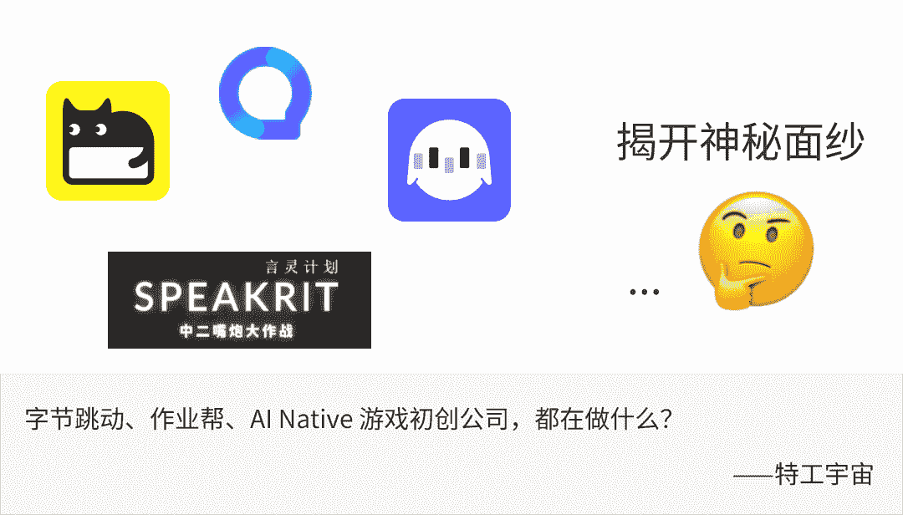
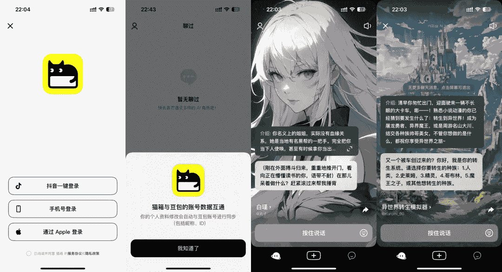
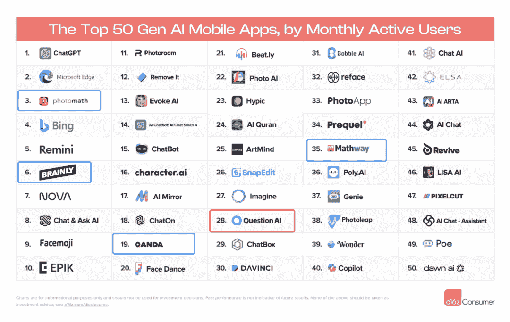

# 盘点丨那些 AI 公司悄咪咪上线的产品（四）

> 来源：[https://agispace.feishu.cn/docx/ITjBdv5aqobI0WxSunrc1fa7n5c](https://agispace.feishu.cn/docx/ITjBdv5aqobI0WxSunrc1fa7n5c)

> 作者：特工少女

> 公众号：特工宇宙

> 原文链接：https://mp.weixin.qq.com/s/4BcO8GskSyMPReS0pdNlKA

感谢大家对此系列的喜爱，今天我们迎来了第四期！（文末有前三期的链接）话不多说直接上菜。

第一款 AI 产品叫「**猫箱**」，来自字节跳动（怎么每期都有宇宙厂？）

我先不说，大家猜猜这是个啥产品？我理解可能是装了很多“猫娘”的箱子？也就是很多“智能体”，或者说聊天机器人聚合的平台。

其实这个产品之前我们提过，原名叫「话炉」。最近手机上突然出现了一个陌生的黄色软件，发现原来是你突然改名然后更新了。

说白了就是字节版的“星野”，上下滑动可以快速切换角色，除了聊天外，也有很多 xxx 模拟器的小游戏，体验还不错，声音挺逼真的，回复速度也挺快。

**猫箱和豆包的账号数据互通**，且最近发现了它在抖音上投放了，不知道各位朋友玩过没有？

第二款 AI 产品来自作业帮，话说这作业帮在海外，悄咪咪的这个 AI+教育做的是如火如荼。

Question.AI，还被 a16z 收录且名列前茅（第二十八个）。

根据三方数据，Question.AI 于 2023 年 5 月 30 日在美国市场上线，之后于 6 月、7 月相继在东南亚和全球其他市场上线。

官网：www.questionai.com

APP也有。

实际能力就不测了，感兴趣的话可以去体验一下，对 AI+教育感兴趣的朋友，也可以看看我们之前的这几篇文章：1.AI+教育丨让学习没有边界，让世界成为教材。

2.AI+教育丨AskSia，超越MathGPT的存在！

此外，据前方情报得知，作业帮出海的不止 Question.AI，还有一些别的产品，比如 Poly.ai，也是一款 AI 聊天机器人产品。

最后一个 AI 产品之前在内测，很荣幸能拿到内测资格。它是除了各类 AI 聊天模拟器之外，我见过的为数不多的眼前一亮的 AI 原生游戏。

**言灵计划，中二嘴炮大作战**。听不懂什么意思吧，简单说就是 AI 版的宝可梦对战游戏，形象、技能什么的，都是 AI 生成的。

第一次关注到这支团队还是在去年 12月 奇绩创坛路演日。仅用时 4 个月，只有 5 位成员的喵吉托工作室（AgentLive），完成这款《言灵计划》，允许玩家随机输入文字或语音，自动生成千奇百怪的“言灵”对战。据了解，工作室创始人 Jesse 是前字节跳动游戏 AI 小镇的负责人。联创曾在阿里做 AI 大语言模型训练，也拿过《魔兽世界》国服第一；主策之前在网易和雷霆游戏（豪华阵容）。我的感受是这是一个需要你有想象力的游戏，你得懂足够多的梗，且匹配到的玩家也要比较逆天，会比较有趣。以下是我内测时的一些截图。

笑死，当时不知道该捏个啥，拿朋友身份测试了下（还挺强的，南开牛逼）。

根据用户各自输入的招式，AI 来进行判断，然后给与不同的得分。

如何能够玩到？4 月 15 日官方会开放内测版，可以留意下 steam 申请~

