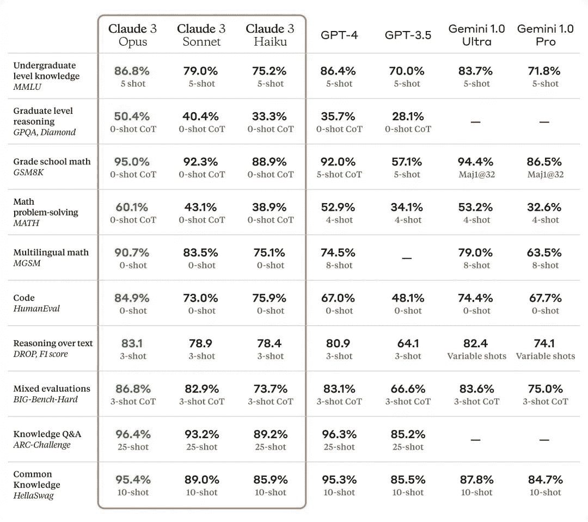
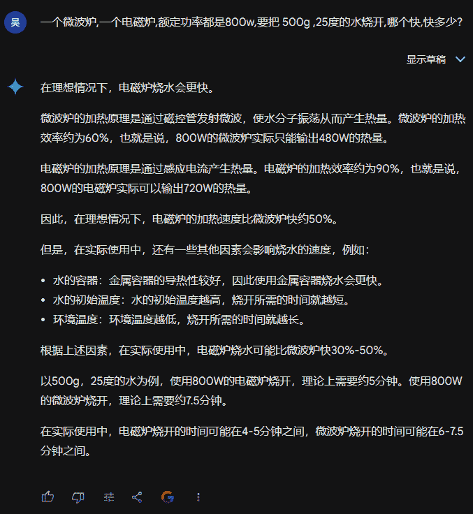
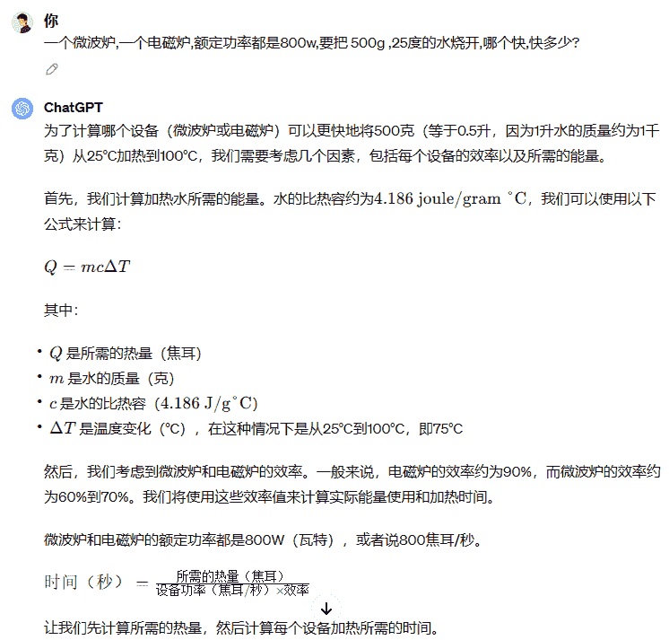
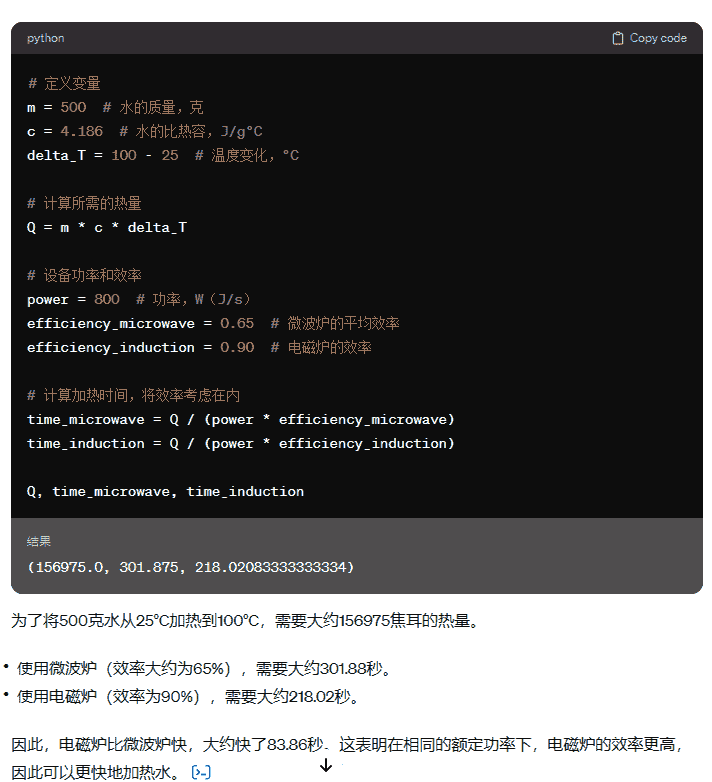
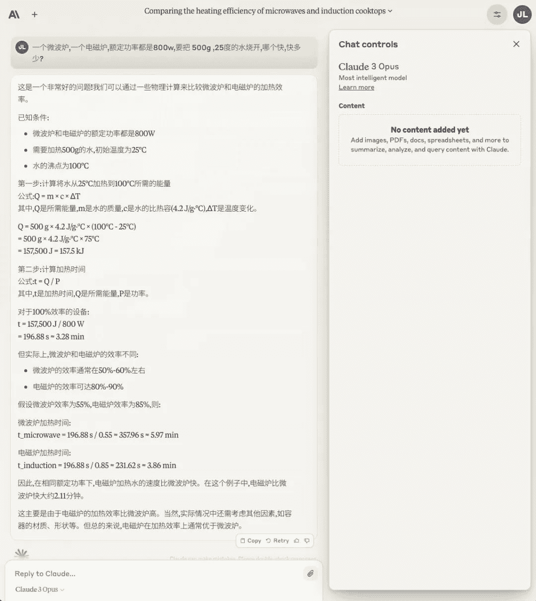
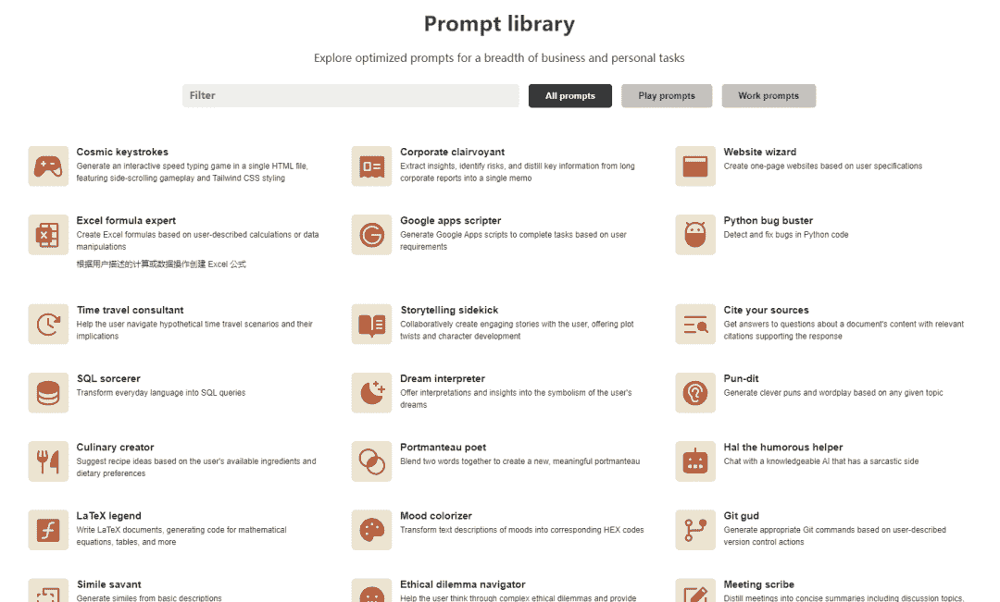

# 颠覆GPT-4霸主地位的AI横空出世

> 来源：[https://agispace.feishu.cn/docx/IJmpd2jVEor7gVxumzzc63sqnLg](https://agispace.feishu.cn/docx/IJmpd2jVEor7gVxumzzc63sqnLg)

> 作者：毅鸣

> 公众号： AI洞察笔记

> 原文链接：https://mp.weixin.qq.com/s/QVvmVOvlHEkIIzoNVcbBXw

今日，AI圈最火的新闻莫过于Claude3的发布，该系列包括三种最先进的型号（按功能升序排列）：Claude 3 Haiku、Claude 3 Sonnet 和 Claude 3 Opus，一众科技界大V的测试结果，都比GPT-4要强，支持100万token上下文。

下图非常形象的说明了这一点，OpenAI的GPT-4和Google的Gemini都被Aanthropic的Claude3打趴下了。

Haiku是市场上智能类别中最快速、最具成本效益的模型。它可以在不到三秒的时间内阅读一篇arXiv上信息密集、数据丰富的研究论文（约10,000个标记），包括图表和图形。

Opus、Sonnet和Haiku更不太可能拒绝回答接近系统底线的提示，相比以往的模型，克劳德3模型表现出更加细致的请求理解，识别真实伤害，并且拒绝回答无害提示的频率大大降低。

与Claude 2.1相比，Opus在这些具有挑战性的开放性问题上的准确性（或正确答案）实现了两倍的改进，同时也展现出了降低的错误答案水平。

所有三个模型都能够接受超过100万个标记的输入，可能会向需要增强处理能力的特定客户提供这一功能。Claude 3模型更擅长遵循复杂的多步指令。它们特别擅长遵循品牌语调和响应指南，并开发用户可以信任的客户体验。

此外，Claude 3模型更擅长生成流行的结构化输出，如JSON格式。Opus和Sonnet现已可在API中使用，该API现已普遍可用，使开发人员能够立即注册并开始使用这些模型。Haiku将很快可用。

**测评案例分享**

问题：“一个微波炉,一个电磁炉,额定功率都是800w,要把 500g ,25度的水烧开,哪个快,快多少?”

谁的答案好？

**Google Gemini**

**ChatGPT4**

**Claude3**

**如何才能使用？**

目前需要付费购买Claude Pro版本，才能使用最新的Claude3 Opus模型：https://claude.ai/chats

伴随 Claude 3 推出的还有一个提示词库，里面有Anthropic提供的非常多的示例提示词，方便开发者和用户尝试。详情页还给出了对应提示词的示例回答和 API，可以去看看学一下 Claude 的提示词写法。

prompt 提示词库：https://docs.anthropic.com/claude/page/prompts

# 精彩回顾

[1.  继Sora之后，阿里巴巴](http://mp.weixin.qq.com/s?__biz=Mzk0NjQ0NTQ1Mg==&mid=2247485529&idx=1&sn=53373095050bf42984c3d424a898d780&chksm=c30745baf470ccac2111c0c143b8a456c33c6f5f25b857c5aa5b40405ae5be5e7909f3432cb1&scene=21#wechat_redirect)放大招！一张照片即可生成会说话唱歌的视频

1.  利用AI写任意主题的书籍，你只差一个prompt

1.   一文汇总GPTs攻防prompts

1.   一文搞懂OpenAI推出的AI文本视频生成模型Sora

