# AGI空间站

> 来源：[https://agispace.feishu.cn/docx/DzRTdPZsdotz5qxg5SPcbne9nXg](https://agispace.feishu.cn/docx/DzRTdPZsdotz5qxg5SPcbne9nXg)

# 🎯 愿景 ｜ 加速AGI到来

> Hi，欢迎大家来到🚀A**GI空间站！**

> 本知识库提供全面系统的AI知识、主流应用、AI 与行业和企业的交汇，具身智能等前沿科技！

> **致**力帮助更多人成为AGI时代的引领者。

#  学习方法

> 如果您持手机📱请查看：浏[览技巧](https://agispace.feishu.cn/wiki/GWGTwXuuuifqa9kDSsYcr79wn4f)

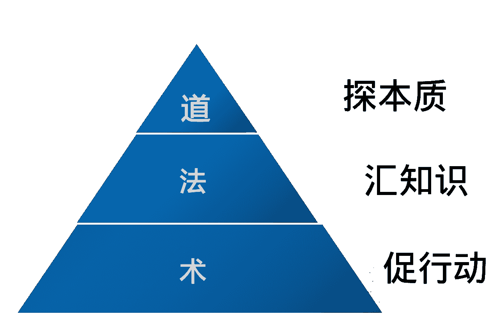

**理论（“道”）**：从大模型和机器人概念的本质出发，通过现象探索其规律和核心。

**系统（“法”）**：构建细分领域知识体系，探讨AI和机器人在不同行业、职业发展、商业变现中的应用场景和案例。

**实践（“术”）**：展示AI工具的使用方法和案例，注重实际应用能力，助力技能提升。

先从👉学[**习引导开**](https://agispace.feishu.cn/wiki/UHgbwG31Wis5VHkWDqLcz2JKnhd?blockId=doxcnLM7EzkWPGZgDmznOfZdJne&blockToken=NIyhwmnbQhjwE0b1S8Dc3oDUn1g&blockType=whiteboard)始吧！

---

# 快速导航

[🎉 前](https://agispace.feishu.cn/wiki/Hp02wThabiyR0QkX08RctWNZnIl)[沿动态｜](https://agispace.feishu.cn/wiki/Hp02wThabiyR0QkX08RctWNZnIl) [🎈 入门](https://agispace.feishu.cn/wiki/I76gw5RsqineXgkjIDocC6XLnIg)[指南｜💡](https://agispace.feishu.cn/wiki/I76gw5RsqineXgkjIDocC6XLnIg) [Pro](https://agispace.feishu.cn/wiki/XbX7w9NGsi0wVwkGIE6c3YebnBg?table=tblZHlA6yhta2Wsa&view=vewBkCo4Pi)[mpt (提](https://agispace.feishu.cn/wiki/XbX7w9NGsi0wVwkGIE6c3YebnBg?table=tblZHlA6yhta2Wsa&view=vewBkCo4Pi)[示词) | ](https://agispace.feishu.cn/wiki/XbX7w9NGsi0wVwkGIE6c3YebnBg?table=tblZHlA6yhta2Wsa&view=vewBkCo4Pi) 🤖 A[I A](https://agispace.feishu.cn/wiki/XAMKwqg8qiugtYkS9PDcImAon3g?table=blkMmMIFAw5pflBY)[gents(智能体](https://agispace.feishu.cn/wiki/XAMKwqg8qiugtYkS9PDcImAon3g?table=blkMmMIFAw5pflBY)[) ｜📕 ](https://agispace.feishu.cn/wiki/XAMKwqg8qiugtYkS9PDcImAon3g?table=blkMmMIFAw5pflBY)AI 社群

🌟 个[体赋能 ](https://agispace.feishu.cn/wiki/LC8bwSc49i1mRgkZPdxcupuFnIc)｜🌈 行业[革新 ｜](https://agispace.feishu.cn/wiki/BwRewiHLRiDVZ4k1CyTctwt1nId)💹 [资本动](https://agispace.feishu.cn/wiki/ZenewKg0xi35GVk616jcK6ENnMb?table=blk0aiswsRKDP0l1)[态 ｜🚀](https://agispace.feishu.cn/wiki/ZenewKg0xi35GVk616jcK6ENnMb?table=blk0aiswsRKDP0l1) A[I大模](https://agispace.feishu.cn/wiki/CYJQwbZKXi50Rmkd9DMcnjUDnXX)[型  ｜ ](https://agispace.feishu.cn/wiki/CYJQwbZKXi50Rmkd9DMcnjUDnXX)👨‍🚀 [ 人形机器人 ](https://agispace.feishu.cn/wiki/GgShw5AdkiwxaEkpRQhct3Qintb?table=blkJ8qdfaGks02Vc)[｜ 📚 知](https://agispace.feishu.cn/wiki/GgShw5AdkiwxaEkpRQhct3Qintb?table=blkJ8qdfaGks02Vc)识分栏

---

# 节选报告

> 不定时更新最近 30 的精选报告资源

---

【智能体】

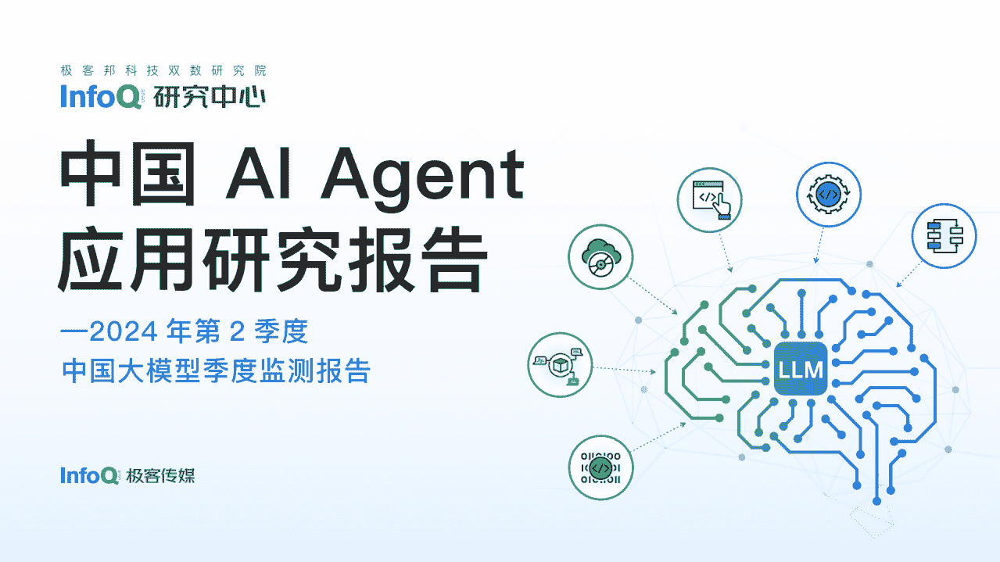

[中国AI_Agent应用研究报告.pdf](https://internal-api-drive-stream.feishu.cn/space/api/box/stream/download/all/Rph3bTB1doKJMRxp8vLcUXpMnof)

【AI 大模型】

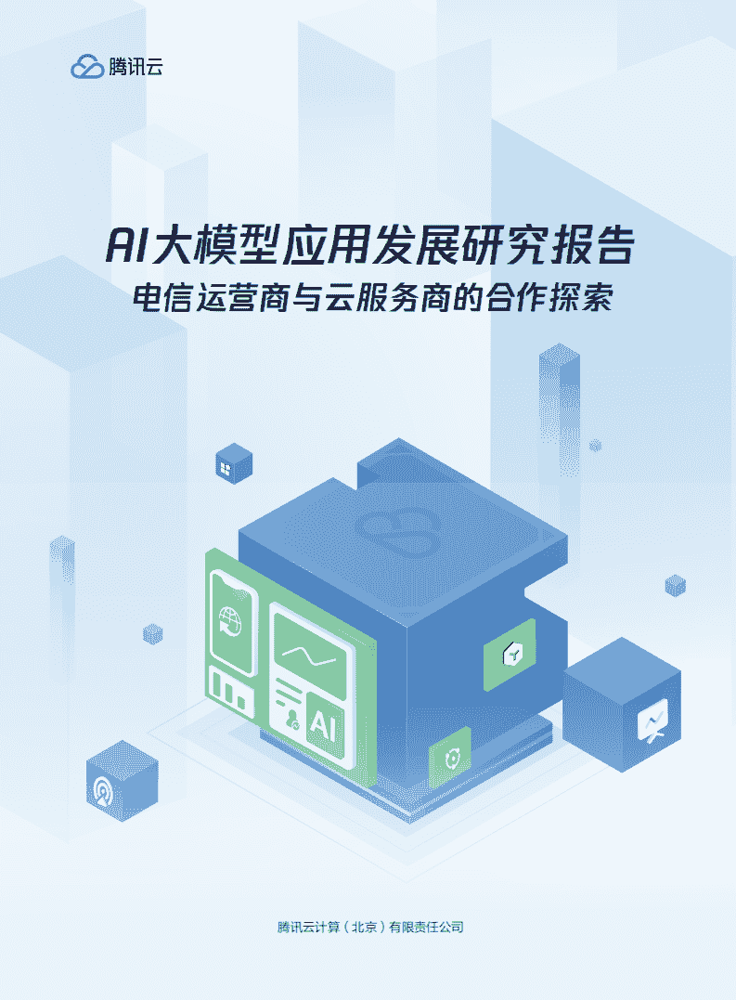

[AI大模型应用发展研究报告.pdf](https://internal-api-drive-stream.feishu.cn/space/api/box/stream/download/all/VethbZ1kxovUOFxLdFOcRoD8n6f)

【智能体】

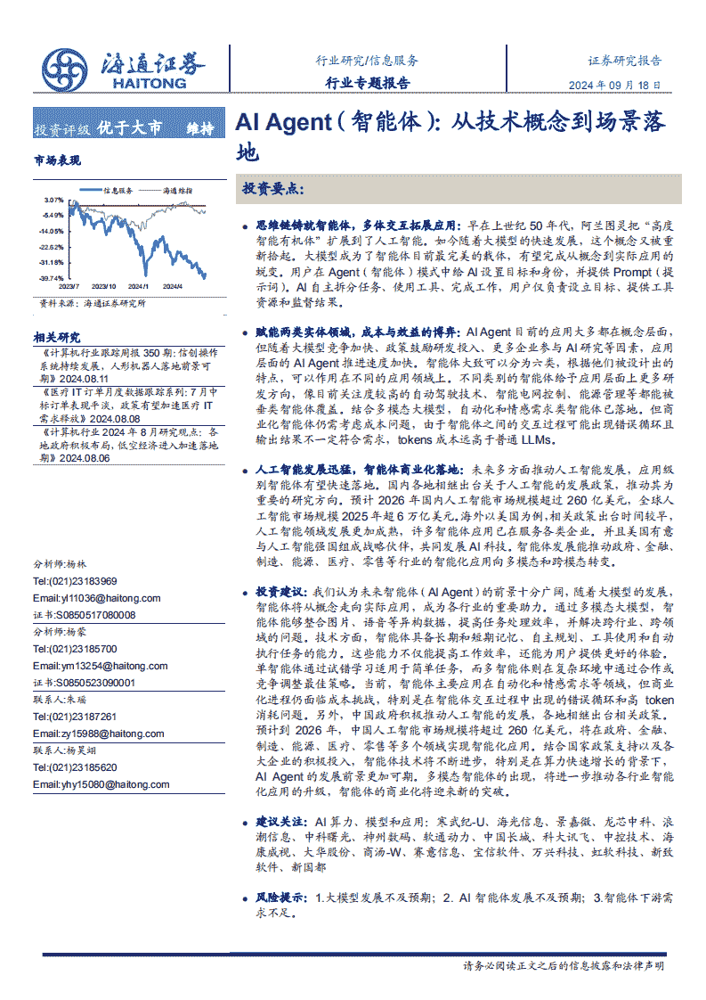

[信息服务行业专题报告-AIAgent(智能体)：从技术概念到场景落地-240918-海通证券-33页.pdf](https://internal-api-drive-stream.feishu.cn/space/api/box/stream/download/all/ATFFboYeJo2anZxYKDocOXTZnXd)

【C端】

[行业洞察：AI大模型时代C端应用生态变局.pdf](https://internal-api-drive-stream.feishu.cn/space/api/box/stream/download/all/YVe1bjumQoX40bxHkcBcBWcinxd)

【AI 金融】

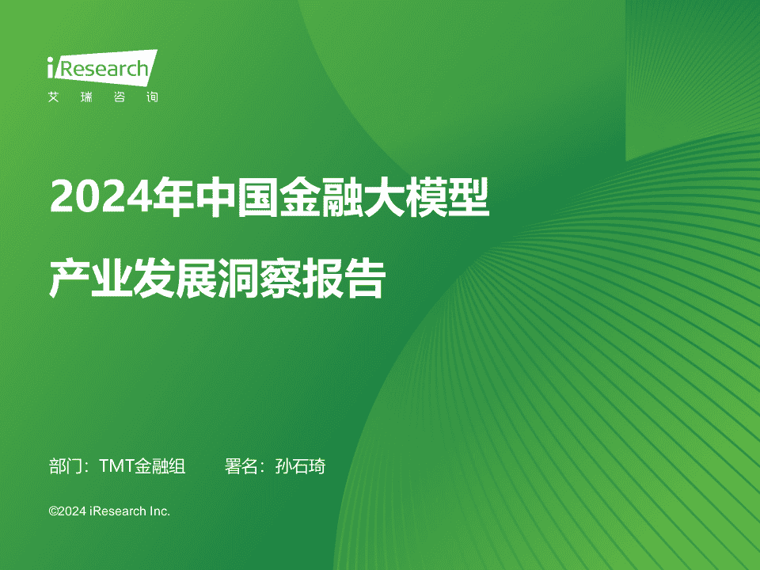

[艾瑞咨询：2024年中国金融大模型产业发展洞察报告.pdf](https://internal-api-drive-stream.feishu.cn/space/api/box/stream/download/all/C6E6bwrmhouJo3xwZVBcVKKSn0d)

【AI 手机】

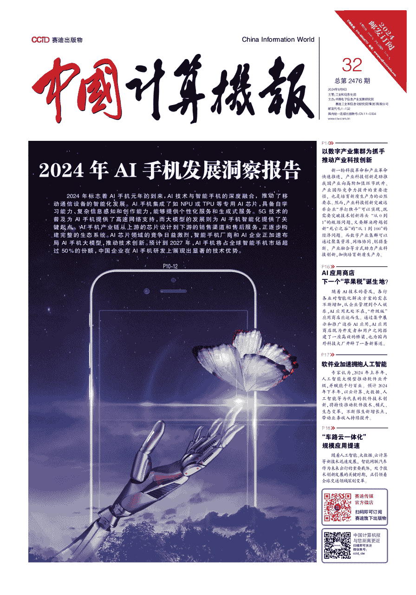

[2024 年AI 手机发展洞察报告.pdf](https://internal-api-drive-stream.feishu.cn/space/api/box/stream/download/all/Yd5pbeb1koAtGAxe4gOceknKnab)

【AI 劳动力】

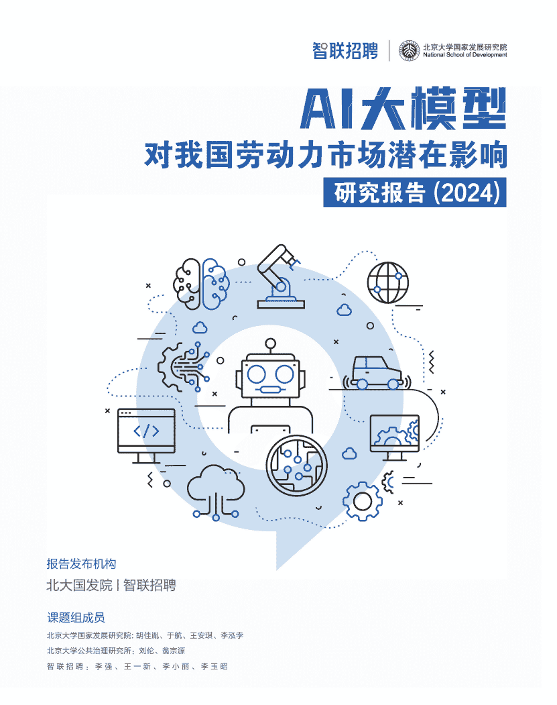

[AI大模型对我国劳动力市场潜在影响研究：2024-20页.pdf](https://internal-api-drive-stream.feishu.cn/space/api/box/stream/download/all/UqymbTwVeoSbfUxBtnJcHQL8nzh)

【自动驾驶】

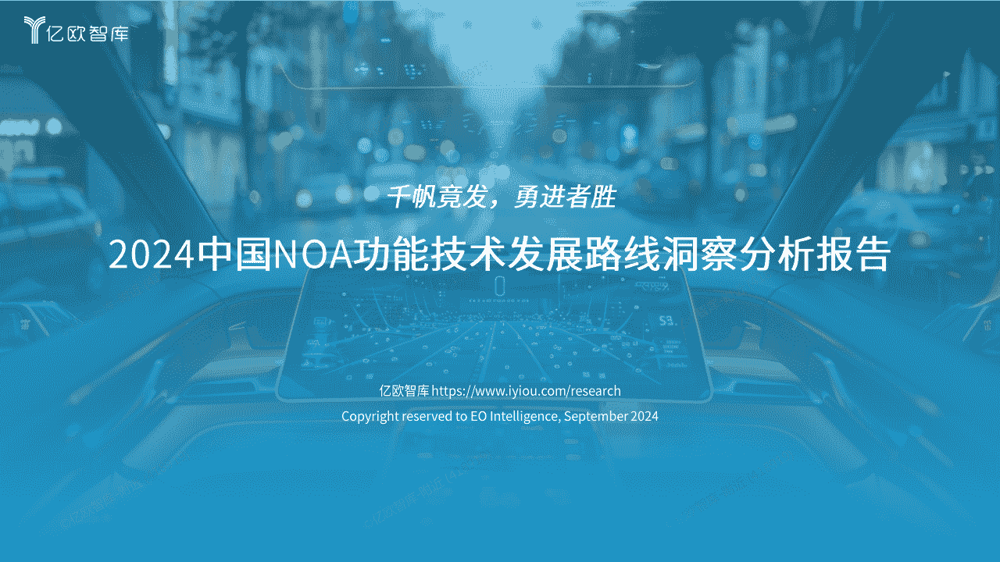

[【亿欧智库】2024中国NOA功能技术发展路线洞察分析报告-0919.pdf](https://internal-api-drive-stream.feishu.cn/space/api/box/stream/download/all/VmuIbJk7eoEkoYxCo03clGaSnkb)

【AI 市场】

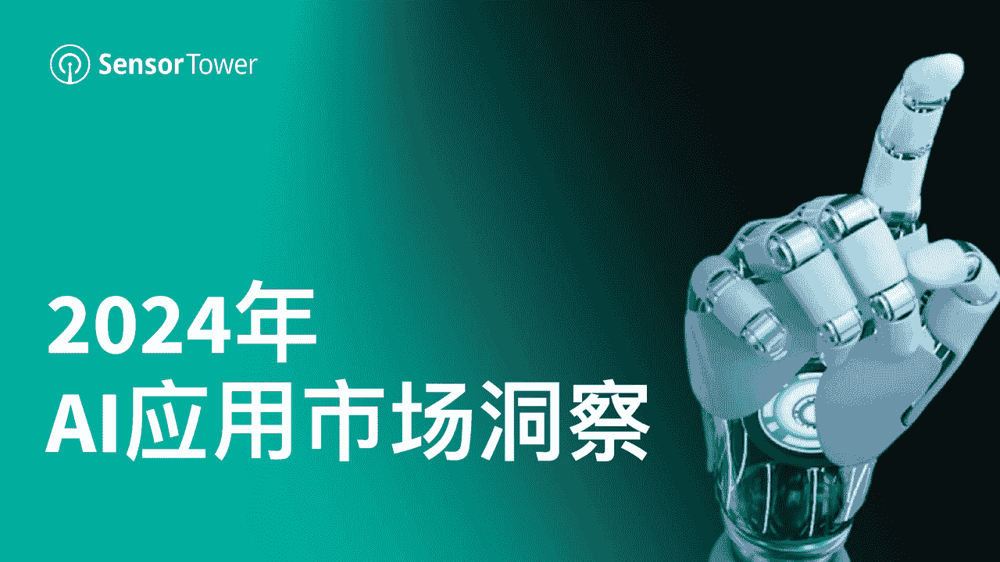

[2024年AI应用市场洞察.pdf](https://internal-api-drive-stream.feishu.cn/space/api/box/stream/download/all/BOkgbSwirozgBAxomVDcBgVRnyg)

【认知】

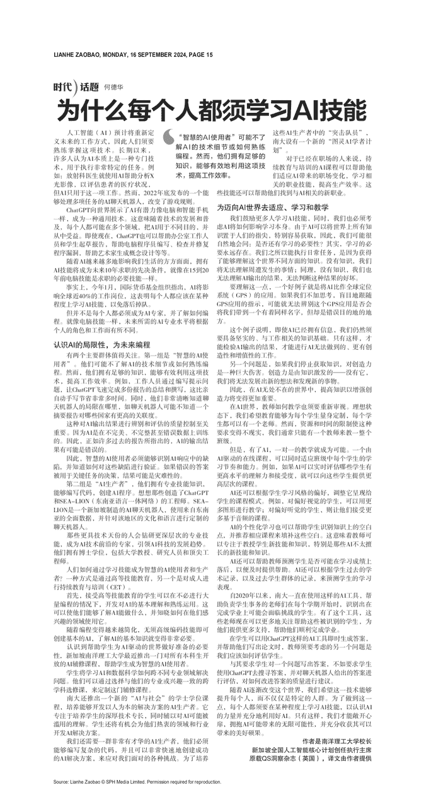

[为什么每个人都须学习AI技能.pdf](https://internal-api-drive-stream.feishu.cn/space/api/box/stream/download/all/BBR2b0BJJoU0jzxpOQHcZgMmnhg)

【AI 游戏】

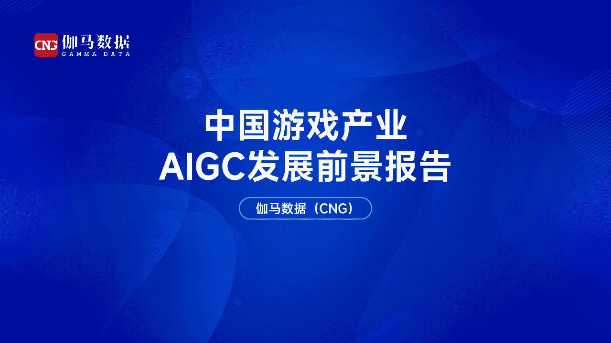

[中国游戏产业AIGC发展前景报告.pdf](https://internal-api-drive-stream.feishu.cn/space/api/box/stream/download/all/Dwcsb9dMdoecYHxZkQlcS6v9nod)

# 近期动态

> 筛选分享 AI人工智能领域最优质、最好玩、最前沿的一手动态。

---

### 【Prompt 创作】李继刚：用20年时间，给世界留下一句话

这篇文章是对“Prompt之神”李继刚的专访，深入探讨了他在AI领域，尤其是prompt创作的卓越贡献。李继刚以其独特的公文笔杆子和汉语新解等作品，在prompt社区中引起了广泛关注。文中提到，李继刚在消失的半年里，专注于读书，特别是哲学书籍，这使得他的prompt风格发生了显著变化，变得更加注重逻辑推理和深度表达。他认为，之前的工具书虽然提供了大量方法论，但在解决复杂问题时显得力不从心，而哲学书籍则帮助他构建了更为系统和深刻的思考框架。李继刚的观点犀利而深刻，他强调通过阅读和思考，才能真正提升prompt的质量和深度，进而更好地服务于各种写作需求。（原文链接：https://mp.weixin.qq.com/s/JT2oOG2SYw2pDYEHlEmcyQ）

### 【AI 编程】v0 工具惊艳亮相，轻松复制界面

今日，颇有名气的博主 Alvaro Cintas 分享了一个有关 v0 AI 编程工具的实操视频，引起了众人的强烈兴趣。

这款 v0 编程工具在界面复制方面有着非凡的表现。博主从 X 平台上传了一个应用截图，仅仅给出一个提示，它就出色地完成了界面复制任务。这一功能对于编程人员来说实在是太实用了。它能够大大提高编程工作的效率，避免不必要的重复劳动，让编程者有更多的精力投入到创新和优化工作中。

[GODLLQ838Bp117qh.mp4](https://internal-api-drive-stream.feishu.cn/space/api/box/stream/download/all/Jfp4bgzPXocgw1x5dFWcMnktn4f)

官方介绍：https://githubnext.com/projects/github-spark

### 【AI 编程】GitHub发布了AI大模型编程产品Spark

GitHub发布了AI大模型编程产品Spark，它支持四款超强编程模型，用户无需代码和部署环境，用自然语言就能开发微应用程序。Spark能打破编程界限，让不懂编程的人开发应用，还能生成代码并立即运行展示效果，提供修订变体功能，自动保存迭代内容，用户可从四个AI模型中选择，它包含内置组件和可主题化设计系统，运行时与GitHub Models集成，提供提示编辑器，还提供托管运行时环境，目前处于预览版，支持申请注册体验。

[avCjyB9lucvz4FaD.mp4](https://internal-api-drive-stream.feishu.cn/space/api/box/stream/download/all/CkGCbk8MJogNTWxmokDc4kaun9f)

> 我们能否让任何人都能使用人工智能和完全管理的运行时为自己创建或调整软件？

### 【AI 绘画】Recraft V3：“红熊猫” 登顶 Hugging Face 图像榜

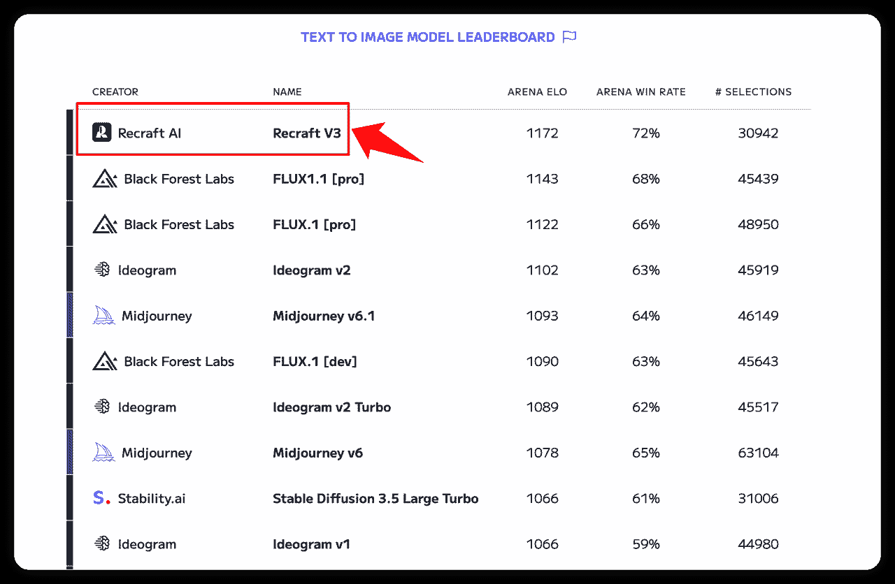

来自[机器之心的一篇文章](https://mp.weixin.qq.com/s/Hw8o0IwLseGUkmo2iJ877Q)介绍了在 Hugging Face 文本转图像排行榜上排名第一的 “red_panda” 模型，谜底揭晓它是由 AI 初创公司 Recraft 提供的 Recraft V3 模型。该模型以 1172 的 ELO 评分位居第一，超越了 Midjourney、OpenAI 等公司的模型。Recraft V3 在文本生成方面有高质量表现，还具备多项新功能，如可指定图像中文本大小和位置等。它是图像生成领域唯一可生成带有长文本图像的模型。Recraft 于 2022 年成立，总部在英国伦敦，致力于帮助设计师控制设计过程。

---

### 【智能体】智谱AI的AutoGLM后，Google和微软也下场来做“贾维斯”了

来自[卡兹克的一批文章](https://mp.weixin.qq.com/s/AuMHN_17mgCmdmF9kan4Eg)主要讲述了智谱AI推出AutoGLM后，Google和**微软也下场参与类似“贾维斯”产品的研发。微软发布了Omni**Parser for Pure Vision Based GUI Agent模型用于网页自动化操作，谷歌也被爆料准备推出接管计算机的人工智能。一周内已有四个公司有相关动作，其中Anthropic的Claude、智谱的AutoGLM和微软的OmniParser已发布产品。自主人工智能引发了AI圈的热情，其完成任务流程包括理解需求、系统规划、调用工具和完成目标。此前AutoGPT因基于大语言模型有局限性而沉寂，自主人工智能前期进展缓慢是因为多模态模型不成熟和缺乏行为数据，现在多模态模型基本可用，通过强化学习补充数据的范式逐渐形成共识。还对AutoGLM的能力实现进行了猜测，以微信发消息为例说明其可能的推理过程，最后指出Claude和AutoGLM都有问题，产品还需完善，但未来可能会快速发展。

### 【智能体】聊聊 AI Agent 应用、商业化以及当前行业的现状

文章是对澜码科技 CEO 周健的访谈，主要探讨了 AI Agent 的应用、商业化以及行业现状。周健介绍了澜码科技的业务，强调了 AI Agent 与 Chatbot、Copilot 的区别，阐述了其对企业结构和 SaaS 的影响，并分析了国内外在该领域的差距以及不同行业应用的差异，还分享了澜码科技的成功案例和未来展望。原文链接：https://mp.weixin.qq.com/s/iZHSidx0IDl23-5APuriCw

**金句提炼**

1.  “AI Agent 不仅具备语言理解能力，还能自主操作，改变传统业务流程。”

1.  “Agent 的自主性和业务属性的结合使其具备跨工具执行任务的能力，这是 Copilot 无法比拟的。”

1.  “未来的企业结构将更多依赖 AI Agent，Agent 不仅是工具，更是企业运作的重要组成部分，这将推动传统 SaaS 向记录性工具的转型。”

1.  “从今天的角度来看，我觉得更关键的是 Agent 如何对环境和目标进行建模。”

1.  “Agent 需要能够感知环境，采取相应的行动，并通过推理和学习来优化自身的表现。”

1.  “不同行业和职能中的核心能力也会有所不同，具体的应用场景会决定它们的侧重点。”

1.  “国内的追赶速度非常快，但最大的差距还是在大模型的创新和推理能力上，尤其是推理能力的泛化问题。”

1.  “AI Agent 作为业务自动化和管理增强的工具，能够帮助企业在不依赖人海战术的情况下，通过知识整理和管理提效来实现增收。”

1.  “AI 更偏向于具体业务场景，不像传统 SaaS 那样通用。”

1.  “Agent 的真正价值在于加速专家知识的传递和运用。”

### 【AI 笔记】腾讯低调发布 AI 笔记 ima copilot

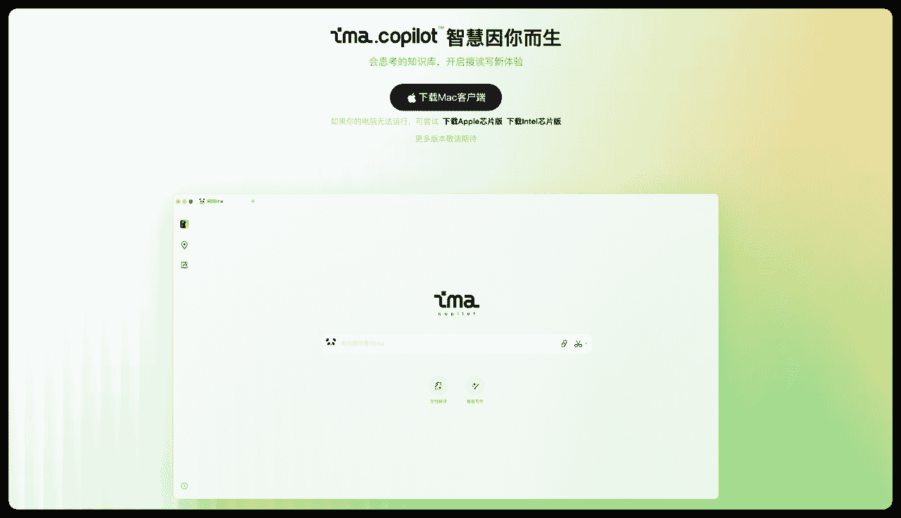

官网：https://ima.qq.com/

量子位测评：https://mp.weixin.qq.com/s/fWIDcB18CvzSqmYuLaAzmw

**最近智能体又频频带来**不少惊喜，前阵子谷歌 AI 笔记Google发布的notebooklm热度刚过去，腾讯便来了一个“传承延续”。

借助本身公众号数据优势壁垒，加上吸取的知识库概念，算是本土化AI 知识库的亮点，隔壁 notionAI 笔记已经很久没有炸裂更新，此次腾讯也是看准了智能体在笔记垂类的趋势，悄然小范围的开始推广试错。

---

### 【终端 AI】苹果发布 iOS18.1，Apple Intelligence终于来了

10月29日凌晨，苹果公司发布的 iOS 18.1 系统引入了一系列新功能，其中最引人注目的是 Apple Intelligence 。不过国行用户和全球大量非英语用户目前暂无法使用部分功能。以下是关于更新的详细介绍：

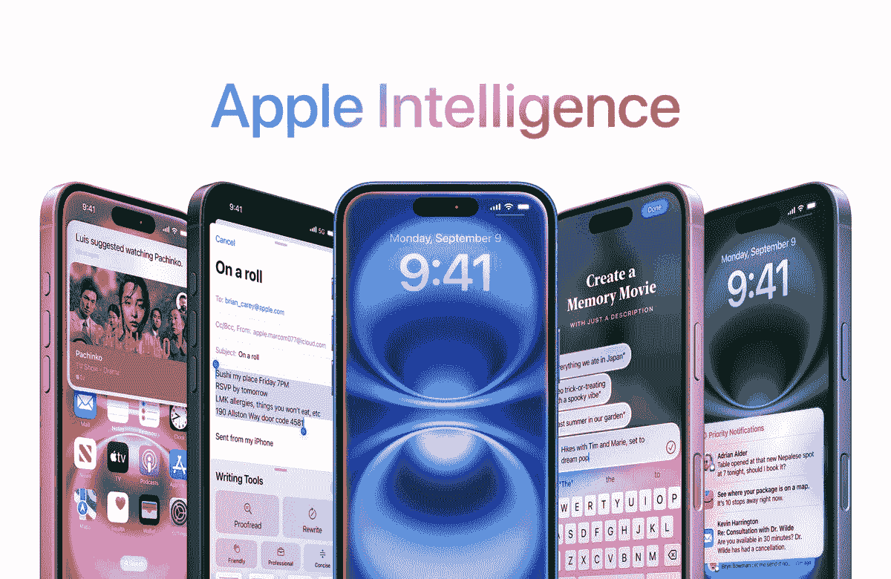

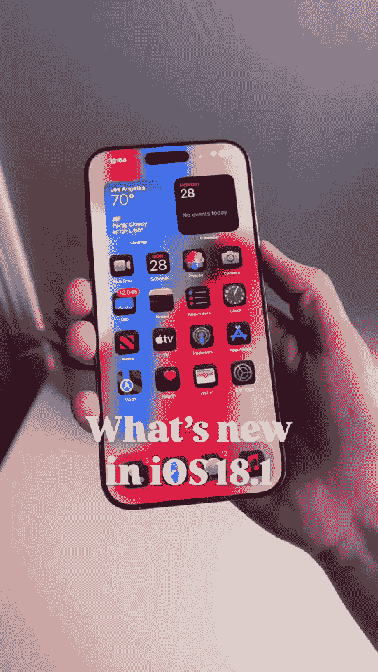

[4YxSmY6li11yebfF.mp4](https://internal-api-drive-stream.feishu.cn/space/api/box/stream/download/all/HW9NbqSLYo0pvTx3QoncmQEBncc)

Apple Intelligence

+   **写作工具** - 写作工具支持一键总结归纳、对文本校对、针对用词和文本结构提出建议等

+   **Siri** - Siri 焕然一新，提供苹果设备产品知识，新增“输入给 Siri”功能，Siri 能够维持请求间的上下文，并理解你在说话时遇到困难。

+   **智能回复** - 在邮件和消息中，苹果可以建议回复收到的消息。

+   **功能概述** - 苹果智能可以总结电子邮件和通知，让您一眼就能看到重要内容。您还可以在“笔记”应用中查看转录摘要，以及在“Safari”浏览器中查看网站摘要。

+   **照片** - 记忆创造者让您只需描述即可创建个性化幻灯片，支持自然语言搜索，并提供清理功能，可从图片中移除不需要的对象。

**其它主要更新**

1.  **通话录音**：拨打电话接通后，通话页面左上角会出现录音小图标，点击可开启录音。虽然无需对方同意，但会通过语音提示对方通话正在被录音，录音会保存在备忘录中，可直接播放音频并转写为文本。

1.  **新增 rcs 信息**：在 iPhone 设置--app--信息中新增了“rcs 信息”选项，开启后可给安卓设备发送高清照片、视频等信息。

1.  **控制中心改进**：长按控制中心的连接模块，无线局域网、隔空投送、蜂窝数据、蓝牙四个模块由长条形改成方块形式；还可在控制中心添加单独的 Wi-Fi 控件、隔空投送控件。此外，新增还原控制中心的选项，能将其还原为厂家默认布局。

1.  **iPhone 镜像支持文件拖拽**：将 iPhone 更新到 iOS18.1正式版，mac 同步更新到 macOS15.1正式版后，使用屏幕镜像时可在 mac 和 iPhone 之间拖拽移动照片、文件、视频。

苹果CEO库克称正努力推动苹果智能在中国市场使用，需走完监管流程。按计划，今年12月将增加英国、澳大利亚等国的本地化英语支持，中文、印度英语、法语、德语、日语等语言的支持将于明年陆续推出。

[更多](https://agispace.feishu.cn/wiki/AJ6hwlMmRiCa1qkXrhtckeTYnZe)[Ap](https://agispace.feishu.cn/wiki/AJ6hwlMmRiCa1qkXrhtckeTYnZe)ple Intelligence详情

### 【AI+教育】北京市发布首份教育领域人工智能应用指南

10月26日，2024年北京市数字教育工作推进会在北京师范大学召开，正式发布了《北京市教育领域人工智能应用指南（2024年）》（以下简称《指南》），明确人工智能在教育领域应用规范，指导学校、师生稳妥、有序地开展应用实践。该指南是由北京市教育行政主管部门委托研制并发布的首份教育领域人工智能应用指南。

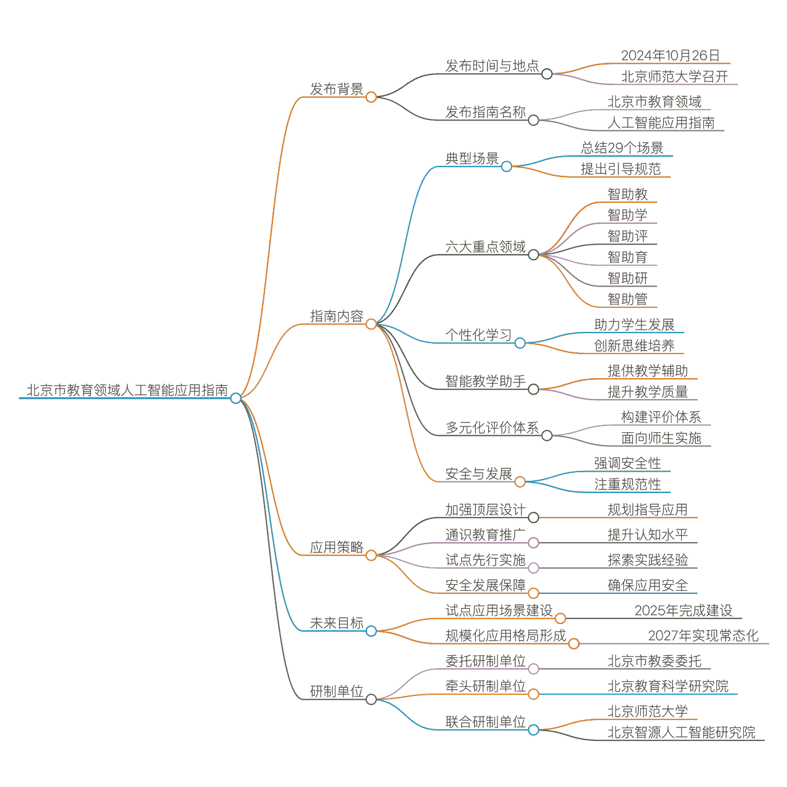

该指南由北京市教委委托研制，旨在明确人工智能在教育领域的应用规范，指导学校和师生稳妥、有序地开展应用实践。指南总结了29个典型场景，并提出了引导和规范，确保人工智能技术在教学、管理、科研等环节中充分发挥作用。指南涵盖了六大重点应用领域，包括助教、助学、助评、助育、助研和助管，并对教育人工智能应用作出规范要求，强调安全发展和批判性使用人工智能的理念。该指南是北京市教育领域人工智能应用政策监管体系的关键举措之一。

### 【智能体】智谱上线自主智能体AutoGLM，PC端已开放使用

AutoGLM是由智谱AI开发的一款自主智能体，它能够通过文字或语音指令模拟人类操作手机和网页，完成各种自动化任务。

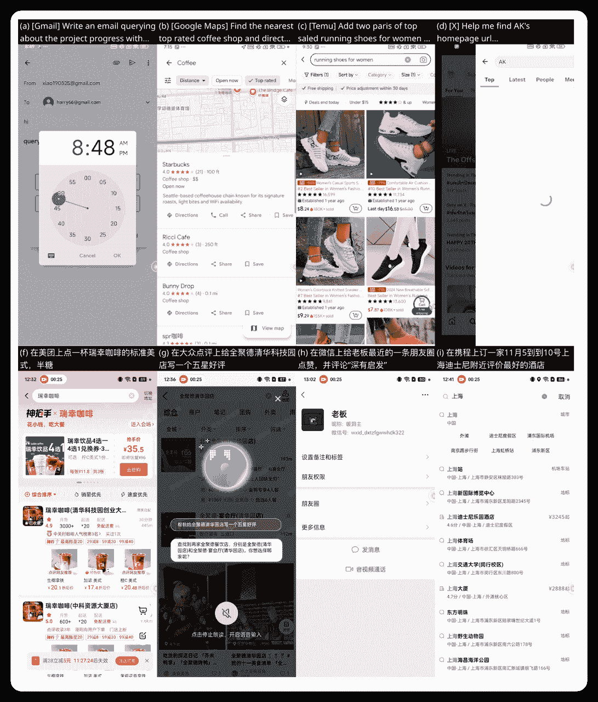

（https://xiao9905.github.io/AutoGLM/项目地址）

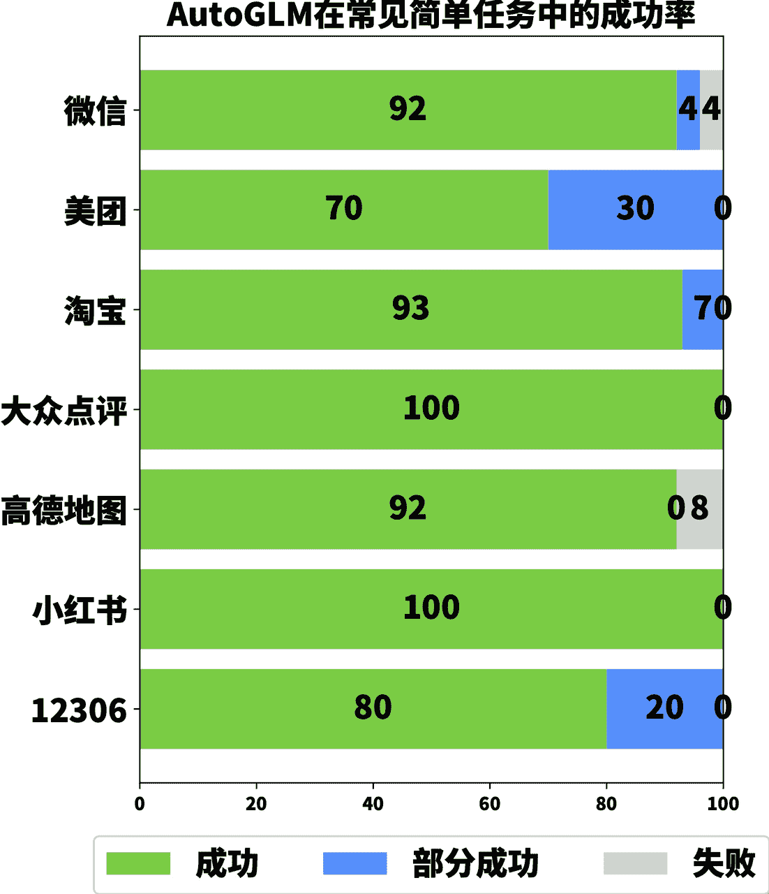

**核心功能：**AutoGLM 可以模拟人类在手机和网页上进行点赞、购物、预订酒店等操作。它基于智谱自研的 “基础智能体解耦合中间界面” 和 “自进化在线课程强化学习框架”，克服了网页智能体研究和应用中训练任务稀缺、反馈信号稀少和策略分布漂移等难题。

**AutoGLM的应用前景：**AutoGLM已在微信、淘宝、美团等热门应用中实现应用，覆盖了聊天、网购、社交、地图服务及订票等日常生活场景。市场潜力：根据IDC的预测，到2027年，中国市场AI手机和AI PC的市占率将分别超过50%、80%。智谱正在加紧推动大模型落地AI手机，并已与高通、三星等手机厂商达成合作。

**如何使用AutoGLM？**

**一、手机端使用**

目前移动端仅支持安卓端应用测试。用户需前往智谱清言，查找“AutoGLM小助手”，提交姓名、职业、手机号码以及申请原因。内测申请通过后，会收到含下载链接的短信。

获得测试资格后，使用步骤如下：

1.  **打开清言App**：确保已安装清言app。

1.  **开启AutoGLM模式**：在app内找到AutoGLM入口，开启自动驾驶模式。

1.  **下达指令**：像与朋友聊天一样，告知AutoGLM想要完成的任务，例如“帮我订个外卖”或“查找下周的天气预报”。

1.  随后，AutoGLM会依据指令自动完成相应操作。

**二、网页版使用**

目前，用户可通过安装“智谱清言”插件体验AutoGLM - Web。它是一个浏览器助手，能够模拟用户访问网页、点击网页，并在网站上自动完成高级检索、总结与内容生成。

> 项目地址：https://xiao9905.github.io/AutoGLM/

> 官网介绍：https://www.zhipuai.cn/news/144

### 【端侧大模型】端侧大模型浪潮奔涌而至：态势、影响与建议

来自腾讯研究院的一篇关于端侧大模型的文章https://mp.weixin.qq.com/s/G7lSj-tKijNWtr8lckVmTQ

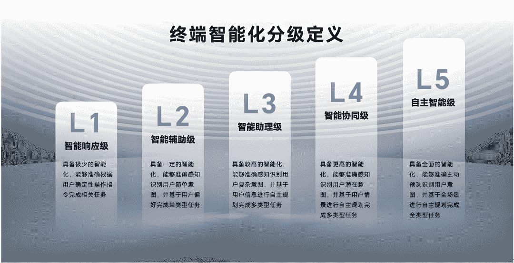

这篇文章探讨了端侧大模型在智能手机和其他终端设备上的快速发展和广泛应用，分析了其技术特点、优势（如实时性、保密性和经济性）以及未来发展趋势。文章指出，端侧大模型将重塑用户体验和生态格局，尤其在智能手机领域有望带来新的增长动力，并可能改变应用分发和商业模式。同时，文章也讨论了国内外在端侧大模型方面的发展态势及其对产业和数据隐私的潜在影响。

---

### 【AI 复活】AI赋予罗马半身像栩栩如生

今日，AI 技术再次惊艳众人！它竟能让古老的罗马半身像，如图拉真、尤利乌斯・凯撒、埃拉加巴鲁斯、卡利古拉等，从原始照片中 “活” 过来，生成栩栩如生的真人短视频。AI 的强大功能让历史与现代完美融合，充分展现了其在图像和视频处理领域的飞速发展，为我们带来了全新的视觉体验和历史感悟。

[oN9NP9RV1XRWYBSv.mp4](https://internal-api-drive-stream.feishu.cn/space/api/box/stream/download/all/Lr6kb56FBofIXXxb8sycutXnnuf)

[WmcEUaYETfg_IabY.mp4](https://internal-api-drive-stream.feishu.cn/space/api/box/stream/download/all/GiZYbul6hoqzCex2ofscKkgJnyd)

[2nncG7jJ61m7ZpH9.mp4](https://internal-api-drive-stream.feishu.cn/space/api/box/stream/download/all/GNIMb0Z7wozU7axCOvScCVsSnKb)

[obs0-0IaeEZx1p9n.mp4](https://internal-api-drive-stream.feishu.cn/space/api/box/stream/download/all/B12KbYldyo5OsGxdsL8cCsy6nfc)

图拉真、尤利乌斯·凯撒、埃拉加巴鲁斯、卡利古拉转自Angry Tom

### 【前沿访谈】OpenAI 产品官洞察，未来 AI 更自主异步，产品构建变，新可能出现

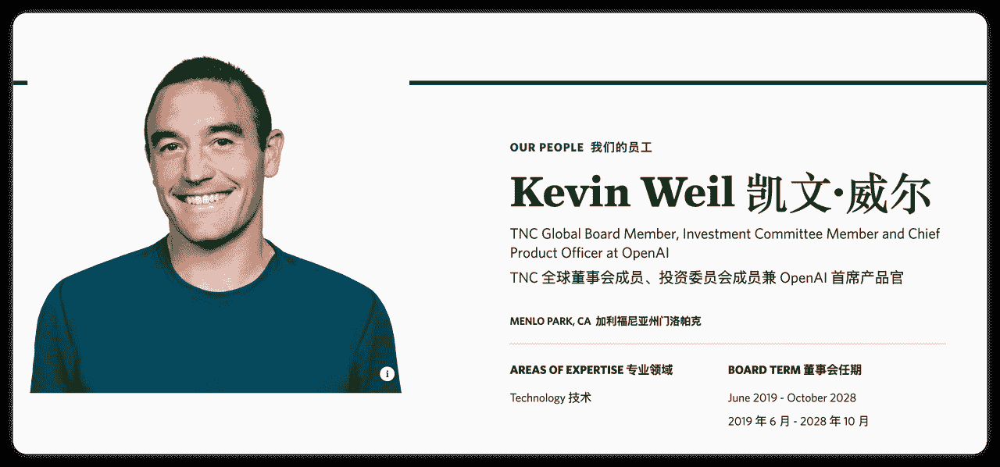

这篇文章是关于OpenAI首席产品**官Kev**in Wei**l的最新见解，**讨论了未来AI的发**展方向、产品构**建的变化以及OpenAI在技术和产品策略上的创新。

1.  **OpenAI产品管理的独特性**：Kevin Weil提到，在OpenAI工作与在其他公司最大的不同在于技术基础的不固定性，以及快速变化的技术带来的挑战和机遇。

1.  **AI技术的快速发展**：Weil强调，AI技术每隔一两个月就会有新的突破，这使得产品构建方式需要不断调整，以适应技术的不确定性。

1.  **开发者路线图策略**：OpenAI希望将AI交给开发者，让他们创造惊人的应用。Weil介绍了包括实时语音API和模型蒸馏功能在内的新发布，旨在降低AI应用的门槛。

1.  **AI应用的未来潜力**：Weil和Nishihara讨论了AI在翻译、商业对话等领域的应用前景，以及开源模型对OpenAI业务的影响。

1.  **竞争与合作**：文章还提到了OpenAI与其他云服务提供商的竞争关系，以及OpenAI如何通过快速行动和承担风险来保持竞争优势。

1.  **o1模型的挑战与应用**：Weil分享了将o1模型转化为产品的挑战，包括其推理能力和在解决问题过程中的应用。

总的来说，文章深入呈现了 OpenAI 首席产品官的最新见解，涵盖未来 AI 发展方向、产品构建变化及技术与产品策略创新，展现了 OpenAI 在 AI 技术飞速发展潮流中的积极探索与引领作用。

> 根据OpenAI首席产品官Kevin Weil与Anyscale联合创始人Robert Nishihara的对话内容整理，原文链接：https://mp.weixin.qq.com/s/Dc8c4dwTYhHv64ord02QyA

### 【行业报告】2024年Q3全球AIGC行业月报-流量篇

来自《非凡产研：2024 年 Q3 全球 AIGC 行业月报 - 流量篇》主要展示和分析了 2024 年 Q3 全球 AI 产品的流量态势，涵盖全球、国内及出海等维度，通过多种核心指标揭示市场竞争格局和用户需求偏好。

以下是报告中的一些重要数据结果：

+   **全球规模以上 AI 产品数量**：截至2024年9月底，全球规模以上（月访问量超过1万次）AI 产品数量达1743个，与上月相比相差不大，整体趋于稳定。中国规模以上 AI 产品数量（含国内及出海）在9月达316家，环比增长2.93%，创历史新高；出海规模以上的 AI 产品数量9月继续增加，产品数量达117个，较上月增加8家。

+   全球 AI APP 产品使用次数：9月份，与生成式人工智能相关的应用程序实现了552.67亿次单月使用量。

+   **全球市场 AI 产品内购收入**：9月份，全球用户对 AI 产品的内购消费总计达29959万美金。

+   **ChatGPT 相关数据**：9月独立访客数为2.84亿人；Q3访问量和月活人数稳步上升，其月访问量从1月的16.10亿次显著增长至9月的31.24亿次；访问时长方面，9月以3.22亿小时位居榜首。

+   **国内聊天机器人访问量**：9月国内月访问量过千万的聊天机器人仅有3家，分别是Kimi.ai（2455 万次）、豆包（2053 万次）、阿里通义（929 万次）。

+   **部分 AI 产品下载量**：9月全球 AI APP 下载量方面，ChatGPT 为3569万次，剪映为2460万次；国内 AI APP 下载量中，剪映为2460万次，豆包APP 为1631万次；出海 AI APP 单月下载量超过500万次的仅有 Gauth 和 InShot。

+   **教育类 APP 收入**：9月教育类 APP Duolingo 逼近4000万美金，单月吸金3976万美元；ChatGPT 本月收入3730万美元；剪映以3186万美元位列第三。

> 原文链接(非凡产研)：https://mp.weixin.qq.com/s/mzI5y9aOKLaT9HGUle9qfw

---

**👉更**[**多动态**](https://agispace.feishu.cn/wiki/Hp02wThabiyR0QkX08RctWNZnIl)

# 知识分栏

> 本栏目旨在梳理知识库概要，方便大家快速找到自己感兴趣的分类

> **入门指南**

> [**AI 基本概念**](https://agispace.feishu.cn/wiki/UTGXwEhALiMCUzkFaFmcHA5Snzc?table=ldxFzQm5az3GILJz)

> [**图说**](https://agispace.feishu.cn/wiki/UTGXwEhALiMCUzkFaFmcHA5Snzc?table=tblnI4InMW3PvfGu&view=vewxUXYx8W)**（一张图片快速理解）**

> [**优质AI 通识课**](https://agispace.feishu.cn/wiki/UTGXwEhALiMCUzkFaFmcHA5Snzc?table=tbli4xb5quZLGDE6&view=vewF2knMtq)

> [**推荐阅读文章**](https://agispace.feishu.cn/wiki/UTGXwEhALiMCUzkFaFmcHA5Snzc?table=tblKiIdfswBCpQmF&view=vewhis3Os8)

> [**精选 TED视频**](https://agispace.feishu.cn/wiki/UTGXwEhALiMCUzkFaFmcHA5Snzc?table=tbl3KLXN4zZPMTvc&view=vewbKQvjGL)

> **AI 大模型**

> [认知：大模型能帮我解决什么](https://agispace.feishu.cn/wiki/ZrPvwlLSLiu6ypkFdGLc1WhynPd)

> [国内AI大模型](https://agispace.feishu.cn/wiki/SSTcwfaWAiTUZiksGyocICJFnSd)

> [视频AI大模型](https://agispace.feishu.cn/wiki/PeNkwcz7wi4pQUkJQfBcwb21n0e)

> [国外AI大模型](https://agispace.feishu.cn/wiki/IFjEwAF7wi4607kddyJc0PdSnYf)

>

> **应用&行业**

> [**个体赋能**](https://agispace.feishu.cn/wiki/H4RlwxNpSijbhfkjYXlcYFPCnbg)

> [**AIGC 行业图谱**](https://agispace.feishu.cn/wiki/BwRewiHLRiDVZ4k1CyTctwt1nId?table=tbl19hCoJLAv6YDY&view=vewvmjor2D)

> [企业智能方案系列](https://agispace.feishu.cn/wiki/EYXawbNPMixiPwkirvXcR47pnwb)

>

> **科技前沿（具身智能）**

> [3.0 人形机器人-具身智能](https://agispace.feishu.cn/wiki/DmzWw8aNnig4QckQvF6cE4hSn1g)

> [2024世界机器人大会](https://agispace.feishu.cn/wiki/KrEUwpClsiImYhkPjnZcr0cKnQd)

> [机器人全景报告](https://agispace.feishu.cn/wiki/TleKw5737ihDUOkeKRXcwlHtnFb?table=tblhuPppAHsmJfsb&view=vew7fbjhi0)

>

> **资本与拓展**

> [全球商业化项目](https://agispace.feishu.cn/wiki/QA8TwBUjwi03GJkjcdHcd0Mgn3g)

# AI 社群

> 《AGI 空间站社区》 欢迎大家加入！

> 我们会定期分享 AI 前沿信息，大家可交流 AI 相关内容，还能获得AI 学习资源。快来加入，一起探索 AI 有趣的知识！

公众号：里昂船长

合作交流

---