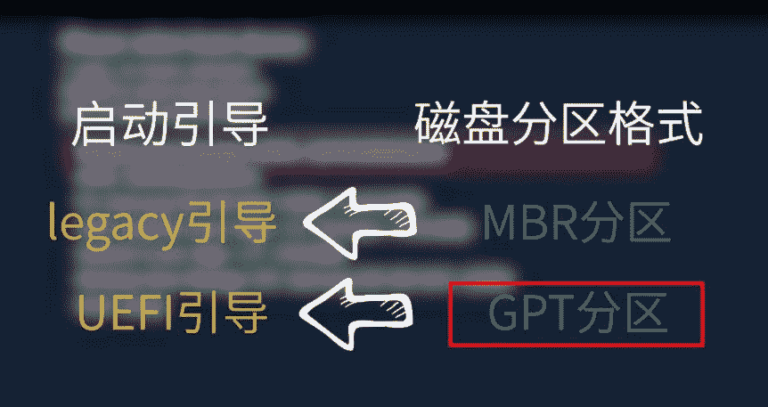
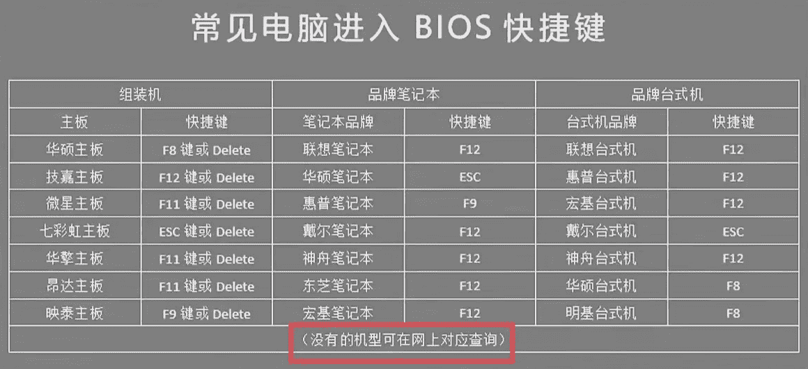

# 如何重装系统？

> 来源：[https://xodnytdcaw.feishu.cn/docx/FdK4dWszjovTjGxcyIfcV5QLnic](https://xodnytdcaw.feishu.cn/docx/FdK4dWszjovTjGxcyIfcV5QLnic)

参考教程：https://zhuangit.ababtools.com/

| U启**工具** | [Rufus](https://rufus.ie/zh/)   [balena](https://etcher.balena.io/)  [Ventoy](https://www.ventoy.net/cn/download.html)   [WePE](https://www.wepe.com.cn/download.html) |
| --- | --- |
| **镜像下载** | [微软官网](https://www.microsoft.com/zh-cn/software-download/)  [Cmdpe](https://www.cmdpe.com/post/246.html)   [Massgrave](https://massgrave.dev/windows_ltsc_links)   [itellyou](https://msdn.itellyou.cn/?ang=2h-cn)  [极简系统 ](https://www.sysmini.com/)  [uupdump](https://uupdump.net/)   [CYegats](https://kdocs.cn/l/cgTGWjbUVnMf)  [uupdump中文站](https://uupdump.cn/) |
| **实用教程** | [删除U盘的EFI分区方法](https://web.okjike.com/originalPost/6639f4b1a922aa28d0fa4dec)    [E盘合并到D盘](https://www.bilibili.com/video/BV1hd4y1m7BP/?spm_id_from=333.337.search-card.all.click&amp;vd_source=206031f494850e57fd6c92ace02b1bed) |

