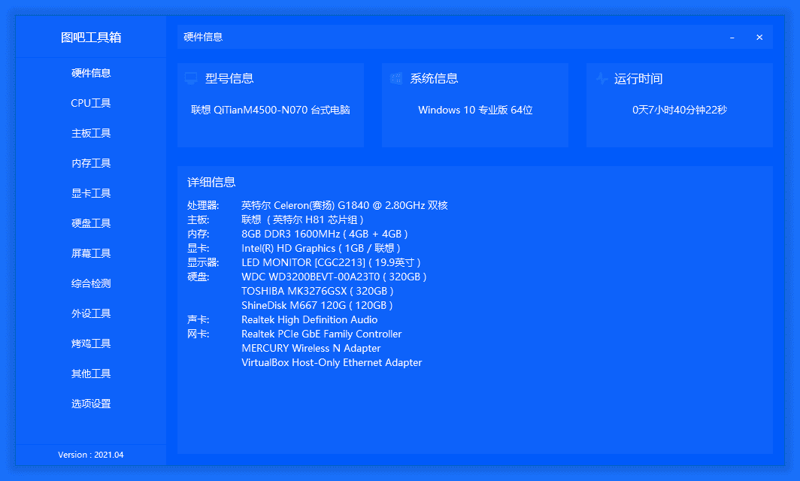
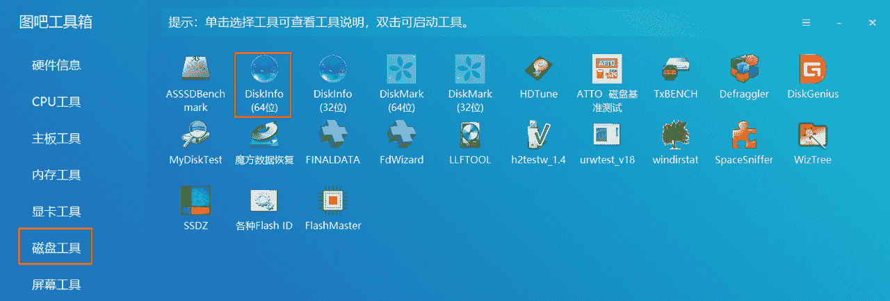
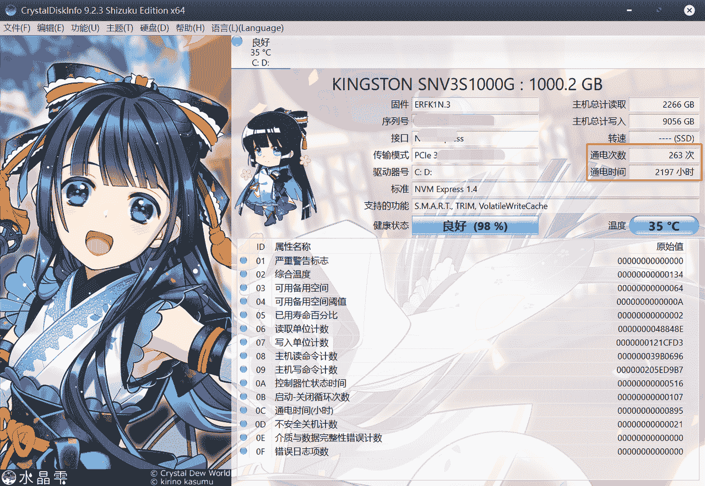
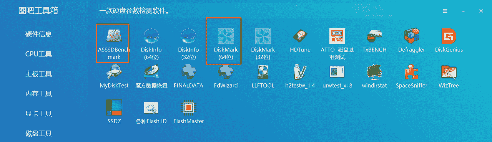
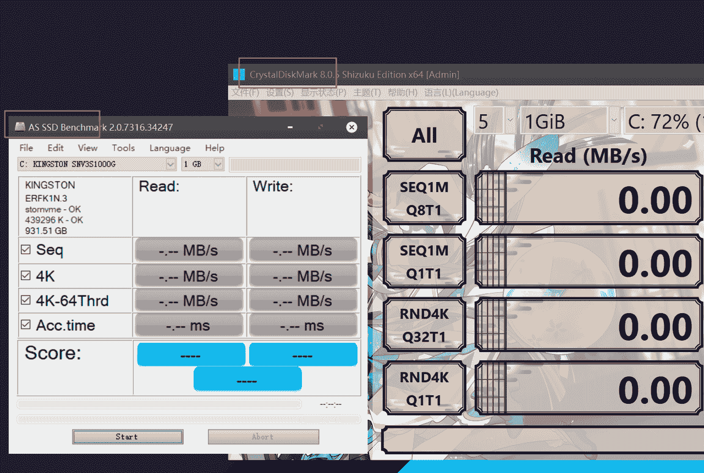
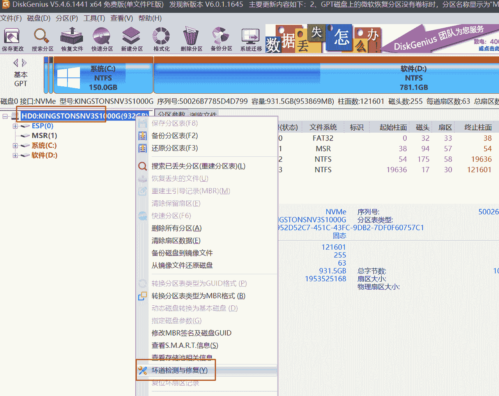
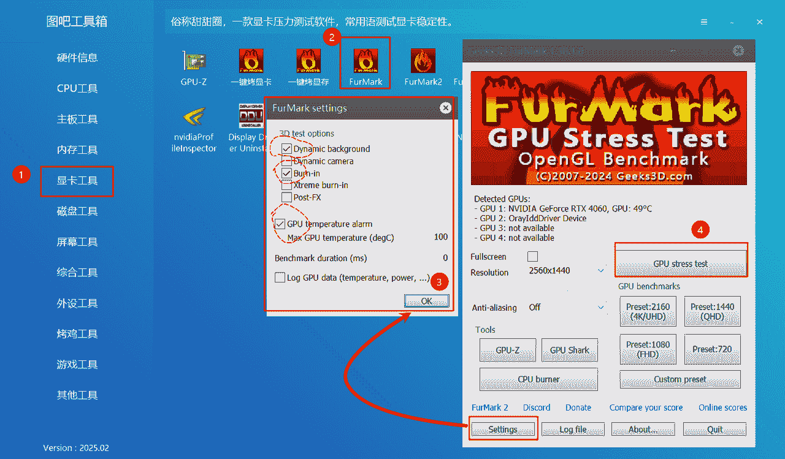
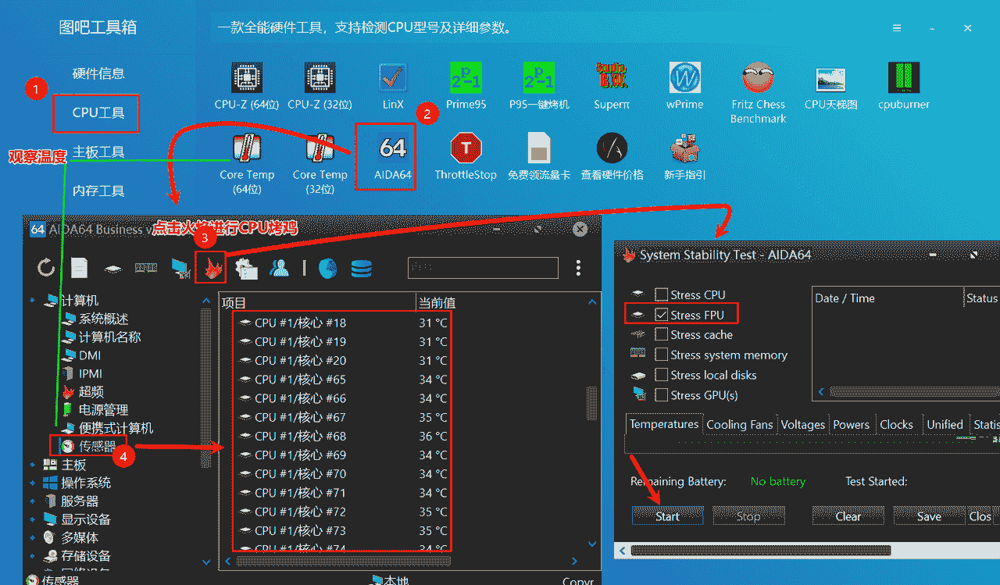
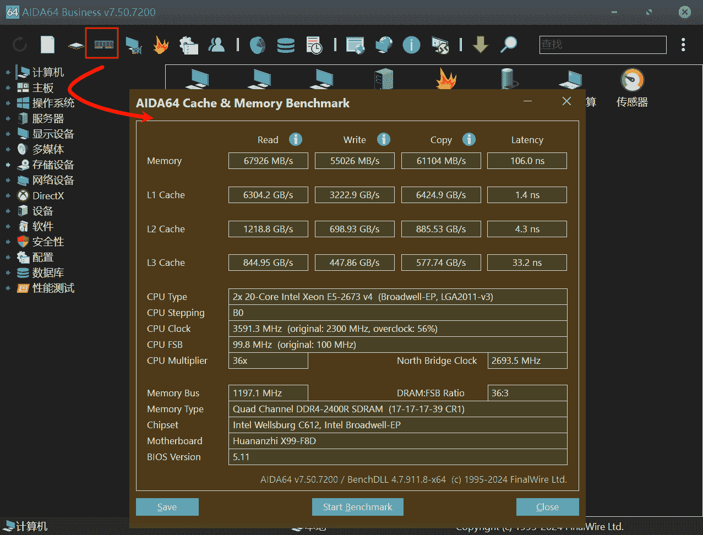

# 图吧工具箱验机教程

> 来源：[https://xodnytdcaw.feishu.cn/docx/OV2mdWsk3oSvf9xxqAEctPxsnwf](https://xodnytdcaw.feishu.cn/docx/OV2mdWsk3oSvf9xxqAEctPxsnwf)

## 一.软件介绍

一款开源、免费、绿色、纯净的硬件检测工具合集，专为所有计算机硬件极客、DIY爱好者、各路大神及小白制作。集成大量常见硬件检测、评分工具，一键下载、方便使用。工具箱收集了各种硬件检测、评分、测试工具，常见工具均有收集。纯净 · 无任何捆绑强制安装行为，不写入注册表，没有任何敏感目录及文件操作，无任何诱导、孔吓、欺乍等操作。

## 二.下载地址

## https://www.tbtool.cn/

## 三.常用操作

### 硬盘测试

####  Disklnfo（判断是否二手盘）

#### ASSSD/DiskMark(速度测试)

#### DiskGenius（坏道检测）

### 烤鸡压力测试（温度）

> 模拟显卡/CPU在极限环境下的温度变化，以确保其在高强度工作环境下能正常运行

> 如果中途出现黑屏重启死机等问题，说明硬件安装或散热有问题，

#### 显卡烤鸡FurMark

#### CPU烤鸡用ALDA

### 内存测试ALDA

