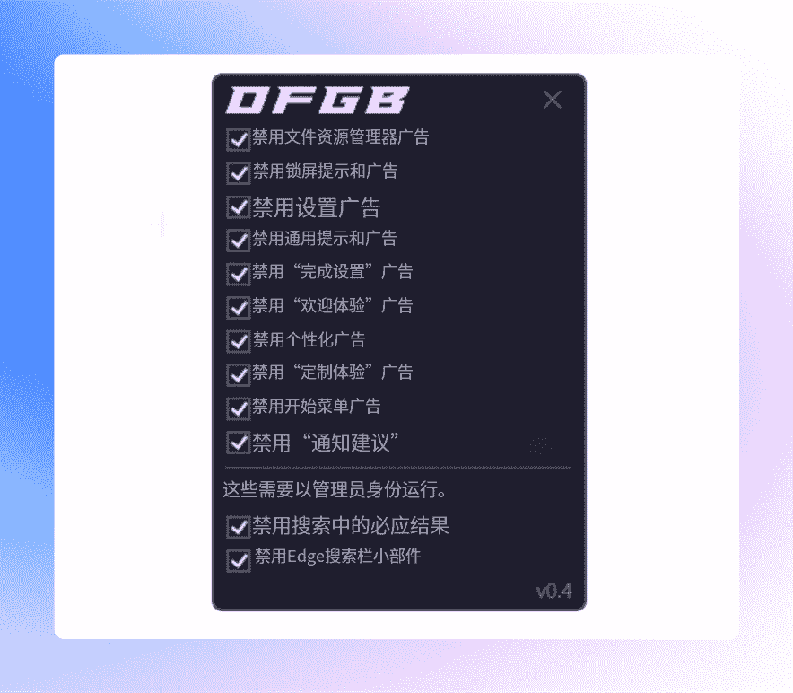
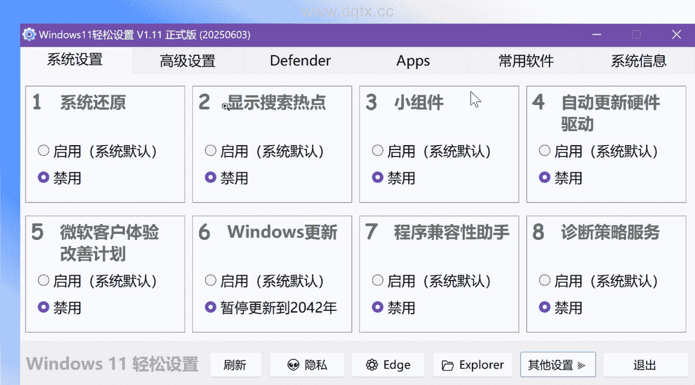
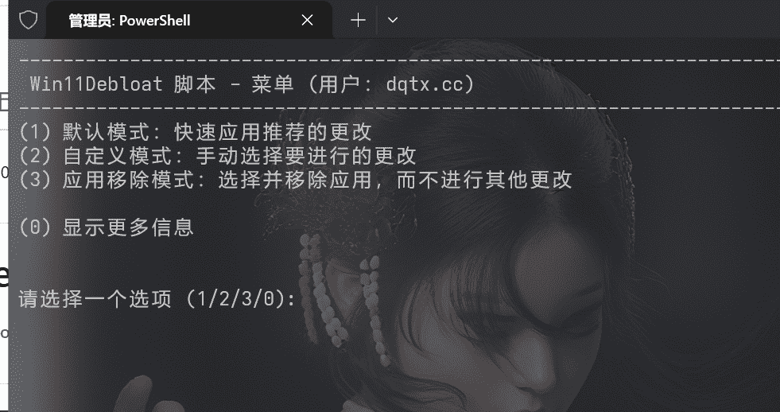
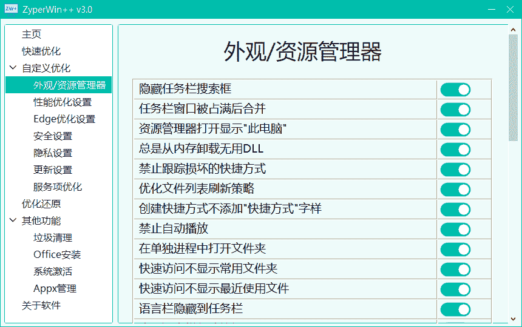
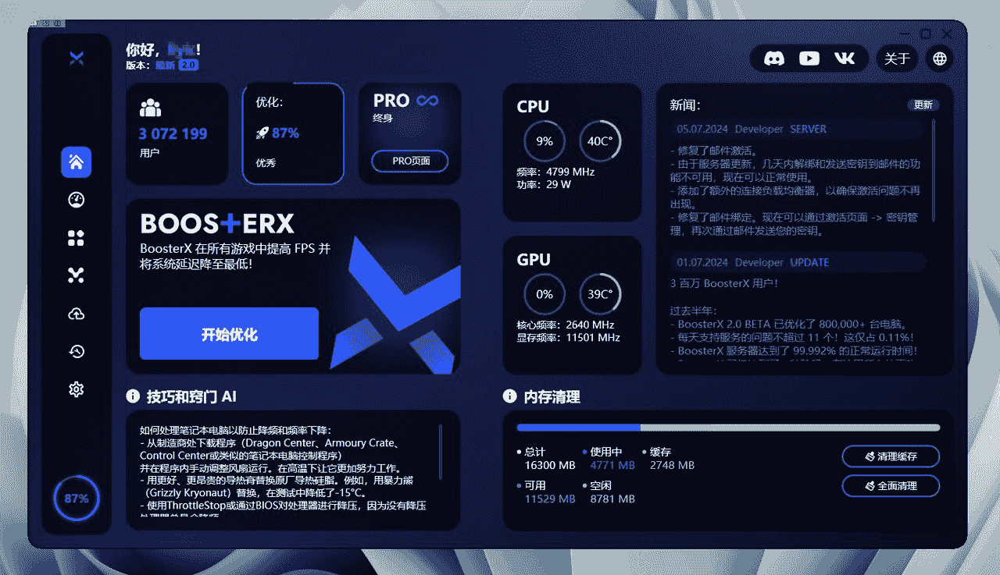
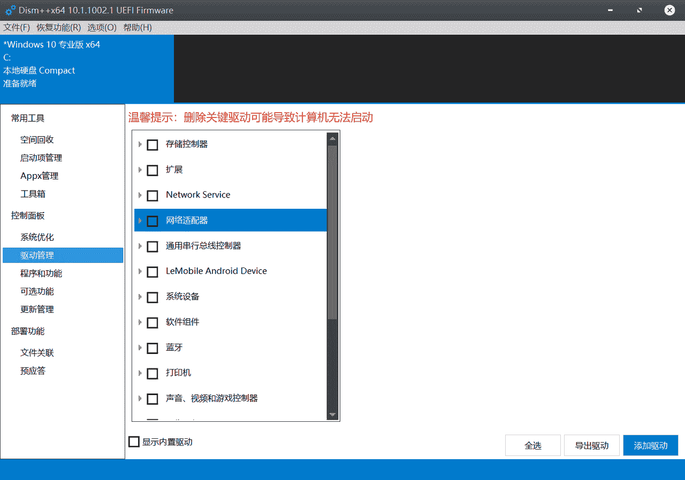
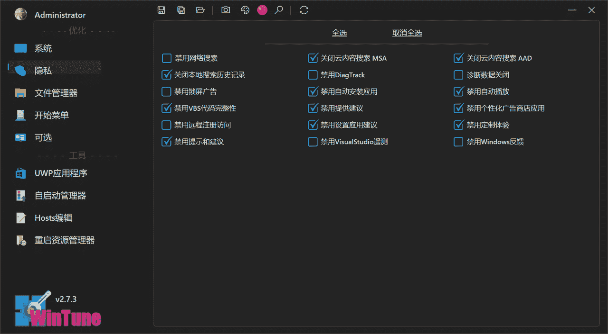
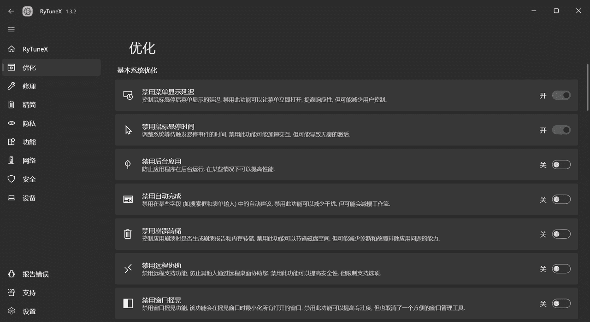
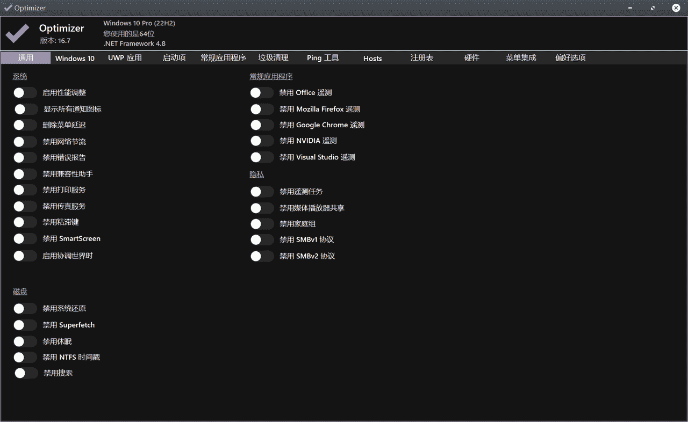
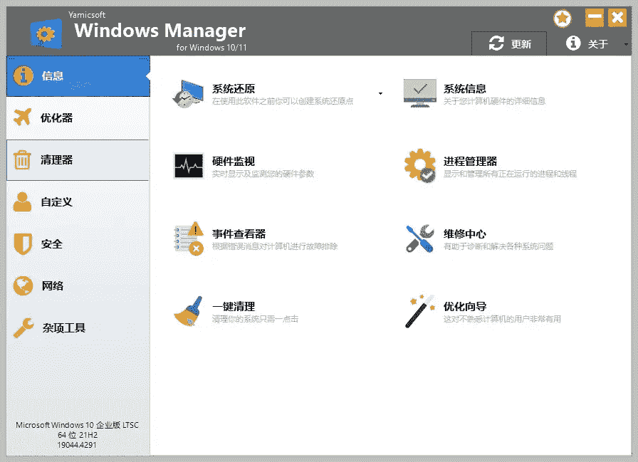

# Windows优化工具包

> 来源：[https://xodnytdcaw.feishu.cn/docx/QXTkdNo9ioHfp2xhJfCcHDiAn9f](https://xodnytdcaw.feishu.cn/docx/QXTkdNo9ioHfp2xhJfCcHDiAn9f)

# Windows11

## [OFGB](https://github.com/xM4ddy/OFGB)：一键关闭Win11广告

汉化版https://github.com/zetaloop/OFGB

## [Windows轻松设置](https://www.bilibili.com/opus/904672369138729017?from=search&spm_id_from=333.337.0.0)

## [Win11DebloatCN](https://github.com/HSSkyBoy/Win11DebloatCN)

# Windows10

## [ZyperWin++](https://github.com/ZyperWave/ZyperWinOptimize)

## BoosterX

https://boosterx.org/zh/

## Dism++

https://github.com/Chuyu-Team/Dism-Multi-language/releases/tag/v10.1.1002.2

## WinTune

https://github.com/tranht17/WinTune/releases/tag/2.7.3

## **RyTuneX**

https://github.com/rayenghanmi/RyTuneX/releases/tag/v1.3.2

## **Optimizer**

https://github.com/hellzerg/optimizer/releases/tag/16.7

## Windows Manager

## Wise Care 365

