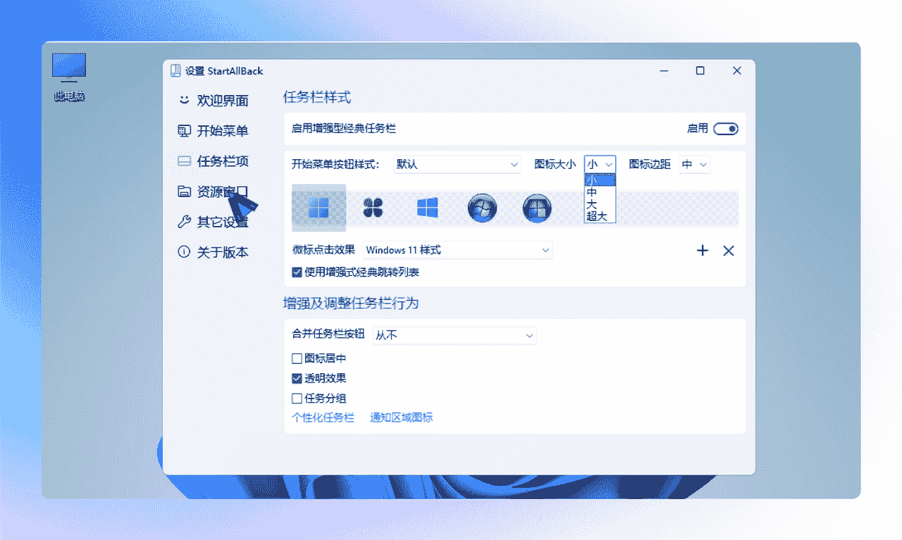
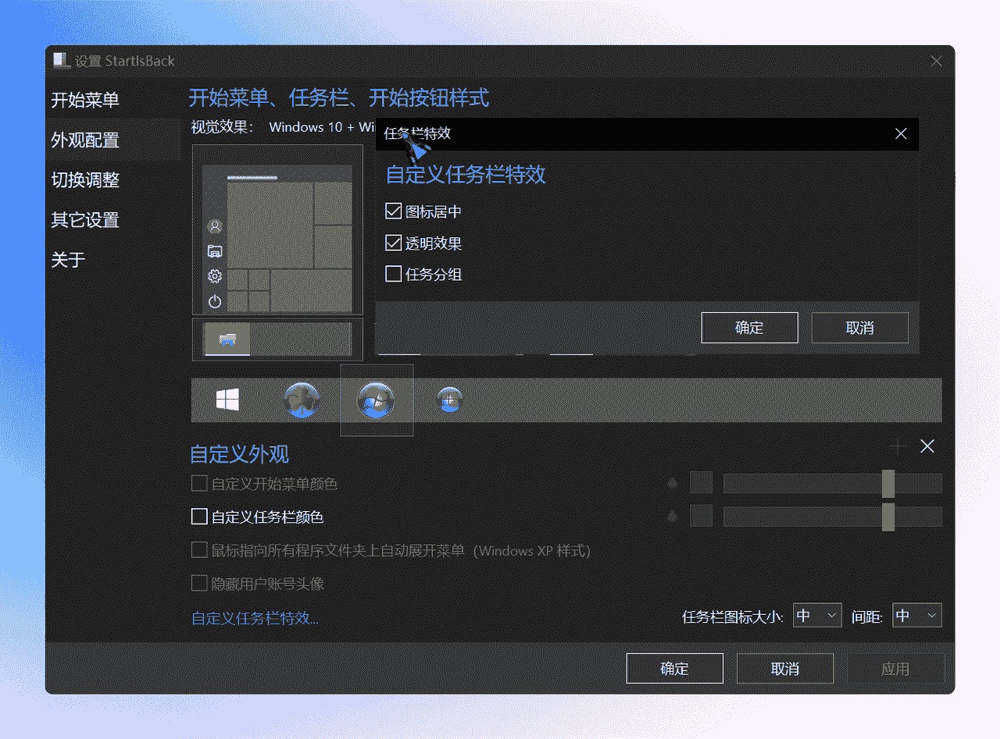

# Windows美化包

> 来源：[https://xodnytdcaw.feishu.cn/docx/FlhSdasSqoxc9rxQFpYcstovnWm](https://xodnytdcaw.feishu.cn/docx/FlhSdasSqoxc9rxQFpYcstovnWm)

## 浏览器标签页插件

TabMark-Bookmark New Tab

星愿新标签页 - Chrome 应用商店  主题包


[my.tabtheme](https://internal-api-drive-stream.feishu.cn/space/api/box/stream/download/all/VpZ3b7RDQo4CbnxbZYacgduqnJ2)

## Win主题模板

https://zhutix.com/pc/

## 磁盘图标美化

https://zhutix.com/tag/tubiao/?post_order=views

## 鼠标指针

> 里面有3套指针皮肤，配置[InputTip](https://github.com/abgox/InputTip)使用


[default.rar](https://internal-api-drive-stream.feishu.cn/space/api/box/stream/download/all/Um2AbPbU4o098TxDmwRcFj2Wngf)

## 资源管理器亚克力透明插件

> 资源管理器亚克力透明插件

> https://github.com/Maplespe/ExplorerBlurMica

> 下载压缩包，解压到下面路径C:\Windows\System32

> 管理员运行：register.cmd

## 动态桌面壁纸软件

[动态壁纸软件](https://www.rocksdanister.com/lively/)

[动态壁纸素材](https://livelywallpapers.net/Cartoon/)

## VLC播放器皮肤/乱码问题

链接：https://pan.xunlei.com/s/VOYbWwZ9BWLBWjqZOCIHdW6uA1

提取码：c8qr

> 中文乱码问题：

> 借助脚本https://github.com/linsui/vlt_zh

> python vlt_zh.py [vlt 文件路径或所在目录] [字体文件路径]

> 使用方法：

> 1，下载vlt_zh.py  下载FusionX2_B_VLC.vlt 皮肤，这两个都放在桌面

> 下载字体[MiSans](https://hyperos.mi.com/font/zh/details/sc/)字体，安装后文件路径：C:\Users\Administrator\AppData\Local\Microsoft\Windows\Fonts\MiSans-Bold.ttf

> 2，运行脚本

> python vlt_zh.py FusionX2_B_VLC.vlt "C:\Users\Administrator\AppData\Local\Microsoft\Windows\Fonts\MiSans-Bold.ttf"

## PotPlayer主题

https://www.kdocs.cn/l/clmJIYpDA4mH

## cmd/PowerShell美化

[cmd/PowerShell美化全攻略](https://xodnytdcaw.feishu.cn/wiki/ML9MwFQ1vijfHikBc48cq9dunjc?fromScene=spaceOverview)

## ShareX截图美化

https://blog.csdn.net/2402_82616859/article/details/151227781?spm=1001.2014.3001.5502

## GitHub主页美化

https://github.com/dqtx760

## Typora主题

官网主题https://theme.typoraio.cn/

自用主题一键包：加dqtx33获取

## openlist美化

[OpenList保姆级教程](https://xodnytdcaw.feishu.cn/wiki/LXNDw3bCLiwpOdktmnOcV9mincc?fromScene=spaceOverview)

## Win11右键完整菜单

```
reg add &quot;HKCU\Software\Classes\CLSID\{86ca1aa0-34aa-4e8b-a509-50c905bae2a2}\InprocServer32&quot; /f /ve

taskkill /f /im explorer.exe &amp; start explorer.exe   #启资源管理器
```

## 去除桌面图标小箭头

在桌面新建 txt 文件，把以下代码复制到里面，后缀名改成bat，右键以管理员身份运行。

```
reg add &quot;HKEY_LOCAL_MACHINE\SOFTWARE\Microsoft\Windows\CurrentVersion\Explorer\Shell Icons&quot; /v 29 /d &quot;%systemroot%\system32\imageres.dll,197&quot; /t reg_sz /f
taskkill /f /im explorer.exe
attrib -s -r -h &quot;%userprofile%\AppData\Local\iconcache.db&quot;
del &quot;%userprofile%\AppData\Local\iconcache.db&quot; /f /q
start explorer
pause
```

## B站美化

去搜索相关插件即可

## StartAllBack 开始菜单Windows11

https://www.423down.com/12420.html



## StartlsBack 开始菜单Windows10

## StartIsBackv2.9.20---------Win10中文版

https://www.gndown.com/151.html



## U盘弹窗提示

## Ventoy美化

## 参考教程

https://www.betaflare.com/prettify-software.html