# Windows系统重装教程

> 来源：[https://xodnytdcaw.feishu.cn/docx/BoxLdxD8WoVdwIxHG3HcQFlln2d](https://xodnytdcaw.feishu.cn/docx/BoxLdxD8WoVdwIxHG3HcQFlln2d)

# 一.无需U盘重装系统

> 这种方式也叫PE装机，相比于传统的直接安装安装镜像文件，

> 速度快，另外可以子是PE里进行硬盘分区。

## 1.下载镜像

> Win10/Win11兼容绝大多数PC游戏，支持办公生产力软件安装。

> 老电脑首选Windows10  新电脑/高配置优先选择Windows11（硬件须支持 TPM 2.0）

> **⚠️⚠️⚠️注意：**

> Windows 10 将在 2025 年 10 月停止支持（安全更新、Bug 修复或技术支持）

Windows7   旗舰版：[点此下载](https://www.123pan.com/s/X1Y0Vv-ZMsod.html)   密码：CYeg  （增加60多个补丁）

W[indo](https://www.123pan.com/s/X1Y0Vv-CcCod.html)ws10 专业版 21H2：点此下载   CYeg  （游戏玩家装这个）

W[indo](https://www.123pan.com/s/X1Y0Vv-xFsod.html)ws10 专业版 22H2：点此下载   CYeg  （添加了驱动，部分办公软件）

W[indo](https://www.123912.com/s/4tfljv-bvQ43)ws11 专业版 24H2（内置中文语言包）：点此下载

W[indo](https://www.microsoft.com/zh-cn/evalcenter/download-windows-server-2025)ws server 2025预览版：点击下载

```
DISM /online /Set-Edition:ServerDatacenter /ProductKey:D764K-2NDRG-47T6Q-P8T8W-YP6DF /AcceptEula
```

## 2.安装PE

CMDPE安装器：[点此下载](http://193.200.134.86:5244/d/Cloud189/cmdpe/CMDPE-3.9.zip)

下载后解压，然后打开“CMDPE安装器”，输入：1

进行安装CMEpe，提供成功后重启电脑

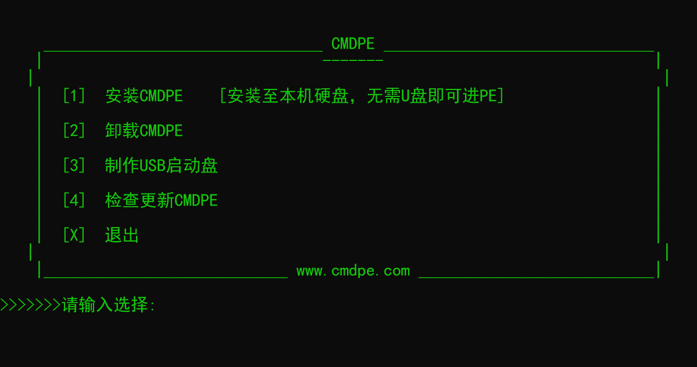

重启进入这个界面，选择从CMDPE-急救启动

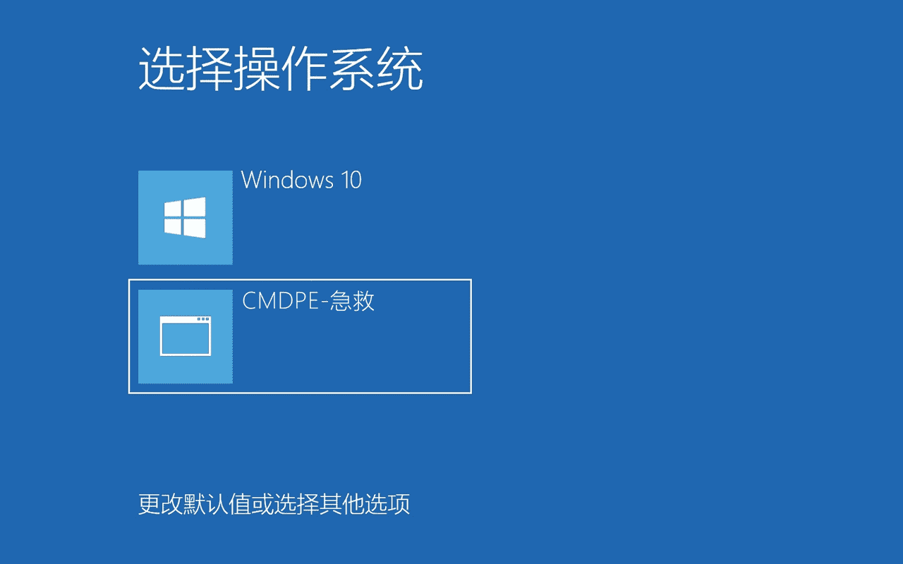

## 3.重装系统

打开桌面上的“**安装系统”**，选项【1】可以全盘搜索系统镜像安装。

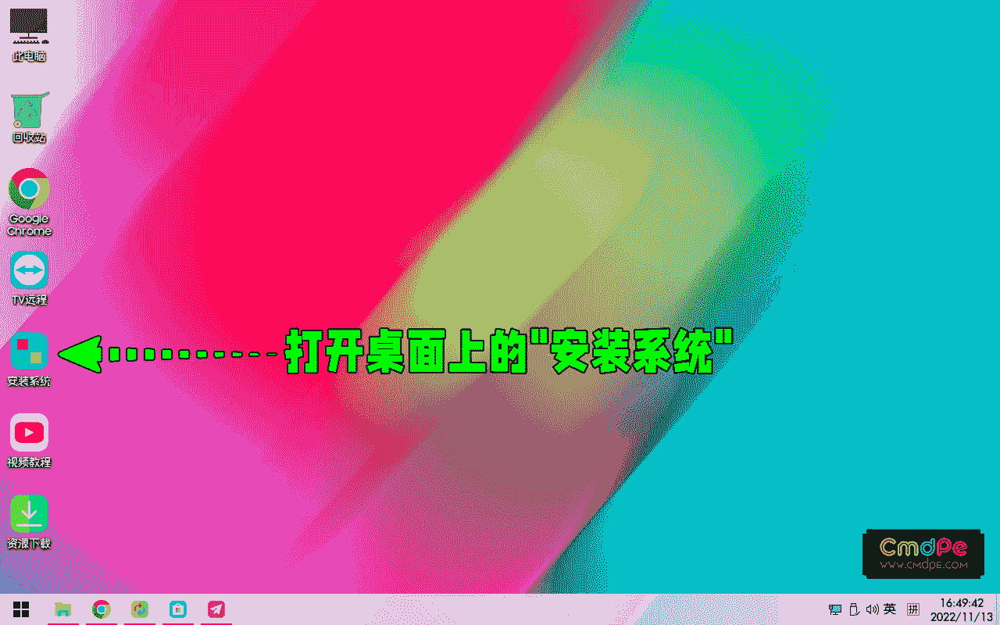

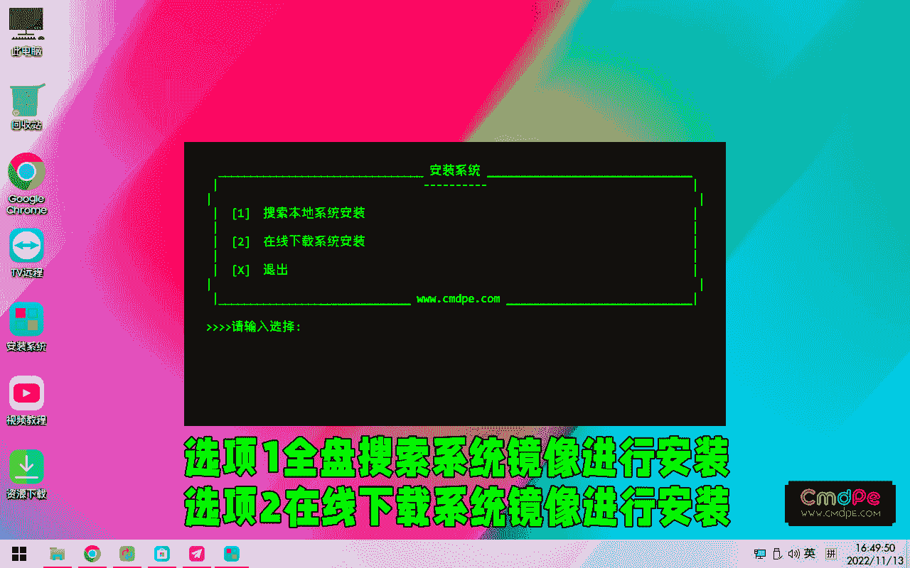

### 搜索本地安装安装（输入1后）


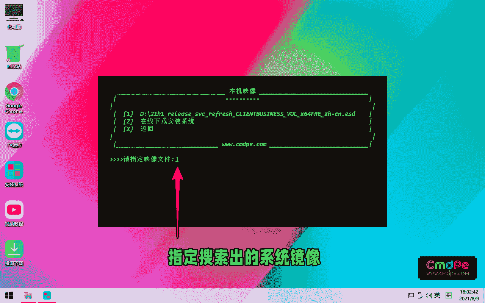

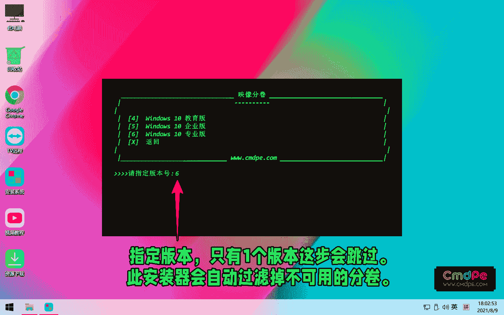

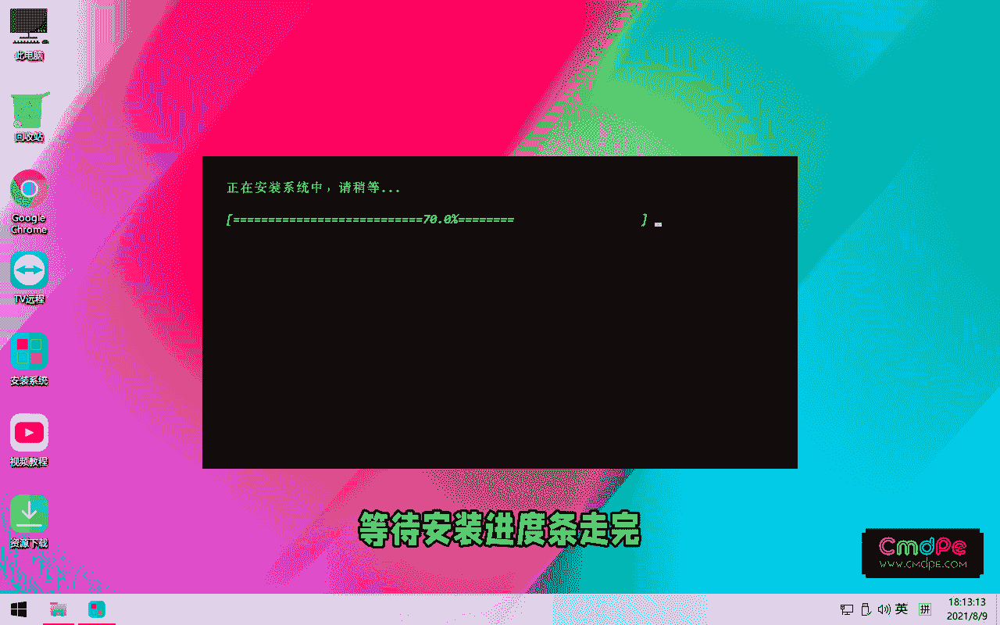

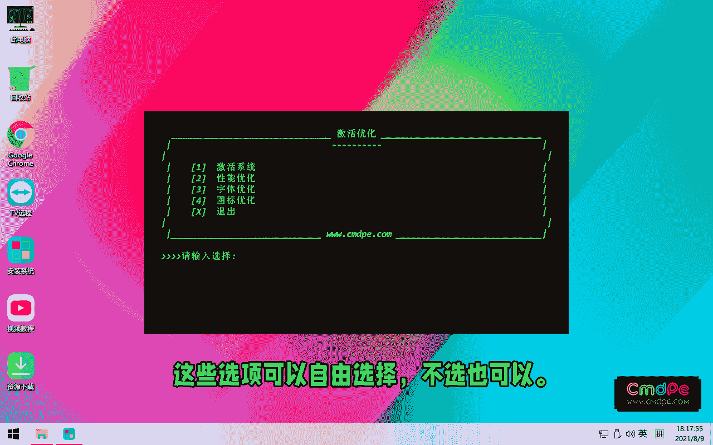

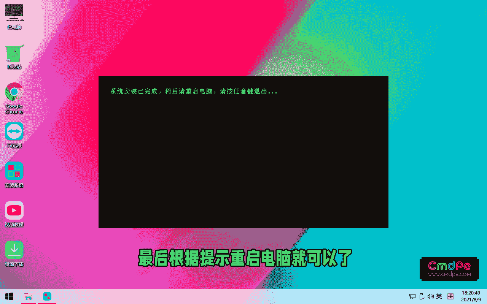

### 在线下载安装系统（输入2后）

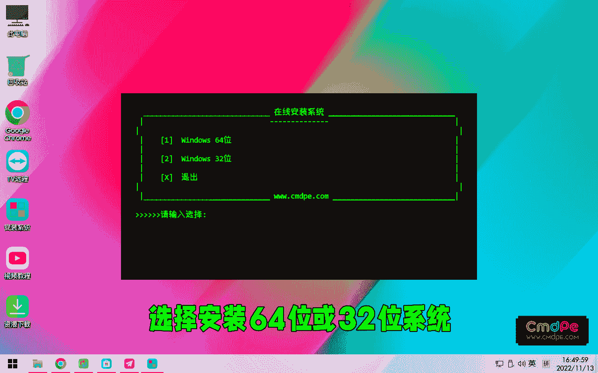

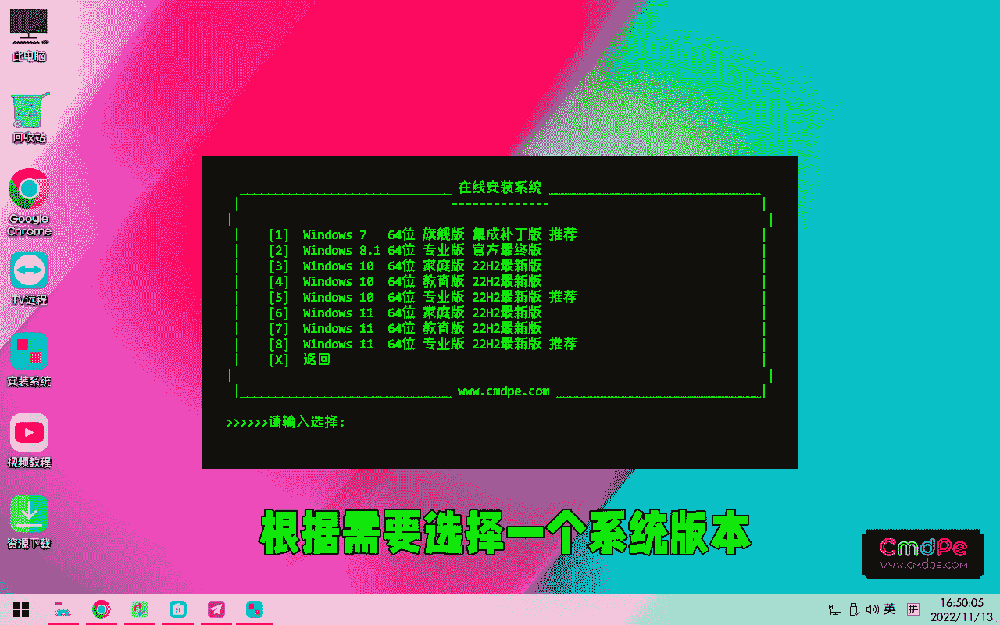

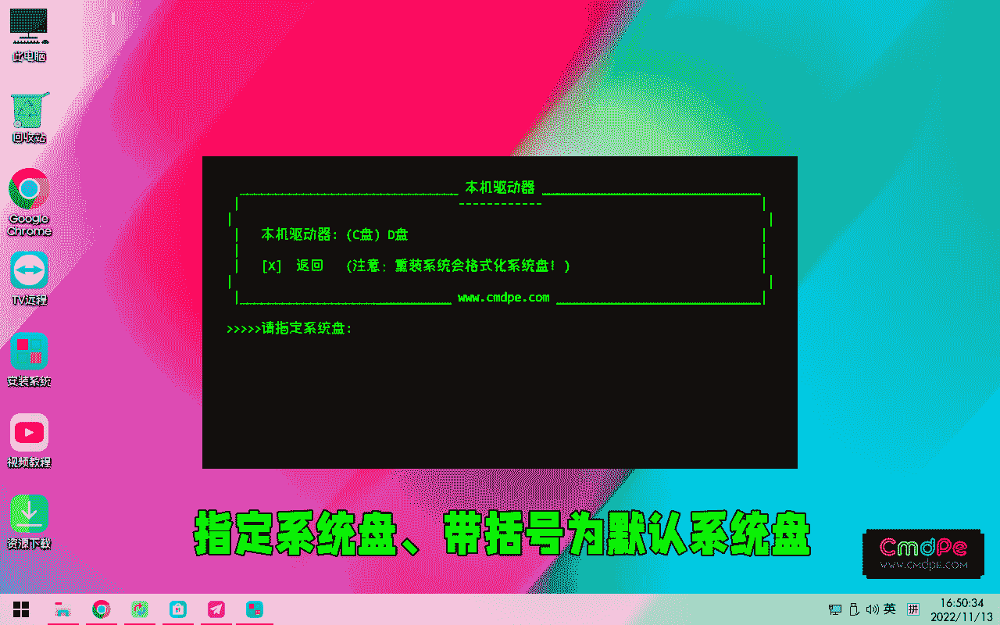

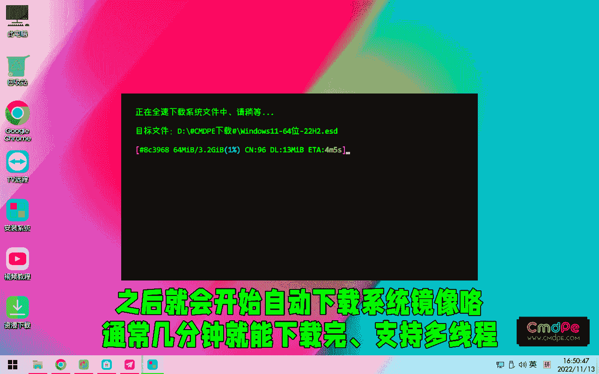

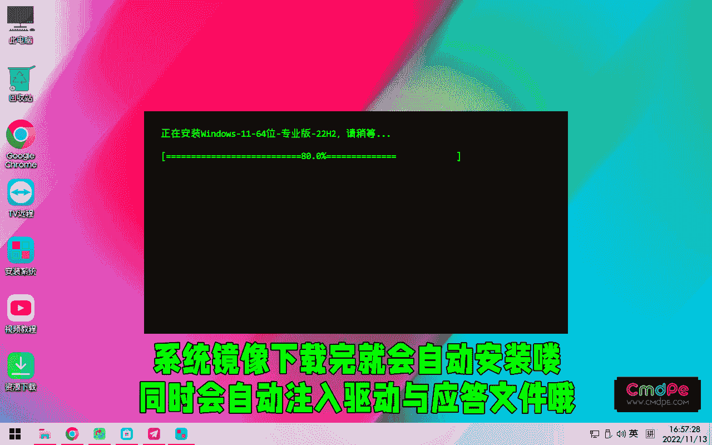

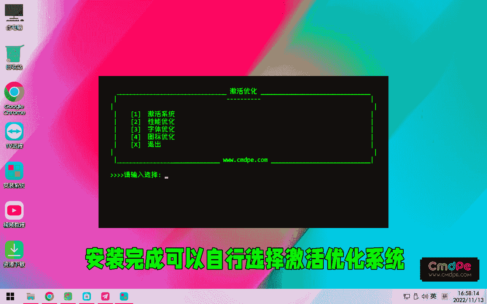

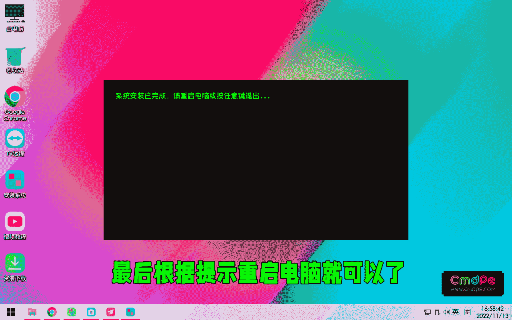

# 二.U盘重装系统

## 1.准备U盘

一般8G就就够用！

》》》推荐：[海康威视3.2 64g 28元](https://3.cn/2fK-sHWG)

## 2.制作U启动盘

+   软件： [Ventoy](https://www.ventoy.net/cn/download.html)   [Rufus](https://rufus.ie/zh/)   [balena](https://etcher.balena.io/)   [WePE](https://www.wepe.com.cn/download.html) （任何一个都行）

+   镜像下载：[Cmdpe](https://www.cmdpe.com/post/246.html)   [Massgrave](https://massgrave.dev/windows_ltsc_links)   [itellyou](https://msdn.itellyou.cn/?ang=2h-cn)  [极简系统 ](https://www.sysmini.com/)   [CYegats](https://kdocs.cn/l/cgTGWjbUVnMf)

## 3.进BIOS

```
shutdown /r /fw /t 0
```

将第一启动项改成U盘，F10保存重启后进PE/重装系统镜像选择界面。