# E5电脑优化

> 来源：[https://xodnytdcaw.feishu.cn/docx/SywLdJDKbo3NKpxF498cfeBUnqg](https://xodnytdcaw.feishu.cn/docx/SywLdJDKbo3NKpxF498cfeBUnqg)

## 一.鼠标出现短暂失灵和卡顿解决方法

参考视频https://www.bilibili.com/video/BV13w4m1v7nF/?spm_id_from=333.1387.favlist.content.click&vd_source=206031f494850e57fd6c92ace02b1bed

### CPU调整

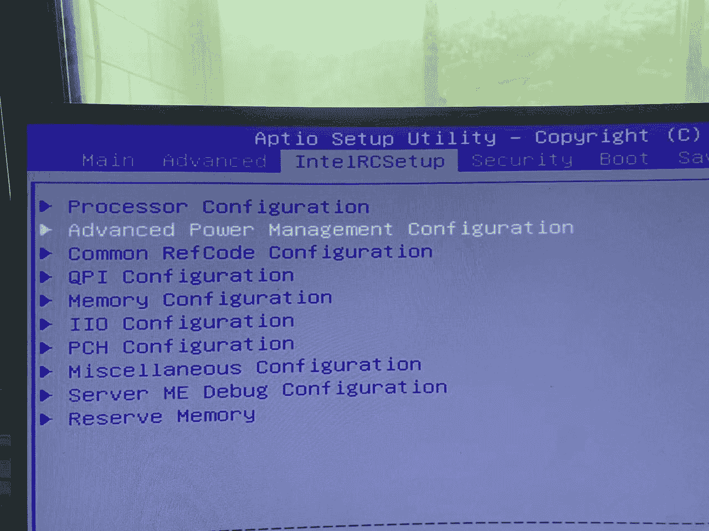

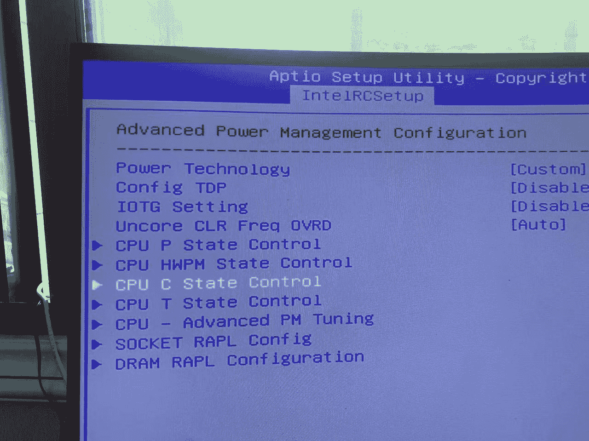

调整成如下图参数

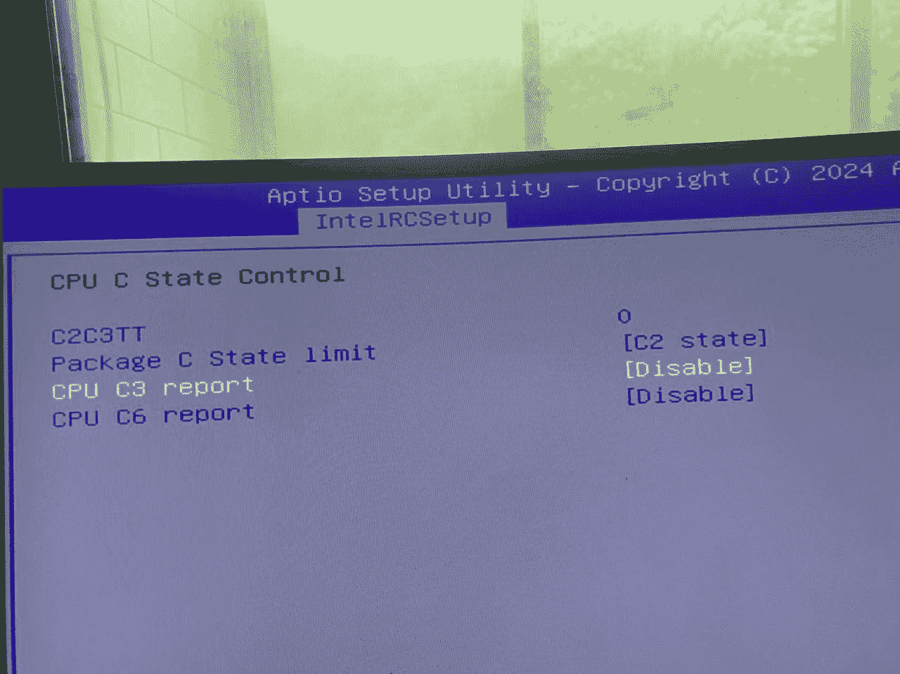

### 内存设置

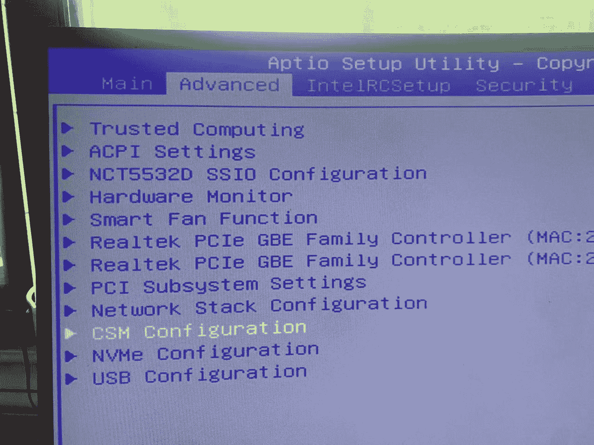

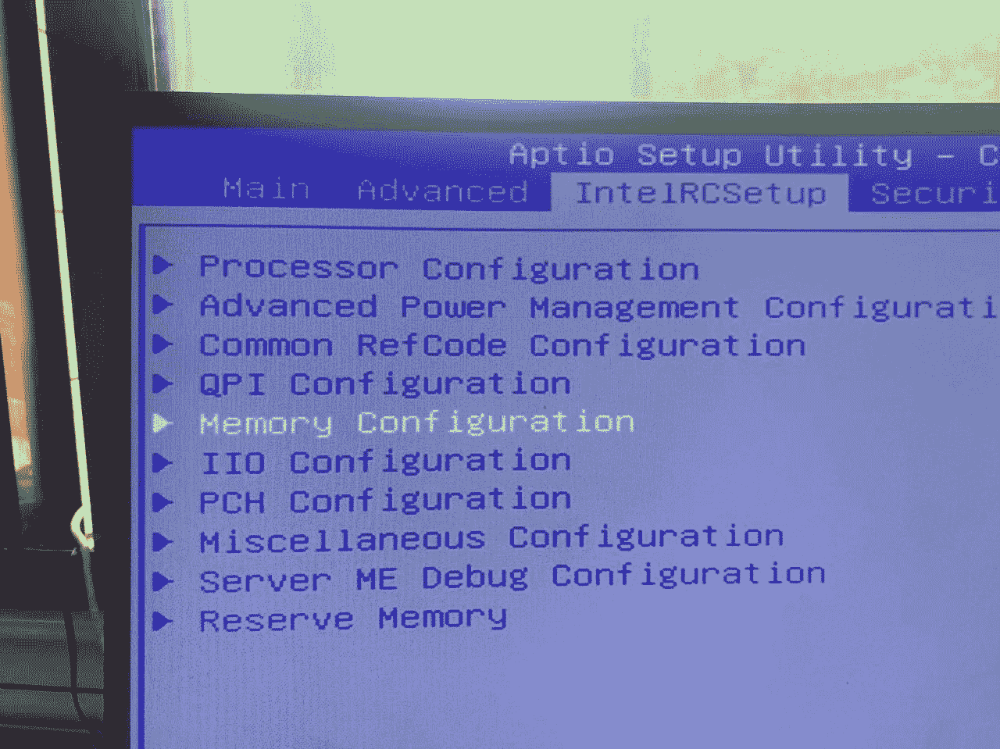

调整如下

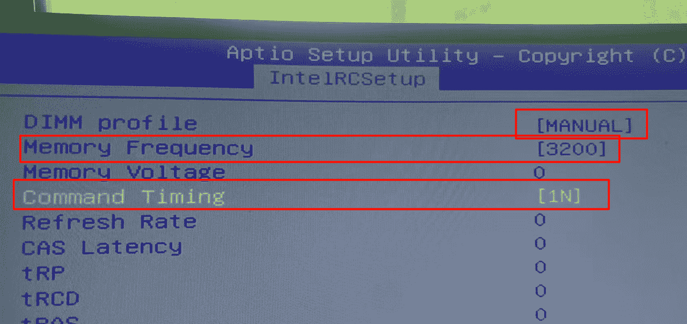

## 二.CPU核心与线程调整方法

参考视频：[点击查看](https://www.bilibili.com/video/BV1wBG7zeEEE/?spm_id_from=333.1387.upload.video_card.click&vd_source=206031f494850e57fd6c92ace02b1bed)

### 关闭超级线程

CPU核心数不变，线程会降一般，如我是原本40核显80线程，调成后变成40核显40线程

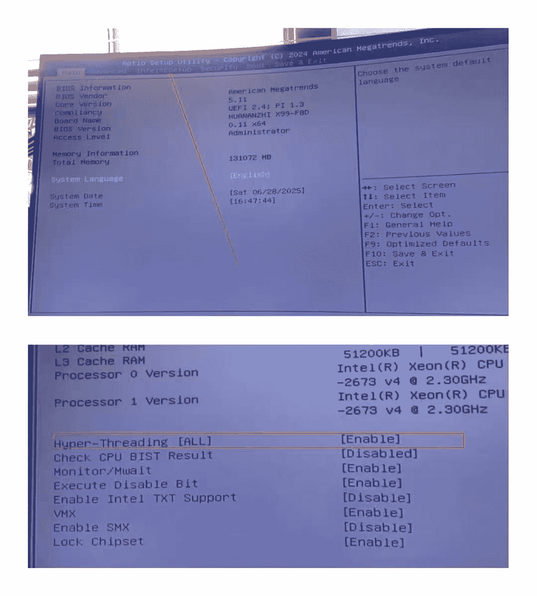

### 调整核心与线程

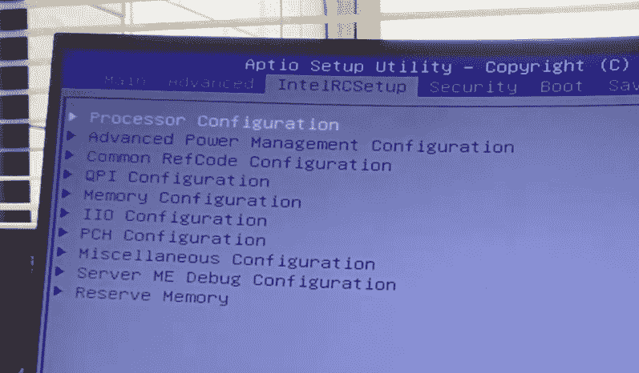

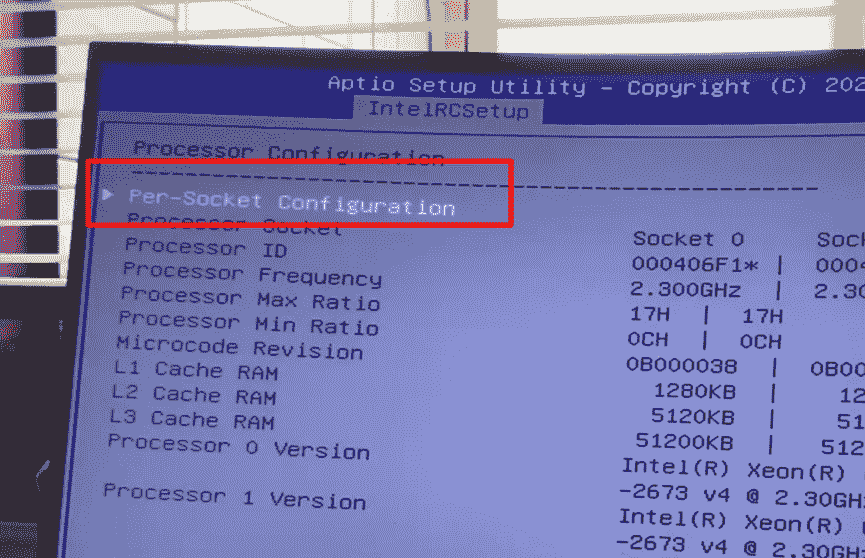

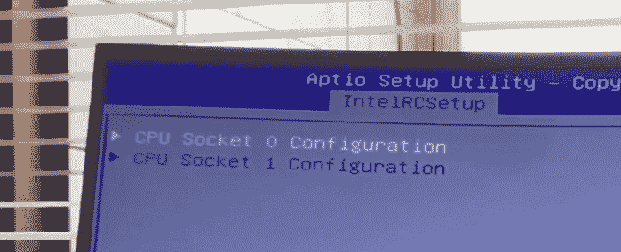

因为是双路所以这里每个CPU0与CPU1核心都是20， 比如调整各调整到15，之后的任务管理器的CPU核心就是30，就是说核心总共降低了10，但是注意这个核心的变动线程也会同步降低10。

## 三.其他教程

### 开启CPU虚拟化

参考视频：

https://www.douyin.com/user/self/search/%E5%8D%8E%E5%8D%97x99CPU%E8%99%9A%E6%8B%9F%E5%8C%96?aid=21dc93b5-71cc-4ee3-bac0-26cdb21aff3b&modal_id=7533781914181881115&type=general

调内存条频率，压内存条时序

https://www.douyin.com/user/self/search/%E5%8D%8E%E5%8D%97x99CPU%E8%99%9A%E6%8B%9F%E5%8C%96?aid=21dc93b5-71cc-4ee3-bac0-26cdb21aff3b&modal_id=7346171860343622923&type=general

## 四.配置清单

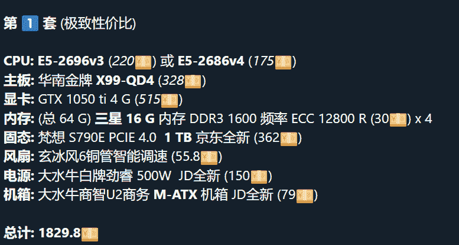

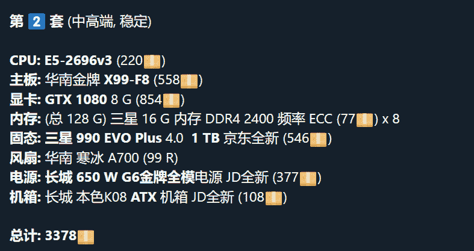

HDMI 线一根，网线一根，螺丝刀一个，开机跳线一根，散热硅脂一个

购买以上所有零件，先在淘宝搜索 "e5整机"，销量多, 粉丝多的店铺

找懂电脑的朋友, 帮忙组装，找电脑维修店, 花 100, 帮忙组装 (你要看着他, 防止零件被替换)

### 双路CPU的缺点说明

**双路对系统特别挑剔, 不同****的业**务场景表现相差很多，双路并不是 1+1 = 2, 实际上是 1.3 到 1.5，双路需要两颗 CPU 协同工作, 就像两个不会配合的学渣, 那还不如一个学霸做的好，系统对双路调度特别不好, 往往双路只有单路 1.3 - 1.5 倍的性能，而且双路主板贵, 电费高, 实际上并不比单路性价比高

## 我的电脑

E5-2696v3 (220)与E5-2673 v4主频与睿频对比

| 处理器型号 | 主频 | 单核睿频 | 全核频率 | 核心线程 |
| --- | --- | --- | --- | --- |
| E5 - 2696v3 | 2.3GHz | 3.8GHz | 2.8GHz | 18/36 |
| E5 - 2673v4 | 2.3GHz | 3.5GHz | 2.6GHz | 20/40 |