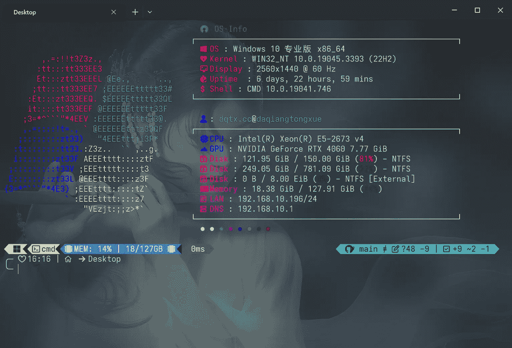

# cmd/PowerShell美化全攻略

> 来源：[https://xodnytdcaw.feishu.cn/docx/Qfusdp0MUogyTcxWKHWccEbmnde](https://xodnytdcaw.feishu.cn/docx/Qfusdp0MUogyTcxWKHWccEbmnde)

当95%的开发者还在使用默认终端时，高手早已通过`Windows Terminal`重构了生产力环境。支持GPU加速的文本渲染、自定义JSON配置的无限可能、`WSL2`无缝集成——这不是简单的界面美化，而是终端效能的次世代革命。我们拆解了微软官方文档中隐藏的7个性能优化参数，帮你打造毫秒级响应的梦幻命令行。

## 一.安装必备软件

在开始美化之前，先安装以下工具：

### [`oh-my-posh`](https://github.com/JanDeDobbeleer/oh-my-posh/releases/tag/v26.18.0) —— 终端美化利器

### [`clink`](https://github.com/chrisant996/clink) —— CMD 增强工具

### `Windows Terminal` —— 现代终端

### [`Fastfetch`](https://github.com/fastfetch-cli/fastfetch/releases/tag/2.51.1) —— 系统信息展示

## 二.cmd美化

### 1.添加启动主题

进入`clink`安装目录，新建`oh-my-posh.lua`文件，写入以下内容：

```
load(io.popen('oh-my-posh init cmd --config "C:\\Users\\用户名\\AppData\\Local\\Programs\\oh-my-posh\\themes\\atomic.omp.json"'):read("*a")())
```

主题文件存放路径：

```
C:\Users\Administrator\AppData\Local\Programs\oh-my-posh\themes
```

更多主题参考 👉 `oh-my-posh` Themes

### 2.隐藏cmd启动提示信息

每次启动都会显示`clink`版本信息？一条命令搞定：

```
clink set clink.logo none
```

### 3.配置Fastfetch（可选）

> Fastfetch = 高性能的系统信息展示工具。

安装方式（自动配置环境变量）：

```
sudo winget install fastfetch
```

手动安装：

- 下载`fastfetch-windows-amd64.zip`
- 解压到：

  ```
  C:\Users\用户名\AppData\Local\Microsoft\WinGet\Links
  ```

- 添加环境变量

让 CMD 启动时自动运行`fastfetch`，在`clink`插件目录创建`clink_startup.lua`

```
-- 切换到指定目录
os.execute('cd /d E:\\User\\lololowe\\Desktop')

-- 设置 doskey 别名
os.execute('doskey ll=lsd -lFha')
os.execute('doskey pwd=cd')
os.execute('doskey clear=cls')

-- 运行fastfetch
os.execute('C:\\Users\\用户名\\AppData\\Local\\Microsoft\\WinGet\\Links\\fastfetch.exe')

-- 设置中文编码并隐藏输出(fastfetch会导致chcp 936失效)
os.execute('chcp 936>nul')
```

`fastfetch`配置文件路径(`%userprofile%\.config\fastfetch\config.jsonc`) 如下

```
{
  "$schema": "https://github.com/fastfetch-cli/fastfetch/raw/dev/doc/json_schema.json",
  "logo": {
    "type": "builtin",
    "source": "windows",
    "height": 18,
    "padding": {
      "top": 2,  // 减小顶部边距，使logo上移
      "bottom": 3  // 适当增加底部边距保持平衡
    }
  },
  "display": {
    "separator": " : "
  },
  "modules": [
    {
      "type": "custom",
      "format": "\u001b[36m    OS Info"
    },
    {
      "type": "custom",
      "format": "┌────────────────────────────────────────────────────────┐"
    },
    {
      "type": "os",
      "key": "   OS",
      "keyColor": "red"
    },
    {
      "type": "kernel",
      "key": "  󰻹 Kernel",
      "keyColor": "red"
    },
    {
      "type": "host",
      "key": "   Machine",
      "format": "{name}{?vendor}",
      "keyColor": "red"
    },
    {
      "type": "display",
      "key": "  󰹑 Display",
      "format": "{1}x{2} @ {3} Hz",
      "keyColor": "red"
    },
    {
      "type": "uptime",
      "key": "  󱫐 Uptime ",
      "keyColor": "red"
    },
    {
      "type": "shell",
      "key": "   Shell",
      "keyColor": "red"
    },
    {
      "type": "custom",
      "format": "└────────────────────────────────────────────────────────┘"
    },
    "break",
    {
      "type": "title",
      "key": "  "
    },
    {
      "type": "custom",
      "format": "┌────────────────────────────────────────────────────────┐"
    },
    {
      "type": "cpu",
      "format": "{1}",
      "key": "   CPU",
      "keyColor": "blue"
    },
    {
      "type": "gpu",
      "format": "{2} {7}",
      "key": "  󰋵 GPU",
      "keyColor": "blue"
    },
    {
      "type": "disk",
      "key": "   Disk",
      "keyColor": "magenta"
    },
    {
      "type": "memory",
      "key": "   Memory",
      "keyColor": "magenta"
    },
    {
      "type": "bluetooth",
      "key": "   Bluetooth",
      "keyColor": "magenta"
    },
    {
      "type": "wifi",
      "key": "   WiFi",
      "keyColor": "magenta"
    },
    {
      "type": "localip",
      "showIpv6": false,
      "showMac": false,
      "showSpeed": false,
      "showMtu": false,
      "showLoop": false,
      "showFlags": false,
      "showAllIps": false,
      "key": "  󱦂 LAN",
      "keyColor": "magenta"
    },
    {
      "type": "publicip",
      "timeout": 500,
      "url": "http://4.ipw.cn",
      "key": "  󰩟 WAN",
      "keyColor": "magenta"
    },
    {
      "type": "dns",
      "key": "  󰮌 DNS",
      "keyColor": "magenta"
    },
    {
      "type": "custom",
      "format": "└────────────────────────────────────────────────────────┘"
    },
    {
      "type": "colors",
      "paddingLeft": 2,
      "symbol": "circle"
    },
    "break"
  ]
}
```

配置启动效果如下,完整示例配置见 👉 GitHub: `sqlsec/fastfetch`



### 4.下一代 `ls` 命令: `lsd`（可选）

- 项目地址：[`lsd`](https://github.com/lsd-rs/lsd)
- 安装命令：

  ```
  winget install --id lsd-rs.lsd
  ```

如果输入`ls`报错：

```
@echo off
dir
```

另存为`文件名` `ls.bat`，放到windows根目录下即可。

### iFlow CLI

参考教程

AI智能终端，小白秒变大神的神仙玩法。。

[一个冷门但神奇的电脑用法！](https://www.bilibili.com/video/BV1ACeqzEE8g/?spm_id_from=333.1387.favlist.content.click&vd_source=206031f494850e57fd6c92ace02b1bed)

> 1、安装`Node.js`：https://nodejs.org/zh-cn/download
> 2、配置加速镜像，打开终端输入：`npm config set registry https://registry.npmmirror.com`
> 3、安装`iFlow CLI`，打开终端输入：`npm install -g @iflow-ai/iflow-cli@latest`
> 4、启动`iFlow CLI`，打开终端输入：`iflow`
> 首次使用，可以通过上下键盘选择下认证方式，比如选择第1个默认的，回车后会自动打开浏览器，跳转到心流AI官网登录。

## 三.PowerShell美化

### 1.修改`Windows Terminal`配置

按 Win + R 输入`wt` → 设置 → 打开 JSON 文件，替换为配置：

里面用到的`meinv.png`图片可以加`dqtx33`领取


```json
{
    "$help": "https://aka.ms/terminal-documentation",
    "$schema": "https://aka.ms/terminal-profiles-schema",
    "actions": [],
    "copyFormatting": "none",
    "copyOnSelect": false,
    "defaultProfile": "{61c54bbd-c2c6-5271-96e7-009a87ff44bf}",
    "keybindings": [
        {
            "id": "Terminal.CopyToClipboard",
            "keys": "ctrl+c"
        },
        {
            "id": "Terminal.PasteFromClipboard",
            "keys": "ctrl+v"
        },
        {
            "id": "Terminal.DuplicatePaneAuto",
            "keys": "alt+shift+d"
        }
    ],
    "newTabMenu": [
        {
            "type": "remainingProfiles"
        }
    ],
    "profiles": {
        "defaults": {
            "useAcrylic": true,
            "acrylicOpacity": 0.2,
            "backgroundImage": "D:/web3/meinv.png",
            "backgroundImageOpacity": 0.4,
            "fontFace": "AdwaitaMono Nerd Font",
            "fontSize": 14
        },
        "list": [
            {
                "commandline": "%SystemRoot%\\System32\\WindowsPowerShell\\v1.0\\powershell.exe",
                "guid": "{61c54bbd-c2c6-5271-96e7-009a87ff44bf}",
                "hidden": false,
                "name": "Windows PowerShell"
            },
            {
                "commandline": "%SystemRoot%\\System32\\cmd.exe",
                "guid": "{0caa0dad-35be-5f56-a8ff-afceeeaa6101}",
                "hidden": false,
                "name": "命令提示符"
            },
            {
                "guid": "{b453ae62-4e3d-5e58-b989-0a998ec441b8}",
                "hidden": false,
                "name": "Azure Cloud Shell",
                "source": "Windows.Terminal.Azure"
            }
        ]
    },
    "schemes": [],
    "themes": []
}
```

## 2. 添加主题

`code $PROFILE/` `notepad $PROFILE`

其他主题文件夹，进入 `C:\Users\Administrator\AppData\Local\Programs\oh-my-posh\themes`

```
oh-my-posh init pwsh --config $env:POSH_THEMES_PATH\M365Princess.omp.json | Invoke-Expression
```

## 3. 解决字体乱码

安装 [Nerd Fonts](https://www.nerdfonts.com/font-downloads?utm_source=chatgpt.com)，解决乱码问题。

## 隐藏 powershell 启动提示信息

打开设置，点开 powershell 的配置文件，在命令行处修改为：

```
powershell.exe -nologo
```

## 4. 集成到右键菜单

在 PowerShell 以管理员身份运行：

```
$key = "HKEY_CLASSES_ROOT\Directory\Background\shell\wt"
New-Item -Path "Registry::$key" -Force
New-ItemProperty -Path "Registry::$key" -Name "(Default)" -Value "Open Terminal Here" -Force
```

修改右键图标：

```
$terminalKey = "HKEY_CLASSES_ROOT\Directory\Background\shell\wt"
$psIconPath = "C:\Windows\System32\WindowsPowerShell\v1.0\powershell.exe,0"
Set-ItemProperty -Path "Registry::$terminalKey" -Name "Icon" -Value $psIconPath
Stop-Process -Name explorer -Force
```

## 四. 常用命令

## 参考教程

https://blog.lololowe.com/posts/33ec/

参考教程 https://www.bilibili.com/video/BV1dntWe9Eub/?spm_id_from=333.337.search-card.all.click&vd_source=206031f494850e57fd6c92ace02b1bed

参考教程 https://www.bilibili.com/video/BV1Qa411T7Au/?spm_id_from=333.337.search-card.all.click&vd_source=206031f494850e57fd6c92ace02b1bed
